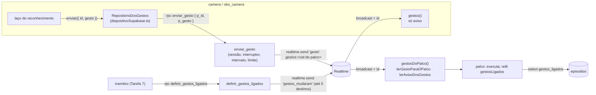

# VER-061 — E5, Tarefa 4: adaptadores dos gestos (canal só de recepção, as quatro `rpc` e a carga do palco)

## Cabeçalho

| Campo | Valor |
|---|---|
| Id | VER-061 |
| Título | E5, Tarefa 4: o canal de gestos (recepção em `gestos:<uid da sessão>`, para o palco e para o aparelho que reconhece), as `rpc` dos gestos (`enviar_gesto`, `situacao_dos_gestos`, `definir_gestos_ligados`, `definir_reconhecimento`) e a carga do palco com o mapa de gestos e o interruptor, no lugar dos valores neutros da Tarefa 2 |
| Gravidade | alta |
| Tipo | implementação · segurança |
| Data | 2026-11-28 (data do commit, em UTC) |
| Usuário responsável | TokumoH |
| Status de implementação | implementado |
| Commits | commit que introduz este arquivo — `git log --diff-filter=A --format=%h -- docs/verificacoes/2026-11-28-061-e5-adaptadores-gestos.md` |
| Arquivos | `src/shared/infra/{canalSupabase,aoVivoSupabase,dispositivoSupabase,preparacaoSupabase}.ts`, `src/shared/infra/{canalSupabase,realtimeContrato,aoVivoSupabase,dispositivoSupabase,preparacaoSupabase}.test.ts` (o da Preparação desde a rodada 1), `src/app/{servicos,servicosFalsos}.ts`, `src/app/{servicos,servicosFalsos}.test.ts`, `src/domains/aovivo/portas.ts`, `src/domains/captura/falsos.ts` (só o comentário do topo), READMEs de `src/shared/infra/`, `src/app/`, `src/domains/aovivo/` e `src/domains/captura/`, `docs/verificacoes/README.md`, este registro (21 arquivos desde a rodada 1) |

**Revisões:** R1 — revisão independente (12 sabotagens numa cópia com `--no-cache --no-fsModuleCache`): spec ✅; reprovada só por 1 achado importante de documentação (I1: o tempo-limite cobre só os cabeçalhos, não o corpo) e 3 nits; código correto e sem achado de segurança. Tudo corrigido na rodada 1 (linha C1), só texto, um comentário e um teste a mais; reconferência pontual pelo controlador (decisão do responsável de 2026-11-22): `npm run check` 0 no conteúdo exato do commit.

## Problema

Depois das Tarefas 1 a 3 ([VER-058](2026-11-28-058-e5-dominio-gestos.md), [VER-059](2026-11-28-059-e5-palco-com-gestos.md), [VER-060](2026-11-28-060-e5-banco-gestos.md)), o domínio sabe confirmar um gesto e o palco sabe executá-lo, e o banco tem as quatro funções e o tópico `gestos:<uid>` só de recebimento, mas **nada liga um ao outro**:

- não há adaptador para o tópico de gestos: o palco não recebe o gesto e o aparelho que reconhece não recebe o aviso `gestos_mudaram` (as portas `CanalDeGestosDoPalco` e `FabricaDeCanaisDeGestos` existem sem implementação);
- não há adaptador para `enviar_gesto` e `situacao_dos_gestos` (porta `RepositorioDosGestos`), nem para `definir_gestos_ligados` e `definir_reconhecimento` (o `RepositorioDoAoVivo` nem tem os métodos);
- o repositório do palco devolve os **valores neutros** da Tarefa 2: `gestosLigados: false` e `mapa: []` na carga, e `gestosLigados()` sempre `false` sem ler o banco. Com eles, o palco nunca executaria um gesto, mesmo com o interruptor ligado no banco.

## Era proposital?

Sim, como etapa: o [PLA-006](../planos/2026-11-28-e5-gestos.md) põe os adaptadores na Tarefa 4 (estrutura de arquivos: "tópico de gestos só para receber; as quatro `rpc`; `carregar` com mapa e interruptor"), e o código da Tarefa 2 marca os neutros com `// E5 (PLA-006, Tarefa 2): valores neutros até a Tarefa 4` (`aoVivoSupabase.ts`, commit `cd469ff`). Os Riscos do VER-059 deixaram para cá o tempo-limite da leitura do interruptor ("a Tarefa 4 põe tempo-limite na porta do adaptador") e lembram que reenviar o mesmo valor não gera aviso (assunto da tela, Tarefa 7).

Ficam **neutros de propósito**, porque o plano os põe na Tarefa 7: o `SEM_CANAL_DE_GESTOS` de `PalcoNoAr.tsx` (a rota do palco passa a abrir `gestosDoPalco()` na Tarefa 7, "`PalcoNoAr.tsx` … palco com o tópico de gestos | 7") e o `gestosLigados()` do palco falso de `servicosFalsos.ts` (comentário "neutro (desligados) até a Tarefa 7 programar o interruptor nos falsos").

**Divergências entre o brief e o código commitado (segui o código):**

| Brief | Código commitado | O que foi feito |
|---|---|---|
| a fábrica ganha `gestosDoDispositivo(): CanalDeGestos` | a porta da Tarefa 1 é `FabricaDeCanaisDeGestos { gestos(): CanalDeGestos }` (`captura/portas.ts`) | o método do aparelho chama-se `gestos()` (implementa a porta como está) |
| a fábrica ganha `gestosDoPalco(): CanalDeGestosDoPalco` | não há porta de fábrica para o canal do palco (`FabricaDeCanais` só tem `estudio`, `controle` e `estado`) | porta nova `FabricaDeCanaisDeGestosDoPalco { gestosDoPalco() }` em `aovivo/portas.ts`, para a composição (`CanaisDoDispositivo`) e a Tarefa 7 tiparem a rota do palco sem conhecer o adaptador |
| `situacao_dos_gestos` com forma errada → "`falhou` no adaptador" | `situacao()` devolve `Promise<{ ligados, reconhecerAqui }>` (sem um valor `falhou`) | forma errada → a promessa falha (`ErroDeDispositivo('outro')`); a rota (Tarefa 8) a trata como `{ ligados: false, reconhecerAqui: false }` |
| lista de arquivos | o leitor do `mapa_gestos` já existia dentro de `preparacaoSupabase.ts` | extraído para `lerMapaDeGestos` + `COLUNAS_DO_MAPA` (exportados), usados pela Preparação e pelo palco: um leitor só (reuso, `CLAUDE.md`) |

## Solução

- **Canal de gestos (`canalSupabase.ts`, D2, D4):** `gestosDoPalco()` e `gestos()` abrem pelo mesmo registro do ao vivo (um canal por tópico, contagem de referências, fechado e negado saem do mapa) só `topicoDosGestos(usuarioId)` (= `gestos:<uid da sessão>`; uuid fora da forma lança antes de abrir), com a configuração privada de sempre. O palco recebe o gesto (`lerGestoParaOPalco` + `lerRemetente`) e o aviso (`lerAvisoDosGestos`); o aparelho, só o aviso. **As alças não têm `enviar` nem `marcarPresenca`**: nenhum `send`, `track` ou `untrack` nesses tópicos.
- **Repositório dos gestos (`dispositivoSupabase.ts`, D2, D5, D8):** `criarRepositorioDosGestosSupabase(cliente)`: `enviar(g)` → `rpc('enviar_gesto', { p_id, p_gesto })` com exatamente essas duas chaves, montadas no adaptador (id fora de uuid minúsculo ou gesto fora dos 7 → `falhou` sem rede); `enviado`/`intervalo`/`desligados`/`sem_palco` → iguais; `54000` → `limite`; `42501` ou `55000` → `negado` (revisão 1, N3); o resto → `falhou`. `situacao()` → `rpc('situacao_dos_gestos')`, só dois booleanos.
- **Ao vivo (`aoVivoSupabase.ts`, D4, D5, D6):** `traduzirErroDoAoVivo` ganha `54000` → `limite` (motivo novo de `MotivoDoAoVivo`); `definirGestosLigados(episodioId, ligado)` → `rpc('definir_gestos_ligados', { p_episodio, p_ligado })`, devolve o booleano gravado (outra forma → `outro`); `definirReconhecimento(cameraId, local)` → `rpc('definir_reconhecimento', { p_dispositivo, p_local })`. No palco, a carga lê `gestos_ligados` com o episódio e o `mapa_gestos` (5.ª consulta do `Promise.all`), e `gestosLigados(episodioId)` lê só a coluna; sem linha ou valor que não é booleano → `invalido`.
- **Composição e falsos (`servicos.ts`, `servicosFalsos.ts`):** `ServicosDoDispositivo` ganha `gestos` (o repositório real sobre o cliente do tipo) e `canais` passa ao tipo `CanaisDoDispositivo` (ao vivo + vídeo + gestos); os falsos ganham `gestos` (repositório) e `reconhecedores` (os falsos do domínio), o canal falso dá os tópicos de gestos pelo adaptador real, e o `aoVivoVazio` implementa os dois métodos novos.

## Por que esta solução

- **Segurança (D2, F15):** os gestos saem só pela `rpc` (o banco confere sessão, episódio, interruptor, aparelho que reconhece, intervalo e limite a cada chamada e põe o remetente e o dispositivo); o tópico de gestos é só de recepção também no cliente (as alças nem têm método de envio), e toda mensagem passa pelo leitor do domínio antes de chegar à tela, nunca dentro do callback do `realtime-js`. Um `comando` no tópico de gestos é descartado; um gesto no aparelho é descartado; um aviso com valor é descartado.
- **D8 (nada sai do aparelho além do nome e do uuid):** o objeto da `rpc` é montado campo a campo no adaptador; um chamador que passasse a leitura inteira (confiança, quadro, pontos) não vaza nada (`rpc-so-com-gesto-e-id`).
- **Falhar para o lado seguro sem mentir:** o interruptor fora da forma ou ausente vira erro (`invalido`), nunca "desligado" (o palco publicaria um desligado que o banco não tem, VER-059) nem "ligado". A rede e o tempo-limite de 15 s do `fetch` (`tempoLimite.ts`, VER-021) viram `rede` (o `postgrest-js` devolve status 0 sem código), e o palco já tenta de novo no fim da janela: isso reduz o risco "leitura que nunca responde" do VER-059, mas não o fecha: o tempo-limite vale **até a chegada dos cabeçalhos** da resposta; a leitura do corpo não tem limite (`tempoLimite.ts`, comentário de `fetchComTempoLimite`; rodada 1, I1), e o resto fica nos Riscos.
- **Arquitetura:** os adaptadores são fabricações puras em `shared/infra/` sobre portas do domínio (GRASP Pure Fabrication); a porta nova do palco fica no domínio que a consome (`aovivo`), como `CanalDeGestosDoPalco`; um leitor só do mapa (reuso).
- **Otimização:** a carga do palco faz as 5 consultas em paralelo (o mapa entra no mesmo `Promise.all`); `gestosLigados` lê uma coluna de uma linha; os tópicos de gestos dividem o canal por tópico (um canal a mais por cliente: 3 na câmera e no `obs_camera`, 4 no palco, como nas restrições do plano).

## Por que não outras soluções

| Opção | Motivo de descarte |
|---|---|
| Alças de gestos com `enviar` (como as do ao vivo) | ninguém envia nos tópicos de gestos (D2); um método que existe acaba usado; a matriz do banco nega, mas o cliente não deve nem tentar |
| Repetir o leitor do `mapa_gestos` em `aoVivoSupabase.ts` | dois leitores do mesmo dado divergem (por exemplo, um descarta ação desconhecida e o outro não; a sabotagem S19 cai nos dois testes agora) |
| `gestosLigados` devolvendo `false` quando falha | publicaria "desligado" sem o banco dizer isso; o palco já trata a falha com nova tentativa (VER-059) |
| Tempo-limite próprio na leitura do interruptor | o `fetch` do cliente já tem 15 s em `/rest/v1/` (VER-021), exercitado pelos testes de `tempoLimite.ts`; um segundo relógio só duplicaria |
| `situacao()` resolvendo `{ ligados: false, reconhecerAqui: false }` na forma errada | esconderia da rota a diferença entre "o banco disse não" e "não deu para saber" (a rota pode querer tentar de novo); a porta já permite rejeitar |
| `42501`/`55000` → `falhou` em `enviar` | o laço continuaria mandando gestos que o banco recusa (revisão 1, N3): com `negado` ele para e a rota reavalia |
| Abrir o tópico de gestos pelo id do dispositivo | o repareamento mantém o id; a sessão antiga continuaria recebendo (D2: o tópico é o `auth.uid()` da sessão atual) |

## Onde

| Arquivo | Linhas | O que mudou |
|---|---|---|
| [`src/shared/infra/canalSupabase.ts`](../../src/shared/infra/canalSupabase.ts#L4-L15) | 4–15, 88–92, 98, 340–352, 452–476 | imports das portas e leitores de gestos; documentação; tipo da fábrica com `FabricaDeCanaisDeGestos & FabricaDeCanaisDeGestosDoPalco`; `alcaDosGestos`; `gestosDoPalco()` e `gestos()` |
| [`src/shared/infra/canalSupabase.test.ts`](../../src/shared/infra/canalSupabase.test.ts#L959-L1133) | 959–1133 | bloco `canal de gestos` (5 testes) |
| [`src/shared/infra/realtimeContrato.test.ts`](../../src/shared/infra/realtimeContrato.test.ts#L364-L418) | 364–418 | `gestos-contrato` (cliente real em quadro de texto e binário, e o falso) |
| [`src/shared/infra/aoVivoSupabase.ts`](../../src/shared/infra/aoVivoSupabase.ts#L12) | 12, 20–21, 31, 143–153, 157–171, 176–193, 235–243 | import do leitor do mapa; `54000` → `limite`; `definirGestosLigados` e `definirReconhecimento`; `interruptor`; carga com `gestos_ligados` e `mapa_gestos`; `gestosLigados` real (os neutros saíram) |
| [`src/shared/infra/aoVivoSupabase.test.ts`](../../src/shared/infra/aoVivoSupabase.test.ts#L198-L243) | 198–243, 252–297, 344–405 | `definir-gestos-ligados`, `definir-reconhecimento`; `palco-carrega` com a coluna nova; `carregar-com-mapa-e-interruptor` e `gestos-ligados` (no lugar de `palco-gestos-neutros`) |
| [`src/shared/infra/dispositivoSupabase.ts`](../../src/shared/infra/dispositivoSupabase.ts#L129-L177) | 6–9, 129–177 (rodada 1: comentário de `situacao()`, N1) | `criarRepositorioDosGestosSupabase`, `respostaDoErroDoGesto`, `RESPOSTAS_DO_GESTO` |
| [`src/shared/infra/dispositivoSupabase.test.ts`](../../src/shared/infra/dispositivoSupabase.test.ts#L231-L315) | 5, 48, 231–315 | o falso expõe o cliente; `rpc-so-com-gesto-e-id`, `respostas-do-gesto` (15 casos e a `rpc` que lança), `situacao-dos-gestos` |
| [`src/shared/infra/preparacaoSupabase.ts`](../../src/shared/infra/preparacaoSupabase.ts#L285-L306) | 285–306 | `COLUNAS_DO_MAPA` e `lerMapaDeGestos` extraídos de `listar` (e descartando linha que não é objeto) |
| [`src/shared/infra/preparacaoSupabase.test.ts`](../../src/shared/infra/preparacaoSupabase.test.ts#L133-L139) | 133–139 | rodada 1 (N2): `mapa-descarta-linha-que-nao-e-objeto` |
| [`src/domains/aovivo/portas.ts`](../../src/domains/aovivo/portas.ts#L11-L15) | 11–15, 104–108, 131–138 | `MotivoDoAoVivo` com `limite`; porta `FabricaDeCanaisDeGestosDoPalco`; `definirGestosLigados` e `definirReconhecimento` em `RepositorioDoAoVivo` |
| [`src/domains/captura/falsos.ts`](../../src/domains/captura/falsos.ts#L24-L25) | 24–25 | comentário: `servicosFalsos.ts` (só de teste) passa a reusar os falsos dos gestos |
| [`src/app/servicos.ts`](../../src/app/servicos.ts#L110-L126) | 5–6, 16, 110–126, 134–135, 189 | `CanaisDoDispositivo`; `gestos` em `ServicosDoDispositivo` e na composição |
| [`src/app/servicos.test.ts`](../../src/app/servicos.test.ts#L174-L182) | 174, 179–182 | chaves com `gestos`; os canais de gestos na fábrica do tipo |
| [`src/app/servicosFalsos.ts`](../../src/app/servicosFalsos.ts#L918-L926) | 23, 35, 46, 608, 624, 880–883, 918–926, 996–1000 | `CanaisDoDispositivo`; `aoVivoVazio` com os métodos novos; `gestos` e `reconhecedores` em `criarFalsosDeDispositivo` |
| [`src/app/servicosFalsos.test.ts`](../../src/app/servicosFalsos.test.ts#L236-L299) | 236–299 | `gestos-falsos` |
| [`src/shared/infra/README.md`](../../src/shared/infra/README.md) | propósito, regras, "Onde", lógica, verificação, riscos | os adaptadores dos gestos |
| [`src/app/README.md`](../../src/app/README.md) | 33, 64, 77–78, 156 | `servicos.ts` e os falsos dos gestos |
| [`src/domains/aovivo/README.md`](../../src/domains/aovivo/README.md) | 29, 59 | `MotivoDoAoVivo`, `RepositorioDoAoVivo` e a porta nova |
| [`src/domains/captura/README.md`](../../src/domains/captura/README.md) | 32 | `falsos.ts` reusado por `servicosFalsos.ts` |
| [`docs/verificacoes/README.md`](README.md) | "Arquivos" e "Onde" | linha deste registro |

## Lógica

| Passo | Antes | Depois |
|---|---|---|
| Tópico de gestos no cliente | sem adaptador | `gestos:<uid da sessão>`, mesmo registro, só recepção; nenhuma alça com envio ou presença |
| Gesto recebido no palco | — | evento `gesto`, `tipo: 'gesto'`, 5 campos, com remetente → `aoGesto({ id, gesto, dispositivoId }, remetente)` fora do callback; o resto descartado |
| Aviso | — | evento e `tipo` `gestos_mudaram`, sem valor, com remetente → `aoAviso()` (palco e aparelho) |
| Envio do gesto | sem adaptador | `rpc('enviar_gesto', { p_id, p_gesto })`; resposta → `RespostaDoGesto` |
| Situação | sem adaptador | `rpc('situacao_dos_gestos')` → `{ ligados, reconhecerAqui }` ou rejeição |
| Interruptor (membro) | sem método | `definirGestosLigados` → booleano gravado; `54000` → `limite` |
| Onde reconhecer | sem método | `definirReconhecimento(cameraId, 'celular' | 'computador')` |
| Carga do palco | `gestosLigados: false`, `mapa: []` | `gestos_ligados` do banco (só booleano) e o mapa pelo leitor da Preparação |
| `gestosLigados()` do palco | sempre `false`, sem rede | `select gestos_ligados … eq id`; sem linha ou fora da forma → `invalido`; rede/tempo-limite → `rede` |

## Exemplo

- **Gesto no palco (contrato com o `realtime-js` 2.119.0 real):** o banco publica `{ tipo: 'gesto', gesto_id: '6b7c…8d9e', gesto: 'Victory', dispositivo: '8d9e…0f1a', remetente: '7b2d…7d8e', id: '4f5a…5a6b7c' }` com `event = 'gesto'` (quadro de texto ou binário tipo 4); o ouvinte bruto vê `{ type: 'broadcast', event: 'gesto', payload }` e a alça entrega `[{ id: '6b7c…8d9e', gesto: 'Victory', dispositivoId: '8d9e…0f1a' }, '7b2d…7d8e']`. O mesmo payload num aparelho (`gestos()`): nada; o aviso `{ tipo: 'gestos_mudaram', remetente, id }`: um `aoAviso()`. Antes, nenhum dos dois era recebido.
- **Envio:** `enviar({ id: '6b7c…8d9e', gesto: 'ILoveYou', confianca: 0.93, quadro: 'nunca', pontos: [[0, 0]] })` chama `rpc('enviar_gesto', { p_id: '6b7c…8d9e', p_gesto: 'ILoveYou' })` (duas chaves). `54000` → `limite`; `55000` → `negado`; `{ data: ['enviado'] }` → `falhou`.
- **Carga:** com `gestos_ligados: true` e 7 linhas no mapa (uma com gesto `None`, uma com ação `teletransporte`, uma `null`), a carga traz `gestosLigados: true` e 4 linhas; antes, `false` e `[]`. `gestos_ligados: 'sim'` → `invalido`.

## Verificação

| # | Abordagem | Comando / método | Resultado |
|---|---|---|---|
| Fontes (Passo 1) | leitura do `realtime-js` 2.119.0 instalado | `RealtimeChannel.js` (`_updateFilterMessage`: o ouvinte `broadcast` com `event: '*'` recebe todo `event`), `lib/serializer.js` (`_decodeUserBroadcast`, tipo 4) | o mesmo caminho do vídeo (VER-051): `event` e `payload` com o `id` chegam ao ouvinte; provado no `gestos-contrato` contra o cliente real |
| TDD (vermelho) | os testes novos antes da implementação | `npx vitest run --no-cache` nos 6 arquivos de teste tocados (só o cache de resultados desligado; o vermelho não depende de cache) | 33 falhando, 116 passando (nenhum método nem porta existia) |
| TDD (verde) | depois da implementação | o mesmo comando, mais `preparacaoSupabase.test.ts` | 158 passando |
| Tipos | `npm run typecheck` | `tsc --noEmit` | 0 erros |
| Contagens | `npx vitest run src/shared/infra` | relatório JSON | 16 arquivos, 303 testes desde a rodada 1 (302 antes; `aoVivoSupabase` 8→11, `canalSupabase` 30→35, `dispositivoSupabase` 6→24, `realtimeContrato` 53→56, `preparacaoSupabase` 9→10 na rodada 1); `servicosFalsos.test.ts` 7→8 |
| Sabotagens | 21 alterações numa cópia do repositório (`git ls-files` copiados com `tar`, `node_modules` por link), `npx vitest run --no-cache --no-fsModuleCache` (cache de resultados e cache de módulos desligados; na rodada 1, as 21 foram rodadas de novo com as duas opções e derrubaram exatamente os mesmos testes da primeira execução, que tinha só `--no-cache`), arquivo restaurado depois de cada uma | script fora do repositório; `sha256sum` dos 288 arquivos do repositório antes e depois: iguais; a cópia restaurada confere com o mesmo `sha256sum` | as 21 derrubaram ao menos um teste (tabela abaixo) |
| Releitura do implementador | outra abordagem: diff linha a linha dos três adaptadores contra a migração `20261128093000_gestos.sql` (códigos `42501`/`55000`/`22023`/`54000`, `returns text`/`boolean`/`void`/`table (ligados, reconhecer_aqui)`, nomes dos parâmetros `p_id`, `p_gesto`, `p_episodio`, `p_ligado`, `p_dispositivo`, `p_local`) e busca de `send(`/`track(` nos caminhos de gestos | `git diff`, `grep` | sem divergência; nenhum caminho de gestos chama `send` ou `track` |
| C1 (rodada 1) | correções da revisão R1 (spec ✅; qualidade reprovada só pelo I1, de documentação): I1 — a frase do tempo-limite dizia que a leitura nunca fica pendurada mais que 15 s; corrigida ("até os cabeçalhos") e o corpo sem limite foi para os Riscos; N1 — comentário de `situacao()` em `dispositivoSupabase.ts` (`42501` com 403 → `negado`; com 401, `outro`); N2 — teste `mapa-descarta-linha-que-nao-e-objeto` em `preparacaoSupabase.test.ts`; N3 — registro do cache desligado como `--no-cache --no-fsModuleCache`, aqui e no README de `src/shared/infra` | sabotagem S21 numa cópia (tirar a guarda `typeof l !== 'object' \|\| l === null` de `lerMapaDeGestos`), `npx vitest run --no-cache --no-fsModuleCache`, `sha256sum` do repositório igual antes e depois; as 21 sabotagens rodadas de novo com as duas opções; `npm run check` | S21 derruba `mapa-descarta-linha-que-nao-e-objeto` e `carregar-com-mapa-e-interruptor`; as 21 derrubam os mesmos testes; código de produção sem mudança além do comentário do N1 |
| Final | `npm run check` | `typecheck` + `npm test` + `check-docs` + `check-doc-secrets` + `rpc:grants-check` + `data-api:check` + `check-deps-audit` | 0 erros: 70 arquivos e 2944 testes no `npm test` desde a rodada 1 (2943 antes; 31 a mais que no VER-060), `check-docs` 61 registros, 8 migrações nas duas checagens do banco, `check-deps-audit` 0 avisos |

| Sabotagem | Teste que caiu |
|---|---|
| S1 `canal.send` no ouvinte do aviso (envio pelo canal) | `gestos-sem-envio-pelo-canal` |
| S2a tópico sem conferir o uuid da sessão | `gestos-topico-da-sessao` |
| S2b tópico pelo id do dispositivo (outro uuid) | `gestos-topico-da-sessao`, `gestos-sem-envio-pelo-canal`, `gestos-recebe-valida`, `gestos-um-canal-por-topico`, `gestos-fechar`, `gestos-falsos` |
| S3 leitor do aparelho aceitando `gesto` | `gestos-recebe-valida`, `gestos-um-canal-por-topico`, `gestos-contrato` (3 casos) |
| S4 campo a mais na `rpc` (`{ ...g, p_id, p_gesto }`) | `rpc-so-com-gesto-e-id` |
| S5 `54000` tratado como `falhou` | `respostas-do-gesto: 54000` |
| S6 `55000` tratado como `falhou` (N3) | `respostas-do-gesto: 55000` |
| S7 `enviar` sem conferir id e gesto antes da rede | `rpc-so-com-gesto-e-id` |
| S8 resposta fora da lista aceita | `respostas-do-gesto` (`texto fora da lista`, `sem dado`, `lista`) |
| S9 situação com forma errada vira booleano | `situacao-dos-gestos` |
| S10 carga com o mapa neutro (`[]`) | `carregar-com-mapa-e-interruptor` |
| S11 carga com o interruptor neutro (`false`) | `carregar-com-mapa-e-interruptor` |
| S12 interruptor fora da forma vira desligado | `carregar-com-mapa-e-interruptor`, `gestos-ligados` |
| S13 `gestosLigados` sem linha vira desligado | `gestos-ligados` |
| S14 `gestosLigados` sem filtrar o episódio | `gestos-ligados` |
| S15 `54000` sem tradução no ao vivo | `definir-gestos-ligados`, `definir-reconhecimento` |
| S16 `definirGestosLigados` devolve o pedido, não o gravado | `definir-gestos-ligados` |
| S17 `definirReconhecimento` com o argumento trocado | `definir-reconhecimento` |
| S18 palco lendo gesto sem conferir o evento | `gestos-recebe-valida` |
| S19 leitor do mapa sem descartar ação desconhecida | `carregar-com-mapa-e-interruptor`, `listar-converte` (Preparação) |
| S20 `aoVivoVazio` com o interruptor sempre ligado | `gestos-falsos` |
| S21 (rodada 1, N2) `lerMapaDeGestos` sem a guarda de linha que não é objeto | `mapa-descarta-linha-que-nao-e-objeto` (Preparação), `carregar-com-mapa-e-interruptor` |

Revisões independentes: R1 — revisão independente (12 sabotagens numa cópia com `--no-cache --no-fsModuleCache`): spec ✅; reprovada só por 1 achado importante de documentação (I1: o tempo-limite cobre só os cabeçalhos, não o corpo) e 3 nits; código correto e sem achado de segurança. Tudo corrigido na rodada 1 (linha C1), só texto, um comentário e um teste a mais; reconferência pontual pelo controlador (decisão do responsável de 2026-11-22): `npm run check` 0 no conteúdo exato do commit.

Nits corrigidos (não zeram a contagem): N1 (comentário de `situacao()`), N2 (teste do descarte de linha que não é objeto, com a sabotagem S21) e N3 (registro das opções de cache), todos na linha C1.

## Riscos

- **O palco ainda não abre o tópico de gestos:** a rota passa `SEM_CANAL_DE_GESTOS` até a Tarefa 7, e nenhuma tela chama `definirGestosLigados` antes dela. Entre este commit e a Tarefa 7, a carga já lê o interruptor real: se alguém ligar os gestos direto no banco, o estado no ar mostra `gestosLigados: true` sem que gesto algum chegue ao palco (o interruptor fica `false` por padrão e `encerrar_ao_vivo` o desliga).
- **Sem servidor real:** a forma das mensagens do banco (`event` `gesto`/`gestos_mudaram`, `payload` com `id`) foi provada no serializer e no phoenix instalados com quadros montados no teste e na migração da Tarefa 3 (PGlite com a simulação do Realtime); as quatro `rpc` foram testadas com um cliente falso. A conferência real é a Tarefa 9.
- **Rejeição de `situacao()`:** a rota da Tarefa 8 precisa tratar a promessa rejeitada (forma errada, `negado`, `rede`) como `{ ligados: false, reconhecerAqui: false }` e reler nos eventos da D5; o adaptador não tenta de novo sozinho.
- **`42501` com 401 em `enviar`:** vira `negado` (o código decide, não o status), como o brief manda; um JWT expirado com `PGRST301`/`PGRST303` vira `falhou`, e o laço segue até a próxima resposta (o auth-js renova o token sozinho).
- **Leitor do mapa mais estrito também na Preparação:** `lerMapaDeGestos` descarta linha que não é objeto (antes, `null` lançaria `TypeError` dentro de `listar`); os testes da Preparação continuam passando, e desde a rodada 1 o `mapa-descarta-linha-que-nao-e-objeto` cobre o descarte.
- **Corpo da resposta sem tempo-limite (rodada 1, I1):** o `fetch` com 15 s corta só até os cabeçalhos (`tempoLimite.ts`); uma resposta de `gestosLigados()` (ou de qualquer `rpc` dos gestos) que trave depois dos cabeçalhos fica pendurada sem nova tentativa: o palco só relê no próximo aviso `gestos_mudaram` ou na próxima volta do tópico a `conectado` (o caso N5 do VER-059). É improvável (corpo de poucos bytes) e aceito como pendência; um limite no corpo seria mudança em `tempoLimite.ts`, item próprio.
- **Para a Tarefa 7 (VER-059):** `definirGestosLigados` com o valor igual ao atual devolve o valor sem aviso; a tela pode usar o retorno para saber que não houve mudança.
- **Âncoras antigas:** nenhum arquivo citado encolheu: `canalSupabase.ts` 425→476, `aoVivoSupabase.ts` 245→278, `dispositivoSupabase.ts` 124→176, `preparacaoSupabase.ts` 322→333, `servicos.ts` 187→194, `servicosFalsos.ts` 1010→1022, `aovivo/portas.ts` 152→168, `captura/falsos.ts` 420→421, `src/shared/infra/README.md` 242→250, `src/app/README.md` 171→172 (conferido também pelo `check-docs`).
- **Data no nome:** se o commit sair depois de 2026-11-28 (UTC), o nome deste arquivo e os links dos READMEs acompanham.
