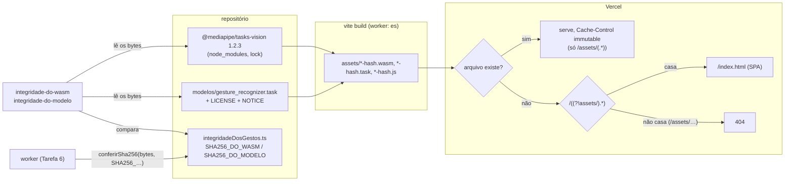

# VER-062 — E5, Tarefa 5: dependência `@mediapipe/tasks-vision` 1.2.3, modelo versionado com a licença, integridade por SHA-256 e configuração de build e de deploy

## Cabeçalho

| Campo | Valor |
|---|---|
| Id | VER-062 |
| Título | E5, Tarefa 5: a dependência `@mediapipe/tasks-vision` 1.2.3 (npm 11, `--save-exact --ignore-scripts --before=2026-11-14`), o modelo `gesture_recognizer.task` versionado em `src/shared/infra/modelos/` com a licença Apache-2.0 e o `NOTICE.txt`, os SHA-256 fixos do WASM e do modelo com `conferirSha256`, os workers do Vite em formato ES, a licença e o aviso servidos pelo deploy em `/licencas/` (rodada 1) e a rewrite de SPA da Vercel que não pega `/assets/` nem `/licencas/`, com cache `immutable` só em `/assets/` |
| Gravidade | alta |
| Tipo | implementação · dependência · segurança · deploy |
| Data | 2026-11-28 (data do commit, em UTC) |
| Usuário responsável | TokumoH |
| Status de implementação | implementado |
| Commits | commit que introduz este arquivo — `git log --diff-filter=A --format=%h -- docs/verificacoes/2026-11-28-062-e5-dependencia-e-modelo.md` |
| Arquivos | `package.json`, `package-lock.json`, `vite.config.ts`, `vercel.json`, `src/shared/infra/integridadeDosGestos.ts`, `src/shared/infra/integridadeDosGestos.test.ts`, `src/shared/infra/modelos/{README.md,gesture_recognizer.task,LICENSE-APACHE-2.0.txt,NOTICE.txt}`, `src/app/implantacao.test.ts`, `src/app/lerArquivoDoRepositorio.ts` (só o comentário), READMEs de `src/shared/infra/` e `src/app/`, `docs/verificacoes/README.md`, este registro (17 arquivos) |

**Revisões:** R1 — spec ✅; qualidade reprovada por 1 importante de licença (I1: a licença e o aviso não iam com o deploy, e o registro dizia que sim) e 6 nits (N2–N7); tudo corrigido na rodada 1 (linha C1). R2 — re-revisão focada (`vite build` numa cópia com os dois arquivos em `dist/licencas/` e mesmo hash; bundle inalterado; rotas do app pela rewrite nova; 4 sabotagens do plugin e da rewrite; R3 e R5 repetidas): **limpa**. `npm run check` 0 no conteúdo exato do commit. Demais revisões: (a registrar pelo controlador)

## Problema

O [PLA-006](../planos/2026-11-28-e5-gestos.md) (D9) e o DES-001 §11 escolheram o `@mediapipe/tasks-vision` para reconhecer os gestos, com o modelo e o WASM servidos pelo próprio app e conferidos por SHA-256. Antes desta tarefa:

- a dependência não estava no projeto, e o modelo `gesture_recognizer.task` não estava no repositório (o build não pode baixá-lo);
- não havia hash fixo para conferir o WASM e o modelo em tempo de execução (D9: diferente → situação `falhou`, motivo `integridade`);
- o Vite montaria um worker em `iife` (padrão do 8.3.5; revisão 1, N6), e o worker do reconhecedor é de módulo (carrega o `vision_wasm_module_internal.js` por `import()`, F4);
- a rewrite `/(.*)` → `/index.html` da Vercel pegaria um arquivo de `assets/` que não existe mais (de um deploy anterior): com o `Cache-Control: immutable` de um ano que a D9 põe em `assets/`, o navegador guardaria o `index.html` no lugar do WASM ou do modelo por um ano (revisão 1, N7);
- o pacote não traz arquivo `LICENSE` e o WASM e o modelo serão redistribuídos pelo deploy, sem a cópia da licença que a Apache-2.0, §4(a), pede para quem recebe a obra (revisão 1, N8); quem recebe o WASM e o modelo é o navegador de quem abre o app, então a cópia tem de ir com o deploy (rodada 1, I1).

## Era proposital?

Sim, como etapa: o PLA-006 põe tudo isto na Tarefa 5 (revisão 1, N13: a antiga Tarefa 5 foi dividida; esta não tem worker nem código que rode o MediaPipe, que vêm na Tarefa 6). A dependência nova foi decidida pelo responsável em 2026-11-26 ("Resolve"): npm 11 (11.21.2), `--save-exact`, `--ignore-scripts` e `--before` pelo menos 2 semanas antes de hoje e depois da publicação. Nada no código anterior dependia da rewrite `/(.*)` pegar `assets/` (o build do Vite põe todo arquivo gerado em `assets/` com hash no nome; as rotas do app são `/`, `/entrar`, `/painel`, `/controle`, `/camera`, `/obs/palco`, `/obs/camera`, nenhuma sob `/assets/`).

## Solução

- **Dependência:** `npx -y npm@11 install @mediapipe/tasks-vision@1.2.3 --save-exact --ignore-scripts --before=2026-11-14` (npm 11.21.2). A 1.2.3 foi publicada em 2026-11-11T22:49:09Z (antes de 2026-11-14, que é exatamente 14 dias antes de 2026-11-28); a regra fecha. Diff do lock: só a entrada do pacote (e a linha em `dependencies` da raiz), `integrity` igual à de F1, os 10 campos `libc` intactos.
- **Modelo, licença e aviso:** `gesture_recognizer.task` baixado da URL de F10 (`storage.googleapis.com/mediapipe-models/…/float16/1/gesture_recognizer.task`) numa pasta própria do scratchpad, conferido (8 373 440 bytes; SHA-256 `97952348…2b0482`, igual ao publicado) e só então copiado para `src/shared/infra/modelos/`; `LICENSE-APACHE-2.0.txt` baixado de `https://www.apache.org/licenses/LICENSE-2.0.txt` (11 358 bytes; SHA-256 `cfc7749b96f63bd31c3c42b5c471bf756814053e847c10f3eb003417bc523d30`); `NOTICE.txt` escrito (o que é redistribuído, de Google LLC, sob Apache-2.0: o WASM, o carregador e o modelo sem modificação; o `vision_bundle.mjs` em forma de objeto, empacotado e minificado pelo Vite a partir da Tarefa 6; com a origem e os SHA-256). Pasta nova com README de 11 seções.
- **Licença no deploy (rodada 1, I1):** o plugin `revocast:licencas-no-deploy` do `vite.config.ts` (`apply: 'build'`) emite `LICENSE-APACHE-2.0.txt` e `NOTICE.txt` de `src/shared/infra/modelos/` em `dist/licencas/` (`this.emitFile`, sem segunda cópia na fonte); a Vercel os serve em `/licencas/` como arquivo estático, e a rewrite de SPA passa a excluir também `/licencas/` (um nome errado ali dá 404, não o `index.html`).
- **Integridade (`integridadeDosGestos.ts`):** `SHA256_DO_WASM` (F3) e `SHA256_DO_MODELO` (F10), literais do brief, e `conferirSha256(bytes, esperado, digest?)`: `true` só se o SHA-256 for exatamente o esperado; esperado fora da forma (64 hexadecimais minúsculos) → `false` (falha fechada); `digest` injetável, padrão `crypto.subtle.digest('SHA-256', …)`.
- **Build:** `worker: { format: 'es' }` em `vite.config.ts`.
- **Deploy:** `vercel.json` com a rewrite `/((?!assets/|licencas/).*)` → `/index.html` (rodada 1; antes `/((?!assets/).*)`) e `headers` com `Cache-Control: public, max-age=31536000, immutable` só em `/assets/(.*)`.
- **Testes:** `integridadeDosGestos.test.ts` (4) e `implantacao.test.ts` (3, escritos antes da implementação; na rodada 1, mais o `licencas-no-build` e casos novos em `assets-fora-da-rewrite`, `cache-so-em-assets` e `conferir-sha256`).

## Por que esta solução

- **Segurança da cadeia de fornecimento:** versão exata, `--ignore-scripts` (nenhum script de instalação roda), `--before` com 14 dias de margem (uma versão maliciosa recém-publicada não entra) e diff do lock conferido à mão; o pacote não tem dependências (F1), então não entra nada transitivo. `npm run check-deps-audit` 0/0.
- **Integridade em dois tempos:** no repositório, os testes amarram os bytes (`integridade-do-wasm` lê o `.wasm` instalado; `integridade-do-modelo` lê o `.task` versionado) às constantes; em tempo de execução (Tarefa 6), o worker confere os mesmos hashes antes de entregar os bytes ao MediaPipe. Uma troca do pacote ou do modelo sem trocar a constante reprova no `npm test`.
- **Deploy sem cache envenenado:** a Vercel serve o arquivo estático antes da rewrite (documentação: "precedence is given to the filesystem prior to rewrites being applied"; e na fonte do `@vercel/routing-utils` 6.6.1, `{ handle: "filesystem" }` vem antes das rotas das rewrites), então um arquivo que existe em `assets/` nunca passa pela rewrite; o que não existe mais volta 404 em vez do `index.html`, e o `immutable` só vale onde o nome tem hash.
- **Licença:** a Apache-2.0, §4(a), pede que quem recebe a obra receba a cópia da licença: o deploy serve `/licencas/LICENSE-APACHE-2.0.txt` ao lado do WASM e do modelo (rodada 1, I1). A §4(d) (repassar o NOTICE da obra) não se aplica, porque o pacote não traz NOTICE (rodada 1, N2); o `NOTICE.txt` daqui é um aviso nosso de atribuição, servido junto. Emitir os arquivos no build (em vez de copiá-los para `public/`) mantém uma fonte só.
- **Arquitetura:** `integridadeDosGestos.ts` é fabricação pura em `shared/infra/` (sem domínio, sem tela), como os outros adaptadores; o teste de implantação fica em `src/app/` (a configuração do app) e reusa `lerArquivoDoRepositorio`.

## Por que não outras soluções

| Opção | Motivo de descarte |
|---|---|
| npm 10 (o do Node 22 instalado) | decisão do responsável: só o npm 11 para `install`/`ci` (lock com os campos `libc`) |
| `--before` mais recente que 2026-11-14 | quebraria a regra das 2 semanas |
| Baixar o modelo do Hugging Face | o plano cita as duas, mas a fonte oficial do MediaPipe é o `storage.googleapis.com` (F10); o hash publicado é o mesmo |
| Conferir o hash só no teste | o arquivo servido pela Vercel ou guardado no navegador não seria conferido; a D9 pede a conferência no worker |
| Conferir com `indexOf`/comparação sem diferenciar maiúsculas | um esperado vazio ou malformado poderia passar; a guarda da forma fecha o caso (`''` com digest vazio, teste `conferir-sha256`) |
| Ler o `vite.config.ts` como texto no teste | um comentário com `format: 'es'` passaria; importado, vale o objeto que o Vite usa |
| Testar a rewrite com a expressão JavaScript literal | a Vercel converte o `source` pelo `path-to-regexp` (prefixo, `strict`, `sensitive`); o teste reproduz essa conversão e confere o texto gerado |
| Instalar `path-to-regexp` para o teste | dependência nova não autorizada; o conversor do teste cobre só o subconjunto usado e lança no resto |
| Licença e aviso só no repositório | quem recebe o WASM e o modelo é o navegador; a §4(a) não fica atendida (rodada 1, I1) |
| Cópia em `public/licencas/` | duas cópias na fonte, que podem divergir; o plugin emite os arquivos de `modelos/` no build |
| `headers` com `immutable` em todas as rotas | o `index.html` ficaria guardado um ano e um deploy novo não chegaria |
| `"cleanUrls"` ou `routes` legados | a documentação recomenda `rewrites`; `routes` não combina com `headers`/`rewrites` |

## Onde

| Arquivo | Linhas | O que mudou |
|---|---|---|
| [`package.json`](../../package.json#L34) | 34 | `"@mediapipe/tasks-vision": "1.2.3"` em `dependencies` |
| [`package-lock.json`](../../package-lock.json#L152-L157) | 11, 152–157 | a dependência da raiz e a entrada `node_modules/@mediapipe/tasks-vision` (`version`, `resolved`, `integrity`, `license`) |
| [`vite.config.ts`](../../vite.config.ts#L5-L35) | 3, 5–28, 31–34 | rodada 1: `LICENCAS_NO_DEPLOY` e o plugin `revocast:licencas-no-deploy` (I1); `worker: { format: 'es' }` com o comentário (N6) |
| [`vercel.json`](../../vercel.json#L1-L9) | 1–9 | rewrite `/((?!assets/|licencas/).*)` (desde a rodada 1) e `headers` com `immutable` só em `/assets/(.*)` (N7) |
| [`src/shared/infra/integridadeDosGestos.ts`](../../src/shared/infra/integridadeDosGestos.ts#L1-L37) | 1–37 | `SHA256_DO_WASM`, `SHA256_DO_MODELO`, `conferirSha256` (rodada 1, N7: o comentário diz que sem `crypto.subtle` a promessa rejeita) |
| [`src/shared/infra/integridadeDosGestos.test.ts`](../../src/shared/infra/integridadeDosGestos.test.ts#L29-L87) | 1–87 (rodada 1, N4: hash diferente só no último ou só no primeiro caractere) | `integridade-do-wasm`, `integridade-do-modelo`, `conferir-sha256`, `licenca-junto-dos-arquivos` |
| [`src/shared/infra/modelos/README.md`](../../src/shared/infra/modelos/README.md) | todas | pasta nova, 11 seções (origem do arquivo, licença e aviso, SHA-256, como atualizar o modelo e a constante juntos) |
| [`src/shared/infra/modelos/gesture_recognizer.task`](../../src/shared/infra/modelos/gesture_recognizer.task) | binário | o modelo, 8 373 440 bytes, sem modificação |
| [`src/shared/infra/modelos/LICENSE-APACHE-2.0.txt`](../../src/shared/infra/modelos/LICENSE-APACHE-2.0.txt) | todas | texto da Apache-2.0, sem modificação |
| [`src/shared/infra/modelos/NOTICE.txt`](../../src/shared/infra/modelos/NOTICE.txt#L1-L31) | 1–31 | o aviso (N8); rodada 1, N3: o `vision_bundle.mjs` em forma de objeto, empacotado pelo build |
| [`src/app/implantacao.test.ts`](../../src/app/implantacao.test.ts#L16-L60) | 1–134 | `fonteDaVercelParaRegExp` (16–60); `vite-worker-em-es`, `assets-fora-da-rewrite`, `cache-so-em-assets` e, na rodada 1, `licencas-no-build` (69–134) |
| [`src/app/lerArquivoDoRepositorio.ts`](../../src/app/lerArquivoDoRepositorio.ts#L6) | 6 | comentário: usado também pelo `implantacao.test.ts` |
| [`src/shared/infra/README.md`](../../src/shared/infra/README.md) | 14, 18, 22, 106, 154–156, 216, 225, 228, 256 | "Arquivos", propósito, origem, regra de `integridadeDosGestos.ts`, "Onde", verificação, risco |
| [`src/app/README.md`](../../src/app/README.md) | 14, 70, 81, 157 | "Arquivos", `lerArquivoDoRepositorio.ts`, "Onde" com `implantacao.test.ts`, verificação |
| [`docs/verificacoes/README.md`](README.md) | "Arquivos" e "Onde" | linha deste registro |

## Lógica

| Caminho | Antes (`/(.*)`) | Depois (`/((?!assets/).*)`) |
|---|---|---|
| `/assets/index-abc.js` (existe) | arquivo (o sistema de arquivos vem antes) | arquivo, com `immutable` |
| `/assets/x-velho.wasm` (de um deploy anterior, não existe) | `index.html` (e, com o `immutable`, guardado um ano) | 404 |
| `/licencas/NOTICE.txt` (emitido pelo build, rodada 1) | — (não existia) | arquivo, sem `immutable` |
| `/licencas/outro.txt` (não existe) | `index.html` | 404 (a rewrite exclui `licencas/`) |
| `/camera`, `/obs/palco`, `/` | `index.html` | `index.html` |

**Conversão do `source` pela Vercel** (fonte do `@vercel/routing-utils` 6.6.1, `sourceToRegex`: `pathToRegexp(source, keys, { strict: true, sensitive: true, delimiter: '/' })`, com o `path-to-regexp` 6.1.0 e a comparação com o 6.3.0; o resultado `r.source` vira o `src` da rota). Lida na fonte do `path-to-regexp` 6.3.0 (`lexer`, `parse`, `tokensToRegexp`, sem executar o pacote baixado): `/((?!assets/).*)` → `^(?:\/((?!assets\/).*))$` (sem flag `i`); `/assets/(.*)` → `^\/assets(?:\/(.*))$`. O teste `assets-fora-da-rewrite` reproduz essa conversão para o subconjunto usado (texto fixo, grupo `(…)`, `:nome`) e lança no resto.

## Exemplo

- **Lock (antes × depois):** `package-lock.json` com 0 entradas do MediaPipe → 1 (`node_modules/@mediapipe/tasks-vision`, `version` 1.2.3, `integrity` `sha512-sxJyfhbN+EamexhaaCmUlw7v8vWWMum7VDsORe6d4c8Dk/xlI4qiIgoSw9cE9hpvYhVRRVLIA8y605FbqWkNeQ==`, `license` Apache-2.0); 7 linhas a mais; `"libc"` 10 → 10. Pacote instalado: 12 arquivos, 31 398 574 bytes (F1); o `.wasm` 14 665 738 bytes.
- **Integridade:** `sha256sum node_modules/@mediapipe/tasks-vision/wasm/vision_wasm_module_internal.wasm` → `a269e84b…1669e46` (= F3; o `vision_wasm_module_internal.js` → `d2999624…e897851`, = F3); `sha256sum src/shared/infra/modelos/gesture_recognizer.task` → `97952348…2b0482`, 8 373 440 bytes (= F10). Com um byte trocado (S2), o teste `integridade-do-modelo` cai.
- **Rewrite:** `/assets/x-abc.wasm` com `^(?:\/(.*))$` (antes) casa → `index.html`; com `^(?:\/((?!assets\/).*))$` (depois) não casa → 404 se o arquivo não existir.

## Verificação

| # | Abordagem | Comando / método | Resultado |
|---|---|---|---|
| Datas | `npx -y npm@11 view @mediapipe/tasks-vision time --json` | 1.2.3 em 2026-11-11T22:49:09.236Z; a 1.2.4-rc.20261114 só em 2026-11-14T14:04Z (excluída pelo `--before=2026-11-14`, que corta em 2026-11-14T00:00Z) | regra das 2 semanas fecha (2026-11-28 − 14 dias = 2026-11-14) |
| Registro | `npx -y npm@11 view @mediapipe/tasks-vision@1.2.3 dist license dependencies peerDependencies --json` | `integrity` `sha512-sxJyfhbN…qWkNeQ==`, 12 arquivos, 31 398 574 bytes, `Apache-2.0`, sem `dependencies` nem `peerDependencies` | = F1 |
| Instalação | `npx -y npm@11 install … --save-exact --ignore-scripts --before=2026-11-14` (npm 11.21.2) | "added 1 package, and audited 100 packages"; "found 0 vulnerabilities" | só 1 pacote |
| Diff do lock | `git diff package-lock.json`; `grep -c '"libc"'` | +7 linhas: a dependência da raiz e a entrada do pacote; `libc` 10 antes e depois | nada além do pacote |
| Auditoria | `npm run check-deps-audit` | `0 erro(s) — 0 aviso(s)` | ✅ |
| Modelo | `curl` da URL de F10 em pasta própria; `stat -c %s`; `sha256sum` | 8 373 440; `97952348cf6a6a4915c2ea1496b4b37ebabc50cbbf80571435643c455f2b0482` | = F10, copiado depois |
| Licença | `curl https://www.apache.org/licenses/LICENSE-2.0.txt`; `sha256sum` | 11 358 bytes, `cfc7749b96f63bd31c3c42b5c471bf756814053e847c10f3eb003417bc523d30` | fixado no teste `licenca-junto-dos-arquivos` |
| Fontes do pacote (F4–F7) | leitura do `vision_bundle.mjs` instalado (155 990 bytes, 2 linhas; posições em linha 1) | `async function Mh(` em L1:C56073 (`importScripts`, `<script crossOrigin="anonymous">` e `import()` no `TypeError`, C56116 e C56358); `qh` em L1:C67699 (`e instanceof Uint8Array` → buffer do modelo, C67798); `fetch(e.modelAssetPath` em L1:C69241; `Sa()` em L1:C66550 (lê `_mediapipeLoggerGetEncodedApiKey`, C66585, e decodifica em base64), chamado em L1:C67494 e passado a `new Nh` (C67503); registrador `xh` em L1:C52080 com `setInterval(…, 6e4)` (C52179) e `flush` que envia `POST https://odml.pa.googleapis.com/v1/log` (C52467) com o cabeçalho `x-goog-api-key`, para de vez no erro (`this.error`); `Wh` em L1:C66839; `Dh` em L1:C56504 | = F4–F6 |
| Contagem (F7) | `grep -oF` | `vision_bundle.mjs`: `sendBeacon` 0, `WebSocket` 0, `XMLHttpRequest` 0, `fetch(` 3; `vision_wasm_module_internal.js`: `sendBeacon` 0, `WebSocket` 0, `XMLHttpRequest` 6, `fetch(` 2 | = F7 |
| Vercel (F17) | `vercel.com/docs/project-configuration/vercel-json`, `/docs/compression` (atualizada em 2026-03-05), `/docs/plans/hobby` (2026-11-12), lidas em 2026-11-28; fonte do `@vercel/routing-utils` 6.6.1 | "The `source` property should **NOT** be a file because precedence is given to the filesystem prior to rewrites being applied"; "With `rewrites`, the regex needs to be wrapped in a capture group" (exemplo `/((?!maintenance).*)`); compressão Gzip e Brotli só para tipos da lista, que traz `wasm` (sem `octet-stream`); Hobby: "Fast Data Transfer — First 100 GB" por mês, e ao passar "you will have to wait until 30 days have passed"; na fonte, `routes.push({ handle: "filesystem" })` antes das rewrites e `sourceToRegex` com `strict`/`sensitive` | arquivo estático antes da rewrite e a sintaxe da rewrite **escritos**; o tipo de conteúdo do `.task` na Vercel (e se é comprimido) **não** está na documentação: premissa do responsável (no deploy) |
| TDD (vermelho) | os 2 arquivos novos antes da implementação | `npx vitest run src/shared/infra/integridadeDosGestos.test.ts src/app/implantacao.test.ts` | `integridadeDosGestos.test.ts` não carrega (módulo inexistente); `implantacao.test.ts` 3 falhando (`worker.format` `undefined`; sem `headers`; e o texto esperado da conversão sem o `\/` que o `RegExp.source` põe — erro do próprio teste, corrigido antes do verde) |
| TDD (verde) | depois da implementação | o mesmo comando | 7 passando; depois, uma asserção a mais no `conferir-sha256` (esperado vazio com digest vazio, para a guarda da forma ter teste que a derrube: S7) e a retirada de uma guarda de tamanho redundante em `conferirSha256` (um digest de outro tamanho nunca forma os mesmos 64 caracteres) |
| Tipos | `npm run typecheck` | `tsc --noEmit` (o `vite.config.ts` entra no programa pelo import do teste) | 0 erros |
| Build | `npx vite build --outDir <scratchpad>` | build completo com `worker.format: 'es'` | ✅ (nenhum worker ainda; nada importa o pacote, então o bundle do app não muda) |
| Contagens | `npx vitest run src/shared/infra` e `src/app` sem `telas/` | 17 arquivos, 307 testes; 9 arquivos, 87 testes desde a rodada 1 (86 antes) | +4 e +4 |
| Sabotagens | 17 alterações numa cópia do repositório (`git ls-files` copiados com `tar`, `node_modules` por link), `npx vitest run --no-cache --no-fsModuleCache` nos 2 arquivos; o arquivo restaurado depois de cada uma | tabela abaixo | 16 derrubam ao menos um teste; a S8 é mutante equivalente (a guarda da forma vem antes da comparação); `sha256sum` dos 295 arquivos do repositório igual antes e depois; a cópia restaurada confere com o `sha256sum` de antes |
| Final | `npm run check` | `typecheck` + `npm test` + `check-docs` + `check-doc-secrets` + `rpc:grants-check` + `data-api:check` + `check-deps-audit` | 0 erros: 72 arquivos e 2952 testes no `npm test` desde a rodada 1 (2951 antes dela; 2944 antes da tarefa) |
| C1 (rodada 1) | correções da revisão R1 (spec ✅; qualidade reprovada pelo I1, de licença) | I1: plugin `revocast:licencas-no-deploy` + rewrite `/((?!assets/|licencas/).*)` + teste `licencas-no-build`; `vite build` real para o scratchpad gerou `dist/licencas/LICENSE-APACHE-2.0.txt` (11 358 bytes, `cfc7749b…`) e `dist/licencas/NOTICE.txt` com o mesmo SHA-256 da fonte; README de `modelos/`, Problema, Solução, Por que e Riscos coerentes. N2 (§4(d) retirada), N3 (texto do `NOTICE.txt`), N4 (casos do último e do primeiro caractere), N5 (`cache-so-em-assets` recusa outra regra com `Cache-Control`), N6 e N7 (Riscos e comentário) | as 17 sabotagens de antes mais 8 novas (C1-S1 a C1-S8), numa cópia nova com `--no-cache --no-fsModuleCache`: 24 derrubam ao menos um teste, a S8 continua mutante equivalente; `sha256sum` dos 297 arquivos igual antes e depois; `npm run check` 0 |

| Sabotagem | Teste que caiu |
|---|---|
| S1 `SHA256_DO_WASM` com um caractere trocado | `integridade-do-wasm` |
| S2 modelo com um byte trocado (posição 4 000 000) | `integridade-do-modelo` |
| S3 `NOTICE.txt` vazio | `licenca-junto-dos-arquivos` (e, desde a rodada 1, `licencas-no-build`) |
| S4 `worker.format` removido | `vite-worker-em-es` |
| S5 rewrite `/(.*)` de volta | `assets-fora-da-rewrite` |
| S6 `SHA256_DO_MODELO` com um caractere trocado | `integridade-do-modelo` |
| S7 `conferirSha256` sem a guarda da forma | `conferir-sha256` |
| S8 comparação com `esperado.toLowerCase().trim()` | nenhum — mutante equivalente: a guarda da forma já recusa maiúsculas e espaços antes da comparação |
| S9 `conferirSha256` ignora o `digest` recebido | `conferir-sha256` |
| S10 `conferirSha256` sempre `true` | `conferir-sha256` |
| S11 `worker.format: 'iife'` | `vite-worker-em-es` |
| S12 `immutable` na fonte `/(.*)` | `cache-so-em-assets` |
| S13 rewrite que exclui `assetsx/` em vez de `assets/` | `assets-fora-da-rewrite` |
| S14 licença sem a última linha | `licenca-junto-dos-arquivos` |
| S15 `NOTICE.txt` sem a versão | `licenca-junto-dos-arquivos` |
| S16 modelo sem o último byte | `integridade-do-modelo` |
| S17 `Cache-Control` sem `immutable` | `cache-so-em-assets` |
| C1-S1 plugin das licenças fora de `plugins` | `licencas-no-build` |
| C1-S2 só a licença, sem o `NOTICE.txt` | `licencas-no-build` |
| C1-S3 rewrite sem excluir `licencas/` | `assets-fora-da-rewrite` |
| C1-S4 plugin com `apply: 'serve'` | `licencas-no-build` |
| C1-S5 `NOTICE.txt` emitido na raiz do `dist` | `licencas-no-build` |
| C1-S6 (R3 da revisão) regra `/(.*)` com `Cache-Control: no-cache` | `cache-so-em-assets` |
| C1-S7 (R5 da revisão) comparação sem o último caractere | `conferir-sha256` |
| C1-S8 `NOTICE.txt` emitido com os bytes da licença | `licencas-no-build` |

(Na rodada 1, S5 e S13 partem da rewrite nova `/((?!assets/|licencas/).*)`.)

Revisões independentes: R1 reprovada por 1 importante de licença e 6 nits, corrigidos na rodada 1 (linha C1); R2 limpa (a primeira tentativa da R1 foi perdida num reinício do container e refeita do zero).

## Riscos

- **Telemetria (F6):** o `vision_bundle.mjs` 1.2.3 envia métricas a `odml.pa.googleapis.com` a cada 60 s; nesta tarefa nada importa o pacote (o bundle do app não muda), e o bloqueio é da guarda de rede do worker (Tarefa 6, D9); a decisão de aceitar ou não as métricas é do responsável (Tarefa 9, Passo 4).
- **Compressão e banda na Vercel (F17):** a documentação lista `wasm` entre os tipos comprimidos, mas não diz com que tipo a Vercel serve um `.task` (provavelmente `application/octet-stream`, fora da lista): o modelo pode ir sem compressão (8,4 MB por aparelho, uma vez, pelo `immutable`). Banda do Hobby: 100 GB por mês de Fast Data Transfer: cerca de 4 300 primeiros acessos (modelo + WASM, 23 MB) sem compressão nenhuma, ou cerca de 8 000 com o WASM comprimido (4,1 MB com `gzip -9` medido localmente), fora o resto do app; o `immutable` faz cada aparelho baixar uma vez por versão. Compressão e banda reais, **só o responsável** (no deploy, pelas ferramentas do navegador). O envio por Git com o WASM e o modelo no build (F14) também.
- **Conversão da rewrite:** o teste reproduz o `path-to-regexp` 6.x lido na fonte, não o executa (o pacote baixado não foi executado nesta sessão); se a Vercel mudar a conversão (por exemplo, para o 8.x), o primeiro deploy mostra (um `/assets/` inexistente deve dar 404).
- **Apache-2.0 (rodada 1, I1):** a licença e o aviso vão com o deploy em `/licencas/` (emitidos pelo build). `vite dev` não os serve (o plugin é só de build), e eles não têm hash no nome (cache padrão da Vercel, sem `immutable`). Nenhuma tela do app aponta para `/licencas/`; um link na página (por exemplo, numa tela "sobre") é um item próprio, se o responsável quiser.
- **404 com `immutable` (premissa do responsável, rodada 1, N6):** os `headers` da Vercel podem valer também para a resposta 404 de um arquivo que não existe em `/assets/`; nesse caso o 404 sai com `immutable` de um ano, e um rollback que traga de volta um arquivo antigo não chega a um navegador que já guardou o 404. A conferir no deploy (ferramentas do navegador).
- **Sem `crypto.subtle` (rodada 1, N7):** em contexto inseguro (por exemplo, `http` na rede local) ou com um `digest` que falha, `conferirSha256` rejeita a promessa em vez de devolver `false`; a Tarefa 6 trata a rejeição como situação `falhou`, motivo `integridade` (e testa com um digest que lança).
- **8,4 MB no repositório** a cada versão do modelo; o histórico guarda todas.
- **Âncoras antigas:** nenhum arquivo citado encolheu: `vite.config.ts` 13→42, `vercel.json` 1→9, `src/shared/infra/README.md` 250→256, `src/app/README.md` 172→173, `lerArquivoDoRepositorio.ts` igual (12).
- **Data no nome:** se o commit sair depois de 2026-11-28 (UTC), o nome deste arquivo e os links dos READMEs acompanham.
