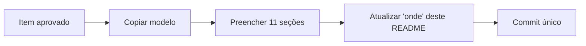

# docs/verificacoes

## Cabeçalho

| Campo | Valor |
|---|---|
| Id | DIR-docs-verificacoes |
| Título | `verificacoes` |
| Tipo | documentação · registros de correção e decisão |
| Data | 2026-11-16 |
| Usuário responsável | TokumoH |
| Status | ativo |
| Commits | commit que introduz este arquivo — `git log --format=%h -- docs/verificacoes/README.md` |
| Arquivos | `README.md`, `_modelo-registro-de-correcao.md`, `2026-11-16-001-core-e-estrutura-docs.md`, `2026-11-16-002-autorizacao-git-e-branch-trabalho.md`, `2026-11-16-003-devsecops-checagens-e-ci.md`, `2026-11-16-004-readme-raiz.md`, `2026-11-16-005-desenho-recomeco.md`, `2026-11-16-006-desenho-verificado.md`, `2026-11-17-007-plano-e0.md`, `2026-11-17-008-e0-limpeza-e-esqueleto.md`, `2026-11-17-009-e0-supabase-cliente.md`, `2026-11-22-010-e0-banco.md`, `2026-11-22-011-e0-checagens-banco.md`, `2026-11-18-012-audit-excecao-com-prazo.md`, `2026-11-22-013-commits-locais-pelo-agente.md`, `2026-11-26-014-plano-e1.md`, `2026-11-26-015-e1-dominio-acesso.md`, `2026-11-26-016-e1-banco-membros.md`, `2026-11-26-017-e1-adaptadores-acesso.md`, `2026-11-26-018-e1-entrada-e-guarda.md`, `2026-11-26-019-e1-painel-e-membros.md`, `2026-11-26-020-e1-conferencia-e-guia.md`, `2026-11-26-021-tempo-limite-supabase.md`, `2026-11-26-022-remove-excecao-picomatch.md`, `2026-11-26-023-plano-e2.md`, `2026-11-26-024-e2-dominio-preparacao.md`, `2026-11-26-025-e2-simulacao-storage-e-checagens.md`, `2026-11-26-026-e2-banco-biblioteca.md`, `2026-11-26-027-e2-adaptadores-preparacao.md`, `2026-11-26-028-e2-aba-biblioteca.md`, `2026-11-27-029-e2-cenas-e-gestos.md`, `2026-11-27-030-e2-episodios-e-avisos.md`, `2026-11-27-031-e2-conferencia-e-guia.md`, `2026-11-27-032-jwt-expirado-sessao-expirada.md`, `2026-11-27-033-membros-foco-no-mesmo-commit.md`, `2026-11-27-034-plano-e3.md`, `2026-11-27-035-e3-dominio-ao-vivo.md`, `2026-11-27-036-e3-simulacao-realtime-e-checagens.md`, `2026-11-27-037-e3-banco-ao-vivo.md`, `2026-11-27-038-e3-adaptadores-ao-vivo.md`, `2026-11-27-039-e3-integracao-obs-e-palco.md`, `2026-11-27-040-e3-telas-de-dispositivo.md`, `2026-11-27-041-e3-controle.md`, `2026-11-27-042-e3-aba-ao-vivo-dispositivos.md`, `2026-11-27-043-e3-aba-ao-vivo-episodio.md`, `2026-11-27-044-e3-conferencia-e-guia.md`, `2026-11-27-045-teste-estavel-aba-biblioteca.md`, `2026-11-27-046-e3-correcoes-revisao-final.md`, `2026-11-27-047-e3-estado-em-topico-proprio.md`, `2026-11-27-048-plano-e4.md`, `2026-11-27-049-e4-dominio-captura.md`, `2026-11-27-050-e4-banco-video.md`, `2026-11-28-051-e4-adaptadores-video.md`, `2026-11-28-052-e4-camera-tela-preta.md`, `2026-11-28-053-e4-obs-camera.md`, `2026-11-28-054-e4-aba-ao-vivo-video.md`, `2026-11-28-055-e4-conferencia-e-guia.md`, `2026-11-28-056-e4-correcoes-revisao-final.md`, `2026-11-28-057-plano-e5.md`, `2026-11-28-058-e5-dominio-gestos.md`, `2026-11-28-059-e5-palco-com-gestos.md`, `2026-11-28-060-e5-banco-gestos.md`, `2026-11-28-061-e5-adaptadores-gestos.md`, `2026-11-28-062-e5-dependencia-e-modelo.md`, `2026-11-28-063-e5-reconhecedor.md` |

## Propósito

Guarda um registro por commit (cada um de um item aprovado: sugestão ou tarefa de plano): o que estava errado, se era proposital, a solução, onde mudou, como foi verificado (duas verificações seguidas sem erro) e os riscos. É a rastreabilidade versionada exigida pelo [CORE](../../CLAUDE.md#commit).

## Origem

Criado em 2026-11-16 a partir da regra do CORE "todo commit leva documento em `docs/verificacoes/`", aprovada pelo usuário como S2 ("aprovado S1 e S2 como documentação"). Registro de origem: [VER-001](2026-11-16-001-core-e-estrutura-docs.md).

## Organização

- `_modelo-registro-de-correcao.md` — modelo com as 11 seções do formato de documentação. O prefixo `_` o mantém no topo da listagem e o separa dos registros.
- Registros: `AAAA-MM-DD-NNN-slug.md`
  - `AAAA-MM-DD` — data do commit;
  - `NNN` — sequência global de 3 dígitos (001, 002, …), que vira o Id `VER-NNN`;
  - `slug` — resumo em minúsculas com hífens.
- Sem subdiretórios.

## Por que esta organização

- A data no nome ordena cronologicamente; a sequência garante Id único mesmo com vários registros no mesmo dia.
- Um arquivo plano por registro facilita `grep`, links relativos estáveis e revisão em PR.
- Um único modelo evita divergência de formato entre registros.

## Por que não outras organizações

| Opção | Motivo de descarte |
|---|---|
| Só sequência (`001-slug.md`) | Perde a data no nome |
| Subpasta por ano/mês | Volume atual não justifica; exigiria README por subpasta |
| Um arquivo único (changelog) com todos os registros | Conflitos de merge e arquivo crescendo sem limite; links por registro ficam instáveis |
| Registro na mensagem do commit | Não comporta tabelas, diagramas e verificação; difícil de consultar |

## Onde

| Arquivo ou subdiretório | O que contém |
|---|---|
| [`README.md`](README.md) | Este arquivo |
| [`_modelo-registro-de-correcao.md`](_modelo-registro-de-correcao.md) | Modelo de registro (copiar para criar um novo) |
| [`2026-11-16-001-core-e-estrutura-docs.md`](2026-11-16-001-core-e-estrutura-docs.md) | VER-001 — criação do `CLAUDE.md` (CORE) e da estrutura `docs/` |
| [`2026-11-16-002-autorizacao-git-e-branch-trabalho.md`](2026-11-16-002-autorizacao-git-e-branch-trabalho.md) | VER-002 — incidente de commit/push sem autorização, troca para `branchTrabalho` e regra "Branch e Git" no `CLAUDE.md` |
| [`2026-11-16-003-devsecops-checagens-e-ci.md`](2026-11-16-003-devsecops-checagens-e-ci.md) | VER-003 — checagens DevSecOps (`scripts/`), hook pre-push e CI econômica |
| [`2026-11-16-004-readme-raiz.md`](2026-11-16-004-readme-raiz.md) | VER-004 — README da raiz (descrição e projeção) e exceções de README (`.github/`, raiz) |
| [`2026-11-16-005-desenho-recomeco.md`](2026-11-16-005-desenho-recomeco.md) | VER-005 — desenho do recomeço (DES-001) e pasta `docs/desenho/` |
| [`2026-11-16-006-desenho-verificado.md`](2026-11-16-006-desenho-verificado.md) | VER-006 — DES-001 corrigido até duas verificações limpas seguidas |
| [`2026-11-17-007-plano-e0.md`](2026-11-17-007-plano-e0.md) | VER-007 — plano de implementação da etapa E0 (PLA-001) e pasta `docs/planos/` |
| [`2026-11-17-008-e0-limpeza-e-esqueleto.md`](2026-11-17-008-e0-limpeza-e-esqueleto.md) | VER-008 — E0, Tarefa 1: limpeza do protótipo, esqueleto React com rotas, telas provisórias, identidade visual e testes no `check` |
| [`2026-11-17-009-e0-supabase-cliente.md`](2026-11-17-009-e0-supabase-cliente.md) | VER-009 — E0, Tarefa 2: configuração (variáveis de ambiente validadas) e cliente Supabase por tipo de sessão |
| [`2026-11-22-010-e0-banco.md`](2026-11-22-010-e0-banco.md) | VER-010 — E0, Tarefa 3: migração inicial do banco (12 tabelas, RLS com 33 políticas, privilégios de tabela explícitos) testada em PGlite com simulação do Supabase; decisões 1 e 2 aplicadas ao DES-001 |
| [`2026-11-22-011-e0-checagens-banco.md`](2026-11-22-011-e0-checagens-banco.md) | VER-011 — E0, Tarefa 4: checagens de banco `rpc:grants-check` e `data-api:check` no `npm run check`, aplicando as migrações num PGlite com a simulação do Supabase e lendo o catálogo |
| [`2026-11-18-012-audit-excecao-com-prazo.md`](2026-11-18-012-audit-excecao-com-prazo.md) | VER-012 — `check-deps-audit` com exceções explícitas e com prazo (aviso do `picomatch` sem correção); VER-010 e VER-011 reservados às Tarefas 3 e 4 da E0 |
| [`2026-11-22-013-commits-locais-pelo-agente.md`](2026-11-22-013-commits-locais-pelo-agente.md) | VER-013 — commits locais pelo agente principal, só de versões limpas; push continua com o usuário |
| [`2026-11-26-014-plano-e1.md`](2026-11-26-014-plano-e1.md) | VER-014 — plano de implementação da etapa E1 (PLA-002): entrada com Google, guarda por papel e aba Membros; autonomia concedida pelo responsável |
| [`2026-11-26-015-e1-dominio-acesso.md`](2026-11-26-015-e1-dominio-acesso.md) | VER-015 — E1, Tarefa 1: domínio Acesso (`src/domains/acesso/`), regras puras, portas, `resolverAcesso` e teste de arquitetura dos domínios; abre com as pendências da E0 |
| [`2026-11-26-016-e1-banco-membros.md`](2026-11-26-016-e1-banco-membros.md) | VER-016 — E1, Tarefa 2: migração `membros_sem_autoalteracao` (nenhum `admin` altera nem remove a própria linha, decisão D1), testes de banco aplicando todas as migrações em ordem, bloco E1 em `rls.test.ts` e exceção da própria linha na matriz |
| [`2026-11-26-017-e1-adaptadores-acesso.md`](2026-11-26-017-e1-adaptadores-acesso.md) | VER-017 — E1, Tarefa 3: adaptadores Supabase das portas do domínio Acesso (`src/shared/infra/acessoSupabase.ts`: sessão, login Google, saída local, eventos de sessão adiados, papel, lista de acesso e tradução de erros) e composição dos serviços de membro (`src/app/servicos.ts`, cliente único por página) |
| [`2026-11-26-018-e1-entrada-e-guarda.md`](2026-11-26-018-e1-entrada-e-guarda.md) | VER-018 — E1, Tarefa 4: entrada com Google, guarda por papel de `/painel` e `/controle` e telas de erro (configuração, erro inesperado, fora da lista, sem acesso, falha); estado de tela com avaliações serializadas (`useAcesso`) e prova de que as rotas de dispositivo não criam o cliente de membro |
| [`2026-11-26-019-e1-painel-e-membros.md`](2026-11-26-019-e1-painel-e-membros.md) | VER-019 — E1, Tarefa 5: painel com as abas do DES-001 §9 por estado (D8), componente `Abas` acessível e a aba Membros (só `admin`): incluir, trocar o papel e remover e-mails da lista de acesso, com as regras do domínio antes de cada escrita, a própria linha sem controles (D1) e reavaliação quando a escrita volta negada |
| [`2026-11-26-020-e1-conferencia-e-guia.md`](2026-11-26-020-e1-conferencia-e-guia.md) | VER-020 — E1, Tarefa 6: conferência no navegador dos dois builds (sem variáveis e com variáveis de mentira, Supabase interceptado; claro e escuro; 320, 390 e 1280 px), guia "Login Google (E1)" em `supabase/README.md` para o responsável (banco, Google Cloud, Supabase Auth sem curinga de host nas Redirect URLs, Vercel e conferência real) e a fila pendurada observada, sem tempo-limite, como decisão pendente |
| [`2026-11-26-021-tempo-limite-supabase.md`](2026-11-26-021-tempo-limite-supabase.md) | VER-021 — tempo-limite de 15 s no `fetch` do cliente Supabase, só para `/rest/v1/` e `/auth/v1/` (Storage fora): uma chamada sem resposta vira erro de rede e a tela de falha com "Tentar de novo"; resolve a fila pendurada do VER-020 |
| [`2026-11-26-022-remove-excecao-picomatch.md`](2026-11-26-022-remove-excecao-picomatch.md) | VER-022 — remoção da exceção `GHSA-fc5q-39xc-vjpf` (`picomatch`) de `EXCECOES` do `check-deps-audit`: o aviso não existe mais no registro do npm; 023 reservado ao próximo registro |
| [`2026-11-26-023-plano-e2.md`](2026-11-26-023-plano-e2.md) | VER-023 — plano de implementação da etapa E2 (PLA-003): domínio Preparação, Biblioteca com o bucket privado `midias`, cenas, gestos, episódios e avisos |
| [`2026-11-26-024-e2-dominio-preparacao.md`](2026-11-26-024-e2-dominio-preparacao.md) | VER-024 — E2, Tarefa 1: domínio Preparação (`src/domains/preparacao/`): tipos aceitos pelos primeiros bytes, limites de 50 MB e 1 GB, caminho no Storage sem o nome do arquivo, cenas, mapa de gestos, episódios e avisos, mídia em uso, portas e o serviço da Biblioteca (envio e exclusão na ordem da D6, com compensação); abre com as pendências da E1 |
| [`2026-11-26-025-e2-simulacao-storage-e-checagens.md`](2026-11-26-025-e2-simulacao-storage-e-checagens.md) | VER-025 — E2, Tarefa 2: simulação do Storage do Supabase (schema `storage`, dono simulado pela participação em `supabase_storage_admin`, gatilho `protect_objects_delete`) e checagens de banco para `storage.*` (nenhuma mudança além de política em `storage.objects`; bucket como conjunção de topo; só select/insert/delete; função de papel por análise; dados do bucket) |
| [`2026-11-26-026-e2-banco-biblioteca.md`](2026-11-26-026-e2-banco-biblioteca.md) | VER-026 — E2, Tarefa 3: migração `biblioteca_storage` (bucket privado `midias` com 50 MB e os 8 tipos da D4; políticas de `storage.objects` para leitura, envio no formato `som\|imagem/<uuid>.<ext>` e exclusão, sem `update`) e o bloco `E2 — Biblioteca e preparação` dos testes de banco |
| [`2026-11-26-027-e2-adaptadores-preparacao.md`](2026-11-26-027-e2-adaptadores-preparacao.md) | VER-027 — E2, Tarefa 4: adaptadores Supabase da Preparação (`errosSupabase.ts` com `classificarErro` e `exigirLinhas`, usado também pela E1 sem mudar o comportamento; repositórios de mídias, sons, cenas, episódios e avisos, e gestos; envio ao Storage por `XMLHttpRequest` com progresso, cancelamento e corte por 30 s de inatividade; prévia e remoção) e composição da Preparação sobre o mesmo cliente de membro (`obterServicosDePreparacao`, `obterPreparacao`) |
| [`2026-11-26-028-e2-aba-biblioteca.md`](2026-11-26-028-e2-aba-biblioteca.md) | VER-028 — E2, Tarefa 5: aba Biblioteca no `/painel` (uso do limite de 1 GB com aviso a 80 %, envio de sons e imagens numa fila com progresso e cancelamento, sons com rótulo, emoji e volume, prévia por URL assinada só ao pedir, exclusão com confirmação que diz os usos), `BarraDeProgresso` e os falsos com estado da Preparação (`criarFalsosDePreparacao`, `arquivoDeTeste`) |
| [`2026-11-27-029-e2-cenas-e-gestos.md`](2026-11-27-029-e2-cenas-e-gestos.md) | VER-029 — E2, Tarefa 6: abas Cenas (incluir com o nome exato do OBS, editar, subir e descer com a renumeração do empate, exclusão bloqueada para cena em gesto) e Gestos (mapa global dos 7 gestos, só `update`, linha normalizada e conferida antes de gravar, opções desabilitadas sem sons ou cenas, sugestão de ligar 👍/👎 a "aplauso"/"buuu") no `/painel` |
| [`2026-11-27-030-e2-episodios-e-avisos.md`](2026-11-27-030-e2-episodios-e-avisos.md) | VER-030 — E2, Tarefa 7: aba Episódios no `/painel` (lista com o estado, criar e editar só título e data, excluir só rascunho; avisos com texto literal, link `https://` validado antes de virar âncora, imagem da Biblioteca ou "Sem imagem", duração e ordem com a renumeração do empate); iniciar e encerrar o ao vivo ficam para a E3 (D2) |
| [`2026-11-27-031-e2-conferencia-e-guia.md`](2026-11-27-031-e2-conferencia-e-guia.md) | VER-031 — E2, Tarefa 8: conferência no navegador de toda a E2 (Biblioteca, Cenas, Gestos, Episódios e avisos com `equipe`, `admin` e `apresentadora`, claro e escuro, 320/390/1280 px, corte de 30 s do envio; 300/300 com 6 sabotagens do script) e guia "Biblioteca no Storage (E2)" em `supabase/README.md` (migração, consultas de conferência, D3–D5, conferência real e o que só o projeto real confirma); passo do responsável pendente |
| [`2026-11-27-032-jwt-expirado-sessao-expirada.md`](2026-11-27-032-jwt-expirado-sessao-expirada.md) | VER-032 — JWT expirado recusado pelo Storage (`InvalidJWT` no corpo, com `statusCode` "400" ou "403") passa a virar `sessao_expirada` no envio, na remoção e na prévia, com prioridade sobre o `statusCode`; a `message` nunca decide (resolve o risco do VER-027 e do VER-031) |
| [`2026-11-27-033-membros-foco-no-mesmo-commit.md`](2026-11-27-033-membros-foco-no-mesmo-commit.md) | VER-033 — foco da aba Membros aplicado com `useLayoutEffect` (no mesmo commit que mostra o aviso), como na aba Biblioteca (VER-028), com teste determinístico por `MutationObserver` |
| [`2026-11-27-034-plano-e3.md`](2026-11-27-034-plano-e3.md) | VER-034 — plano de implementação da etapa E3 (PLA-004): pareamento de dispositivos, `/obs/palco`, `/controle` por toque, modo teste, iniciar e encerrar o ao vivo |
| [`2026-11-27-035-e3-dominio-ao-vivo.md`](2026-11-27-035-e3-dominio-ao-vivo.md) | VER-035 — E3, Tarefa 1: dispositivos no domínio Acesso (forma do código no fragmento, link de pareamento só `https:`, rótulo, situação e `resolverDispositivo` na ordem da D4, sem sessão anônima órfã e sem "revogado" inventado) e o domínio Ao vivo (`src/domains/aovivo/`): mensagens dos canais validadas no recebimento com forma fechada, `Revogados` por 15 min, `resolverComando`, linha do registro e as portas dos canais, repositórios e executor; abre com as pendências da E2 |
| [`2026-11-27-036-e3-simulacao-realtime-e-checagens.md`](2026-11-27-036-e3-simulacao-realtime-e-checagens.md) | VER-036 — E3, Tarefa 2: schema `realtime` na simulação (`realtime.messages` particionada, `realtime.topic()` e `realtime.authorize(...)` com o corpo da fonte), `comoCanal` pelo caminho principal do servidor do Realtime e as checagens de banco: `SCHEMAS_PROTEGIDOS` (`storage` e `realtime`), só as duas políticas de `POLITICAS_DO_CANAL` em `realtime.messages`, com as funções conferidas pelo `oid` |
| [`2026-11-27-037-e3-banco-ao-vivo.md`](2026-11-27-037-e3-banco-ao-vivo.md) | VER-037 — E3, Tarefa 3: migração `ao_vivo_e_pareamento` (tabela `tentativas_pareamento`, nove funções: pareamento com código só em hash, de uso único, válido por 2 min e com limite de tentativas; revogação; `meu_dispositivo`; episódio ativo; iniciar, encerrar e modo teste só por função; `pode_usar_canal` com a matriz da D6; privilégios por coluna em `episodios`, `estudio_estado` só leitura e as duas políticas de `realtime.messages`) e os testes de banco da E3, com os 6 testes da E0 ajustados e `temPrivilegio` por coluna |
| [`2026-11-27-038-e3-adaptadores-ao-vivo.md`](2026-11-27-038-e3-adaptadores-ao-vivo.md) | VER-038 — E3, Tarefa 4: adaptadores Supabase do pareamento (sessão anônima, `parear_dispositivo`, `meu_dispositivo`, saída local), do ao vivo (funções do episódio, códigos, revogação, dispositivos, listas do palco, URL assinada e registro) e do canal Realtime (privado, `ack`, presença, um canal por tópico com contagem de referências, canal fechado ou negado fora do registro, eco local), com a composição por tipo de cliente em `src/app` |
| [`2026-11-27-039-e3-integracao-obs-e-palco.md`](2026-11-27-039-e3-integracao-obs-e-palco.md) | VER-039 — E3, Tarefa 5: domínio Integração OBS (`src/domains/obs/`: portas de `window.obsstudio` e do obs-websocket, versão mínima 30.2.0 e o executor que confere nível de controle, lista de cenas, Replay Buffer e gravação antes de chamar o OBS, com um clipe pendente por vez e 5 s de espera), adaptadores `obsNavegador.ts` e `obsWebsocket.ts` (v5 com `WebSocket` e `crypto.subtle` nativos; a senha só sai como hash) e o serviço do palco (`aovivo/palco.ts`: validar, deduplicar, descartar revogados, resolver, executar, publicar o estado e registrar) |
| [`2026-11-27-040-e3-telas-de-dispositivo.md`](2026-11-27-040-e3-telas-de-dispositivo.md) | VER-040 — E3, Tarefa 6: rotas de dispositivo ligadas — pareamento em `/camera`, `/obs/camera` e `/obs/palco` (`useDispositivo`: fragmento lido uma vez e limpo antes da rede, mensagens fixas, revogação ao vivo, canal fechado reavaliado) e o palco no ar na Fonte do OBS (`PalcoNoAr`: episódio ativo, `:controle`, executor e serviço do palco parados juntos, só o aviso na tela, selo e configuração do obs-websocket por tecla e só com a saída parada, fundo transparente antes da primeira pintura pelo `index.html`) |
| [`2026-11-27-041-e3-controle.md`](2026-11-27-041-e3-controle.md) | VER-041 — E3, Tarefa 7: `/controle` por toque — `useAoVivo` (episódio ativo consultado ao montar, no aviso, na volta do canal e na volta à aba; listas; `:controle` com presença; estado no ar validado; palco presente; envio com `id` uuid; reavaliação na revogação, no canal perdido e em dois `sem_resposta` seguidos), `useEstudio`/`useCanalReaberto` (canal de membro reaberto em 5 s depois de `fechado`/`negado`) e `PainelDeComandos` (estado, avisos, sons, cenas, CLIPE e MARCAR, botões de 44 px, texto sempre literal) |
| [`2026-11-27-042-e3-aba-ao-vivo-dispositivos.md`](2026-11-27-042-e3-aba-ao-vivo-dispositivos.md) | VER-042 — E3, Tarefa 8: aba Ao vivo (1) — `lean-qr` 2.7.4 pelo procedimento do npm 11 (D11), `matrizDoQr` e `CodigoQr` (SVG montado pelo React), lista de dispositivos com a situação pela presença, pareamento com QR e link (câmera reaproveitada, contagem de 2 min, código só no estado da aba), detecção do pareamento com aviso único à sessão antiga, revogação com aviso em `estudio`; o painel abre o `estudio` uma vez (reabertura em 5 s); a remoção de um membro com perfil avisa a sessão dele (trocar o papel não, I4) |
| [`2026-11-27-043-e3-aba-ao-vivo-episodio.md`](2026-11-27-043-e3-aba-ao-vivo-episodio.md) | VER-043 — E3, Tarefa 9: aba Ao vivo (2) — seção Episódio (estado pelo `episodio_ativo()`, seletor só com rascunhos, modo teste, iniciar e encerrar com confirmação que cita o título, `episodio_ativo_mudou` depois de cada ação e nova consulta na própria aba; `duplicado`, `estado_invalido` com recarga, `negado` com `reavaliar()`), checklist mínimo (D13) e comandos (`PainelDeComandos`) com o `useAoVivo` sobre o `estudio` do painel (uma alça, I3) e uma reavaliação por renovação de token; `dispositivo_mudou` de outro painel recarrega a lista; nota da aba Episódios (D12) |
| [`2026-11-27-044-e3-conferencia-e-guia.md`](2026-11-27-044-e3-conferencia-e-guia.md) | VER-044 — E3, Tarefa 10: conferência no navegador (Supabase, Realtime e `window.obsstudio` simulados; pareamento por link e QR lido da captura, tipo errado, reuso, modo teste, toques, teclas `s` e `c`, obs-websocket, matriz D6, queda do WebSocket, iniciar e encerrar, revogação, 320 px claro e escuro; 4 sabotagens), guia "Ao vivo e pareamento (E3)" em `supabase/README.md` e decisões D1–D16 oferecidas ao responsável |
| [`2026-11-27-045-teste-estavel-aba-biblioteca.md`](2026-11-27-045-teste-estavel-aba-biblioteca.md) | VER-045 — teste estável: `AbaBiblioteca.test.tsx > aviso-da-fila-e-saida-da-pagina` espera a limpeza do `useEffect` do `beforeunload` (commit fora de `act`, efeitos passivos numa tarefa posterior do Scheduler contra o `setTimeout(0)` do Testing Library), em vez de lê-la logo depois de o aviso sumir; 9/100 falhas sob carga antes e sonda determinística (5/5 antes, 10/10 depois), sem mudança no produto |
| [`2026-11-27-046-e3-correcoes-revisao-final.md`](2026-11-27-046-e3-correcoes-revisao-final.md) | VER-046 — correções da revisão final da E3: o palco revogado no ar não aparece na transmissão (só com a saída parada, e não volta entre o `Starting` e o `Started`), o palco relê as listas (item desconhecido, entrada no `:controle`, mesmo episódio), lê a cena atual do OBS (A1 do VER-044), aceita comando só de quem está na presença do `:controle` (I4, parte B; o tópico próprio do estado é o VER-047, com a evidência de que o `event` não chega à autorização do Realtime), migração nova que impede apagar o episódio do modo teste (política e chave estrangeira `no action`), `conferirRotulo` no adaptador, porta `MarcadorObs`, `estado` revogado descartado no `/controle`, UUID único e `canais.ts` |
| [`2026-11-27-047-e3-estado-em-topico-proprio.md`](2026-11-27-047-e3-estado-em-topico-proprio.md) | VER-047 — fecha o I4 da revisão final da E3 no banco: migração nova que reescreve `pode_usar_canal` (o `obs_palco` só recebe em `episodio:<id>:controle`; tópico novo `episodio:<id>:estado`, onde só o `obs_palco` envia e membros recebem) e índice único parcial `dispositivos_um_palco_ativo` (um `obs_palco` não revogado); o palco publica o estado em `:estado`, e o `/controle` e a aba Ao vivo o leem só de lá (leitores por tópico no domínio); 3 canais por cliente |
| [`2026-11-27-048-plano-e4.md`](2026-11-27-048-plano-e4.md) | VER-048 — plano de implementação da etapa E4 (PLA-005): `/camera` com tela preta e vídeo por WebRTC direto até o `/obs/camera`; sinalização por função do banco com `realtime.send` e tópico por sessão, limite por remetente, um `obs_camera` ativo; quatro rodadas de revisão do plano |
| [`2026-11-27-049-e4-dominio-captura.md`](2026-11-27-049-e4-dominio-captura.md) | VER-049 — E4, Tarefa 1: domínio Captura (`src/domains/captura/`): sinais do vídeo validados no recebimento (cada leitor só com os tipos do outro lado, a mesma regra do SDP da função), tópico da própria sessão, portas com tipos opacos, as máquinas do emissor (toque antes da câmera, primeira resposta vale, espera crescente, prazo da conexão, `sem_conexao_direta`, `sinal_grande`) e do receptor; presença de `camera` e `obs_camera` com `video`; `dominio-sem-navegador` |
| [`2026-11-27-050-e4-banco-video.md`](2026-11-27-050-e4-banco-video.md) | VER-050 — E4, Tarefa 2: banco do vídeo: `realtime.send` da fonte na simulação; migração `video_da_camera` com a função `enviar_sinal_de_video` (sessão conferida a cada chamada, remetente posto pelo servidor, tipo pelo lado, forma do SDP, limite por remetente sob trava, publicação por `realtime.send` em `video:<uid do par>`), `pode_usar_canal` com o tópico por sessão só para receber e o índice de um `obs_camera` ativo; 9 colunas de vídeo na matriz do canal e o bloco de testes E4 |
| [`2026-11-28-051-e4-adaptadores-video.md`](2026-11-28-051-e4-adaptadores-video.md) | VER-051 — E4, Tarefa 3: adaptadores do vídeo: canal de vídeo no mesmo registro de `canalSupabase.ts` (só recebe em `video:<sessão>`, leitor do lado, envio só pela `rpc('enviar_sinal_de_video')`, `sem_par`/`54000` traduzidos), `conexaoWebrtc.ts` (`sendonly`/`recvonly`, ICE não incremental, estados adiados, `maxBitrate`, STUN e TURN opcional só por `turn:`/`turns:`, erros sem SDP), `cameraNavegador.ts` (restrições da D7, prazo de 30 s, mudo tolerado 3 s, Wake Lock pedido de novo ao voltar a ver, bateria), composição com as três variáveis do TURN e `criarVideoFalso`; contrato do `realtime-js` com o tópico de vídeo e a mensagem do banco |
| [`2026-11-28-052-e4-camera-tela-preta.md`](2026-11-28-052-e4-camera-tela-preta.md) | VER-052 — E4, Tarefa 4: `/camera` com tela preta e vídeo (`CameraNoAr`): toque liga a câmera e pede o Wake Lock (D7), canal de vídeo só com episódio por baixo do emissor (`criarCanalComutavel`, D5), status por 3 s, prévia por 15 s, instruções sem Wake Lock, aviso sem WebRTC, presença com `video` coalescida em 10 s (D13), revogação e saída da página desligam tudo |
| [`2026-11-28-053-e4-obs-camera.md`](2026-11-28-053-e4-obs-camera.md) | VER-053 — E4, Tarefa 5: `/obs/camera` com só o vídeo na Fonte do OBS (`ObsCameraNoAr`): receptor sobre o canal comutável, tópico da própria sessão só com episódio, `<video>` por `srcObject` só em `conectado`, selo pela tecla `s` por 5 s com a guarda da saída, presença com `video`, revogações, `sem_video_direto`; a guarda de saída movida do `PalcoNoAr.tsx` para `src/domains/obs/saida.ts` e a `SoComSaidaParada` para o `TelaDeDispositivo.tsx` (sem mudar uma regra), o `carregando` invisível também no `/obs/camera` e a classe `obs-camera` com o esquema claro no script do `index.html` |
| [`2026-11-28-054-e4-aba-ao-vivo-video.md`](2026-11-28-054-e4-aba-ao-vivo-video.md) | VER-054 — E4, Tarefa 6: aba Ao vivo com a situação do vídeo da presença na lista (frases fixas), o checklist "Vídeo da câmera no OBS" e "Tela do celular ligada" no lugar de "Câmera conectada" (D13), o "Link da câmera do OBS" só com o `obs_camera` da própria câmera (aviso e "Revogar" quando o ativo é de outra câmera; revisão 4, N16), a frase defensiva do `23505` (D2) e o aviso à sessão antiga na troca do `obs_camera` provado |
| [`2026-11-28-055-e4-conferencia-e-guia.md`](2026-11-28-055-e4-conferencia-e-guia.md) | VER-055 — E4, Tarefa 7: conferência no navegador com `RTCPeerConnection` real entre o `/camera` e o `/obs/camera` (câmera falsa do Chromium; Supabase, Realtime com a matriz da D2, `enviar_sinal_de_video` e `window.obsstudio` simulados): pareamento, vídeo no modo teste e no ao vivo sem cair, tela preta e prévia de 15 s, SDP e candidatos, faixa trocada por `replaceTrack`, Wake Lock, queda do WebSocket, queda breve do ICE, falha da conexão direta, repareamento e revogações, selo pela guarda, console e 320 px; 5 sabotagens; guia "Vídeo da câmera (E4)" completo em `supabase/README.md`; decisões D1–D14 e ajustes do DES-001 oferecidos ao responsável |
| [`2026-11-28-056-e4-correcoes-revisao-final.md`](2026-11-28-056-e4-correcoes-revisao-final.md) | VER-056 — E4: correções, numa onda só, da revisão final da etapa: o `/obs/camera` com a câmera do par revogada (tópico de vídeo negado com episódio) fecha o vídeo na hora e reabre por espera crescente, sem laço de reavaliação e presença (I1); a câmera troca de par num `pronto` de outro remetente (I2); uma guarda da saída por rota (N2); `textosDoVideo.ts` (N4); `ligado()` removido (N5); READMEs e guia (N1, N6, passo 9); `VideoDoFluxo` (N3) registrado e deixado (âncora do VER-052) |
| [`2026-11-28-057-plano-e5.md`](2026-11-28-057-plano-e5.md) | VER-057 — plano da etapa E5 (PLA-006, gestos): três rodadas de revisão (I1–I11, N1–N17) incorporadas; nove tarefas reservadas de VER-058 a VER-066; uma migração nova (`gestos`), uma dependência nova (`@mediapipe/tasks-vision` 1.2.3) e o modelo versionado com a licença |
| [`2026-11-28-058-e5-dominio-gestos.md`](2026-11-28-058-e5-dominio-gestos.md) | VER-058 — E5, Tarefa 1: núcleo `src/domains/canal/` com `EstadoDoCanal` (fecha o ciclo de tipos `aovivo` ↔ `captura`; `captura` não importa `aovivo` e `canal` não importa domínio, testado); gestos da Captura (constantes de 1 s, 3 s e a margem de 500 ms do servidor, tópico, leitores do gesto para o palco e do aviso sem valor, situação dos gestos), o confirmador (tolerância, confiança 0,7, soltar, intervalo) e o laço do reconhecimento (um quadro por vez, 10 → 5 quadros/s, `lento`, prazo de 60 s, `negado`/`desligados` param); presença com `gestos`; 46 sabotagens (13 da rodada 1 da revisão: `zerar` não conta como soltar) |
| [`2026-11-28-059-e5-palco-com-gestos.md`](2026-11-28-059-e5-palco-com-gestos.md) | VER-059 — E5, Tarefa 2: o palco executa gestos pelo tópico `gestos:<uid>` (forma conferida de novo, revogados, interruptor desligado, `id` repetido e intervalo de 2,5 s pela chegada descartados; mapa → `comandoDoGesto`, `nenhuma` → `gesto_sem_acao`); o estado no ar ganha `gestosLigados` (relido no banco a cada aviso `gestos_mudaram`, com janela) e o `ultimo` ganha `origem` e `gesto`; o registro ganha o autor `dispositivoId` posto pelo servidor; 25 sabotagens |
| [`2026-11-28-060-e5-banco-gestos.md`](2026-11-28-060-e5-banco-gestos.md) | VER-060 — E5, Tarefa 3: migração `20261128093000_gestos.sql` com as quatro funções dos gestos (`enviar_gesto`: sessão, episódio ativo, câmera, quem reconhece, interruptor, intervalo de 2,5 s e 600 por hora sob trava, remetente e dispositivo postos pelo servidor, publicado com `realtime.send` em `gestos:<uid do palco>`; `definir_gestos_ligados`: aviso sem valor a até 5 sessões, só a mudança publica, limite global só para ligar contado com `event = 'gestos_mudaram'`, desligar nunca negado; `definir_reconhecimento`; `situacao_dos_gestos`) e o tópico `gestos:<uid>` só para receber em `pode_usar_canal`; 12 colunas novas na matriz (6 células abertas) e o bloco `E5 — gestos` (64 testes, com a ordem das travas conferida no corpo das funções); sabotagens numa cópia |
| [`2026-11-28-061-e5-adaptadores-gestos.md`](2026-11-28-061-e5-adaptadores-gestos.md) | VER-061 — E5, Tarefa 4: adaptadores dos gestos: o tópico `gestos:<uid da sessão>` só de recepção (`gestosDoPalco()` com o gesto e o aviso; `gestos()` só com o aviso; nenhuma alça com envio ou presença), `enviar_gesto` com exatamente `{ p_id, p_gesto }` e as respostas traduzidas (`54000` → `limite`; `42501`/`55000` → `negado`), `situacao_dos_gestos`, `definir_gestos_ligados` e `definir_reconhecimento` (`54000` → `limite`, motivo novo do ao vivo) e a carga do palco com o interruptor e o mapa de gestos no lugar dos neutros da Tarefa 2 (leitor do mapa único com a Preparação); `gestos-contrato` com o `realtime-js` real; 21 sabotagens numa cópia |
| [`2026-11-28-062-e5-dependencia-e-modelo.md`](2026-11-28-062-e5-dependencia-e-modelo.md) | VER-062 — E5, Tarefa 5: dependência `@mediapipe/tasks-vision` 1.2.3 (npm 11, `--save-exact --ignore-scripts --before=2026-11-14`; diff do lock só com o pacote, `libc` intactos; audit 0), modelo `gesture_recognizer.task` versionado em `src/shared/infra/modelos/` (8 373 440 bytes, SHA-256 conferido antes da cópia) com a licença Apache-2.0 e o `NOTICE.txt` (servidos pelo deploy em `/licencas/` pelo plugin de build desde a rodada 1), `SHA256_DO_WASM`/`SHA256_DO_MODELO` e `conferirSha256` (falha fechada), `worker.format: 'es'` no Vite e a rewrite `/((?!assets/|licencas/).*)` da Vercel com `immutable` só em `/assets/(.*)` (conversão do `path-to-regexp` reproduzida no teste); fontes F4–F7 e documentação da Vercel (F17) lidas; 25 sabotagens numa cópia (8 na rodada 1) |
| [`2026-11-28-063-e5-reconhecedor.md`](2026-11-28-063-e5-reconhecedor.md) | VER-063 — E5, Tarefa 6: guarda de rede do worker (`fetch` com texto, `URL` e `Request`, `XMLHttpRequest`, `importScripts` e `self.import` só da própria origem; `WebSocket` e `EventSource` sempre lançam; a telemetria do MediaPipe é bloqueada; tentativas só contadas), núcleo do reconhecedor (guarda antes de qualquer busca e do `import()` do MediaPipe; SHA-256 do WASM e do modelo antes de usar; WASM como `blob:` `application/wasm`; GPU e depois CPU, com o `ModuleFactory` devolvido ao escopo), worker de módulo sem import estático do MediaPipe, reconhecedor da página (worker só no `iniciar`, prazo de 60 s, quadro transferido, `terminate` no `fechar`) e fonte de quadros (`<video>` fora do DOM com `play()` explícito, 256 px); `reconhecedores` e `quadros` nos serviços do dispositivo; 28 sabotagens; `vite build` com o MediaPipe só no chunk do worker |

## Lógica

1. Item aprovado pelo usuário: sugestão (como documentação ou implementação) ou tarefa de plano.
2. Copiar `_modelo-registro-de-correcao.md` para `AAAA-MM-DD-NNN-slug.md` com o próximo `NNN`.
3. Preencher as 11 seções; os links da seção "onde" apontam para o código com âncora de linha.
4. Acrescentar a linha do novo registro na tabela "onde" deste README.
5. Commit único com: mudança (se houver) + registro + este README atualizado — feito pelo agente principal só quando a versão está limpa (ver [Commit](../../CLAUDE.md#commit)); o push exige autorização do usuário (ver [Branch e Git](../../CLAUDE.md#branch-e-git)).



## Exemplo

Próximo registro (exemplo hipotético de 2026-11-30):

```bash
cp docs/verificacoes/_modelo-registro-de-correcao.md docs/verificacoes/2026-11-30-067-exemplo.md
```

Para consultar: `ls docs/verificacoes` (ordem cronológica) ou `grep -l "Status de implementação | implementado" docs/verificacoes/*.md`.

## Verificação

- Links relativos deste arquivo resolvidos por script (`npm run check-docs`, desde o VER-003): 0 erros.
- Todo arquivo da pasta listado em "onde" e nenhum item listado inexistente (`npm run check-docs`).
- Sem subdiretórios, então não há README de subdiretório a conferir.

## Riscos

- A sequência `NNN` é manual; dois branches paralelos podem usar o mesmo número — conferir no merge.
- Desde o VER-003, `check-registro` (hook pre-push e CI) exige registro em todo commit, e `check-docs` confere padrão de nome e `NNN` único. O hook pode ser pulado com `--no-verify`; a CI do PR cobre essa brecha.
