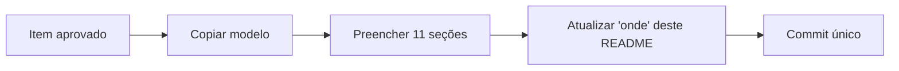

# docs/verificacoes

## Cabeçalho

| Campo | Valor |
|---|---|
| Id | DIR-docs-verificacoes |
| Título | `verificacoes` |
| Tipo | documentação · registros de correção e decisão |
| Data | 2026-11-16 |
| Usuário responsável | TokumoH |
| Status | ativo |
| Commits | commit que introduz este arquivo — `git log --format=%h -- docs/verificacoes/README.md` |
| Arquivos | `README.md`, `_modelo-registro-de-correcao.md`, `2026-11-16-001-core-e-estrutura-docs.md`, `2026-11-16-002-autorizacao-git-e-branch-trabalho.md`, `2026-11-16-003-devsecops-checagens-e-ci.md`, `2026-11-16-004-readme-raiz.md`, `2026-11-16-005-desenho-recomeco.md`, `2026-11-16-006-desenho-verificado.md`, `2026-11-17-007-plano-e0.md`, `2026-11-17-008-e0-limpeza-e-esqueleto.md`, `2026-11-17-009-e0-supabase-cliente.md`, `2026-11-22-010-e0-banco.md`, `2026-11-22-011-e0-checagens-banco.md`, `2026-11-18-012-audit-excecao-com-prazo.md`, `2026-11-22-013-commits-locais-pelo-agente.md`, `2026-11-26-014-plano-e1.md`, `2026-11-26-015-e1-dominio-acesso.md`, `2026-11-26-016-e1-banco-membros.md`, `2026-11-26-017-e1-adaptadores-acesso.md`, `2026-11-26-018-e1-entrada-e-guarda.md`, `2026-11-26-019-e1-painel-e-membros.md`, `2026-11-26-020-e1-conferencia-e-guia.md`, `2026-11-26-021-tempo-limite-supabase.md`, `2026-11-26-022-remove-excecao-picomatch.md`, `2026-11-26-023-plano-e2.md`, `2026-11-26-024-e2-dominio-preparacao.md`, `2026-11-26-025-e2-simulacao-storage-e-checagens.md`, `2026-11-26-026-e2-banco-biblioteca.md`, `2026-11-26-027-e2-adaptadores-preparacao.md`, `2026-11-26-028-e2-aba-biblioteca.md`, `2026-11-27-029-e2-cenas-e-gestos.md`, `2026-11-27-030-e2-episodios-e-avisos.md`, `2026-11-27-031-e2-conferencia-e-guia.md`, `2026-11-27-032-jwt-expirado-sessao-expirada.md`, `2026-11-27-033-membros-foco-no-mesmo-commit.md`, `2026-11-27-034-plano-e3.md` |

## Propósito

Guarda um registro por commit (cada um de um item aprovado: sugestão ou tarefa de plano): o que estava errado, se era proposital, a solução, onde mudou, como foi verificado (duas verificações seguidas sem erro) e os riscos. É a rastreabilidade versionada exigida pelo [CORE](../../CLAUDE.md#commit).

## Origem

Criado em 2026-11-16 a partir da regra do CORE "todo commit leva documento em `docs/verificacoes/`", aprovada pelo usuário como S2 ("aprovado S1 e S2 como documentação"). Registro de origem: [VER-001](2026-11-16-001-core-e-estrutura-docs.md).

## Organização

- `_modelo-registro-de-correcao.md` — modelo com as 11 seções do formato de documentação. O prefixo `_` o mantém no topo da listagem e o separa dos registros.
- Registros: `AAAA-MM-DD-NNN-slug.md`
  - `AAAA-MM-DD` — data do commit;
  - `NNN` — sequência global de 3 dígitos (001, 002, …), que vira o Id `VER-NNN`;
  - `slug` — resumo em minúsculas com hífens.
- Sem subdiretórios.

## Por que esta organização

- A data no nome ordena cronologicamente; a sequência garante Id único mesmo com vários registros no mesmo dia.
- Um arquivo plano por registro facilita `grep`, links relativos estáveis e revisão em PR.
- Um único modelo evita divergência de formato entre registros.

## Por que não outras organizações

| Opção | Motivo de descarte |
|---|---|
| Só sequência (`001-slug.md`) | Perde a data no nome |
| Subpasta por ano/mês | Volume atual não justifica; exigiria README por subpasta |
| Um arquivo único (changelog) com todos os registros | Conflitos de merge e arquivo crescendo sem limite; links por registro ficam instáveis |
| Registro na mensagem do commit | Não comporta tabelas, diagramas e verificação; difícil de consultar |

## Onde

| Arquivo ou subdiretório | O que contém |
|---|---|
| [`README.md`](README.md) | Este arquivo |
| [`_modelo-registro-de-correcao.md`](_modelo-registro-de-correcao.md) | Modelo de registro (copiar para criar um novo) |
| [`2026-11-16-001-core-e-estrutura-docs.md`](2026-11-16-001-core-e-estrutura-docs.md) | VER-001 — criação do `CLAUDE.md` (CORE) e da estrutura `docs/` |
| [`2026-11-16-002-autorizacao-git-e-branch-trabalho.md`](2026-11-16-002-autorizacao-git-e-branch-trabalho.md) | VER-002 — incidente de commit/push sem autorização, troca para `branchTrabalho` e regra "Branch e Git" no `CLAUDE.md` |
| [`2026-11-16-003-devsecops-checagens-e-ci.md`](2026-11-16-003-devsecops-checagens-e-ci.md) | VER-003 — checagens DevSecOps (`scripts/`), hook pre-push e CI econômica |
| [`2026-11-16-004-readme-raiz.md`](2026-11-16-004-readme-raiz.md) | VER-004 — README da raiz (descrição e projeção) e exceções de README (`.github/`, raiz) |
| [`2026-11-16-005-desenho-recomeco.md`](2026-11-16-005-desenho-recomeco.md) | VER-005 — desenho do recomeço (DES-001) e pasta `docs/desenho/` |
| [`2026-11-16-006-desenho-verificado.md`](2026-11-16-006-desenho-verificado.md) | VER-006 — DES-001 corrigido até duas verificações limpas seguidas |
| [`2026-11-17-007-plano-e0.md`](2026-11-17-007-plano-e0.md) | VER-007 — plano de implementação da etapa E0 (PLA-001) e pasta `docs/planos/` |
| [`2026-11-17-008-e0-limpeza-e-esqueleto.md`](2026-11-17-008-e0-limpeza-e-esqueleto.md) | VER-008 — E0, Tarefa 1: limpeza do protótipo, esqueleto React com rotas, telas provisórias, identidade visual e testes no `check` |
| [`2026-11-17-009-e0-supabase-cliente.md`](2026-11-17-009-e0-supabase-cliente.md) | VER-009 — E0, Tarefa 2: configuração (variáveis de ambiente validadas) e cliente Supabase por tipo de sessão |
| [`2026-11-22-010-e0-banco.md`](2026-11-22-010-e0-banco.md) | VER-010 — E0, Tarefa 3: migração inicial do banco (12 tabelas, RLS com 33 políticas, privilégios de tabela explícitos) testada em PGlite com simulação do Supabase; decisões 1 e 2 aplicadas ao DES-001 |
| [`2026-11-22-011-e0-checagens-banco.md`](2026-11-22-011-e0-checagens-banco.md) | VER-011 — E0, Tarefa 4: checagens de banco `rpc:grants-check` e `data-api:check` no `npm run check`, aplicando as migrações num PGlite com a simulação do Supabase e lendo o catálogo |
| [`2026-11-18-012-audit-excecao-com-prazo.md`](2026-11-18-012-audit-excecao-com-prazo.md) | VER-012 — `check-deps-audit` com exceções explícitas e com prazo (aviso do `picomatch` sem correção); VER-010 e VER-011 reservados às Tarefas 3 e 4 da E0 |
| [`2026-11-22-013-commits-locais-pelo-agente.md`](2026-11-22-013-commits-locais-pelo-agente.md) | VER-013 — commits locais pelo agente principal, só de versões limpas; push continua com o usuário |
| [`2026-11-26-014-plano-e1.md`](2026-11-26-014-plano-e1.md) | VER-014 — plano de implementação da etapa E1 (PLA-002): entrada com Google, guarda por papel e aba Membros; autonomia concedida pelo responsável |
| [`2026-11-26-015-e1-dominio-acesso.md`](2026-11-26-015-e1-dominio-acesso.md) | VER-015 — E1, Tarefa 1: domínio Acesso (`src/domains/acesso/`), regras puras, portas, `resolverAcesso` e teste de arquitetura dos domínios; abre com as pendências da E0 |
| [`2026-11-26-016-e1-banco-membros.md`](2026-11-26-016-e1-banco-membros.md) | VER-016 — E1, Tarefa 2: migração `membros_sem_autoalteracao` (nenhum `admin` altera nem remove a própria linha, decisão D1), testes de banco aplicando todas as migrações em ordem, bloco E1 em `rls.test.ts` e exceção da própria linha na matriz |
| [`2026-11-26-017-e1-adaptadores-acesso.md`](2026-11-26-017-e1-adaptadores-acesso.md) | VER-017 — E1, Tarefa 3: adaptadores Supabase das portas do domínio Acesso (`src/shared/infra/acessoSupabase.ts`: sessão, login Google, saída local, eventos de sessão adiados, papel, lista de acesso e tradução de erros) e composição dos serviços de membro (`src/app/servicos.ts`, cliente único por página) |
| [`2026-11-26-018-e1-entrada-e-guarda.md`](2026-11-26-018-e1-entrada-e-guarda.md) | VER-018 — E1, Tarefa 4: entrada com Google, guarda por papel de `/painel` e `/controle` e telas de erro (configuração, erro inesperado, fora da lista, sem acesso, falha); estado de tela com avaliações serializadas (`useAcesso`) e prova de que as rotas de dispositivo não criam o cliente de membro |
| [`2026-11-26-019-e1-painel-e-membros.md`](2026-11-26-019-e1-painel-e-membros.md) | VER-019 — E1, Tarefa 5: painel com as abas do DES-001 §9 por estado (D8), componente `Abas` acessível e a aba Membros (só `admin`): incluir, trocar o papel e remover e-mails da lista de acesso, com as regras do domínio antes de cada escrita, a própria linha sem controles (D1) e reavaliação quando a escrita volta negada |
| [`2026-11-26-020-e1-conferencia-e-guia.md`](2026-11-26-020-e1-conferencia-e-guia.md) | VER-020 — E1, Tarefa 6: conferência no navegador dos dois builds (sem variáveis e com variáveis de mentira, Supabase interceptado; claro e escuro; 320, 390 e 1280 px), guia "Login Google (E1)" em `supabase/README.md` para o responsável (banco, Google Cloud, Supabase Auth sem curinga de host nas Redirect URLs, Vercel e conferência real) e a fila pendurada observada, sem tempo-limite, como decisão pendente |
| [`2026-11-26-021-tempo-limite-supabase.md`](2026-11-26-021-tempo-limite-supabase.md) | VER-021 — tempo-limite de 15 s no `fetch` do cliente Supabase, só para `/rest/v1/` e `/auth/v1/` (Storage fora): uma chamada sem resposta vira erro de rede e a tela de falha com "Tentar de novo"; resolve a fila pendurada do VER-020 |
| [`2026-11-26-022-remove-excecao-picomatch.md`](2026-11-26-022-remove-excecao-picomatch.md) | VER-022 — remoção da exceção `GHSA-fc5q-39xc-vjpf` (`picomatch`) de `EXCECOES` do `check-deps-audit`: o aviso não existe mais no registro do npm; 023 reservado ao próximo registro |
| [`2026-11-26-023-plano-e2.md`](2026-11-26-023-plano-e2.md) | VER-023 — plano de implementação da etapa E2 (PLA-003): domínio Preparação, Biblioteca com o bucket privado `midias`, cenas, gestos, episódios e avisos |
| [`2026-11-26-024-e2-dominio-preparacao.md`](2026-11-26-024-e2-dominio-preparacao.md) | VER-024 — E2, Tarefa 1: domínio Preparação (`src/domains/preparacao/`): tipos aceitos pelos primeiros bytes, limites de 50 MB e 1 GB, caminho no Storage sem o nome do arquivo, cenas, mapa de gestos, episódios e avisos, mídia em uso, portas e o serviço da Biblioteca (envio e exclusão na ordem da D6, com compensação); abre com as pendências da E1 |
| [`2026-11-26-025-e2-simulacao-storage-e-checagens.md`](2026-11-26-025-e2-simulacao-storage-e-checagens.md) | VER-025 — E2, Tarefa 2: simulação do Storage do Supabase (schema `storage`, dono simulado pela participação em `supabase_storage_admin`, gatilho `protect_objects_delete`) e checagens de banco para `storage.*` (nenhuma mudança além de política em `storage.objects`; bucket como conjunção de topo; só select/insert/delete; função de papel por análise; dados do bucket) |
| [`2026-11-26-026-e2-banco-biblioteca.md`](2026-11-26-026-e2-banco-biblioteca.md) | VER-026 — E2, Tarefa 3: migração `biblioteca_storage` (bucket privado `midias` com 50 MB e os 8 tipos da D4; políticas de `storage.objects` para leitura, envio no formato `som\|imagem/<uuid>.<ext>` e exclusão, sem `update`) e o bloco `E2 — Biblioteca e preparação` dos testes de banco |
| [`2026-11-26-027-e2-adaptadores-preparacao.md`](2026-11-26-027-e2-adaptadores-preparacao.md) | VER-027 — E2, Tarefa 4: adaptadores Supabase da Preparação (`errosSupabase.ts` com `classificarErro` e `exigirLinhas`, usado também pela E1 sem mudar o comportamento; repositórios de mídias, sons, cenas, episódios e avisos, e gestos; envio ao Storage por `XMLHttpRequest` com progresso, cancelamento e corte por 30 s de inatividade; prévia e remoção) e composição da Preparação sobre o mesmo cliente de membro (`obterServicosDePreparacao`, `obterPreparacao`) |
| [`2026-11-26-028-e2-aba-biblioteca.md`](2026-11-26-028-e2-aba-biblioteca.md) | VER-028 — E2, Tarefa 5: aba Biblioteca no `/painel` (uso do limite de 1 GB com aviso a 80 %, envio de sons e imagens numa fila com progresso e cancelamento, sons com rótulo, emoji e volume, prévia por URL assinada só ao pedir, exclusão com confirmação que diz os usos), `BarraDeProgresso` e os falsos com estado da Preparação (`criarFalsosDePreparacao`, `arquivoDeTeste`) |
| [`2026-11-27-029-e2-cenas-e-gestos.md`](2026-11-27-029-e2-cenas-e-gestos.md) | VER-029 — E2, Tarefa 6: abas Cenas (incluir com o nome exato do OBS, editar, subir e descer com a renumeração do empate, exclusão bloqueada para cena em gesto) e Gestos (mapa global dos 7 gestos, só `update`, linha normalizada e conferida antes de gravar, opções desabilitadas sem sons ou cenas, sugestão de ligar 👍/👎 a "aplauso"/"buuu") no `/painel` |
| [`2026-11-27-030-e2-episodios-e-avisos.md`](2026-11-27-030-e2-episodios-e-avisos.md) | VER-030 — E2, Tarefa 7: aba Episódios no `/painel` (lista com o estado, criar e editar só título e data, excluir só rascunho; avisos com texto literal, link `https://` validado antes de virar âncora, imagem da Biblioteca ou "Sem imagem", duração e ordem com a renumeração do empate); iniciar e encerrar o ao vivo ficam para a E3 (D2) |
| [`2026-11-27-031-e2-conferencia-e-guia.md`](2026-11-27-031-e2-conferencia-e-guia.md) | VER-031 — E2, Tarefa 8: conferência no navegador de toda a E2 (Biblioteca, Cenas, Gestos, Episódios e avisos com `equipe`, `admin` e `apresentadora`, claro e escuro, 320/390/1280 px, corte de 30 s do envio; 300/300 com 6 sabotagens do script) e guia "Biblioteca no Storage (E2)" em `supabase/README.md` (migração, consultas de conferência, D3–D5, conferência real e o que só o projeto real confirma); passo do responsável pendente |
| [`2026-11-27-032-jwt-expirado-sessao-expirada.md`](2026-11-27-032-jwt-expirado-sessao-expirada.md) | VER-032 — JWT expirado recusado pelo Storage (`InvalidJWT` no corpo, com `statusCode` "400" ou "403") passa a virar `sessao_expirada` no envio, na remoção e na prévia, com prioridade sobre o `statusCode`; a `message` nunca decide (resolve o risco do VER-027 e do VER-031) |
| [`2026-11-27-033-membros-foco-no-mesmo-commit.md`](2026-11-27-033-membros-foco-no-mesmo-commit.md) | VER-033 — foco da aba Membros aplicado com `useLayoutEffect` (no mesmo commit que mostra o aviso), como na aba Biblioteca (VER-028), com teste determinístico por `MutationObserver` |
| [`2026-11-27-034-plano-e3.md`](2026-11-27-034-plano-e3.md) | VER-034 — plano de implementação da etapa E3 (PLA-004): pareamento de dispositivos, `/obs/palco`, `/controle` por toque, modo teste, iniciar e encerrar o ao vivo |

## Lógica

1. Item aprovado pelo usuário: sugestão (como documentação ou implementação) ou tarefa de plano.
2. Copiar `_modelo-registro-de-correcao.md` para `AAAA-MM-DD-NNN-slug.md` com o próximo `NNN`.
3. Preencher as 11 seções; os links da seção "onde" apontam para o código com âncora de linha.
4. Acrescentar a linha do novo registro na tabela "onde" deste README.
5. Commit único com: mudança (se houver) + registro + este README atualizado — feito pelo agente principal só quando a versão está limpa (ver [Commit](../../CLAUDE.md#commit)); o push exige autorização do usuário (ver [Branch e Git](../../CLAUDE.md#branch-e-git)).



## Exemplo

Próximo registro (exemplo hipotético de 2026-11-30):

```bash
cp docs/verificacoes/_modelo-registro-de-correcao.md docs/verificacoes/2026-11-30-045-exemplo.md
```

Para consultar: `ls docs/verificacoes` (ordem cronológica) ou `grep -l "Status de implementação | implementado" docs/verificacoes/*.md`.

## Verificação

- Links relativos deste arquivo resolvidos por script (`npm run check-docs`, desde o VER-003): 0 erros.
- Todo arquivo da pasta listado em "onde" e nenhum item listado inexistente (`npm run check-docs`).
- Sem subdiretórios, então não há README de subdiretório a conferir.

## Riscos

- A sequência `NNN` é manual; dois branches paralelos podem usar o mesmo número — conferir no merge.
- Desde o VER-003, `check-registro` (hook pre-push e CI) exige registro em todo commit, e `check-docs` confere padrão de nome e `NNN` único. O hook pode ser pulado com `--no-verify`; a CI do PR cobre essa brecha.
