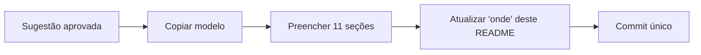

# docs/verificacoes

## Cabeçalho

| Campo | Valor |
|---|---|
| Id | DIR-docs-verificacoes |
| Título | `verificacoes` |
| Tipo | documentação · registros de correção e decisão |
| Data | 2026-11-16 |
| Usuário responsável | TokumoH |
| Status | ativo |
| Commits | commit que introduz este arquivo — `git log --format=%h -- docs/verificacoes/README.md` |
| Arquivos | `README.md`, `_modelo-registro-de-correcao.md`, `2026-11-16-001-core-e-estrutura-docs.md` |

## Propósito

Guarda um registro por commit aprovado: o que estava errado, se era proposital, a solução, onde mudou, como foi verificado (duas verificações seguidas sem erro) e os riscos. É a rastreabilidade versionada exigida pelo [CORE](../../CLAUDE.md#commit).

## Origem

Criado em 2026-11-16 a partir da regra do CORE "todo commit leva documento em `docs/verificacoes/`", aprovada pelo usuário como S2 ("aprovado S1 e S2 como documentação"). Registro de origem: [VER-001](2026-11-16-001-core-e-estrutura-docs.md).

## Organização

- `_modelo-registro-de-correcao.md` — modelo com as 11 seções do formato de documentação. O prefixo `_` o mantém no topo da listagem e o separa dos registros.
- Registros: `AAAA-MM-DD-NNN-slug.md`
  - `AAAA-MM-DD` — data do commit;
  - `NNN` — sequência global de 3 dígitos (001, 002, …), que vira o Id `VER-NNN`;
  - `slug` — resumo em minúsculas com hífens.
- Sem subdiretórios.

## Por que esta organização

- A data no nome ordena cronologicamente; a sequência garante Id único mesmo com vários registros no mesmo dia.
- Um arquivo plano por registro facilita `grep`, links relativos estáveis e revisão em PR.
- Um único modelo evita divergência de formato entre registros.

## Por que não outras organizações

| Opção | Motivo de descarte |
|---|---|
| Só sequência (`001-slug.md`) | Perde a data no nome |
| Subpasta por ano/mês | Volume atual não justifica; exigiria README por subpasta |
| Um arquivo único (changelog) com todos os registros | Conflitos de merge e arquivo crescendo sem limite; links por registro ficam instáveis |
| Registro na mensagem do commit | Não comporta tabelas, diagramas e verificação; difícil de consultar |

## Onde

| Arquivo ou subdiretório | O que contém |
|---|---|
| [`README.md`](README.md) | Este arquivo |
| [`_modelo-registro-de-correcao.md`](_modelo-registro-de-correcao.md) | Modelo de registro (copiar para criar um novo) |
| [`2026-11-16-001-core-e-estrutura-docs.md`](2026-11-16-001-core-e-estrutura-docs.md) | VER-001 — criação do `CLAUDE.md` (CORE) e da estrutura `docs/` |

## Lógica

1. Sugestão aprovada pelo usuário (como documentação ou implementação).
2. Copiar `_modelo-registro-de-correcao.md` para `AAAA-MM-DD-NNN-slug.md` com o próximo `NNN`.
3. Preencher as 11 seções; os links da seção "onde" apontam para o código com âncora de linha.
4. Acrescentar a linha do novo registro na tabela "onde" deste README.
5. Commit único com: mudança (se houver) + registro + este README atualizado.



## Exemplo

Próximo registro, se o S3 for aprovado em 2026-11-17:

```bash
cp docs/verificacoes/_modelo-registro-de-correcao.md docs/verificacoes/2026-11-17-002-devsecops-pre-push.md
```

Para consultar: `ls docs/verificacoes` (ordem cronológica) ou `grep -l "Status de implementação | implementado" docs/verificacoes/*.md`.

## Verificação

- Links relativos deste arquivo resolvidos por script (VER-001, V1): 0 quebrados.
- Todo arquivo da pasta listado em "onde" e nenhum item listado inexistente (VER-001, V2).
- Sem subdiretórios, então não há README de subdiretório a conferir.

## Riscos

- A sequência `NNN` é manual; dois branches paralelos podem usar o mesmo número — conferir no merge.
- Nenhuma checagem automática garante ainda que todo commit traga registro (pendência S3).
