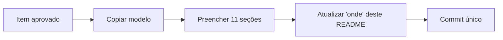

# docs/verificacoes

## Cabeçalho

| Campo | Valor |
|---|---|
| Id | DIR-docs-verificacoes |
| Título | `verificacoes` |
| Tipo | documentação · registros de correção e decisão |
| Data | 2026-11-16 |
| Usuário responsável | TokumoH |
| Status | ativo |
| Commits | commit que introduz este arquivo — `git log --format=%h -- docs/verificacoes/README.md` |
| Arquivos | `README.md`, `_modelo-registro-de-correcao.md`, `2026-11-16-001-core-e-estrutura-docs.md`, `2026-11-16-002-autorizacao-git-e-branch-trabalho.md`, `2026-11-16-003-devsecops-checagens-e-ci.md`, `2026-11-16-004-readme-raiz.md`, `2026-11-16-005-desenho-recomeco.md`, `2026-11-16-006-desenho-verificado.md`, `2026-11-17-007-plano-e0.md`, `2026-11-17-008-e0-limpeza-e-esqueleto.md`, `2026-11-17-009-e0-supabase-cliente.md`, `2026-11-22-010-e0-banco.md`, `2026-11-22-011-e0-checagens-banco.md`, `2026-11-18-012-audit-excecao-com-prazo.md`, `2026-11-22-013-commits-locais-pelo-agente.md` |

## Propósito

Guarda um registro por commit (cada um de um item aprovado: sugestão ou tarefa de plano): o que estava errado, se era proposital, a solução, onde mudou, como foi verificado (duas verificações seguidas sem erro) e os riscos. É a rastreabilidade versionada exigida pelo [CORE](../../CLAUDE.md#commit).

## Origem

Criado em 2026-11-16 a partir da regra do CORE "todo commit leva documento em `docs/verificacoes/`", aprovada pelo usuário como S2 ("aprovado S1 e S2 como documentação"). Registro de origem: [VER-001](2026-11-16-001-core-e-estrutura-docs.md).

## Organização

- `_modelo-registro-de-correcao.md` — modelo com as 11 seções do formato de documentação. O prefixo `_` o mantém no topo da listagem e o separa dos registros.
- Registros: `AAAA-MM-DD-NNN-slug.md`
  - `AAAA-MM-DD` — data do commit;
  - `NNN` — sequência global de 3 dígitos (001, 002, …), que vira o Id `VER-NNN`;
  - `slug` — resumo em minúsculas com hífens.
- Sem subdiretórios.

## Por que esta organização

- A data no nome ordena cronologicamente; a sequência garante Id único mesmo com vários registros no mesmo dia.
- Um arquivo plano por registro facilita `grep`, links relativos estáveis e revisão em PR.
- Um único modelo evita divergência de formato entre registros.

## Por que não outras organizações

| Opção | Motivo de descarte |
|---|---|
| Só sequência (`001-slug.md`) | Perde a data no nome |
| Subpasta por ano/mês | Volume atual não justifica; exigiria README por subpasta |
| Um arquivo único (changelog) com todos os registros | Conflitos de merge e arquivo crescendo sem limite; links por registro ficam instáveis |
| Registro na mensagem do commit | Não comporta tabelas, diagramas e verificação; difícil de consultar |

## Onde

| Arquivo ou subdiretório | O que contém |
|---|---|
| [`README.md`](README.md) | Este arquivo |
| [`_modelo-registro-de-correcao.md`](_modelo-registro-de-correcao.md) | Modelo de registro (copiar para criar um novo) |
| [`2026-11-16-001-core-e-estrutura-docs.md`](2026-11-16-001-core-e-estrutura-docs.md) | VER-001 — criação do `CLAUDE.md` (CORE) e da estrutura `docs/` |
| [`2026-11-16-002-autorizacao-git-e-branch-trabalho.md`](2026-11-16-002-autorizacao-git-e-branch-trabalho.md) | VER-002 — incidente de commit/push sem autorização, troca para `branchTrabalho` e regra "Branch e Git" no `CLAUDE.md` |
| [`2026-11-16-003-devsecops-checagens-e-ci.md`](2026-11-16-003-devsecops-checagens-e-ci.md) | VER-003 — checagens DevSecOps (`scripts/`), hook pre-push e CI econômica |
| [`2026-11-16-004-readme-raiz.md`](2026-11-16-004-readme-raiz.md) | VER-004 — README da raiz (descrição e projeção) e exceções de README (`.github/`, raiz) |
| [`2026-11-16-005-desenho-recomeco.md`](2026-11-16-005-desenho-recomeco.md) | VER-005 — desenho do recomeço (DES-001) e pasta `docs/desenho/` |
| [`2026-11-16-006-desenho-verificado.md`](2026-11-16-006-desenho-verificado.md) | VER-006 — DES-001 corrigido até duas verificações limpas seguidas |
| [`2026-11-17-007-plano-e0.md`](2026-11-17-007-plano-e0.md) | VER-007 — plano de implementação da etapa E0 (PLA-001) e pasta `docs/planos/` |
| [`2026-11-17-008-e0-limpeza-e-esqueleto.md`](2026-11-17-008-e0-limpeza-e-esqueleto.md) | VER-008 — E0, Tarefa 1: limpeza do protótipo, esqueleto React com rotas, telas provisórias, identidade visual e testes no `check` |
| [`2026-11-17-009-e0-supabase-cliente.md`](2026-11-17-009-e0-supabase-cliente.md) | VER-009 — E0, Tarefa 2: configuração (variáveis de ambiente validadas) e cliente Supabase por tipo de sessão |
| [`2026-11-22-010-e0-banco.md`](2026-11-22-010-e0-banco.md) | VER-010 — E0, Tarefa 3: migração inicial do banco (12 tabelas, RLS com 33 políticas, privilégios de tabela explícitos) testada em PGlite com simulação do Supabase; decisões 1 e 2 aplicadas ao DES-001 |
| [`2026-11-22-011-e0-checagens-banco.md`](2026-11-22-011-e0-checagens-banco.md) | VER-011 — E0, Tarefa 4: checagens de banco `rpc:grants-check` e `data-api:check` no `npm run check`, aplicando as migrações num PGlite com a simulação do Supabase e lendo o catálogo |
| [`2026-11-18-012-audit-excecao-com-prazo.md`](2026-11-18-012-audit-excecao-com-prazo.md) | VER-012 — `check-deps-audit` com exceções explícitas e com prazo (aviso do `picomatch` sem correção); VER-010 e VER-011 reservados às Tarefas 3 e 4 da E0 |
| [`2026-11-22-013-commits-locais-pelo-agente.md`](2026-11-22-013-commits-locais-pelo-agente.md) | VER-013 — commits locais pelo agente principal, só de versões limpas; push continua com o usuário |

## Lógica

1. Item aprovado pelo usuário: sugestão (como documentação ou implementação) ou tarefa de plano.
2. Copiar `_modelo-registro-de-correcao.md` para `AAAA-MM-DD-NNN-slug.md` com o próximo `NNN`.
3. Preencher as 11 seções; os links da seção "onde" apontam para o código com âncora de linha.
4. Acrescentar a linha do novo registro na tabela "onde" deste README.
5. Commit único com: mudança (se houver) + registro + este README atualizado — feito pelo agente principal só quando a versão está limpa (ver [Commit](../../CLAUDE.md#commit)); o push exige autorização do usuário (ver [Branch e Git](../../CLAUDE.md#branch-e-git)).



## Exemplo

Próximo registro (exemplo hipotético de 2026-11-23):

```bash
cp docs/verificacoes/_modelo-registro-de-correcao.md docs/verificacoes/2026-11-23-014-exemplo.md
```

Para consultar: `ls docs/verificacoes` (ordem cronológica) ou `grep -l "Status de implementação | implementado" docs/verificacoes/*.md`.

## Verificação

- Links relativos deste arquivo resolvidos por script (`npm run check-docs`, desde o VER-003): 0 erros.
- Todo arquivo da pasta listado em "onde" e nenhum item listado inexistente (`npm run check-docs`).
- Sem subdiretórios, então não há README de subdiretório a conferir.

## Riscos

- A sequência `NNN` é manual; dois branches paralelos podem usar o mesmo número — conferir no merge.
- Desde o VER-003, `check-registro` (hook pre-push e CI) exige registro em todo commit, e `check-docs` confere padrão de nome e `NNN` único. O hook pode ser pulado com `--no-verify`; a CI do PR cobre essa brecha.
