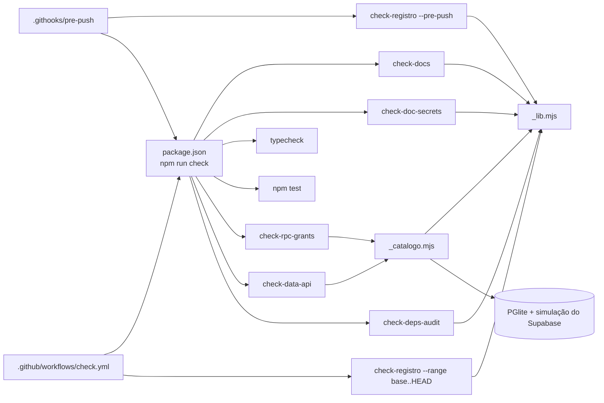

# scripts

## Cabeçalho

| Campo | Valor |
|---|---|
| Id | DIR-scripts |
| Título | `scripts` |
| Tipo | ferramentas de checagem (DevSecOps) |
| Data | 2026-11-16 |
| Usuário responsável | TokumoH |
| Status | ativo |
| Commits | commit que introduz este arquivo — `git log --format=%h -- scripts/README.md` |
| Arquivos | `README.md`, `_lib.mjs`, `_catalogo.mjs`, `check-docs.mjs`, `check-doc-secrets.mjs`, `check-registro.mjs`, `check-deps-audit.mjs`, `check-rpc-grants.mjs`, `check-data-api.mjs`, `install-hooks.mjs`, `tests/` |

## Propósito
Checagens automáticas que transformam as regras do [CORE](../CLAUDE.md) em verificações executáveis: documentação coerente, nenhum segredo versionado, dependências sem vulnerabilidade alta ou crítica (fora das exceções com prazo), registro em `docs/verificacoes/` para todo commit e, no banco, funções e tabelas conforme o DES-001 (seções 8 e 13). São chamadas pelos scripts do `package.json`, pelo hook [`.githooks/pre-push`](../.githooks/README.md) e pela CI ([`.github/workflows/check.yml`](../.github/workflows/README.md)).

## Origem
Sugestão S3 ("DevSecOps do zero"), aprovada pelo usuário como implementação, com CI e atenção ao consumo de minutos do GitHub. Registro: [VER-003](../docs/verificacoes/2026-11-16-003-devsecops-checagens-e-ci.md). Os scripts substituem as verificações temporárias (V1/V2) usadas no VER-001 e no VER-002. `check-rpc-grants.mjs` e `check-data-api.mjs` nasceram na Tarefa 4 da E0 ([PLA-001](../docs/planos/2026-11-17-e0-fundacao.md)), que também ampliou `tests/` (criado no VER-012). Na mesma tarefa, depois de 11 revisões em que a leitura do SQL por expressões regulares (o antigo `_sql.mjs`) continuou divergindo do Postgres, o responsável decidiu trocá-la pela leitura do catálogo real: nasceu `_catalogo.mjs` e `_sql.mjs` foi removido.

## Organização
- `_lib.mjs` e `_catalogo.mjs`: utilitários compartilhados (`_lib.mjs`: Git sem shell, lista de arquivos e diretórios rastreados, relatório de erros; `_catalogo.mjs`: aplica as migrações num PGlite com a simulação do Supabase, como o dono das migrações (`postgres_sim`, sem superusuário), devolve o que elas criaram, alteraram ou removeram no catálogo, e faz a leitura das migrações e a linha de comando das checagens de banco). O prefixo `_` indica que é biblioteca, não comando.
- `check-*.mjs`: uma regra por arquivo. Cada um encerra com código 0 (ok) ou 1 (erro), e o 2 é reservado para uso incorreto. As duas checagens de banco aplicam `supabase/migrations/*.sql` em ordem de nome (ou o diretório dado como argumento), cada arquivo como uma sessão nova do dono `postgres_sim` com o fim simulado (o que o commit dispararia e a recusa do estado de sessão que mudaria a migração seguinte), e dão erro se não houver migração, se um `.sql` do diretório não for arquivo ou tiver nome fora do padrão da Supabase CLI (`<dígitos>_nome.sql`), se uma migração começar com BOM UTF-8, trocar o usuário da sessão ou falhar no Postgres (a mensagem traz o arquivo e a linha); seus testes ficam em `tests/`.
- `install-hooks.mjs`: ativa os hooks versionados (chamado pelo `prepare` do npm).
- Os scripts usam só Node.js, sem dependências externas, exceto as duas checagens de banco, que usam o PGlite (`@electric-sql/pglite`, já nas devDependencies para os testes de banco da Tarefa 3); os testes de `tests/` rodam no Vitest do projeto (`npm test`).

## Por que esta organização
- **GRASP Pure Fabrication:** o acesso ao Git, a lista de arquivos rastreados e o relatório de erros ficam em `_lib.mjs`; a aplicação das migrações no PGlite, a leitura do catálogo, a leitura dos arquivos de migração e a linha de comando das duas checagens de banco ficam em `_catalogo.mjs`; as regras ficam nos `check-*`, e as outras checagens acessam diretamente o que precisam. É reuso sem acoplamento entre as checagens: nenhuma importa a outra. As checagens de banco leem o resultado no catálogo do próprio Postgres, e não o texto SQL: a leitura por expressões regulares foi descartada porque cada forma válida que ela não previa (comentário terminado por `\r`, tag `$é$`, nome `U&"..."`, `do $$ execute $$`, `grant ... on all tables`, `alter default privileges`, `create rule`...) virava um falso negativo de segurança.
- **Componentes:** cada checagem roda sozinha (`npm run check-docs`) ou em conjunto (`npm run check`). O hook e a CI reutilizam os mesmos componentes.
- Node em vez de bash funciona igual em Windows, Linux e macOS.

## Por que não outras organizações

| Opção | Motivo de descarte |
|---|---|
| Scripts em bash | Não rodam no Windows sem Git Bash ou WSL |
| Uma única checagem monolítica | Não dá para rodar uma regra isolada; um erro mascara os outros |
| Ferramentas externas (husky, gitleaks, markdown-link-check) | Dependências e binários a mais (cadeia de suprimentos) para um volume pequeno |
| Subpasta `scripts/lib/` | Dois arquivos de biblioteca (`_lib.mjs`, `_catalogo.mjs`) não justificam um diretório com README próprio |

## Onde

| Arquivo ou subdiretório | O que contém |
|---|---|
| [`README.md`](README.md) | Este arquivo |
| [`_lib.mjs`](_lib.mjs) | Utilitários compartilhados: `git()`, `trackedFiles()`, `trackedDirs()`, `reporter()` |
| [`_catalogo.mjs`](_catalogo.mjs) | `analisarMigracoes()` (aplica as migrações, em ordem, sobre um PGlite com a simulação do Supabase e o dono das migrações (`supabase/tests/dono-migracao.sql`), cada uma como esse dono (`postgres_sim`, sem superusuário) e na sua própria transação: com duas ou mais, cada uma com o seu commit real, numa instância descartável restaurada da base (correção 18); com uma só, numa transação desfeita depois da leitura, com o commit simulado (e refeita com o commit real se sobrar objeto temporário); no fim de cada uma, o fim da sessão é simulado, e devolve o erro do Postgres (com o arquivo e a linha) ou o que mudou no catálogo contra o retrato tirado depois da simulação e do dono: funções, relações com privilégios e políticas, schemas, papéis, participações em papel, privilégios padrão e outros objetos do catálogo), `lerMigracoes()`, `ordenarMigracoes()`, `executadoDiretamente()` e `executar()` (a linha de comando); importa `_lib.mjs` |
| [`check-data-api.mjs`](check-data-api.mjs) | `verificarDataApi()` e `regrasDeTabela()`, sobre o catálogo depois das migrações: toda tabela (inclusive partição) com RLS ativa e ao menos uma política; tabela só-funções (`codigos_pareamento`) sem política e sem privilégio algum de `anon` e `authenticated` (efetivo, inclusive por coluna, por `PUBLIC` ou por herança); e acusa quando nenhuma tabela é criada. Além do DES-001 (Tarefa 4 da E0): objeto fora de `public` ou com dono diferente do papel das migrações (`postgres_sim`); view sem `security_invoker = true`; materialized view e foreign table (forma não suportada); gatilho `INSTEAD OF` em view (forma não suportada); política para qualquer papel além de `authenticated`; política `to authenticated` sem o `grant` da operação a `authenticated`, e `grant` de tabela a `authenticated` (`SELECT`, `INSERT`, `UPDATE`, `DELETE`, de tabela ou de coluna) sem política `to authenticated` que use a operação (correção 16); qualquer privilégio de `anon` ou de `service_role` (efetivo, inclusive por `PUBLIC` ou por herança, e o de coluna; `service_role` desde a correção 17c) em tabela, view ou sequência; e, desde a correção 18, qualquer privilégio (de tabela, view, sequência ou coluna, e no estado final dos privilégios padrão) para qualquer outro papel além de `authenticated` e do dono, como papel novo com `LOGIN` ou `supabase_auth_admin` (o herdado vem de um `grant` a outro papel, também acusado); privilégio de `PUBLIC`, de coluna para `anon` ou `service_role`, ou com grant option; `TRUNCATE`, `REFERENCES`, `TRIGGER` ou `MAINTAIN` para `authenticated` em tabela ou view (também por coluna; `MAINTAIN` desde a correção 16b); qualquer privilégio de `authenticated` em sequência (correção 16b); privilégios padrão que dão algo novo a `anon`/`PUBLIC` ou, no estado final dos do dono, qualquer privilégio a `anon`/`PUBLIC`/`service_role` nas tabelas e sequências criadas depois, ou, a `authenticated`, qualquer privilégio nas sequências e `TRUNCATE`/`REFERENCES`/`TRIGGER`/`MAINTAIN` nas tabelas; schema que dá algo novo a `anon`/`PUBLIC` ou tem dono `anon`/`authenticated`; schema pré-existente com nome, dono ou privilégios alterados, ou removido (forma não suportada); papel novo com `SUPERUSER`/`BYPASSRLS`/`REPLICATION`; participação em papel com `anon` ou `authenticated`; e, como forma não suportada, regras (`create rule`), gatilhos de evento, extensões, objetos pré-existentes (do Postgres ou da simulação) alterados ou removidos e os demais objetos da lista `OUTROS` de `_catalogo.mjs` |
| [`check-rpc-grants.mjs`](check-rpc-grants.mjs) | `verificarGrants()` e `regrasDeFuncao()`, sobre o catálogo depois das migrações, para cada função e procedure criada: `SECURITY DEFINER`; `search_path` vazio (`proconfig` = `search_path=""`) e nenhum outro `SET`; `PUBLIC`, `anon` e `service_role` sem `EXECUTE` (privilégio efetivo, com a ACL nula padrão e a herança; `service_role` desde a correção 17b); `authenticated` com `EXECUTE`; `EXECUTE` só para `authenticated` (e o dono), sem grant option; corpo real (`prosrc`, ou o corpo `begin atomic` desparseado pelo Postgres com `pg_get_function_sqlbody`, sem os valores padrão dos parâmetros) chamando `public.papel_atual()` ou `public.dispositivo_atual()`, exceto `SEM_CHAMADA_DE_PAPEL` em `public`; e acusa quando nenhuma função é criada. Exceção (correção 17b, revisão 15): função de gatilho ligada a algum gatilho em relação criada pelas migrações não pode ser `SECURITY DEFINER` (forma não suportada; deve ser `SECURITY INVOKER`, e então não se exige `SECURITY DEFINER`; as outras regras continuam valendo para ela, inclusive o `grant execute` a `authenticated` e a chamada de papel no corpo, o que é falha fechada aceita pelo controlador: uma função de gatilho não pode ser chamada direto nem por RPC, então esse `EXECUTE` não expõe nada); a ligada só a relação pré-existente (`auth.users`) continua `SECURITY DEFINER`. Além do DES-001 (Tarefa 4 da E0): fora de `public`; dono diferente do papel das migrações (`postgres_sim`); sobrecarga de função isenta; agregado ou função de janela (forma não suportada); privilégio padrão que dá `EXECUTE` a papel diferente de `authenticated`; função pré-existente (do Postgres ou da simulação) alterada ou removida; tipo ou relação em `public` com o nome de uma função de papel (no texto do corpo pareceria a chamada; forma não suportada). `codigoDoCorpo()` é a única leitura de texto que sobrou (comentários e textos do corpo) |
| [`tests/`](tests/README.md) | Testes (Vitest) das duas checagens de banco e de `_catalogo.mjs`, com SQL de exemplo aplicado no PGlite, e do `check-deps-audit`, com relatórios de exemplo do `npm audit` |
| [`check-docs.mjs`](check-docs.mjs) | Links e âncoras; README em todo diretório (exceções: `SEM_README` e a raiz; a lista `LEGADO` existe, mas está vazia); "Onde" e "Arquivos" × conteúdo real; nome e sequência dos registros |
| [`check-doc-secrets.mjs`](check-doc-secrets.mjs) | E-mails, tokens do GitHub, chaves AWS, chaves privadas e atribuições de credencial em arquivos de texto rastreados (inclusive `.sql`, `.toml` e `.env.example`), conferindo cada ocorrência da linha; `PERMITIDOS` libera só o fim `@revocast.test` (domínio de teste sob o TLD `.test`, RFC 2606), sem diferenciar maiúsculas |
| [`check-registro.mjs`](check-registro.mjs) | Todo commit (exceto merges) adiciona ou altera um registro `docs/verificacoes/AAAA-MM-DD-NNN-slug.md` |
| [`check-deps-audit.mjs`](check-deps-audit.mjs) | `npm audit` (completo, com `--include=dev`, e de produção) sem aviso alto ou crítico; exceções explícitas em `EXCECOES` (id GHSA, pacote, gravidade, motivo, data de revisão em UTC), válidas só para aquele pacote e gravidade, fora da produção, sem correção que não suba versão principal e no prazo; relatório inválido ou inconsistente (pacote a pacote) reprova (VER-012) |
| [`install-hooks.mjs`](install-hooks.mjs) | Define `core.hooksPath = .githooks`; não faz nada fora de um repositório Git |

## Lógica


1. `npm install` executa o `prepare`, que chama o `install-hooks.mjs` e ativa `.githooks/`.
2. No `git push`, o hook roda primeiro o `check-registro` (só sobre os commits que ainda não estão no GitHub) e depois o `npm run check`.
3. No PR para `master`, a CI roda o `npm run check` e o `check-registro` sobre `origin/master..HEAD`.

## Exemplo

```bash
npm run check-docs
```

Saída esperada sem problemas: `check-docs: 0 erro(s) — N arquivos .md, M registro(s)`; nas checagens de banco, `check-rpc-grants: 0 erro(s) — 2 migração(ões)` (uma por arquivo de `supabase/migrations/`). Com um diretório novo sem README: `ERRO [check-docs] pasta/ sem README.md` e código de saída 1.

Para acrescentar uma checagem: criar `check-<nome>.mjs` usando `reporter()` de `_lib.mjs`, registrar em `package.json` (e em `check`, se for parte do conjunto) e listar aqui em "Onde".

## Verificação

- Cada checagem foi rodada no estado atual (0 erros) e sabotada para provar que detecta a falha. Detalhes no VER-003, seção "Verificação" (o `check-deps-audit` com exceções, no VER-012; as de banco, no VER-011). As de banco foram rodadas sobre `supabase/migrations/` (0 erros) e sabotadas numa cópia (sem o `revoke` de `papel_atual` e sem o `enable row level security` de `cenas`): cada uma acusou o objeto. Os achados das revisões 10 e 11 da leitura por texto e os da revisão 12 da leitura por catálogo (valor padrão de parâmetro e constante `regproc` em `begin atomic`, `"""public".papel_atual()`, tipo ou relação com o nome da função de papel, schema pré-existente alterado, subdiretório `x.sql`, BOM, simulação sem `anon`) e os da revisão 13 (tabela temporária de uma migração tomando o lugar da de `public` na seguinte, gatilho de constraint adiável que desliga a RLS no commit, `REFERENCES` de coluna para `authenticated`, nome em três partes, banco renomeado, nome de arquivo fora do padrão da CLI) viraram testes de regressão em `tests/`. Na correção 14 (migrações aplicadas como `postgres_sim`), as provas das revisões 12 e 13 e as sabotagens foram refeitas: continuam acusadas, e as formas que só um superusuário consegue (criar ou alterar papel, `UPDATE` no catálogo, gatilho de evento, linguagem não confiável, `copy ... program`) passaram a erro de SQL com o arquivo e a linha.
- Todo arquivo deste diretório está listado em "Onde" (conferido pelo próprio `check-docs`).

## Riscos

- A lista `LEGADO` do `check-docs` está vazia desde a E0 ([VER-008](../docs/verificacoes/2026-11-17-008-e0-limpeza-e-esqueleto.md)): nenhum diretório é isento por ser anterior à regra.
- `check-docs` exige que `.github/` **não** tenha README (`SEM_README`, VER-004) e não confere a raiz, cujo README é só apresentação.
- `check-doc-secrets` usa padrões (regex): não detecta segredos fora desses formatos e pode dar falso positivo. Exceções vão para `PERMITIDOS`, com o motivo; hoje só `@revocast.test` (VER-010), comparado pelo fim da ocorrência.
- `check-deps-audit` precisa de acesso à internet (registro do npm). Cada exceção em `EXCECOES` tem prazo (data em UTC): ao vencer, a checagem volta a falhar e a exceção precisa ser revista (renovada com motivo e registro, ou removida).
- Checagens de banco: o PGlite com a simulação (`supabase/tests/simulacao-supabase.sql`) não é o Supabase inteiro. A simulação cobre os papéis `anon`, `authenticated`, `service_role` (com `BYPASSRLS` e o mesmo padrão de privilégios dos outros dois, desde a correção 14 da Tarefa 3; as checagens exigem o papel e falham fechadas sem ele) e `supabase_auth_admin`, os privilégios padrão do Supabase no schema `public` (tabelas, sequências e funções), `auth.users` (só as colunas usadas), `auth.jwt()` e `auth.uid()`. Não há `storage`, `realtime`, schema `extensions`, extensões além de `plpgsql` nem os demais papéis do Supabase: uma migração que use algo disso dá erro de SQL (falha fechada) até a simulação ser ampliada. Ampliar a simulação não basta para o que o PLA-001 prevê: as políticas em `storage.objects` (E2) e em `realtime.messages` (E3) cairão em "política em relação pré-existente" (e o objeto, em "fora do schema public"); as regras terão de mudar nessas etapas, com decisão registrada. Se alguma etapa precisar de `alter publication supabase_realtime add table ...` (hoje erro de SQL, porque a publicação não existe na simulação), cairá em "tabela em publicação" da lista `OUTROS`. O PGlite é o Postgres 18; o Supabase pode estar em outra versão (por exemplo, o privilégio `MAINTAIN` só existe do 17 em diante). O dono é simulado: as migrações rodam como `postgres_sim` (`supabase/tests/dono-migracao.sql`, da Tarefa 3), sem superusuário como o `postgres` do Supabase, mas não idêntico a ele: tem outro nome (`grant ... to postgres`, `owner to postgres` e `set role postgres` dão erro de SQL aqui), não tem `BYPASSRLS` (de propósito) e tem os demais atributos do `postgres` real (`CREATEROLE`, `CREATEDB`, `LOGIN`, `REPLICATION`) e todos os privilégios no banco, sem grant option (correção 12 da Tarefa 3). Por isso `create role` sem `SUPERUSER`/`BYPASSRLS` e `create schema` passam no Postgres e quem os julga são as regras do catálogo (correção 15): papel novo com `SUPERUSER` ou `BYPASSRLS` (que o dono não consegue criar nem dar depois, nem ao papel que ele mesmo criou), participação em papel envolvendo `anon` ou `authenticated` (o dono consegue `grant <papel que criou> to anon` e `create role ... role anon`; a participação automática do dono no papel que cria não é acusada) e schema com dono `anon` ou `authenticated`. `grant ... on database` feito pelo dono não muda o banco (sem grant option, o Postgres só avisa), e o de um superusuário cai em "alteração do banco" da lista `OUTROS`. Papel novo com `REPLICATION` é erro (decisão do controlador na correção 15b: pela replicação, o papel lê todos os dados por fora da RLS), como com `SUPERUSER` e `BYPASSRLS`; com `CREATEROLE`, `CREATEDB` ou `LOGIN` é aceito, porque o dono real também os tem, mas nenhum privilégio de relação, coluna ou sequência criada pelas migrações pode ser dado a ele (correção 18: um papel novo com `LOGIN` e `TRUNCATE` apagava os dados por fora da RLS). `create database` dá erro de SQL aqui (não roda dentro da transação de cada migração).
- O que as checagens de banco não conferem: o conteúdo das políticas (por exemplo, `using (true)` para `authenticated`); o que a função faz com o resultado de `papel_atual()` (a regra confere a presença da chamada no corpo, não o uso); no corpo em texto (plpgsql e `sql` com `as $$`), qualquer `public.papel_atual(` fora de comentários e textos conta como chamada: um tipo ou relação de `public` com esse nome é acusado, mas uma tabela que o próprio corpo crie em tempo de execução (`create table public.papel_atual (...)` dinâmico) não; o corpo das funções isentas (`SEM_CHAMADA_DE_PAPEL`), inclusive se `papel_atual` for redefinida; gatilhos que não são `INSTEAD OF` (só a função que chamam: sem privilégio algum, `anon` não dispara gatilho nas relações criadas pelas migrações; `authenticated` dispara onde tem o `grant` da operação, e a política não contém o gatilho: o `WITH CHECK` não vale para o gatilho `BEFORE ... for each row`, que roda antes dele, nem para o gatilho de comando (`for each statement`), que dispara mesmo com 0 linhas visíveis; uma função `SECURITY DEFINER` grava como o dono, por fora da RLS da outra tabela, então ela mesma tem de conferir o papel, e a regra do `rpc:grants-check` confere só a presença da chamada de `papel_atual()`, não o uso (revisão 15, I1: um `BEFORE INSERT` que devolve `NULL` gravou em outra tabela com uma política `with check (false)`); por isso, desde a correção 17b (decisão do controlador), a função de gatilho ligada a uma relação criada pelas migrações tem de ser `SECURITY INVOKER`, que roda como o próprio papel, e a RLS da outra tabela vale; o gatilho em relação pré-existente fica de fora: em `auth.users` só o Auth insere, e a Data API não chega, e a função dele (`criar_perfil_membro`, na migração real) precisa ser `SECURITY DEFINER`, porque o papel do Auth não tem privilégio em `public.membros`; risco: um gatilho `SECURITY DEFINER` em outra relação de `auth.*` (ou em `storage.*`, quando existir) não é acusado, e a função dele grava como o dono a partir do que o serviço do Supabase insere ali); objetos criados fora de `supabase/migrations/` (editor SQL, painel) e o estado real do banco. Até a correção 15, `anon` podia manter `SELECT`, `INSERT`, `UPDATE`, `DELETE` e `MAINTAIN` nas tabelas comuns, com a premissa de que ficavam inertes sob a RLS; a revisão 14 provou que não ficam (por um gatilho `INSTEAD OF` em view, ou `BEFORE INSERT` que devolve `NULL`, `anon` gravava como o dono da função `SECURITY DEFINER`), e desde a correção 16 vale a regra literal: qualquer privilégio de `anon` é erro, inclusive os que viriam dos privilégios padrão (desde 2026-10-30 o Supabase não dá mais `SELECT`/`INSERT`/`UPDATE`/`DELETE` automáticos, e a migração inicial revoga o resto). Uma migração com laço infinito trava a checagem (o tempo limite da CI corta).
- Formas não suportadas (falham fechadas, com erro): `begin`/`commit`/`rollback`/`end` dentro da migração; objeto temporário (tabela, view, função, tipo) sobrando no fim de uma migração; gatilho de constraint adiável (`create constraint trigger ... deferrable`); gatilho `INSTEAD OF` (em view: a função grava por fora da RLS, como uma regra `INSTEAD`); função de gatilho `SECURITY DEFINER` ligada a relação criada pelas migrações (correção 17b); troca do usuário da sessão (`set session authorization`); arquivo `.sql` com nome fora do padrão da Supabase CLI; regras (`create rule`), gatilhos de evento, extensões, `alter role/database ... set`, privilégio em parâmetro, alteração do banco, linguagens, wrappers e servidores externos, mapeamentos de usuário, objetos grandes, publicações e assinaturas; qualquer objeto pré-existente (do Postgres ou da simulação) alterado ou removido, onde "alterado" quer dizer que mudou algum campo da impressão do seu grupo em `_catalogo.mjs` (função: nome, schema, tipo, `SECURITY DEFINER`, `SET`, ACL, dono, linguagem, corpo, argumentos e retorno; relação: nome, schema, tipo, dono, ACL, RLS, opções e privilégios de coluna; schema: nome, dono e privilégios; papel: atributos; e os da lista `OUTROS`) — mudanças fora da impressão não são acusadas, como coluna nova em tabela pré-existente (`alter table auth.users add column ...`), senha de papel (`alter role anon password ...`), gatilhos e índices; materialized view, foreign table, agregado e função de janela; sobrecarga de função isenta; `SET` de função além do `search_path`.
- As regras além do DES-001 (as das linhas de `check-rpc-grants.mjs` e `check-data-api.mjs` em "Onde") foram acrescentadas na Tarefa 4 da E0, com decisão registrada no VER-011 (`search_path` só `''` vem da restrição global do PLA-001). Na reescrita por catálogo, mudaram: `REVOKE`/`GRANT` passaram a ser conferidos pelo privilégio efetivo (inclusive a ACL nula padrão, `PUBLIC` e a herança), e por isso, nas funções, o `grant execute` explícito a `authenticated` não é exigido quando o privilégio padrão do Supabase já o dá (o padrão das funções não mudou em 2026-10-30); nas tabelas, desde a correção 16, a regra `grant` × política exige o `grant` explícito de cada operação com política, porque o padrão novo não dá mais `SELECT`/`INSERT`/`UPDATE`/`DELETE`; a tabela só-funções passou a ser conferida pelo privilégio efetivo de `anon` e `authenticated` (não pela presença de `revoke all`); `create or replace function` mantém os privilégios, como no Postgres. Saíram, porque o catálogo as torna sem sentido: objeto sem schema explícito, nome entre aspas não suportado, `drop` de assinatura diferente, sobrecarga em geral (cada assinatura é conferida por inteiro), `create schema` com elementos e `alter extension ... add|drop` (o efeito aparece no catálogo). Na correção 16 (revisão 14 e o padrão novo do Supabase), mudaram: `anon` com qualquer privilégio (antes só `TRUNCATE`/`REFERENCES`/`TRIGGER`, fora de sequência e tabela só-funções), política para qualquer papel além de `authenticated` (antes só `anon`/`PUBLIC`) e o estado final dos privilégios padrão (qualquer privilégio de `anon`/`PUBLIC`, também nas sequências); entraram `grant` × política de `authenticated` e o gatilho `INSTEAD OF`. Na correção 16b (decisão do controlador), `MAINTAIN` entrou nos privilégios proibidos a `authenticated` (a migração já o revoga e nenhuma política o usa), e `authenticated` passou a não poder ter privilégio algum em sequência (antes não era conferido). Entraram: dono diferente do papel das migrações, política para `anon`/`PUBLIC`, privilégio de `PUBLIC`, de coluna ou com grant option, `TRUNCATE`/`REFERENCES`/`TRIGGER`, sequências, privilégios padrão no estado final, schemas, papéis, participações em papel, objetos pré-existentes e a lista `OUTROS`.
- Falsos positivos das checagens de banco: objeto em schema que não é `public` é recusado, porque o DES-001 põe tudo em `public`; tipos de intervalo (`create type ... as range`) criam funções construtoras, que são acusadas; uma migração que não revogue os privilégios padrão das tabelas e das sequências é acusada (o padrão do Supabase de 2026-10-30 ainda dá `TRUNCATE`, `REFERENCES`, `TRIGGER` e `MAINTAIN` nas tabelas e `UPDATE` nas sequências; a migração inicial revoga os dois); uma coluna `serial`/`bigserial` não funciona para `authenticated` sem `USAGE` na sequência, que é acusado (correção 16b): use `generated ... as identity`, cujo insert não confere privilégio na sequência (conferido no PGlite com `authenticated`); uma política `for all` (ou sem `for`) `to authenticated` exige o `grant` das quatro operações, e um `grant` de `authenticated` sem política da operação é acusado mesmo que a intenção seja liberar depois; cada partição precisa de RLS, política e `grant` próprios para `authenticated` (as regras valem para ela como para qualquer tabela), o que a expõe também direto na Data API, e não só pela tabela mãe; a E0 não usa partições, e a isenção fica para quando uma etapa precisar (Riscos); `alter role authenticated set statement_timeout` e extensões em `extensions` são formas não suportadas; um `grant` a `service_role` numa migração futura é sempre acusado (`EXECUTE` no `rpc:grants-check`, privilégio de relação no `data-api:check`, correções 17b e 17c): um uso futuro no servidor, como uma Edge Function, pede decisão própria (o `grant` explícito e o ajuste destas checagens); as regras além do DES-001 podem acusar uma migração que o desenho aceitaria.
- Desempenho: cada processo das checagens de banco inicializa um PGlite e guarda uma cópia do diretório de dados da base (`dumpDataDir`, cerca de 140 ms e 40 MB): cerca de 2,5 a 2,9 s e de 720 a 760 MB de memória residente sobre a migração real, e cerca de 3,0 s e até 800 MB sobre ela mais uma migração, medidos com `process.resourceUsage().maxRSS` em 2026-11-22. Cada análise de uma migração depois disso leva de 30 a 100 ms (uma transação desfeita no fim, sobre a mesma instância); a de duas ou mais leva mais cerca de 0,35 s, para restaurar a instância descartável. Aplicar também a migração única com commit real (numa instância descartável) foi medido e descartado: a suíte de `tests/` passou de 45 s para 135 s. `codigoDoCorpo()` é a única leitura de texto que sobrou: o Postgres não registra as chamadas de um corpo em texto; as premissas dela (comentário terminado em `\r`, tag com letra não-ASCII, escapes de `E'...'`) são conferidas no próprio Postgres pelos testes.
- Memória na CI: a suíte não limita os workers do Vitest (decisão do controlador da E0 na revisão 12; o limite de dois processos pesados vale para agentes rodando numa máquina compartilhada, que usam `--maxWorkers=2`). Com o padrão (núcleos − 1, ou seja, 3 no runner de 4 vCPUs e 16 GB do GitHub), até 3 dos 7 arquivos de teste com PGlite (4 em `tests/`, 3 em `supabase/tests/`) rodam ao mesmo tempo, mais um processo filho de `tests/executaveis.test.mjs` por vez: pico esperado de 3 a 3,5 GB. As duas checagens de banco do `npm run check` rodam depois, uma de cada vez.
- Como as migrações são aplicadas (revisão 13; correção 18, revisão 16): no Supabase, cada migração tem a sua transação; pelo editor SQL (o caminho aprovado no PLA-001), cada uma é colada e rodada à parte. Aqui, com duas ou mais migrações, cada uma roda na sua transação, com commit real, numa sessão só e numa instância descartável restaurada da base (assim `alter type ... add value` numa migração e o uso do valor na seguinte funcionam, como no Supabase); com uma só, ela roda numa transação desfeita depois da leitura do catálogo, e o commit é simulado por `set constraints all immediate`, que dispara o que o commit dispararia (um erro aí é erro da migração; o resultado é o mesmo do commit real, salvo `on commit drop`, e por isso a análise é refeita com o commit real quando sobra objeto temporário). No fim de cada migração: cursores, comandos preparados, travas consultivas e o valor corrente das sequências são descartados (`listen` e os planos guardados não mudam resultado); `set session authorization` (que também desfaz o `set role`) e `reset all` voltam ao superusuário e ao padrão no fim de cada migração, e a seguinte começa de novo como o dono. São recusados: objeto temporário sobrando (se a migração seguinte rodasse na mesma sessão, ele continuaria e tomaria o lugar do objeto de `public` com o mesmo nome; numa sessão nova, sumiria) e gatilho de constraint adiável (por decisão, falha fechada desde a revisão 13: com o commit por migração, o que ele faz no commit é conferido, mas ele muda o momento em que a regra roda, o que é difícil de conferir na migração isolada). Não conferido na fonte da Supabase CLI nesta tarefa: se o `supabase db push` aplica as migrações numa conexão só e se ignora os arquivos fora de `<dígitos>_nome.sql` (as checagens recusam esses nomes, falha fechada). Numa conexão só, um `set search_path` ou `set role` deixado por uma migração valeria na seguinte, e aqui é desfeito: um nome sem schema na migração seguinte poderia resolver para outro objeto lá e não aqui (risco residual, não acusado; a convenção de `supabase/migrations/README.md` é qualificar todo objeto com `public.`, e o objeto criado fora de `public` ou com outro dono continua acusado).
- Dono das migrações (correção 14): a sessão do PGlite é a do superusuário `postgres`. Cada migração entra como `postgres_sim` por `set session authorization` (e não por `set role`), para que um `reset role` da migração volte a `postgres_sim`, como voltaria ao `postgres` no Supabase. No PGlite, `reset session authorization`, `discard all` e o rollback de um `set session authorization` sem valor anterior não voltam ao superusuário; por isso `_catalogo.mjs` volta com `set session authorization postgres` explícito. Como a sessão nasce de um superusuário, a migração consegue `set session authorization postgres`: no fim de cada migração, usuário da sessão diferente de `postgres_sim` é recusado; se a migração voltar a `postgres_sim` antes do fim, só o catálogo acusa o que o superusuário fez (dono `postgres`, papel ou objeto pré-existente alterado), e passam o que não deixa marca no catálogo (ler arquivo, `copy ... program`) e o que deixa marca mas nenhuma regra julga, como a participação num papel do sistema concedida ao dono (`grant pg_read_server_files to postgres_sim`; a regra de participação só olha `anon` e `authenticated`; revisão r18): risco residual de uma migração escrita para enganar a checagem, que no Supabase falharia, porque o `postgres` não é superusuário. Erro do Postgres sem posição (de execução, como `permission denied to create role`): a linha vem de uma busca binária pelo menor trecho inicial da migração (linhas inteiras) que repete o mesmo erro, cada tentativa desfeita por savepoint; se a migração apagar o savepoint ou sair da transação, a mensagem sai sem a linha.
