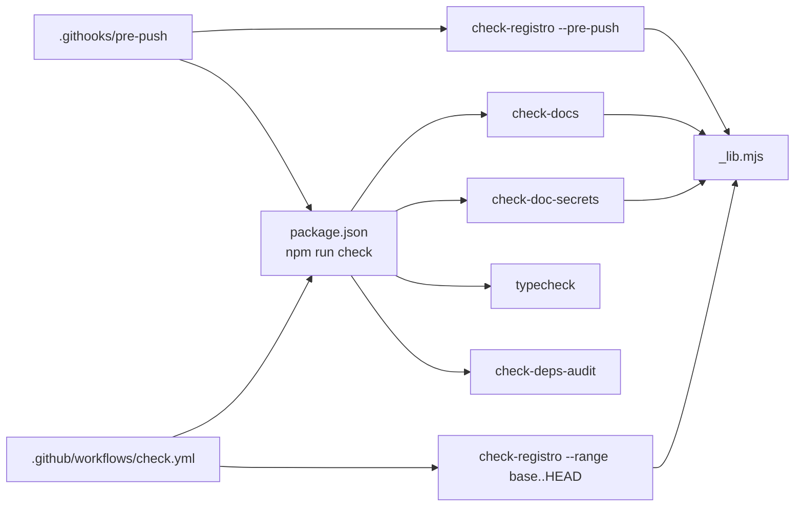

# scripts

## Cabeçalho

| Campo | Valor |
|---|---|
| Id | DIR-scripts |
| Título | `scripts` |
| Tipo | ferramentas de checagem (DevSecOps) |
| Data | 2026-11-16 |
| Usuário responsável | TokumoH |
| Status | ativo |
| Commits | commit que introduz este arquivo — `git log --format=%h -- scripts/README.md` |
| Arquivos | `README.md`, `_lib.mjs`, `check-docs.mjs`, `check-doc-secrets.mjs`, `check-registro.mjs`, `install-hooks.mjs` |

## Propósito

Checagens automáticas que transformam as regras do [CORE](../CLAUDE.md) em verificações executáveis: documentação coerente, nenhum segredo versionado e registro em `docs/verificacoes/` para todo commit. São chamadas pelos scripts do `package.json`, pelo hook [`.githooks/pre-push`](../.githooks/README.md) e pela CI ([`.github/workflows/check.yml`](../.github/workflows/README.md)).

## Origem

Sugestão S3 ("DevSecOps do zero"), aprovada pelo usuário como implementação, com CI e atenção ao consumo de minutos do GitHub. Registro: [VER-003](../docs/verificacoes/2026-11-16-003-devsecops-checagens-e-ci.md). Os scripts substituem as verificações temporárias (V1/V2) usadas no VER-001 e no VER-002.

## Organização

- `_lib.mjs`: utilitários compartilhados (Git sem shell, lista de arquivos e diretórios rastreados, relatório de erros). O prefixo `_` indica que é biblioteca, não comando.
- `check-*.mjs`: uma regra por arquivo. Cada um encerra com código 0 (ok) ou 1 (erro), e o 2 é reservado para uso incorreto.
- `install-hooks.mjs`: ativa os hooks versionados (chamado pelo `prepare` do npm).
- Só Node.js, sem dependências externas.

## Por que esta organização

- **GRASP Pure Fabrication:** o acesso ao Git e ao disco fica concentrado em `_lib.mjs`, e as regras de negócio do processo ficam nos `check-*`. É reuso sem acoplamento entre as checagens.
- **Componentes:** cada checagem roda sozinha (`npm run check-docs`) ou em conjunto (`npm run check`). O hook e a CI reutilizam os mesmos componentes.
- Node em vez de bash funciona igual em Windows, Linux e macOS.

## Por que não outras organizações

| Opção | Motivo de descarte |
|---|---|
| Scripts em bash | Não rodam no Windows sem Git Bash ou WSL |
| Uma única checagem monolítica | Não dá para rodar uma regra isolada; um erro mascara os outros |
| Ferramentas externas (husky, gitleaks, markdown-link-check) | Dependências e binários a mais (cadeia de suprimentos) para um volume pequeno |
| Subpasta `scripts/lib/` | Um arquivo só não justifica um diretório com README próprio |

## Onde

| Arquivo ou subdiretório | O que contém |
|---|---|
| [`README.md`](README.md) | Este arquivo |
| [`_lib.mjs`](_lib.mjs) | Utilitários compartilhados: `git()`, `trackedFiles()`, `trackedDirs()`, `reporter()` |
| [`check-docs.mjs`](check-docs.mjs) | Links e âncoras; README em todo diretório (exceções: `LEGADO`, `SEM_README` e a raiz); "Onde" e "Arquivos" × conteúdo real; nome e sequência dos registros |
| [`check-doc-secrets.mjs`](check-doc-secrets.mjs) | E-mails, tokens do GitHub, chaves AWS, chaves privadas e atribuições de credencial em arquivos de texto rastreados |
| [`check-registro.mjs`](check-registro.mjs) | Todo commit (exceto merges) adiciona ou altera um registro `docs/verificacoes/AAAA-MM-DD-NNN-slug.md` |
| [`install-hooks.mjs`](install-hooks.mjs) | Define `core.hooksPath = .githooks`; não faz nada fora de um repositório Git |

## Lógica



1. `npm install` executa o `prepare`, que chama o `install-hooks.mjs` e ativa `.githooks/`.
2. No `git push`, o hook roda primeiro o `check-registro` (só sobre os commits que ainda não estão no GitHub) e depois o `npm run check`.
3. No PR para `master`, a CI roda o `npm run check` e o `check-registro` sobre `origin/master..HEAD`.

## Exemplo

```bash
npm run check-docs
```

Saída esperada sem problemas: `check-docs: 0 erro(s) — N arquivos .md, M registro(s)`. Com um diretório novo sem README: `ERRO [check-docs] pasta/ sem README.md` e código de saída 1.

Para acrescentar uma checagem: criar `check-<nome>.mjs` usando `reporter()` de `_lib.mjs`, registrar em `package.json` (e em `check`, se for parte do conjunto) e listar aqui em "Onde".

## Verificação

- Cada checagem foi rodada no estado atual (0 erros) e sabotada para provar que detecta a falha. Detalhes no VER-003, seção "Verificação".
- Todo arquivo deste diretório está listado em "Onde" (conferido pelo próprio `check-docs`).

## Riscos

- `check-docs` isenta os diretórios anteriores à regra (`public`, `src`, `src/assets`, lista `LEGADO`). Eles ainda não têm README.
- `check-docs` exige que `.github/` **não** tenha README (`SEM_README`, VER-004) e não confere a raiz, cujo README é só apresentação.
- `check-doc-secrets` usa padrões (regex): não detecta segredos fora desses formatos e pode dar falso positivo. Exceções vão para `PERMITIDOS`, com o motivo.
- `check-deps-audit` precisa de acesso à internet (registro do npm).
