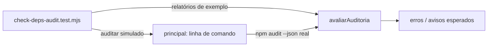

# scripts/tests

## Cabeçalho

| Campo | Valor |
|---|---|
| Id | DIR-scripts-tests |
| Título | `tests` |
| Tipo | testes das checagens (DevSecOps) |
| Data | 2026-11-18 |
| Usuário responsável | TokumoH |
| Status | ativo |
| Commits | commit que introduz este arquivo — `git log --format=%h -- scripts/tests/README.md` |
| Arquivos | `README.md`, `check-deps-audit.test.mjs` |

## Propósito

Testes automáticos das checagens de [`scripts/`](../README.md). Provam que cada regra reprova o que deve reprovar e aceita o que deve aceitar, sem depender de rede nem do estado do repositório.

## Origem

Criado com o registro [VER-012](../../docs/verificacoes/2026-11-18-012-audit-excecao-com-prazo.md), quando o `check-deps-audit` passou de um comando do npm para um script com exceções (aviso `GHSA-fc5q-39xc-vjpf`, sem versão corrigida, bloqueava o `npm run check`).

## Organização

- Um arquivo `<checagem>.test.mjs` por checagem, importando as funções exportadas por ela.
- Relatórios de exemplo montados no próprio teste, no formato do `npm audit --json` (sem rede).
- Os testes rodam pelo Vitest (`vite.config.ts` inclui `scripts/tests/**/*.test.mjs`), dentro do `npm test` e, portanto, do `npm run check`.

## Por que esta organização

As checagens só rodam de verdade contra a internet e o repositório; testar a lógica com relatórios fixos torna o resultado repetível e permite provar cada regra com uma sabotagem. Ficar ao lado de `scripts/` mantém teste e checagem juntos.

## Por que não outras organizações

| Opção | Motivo de descarte |
|---|---|
| Testes chamando o `npm audit` real | Dependem de rede e mudam a cada aviso publicado; não provam as regras |
| Testes dentro de `src/` | Misturam o processo do repositório com o código do app |
| Sem testes (só rodar a checagem) | Uma regra quebrada passaria em silêncio enquanto não houvesse aviso real |

## Onde

| Arquivo ou subdiretório | O que contém |
|---|---|
| [`README.md`](README.md) | Este arquivo |
| [`check-deps-audit.test.mjs`](check-deps-audit.test.mjs) | 53 testes de `avaliarAuditoria`, `avisosRaiz`, `argumentosAuditoria`, `auditar` (com o `spawn` simulado), `hojeUtc`, `principal` e `EXCECOES`: aviso alto ou crítico fora da lista reprova; moderado é ignorado; exceção vale só para o pacote e a gravidade aprovados, no prazo (inclusive o último dia, em UTC), fora da produção e sem correção que não suba versão principal; exceção sem uso vira aviso; relatório inválido ou inconsistente (pacote a pacote, inclusive com a exceção ativa e com ciclos nas duas ordens) reprova; url de aviso só vale com `/advisories/` e o id no fim; `auditar` chama o npm com os argumentos de cada tipo, na raiz do repositório, com tempo limite e `shell` só no Windows, e saída não-JSON reprova; `principal` usa a data atual em UTC por padrão (relógio simulado); o script executado como processo (direto e por link simbólico), com um npm falso, imprime `ERRO` e sai com código 1; a metadata precisa bater nos dois sentidos; toda exceção precisa vencer em no máximo 90 dias a partir de hoje |

## Lógica



O teste importa o módulo sem disparar a linha de comando (ela só roda quando o arquivo é executado diretamente); `principal` e `auditar` são testadas com o `npm audit` e o relatório simulados.

## Exemplo

```bash
npx vitest run scripts/tests
```

Saída esperada: `Tests 53 passed (53)`.

## Verificação

- Cada regra, inclusive as da linha de comando, foi sabotada numa cópia fora do repositório e derrubou ao menos um teste (lista no VER-012).
- "Onde" e "Arquivos" conferidos por `npm run check-docs`; não há subdiretórios.

## Riscos

- Os relatórios de exemplo seguem o formato atual do `npm audit --json` (versão 2 do relatório); a checagem exige a versão 2 e falha fechada se ela mudar; uma mudança de forma dentro da versão 2 pode passar com os testes verdes.
