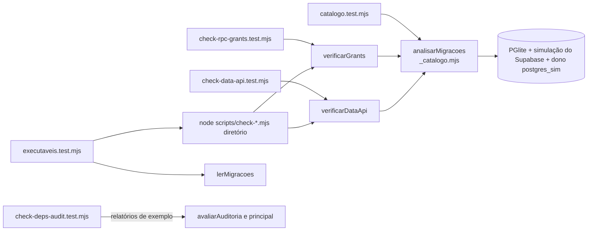

# scripts/tests

## Cabeçalho

| Campo | Valor |
|---|---|
| Id | DIR-scripts-tests |
| Título | `tests` |
| Tipo | testes das checagens (DevSecOps) |
| Data | 2026-11-18 |
| Usuário responsável | TokumoH |
| Status | ativo |
| Commits | commit que introduz este arquivo — `git log --format=%h -- scripts/tests/README.md` |
| Arquivos | `README.md`, `check-rpc-grants.test.mjs`, `check-data-api.test.mjs`, `catalogo.test.mjs`, `executaveis.test.mjs`, `check-deps-audit.test.mjs` |

## Propósito

Testes automáticos das checagens de [`scripts/`](../README.md) que têm teste: `check-rpc-grants`, `check-data-api` e `check-deps-audit` (`check-docs`, `check-doc-secrets` e `check-registro` não têm), e do componente [`_catalogo.mjs`](../_catalogo.mjs), que as duas checagens de banco compartilham. Para cada checagem testada, provam que cada regra reprova o que deve reprovar e aceita o que deve aceitar, sem depender de rede nem do estado do repositório. Para o `check-deps-audit`, usam relatórios de exemplo do `npm audit`. Para as duas checagens de banco, [`check-rpc-grants.mjs`](../check-rpc-grants.mjs) e [`check-data-api.mjs`](../check-data-api.mjs), cada teste passa um SQL de exemplo, que é aplicado de verdade num PGlite com a simulação do Supabase, e compara a lista exata de erros lida do catálogo. Quase toda regra tem um SQL correto e um errado; as formas não suportadas só têm o caso errado (o correto é a ausência do comando). Cobrem também as regras além do DES-001 e, como testes de regressão, todos os achados das revisões 10 e 11 da antiga leitura por texto (comentário terminado por `\r`, tag `$é$`, nomes `U&"..."`, corpo lido do `set` errado, `create rule`, `do $$ execute $$`, `grant ... on all tables in schema`, `alter view`/`alter table <view> set (security_invoker = false)`, `alter default privileges` para `public`/`anon`/`service_role`, `t*`, `create schema ... grant`, `alter extension`, renomear e recriar tabela, `alter role ... bypassrls`, `grant <papel> to anon` e os mutantes não equivalentes) e os achados da revisão 12 da leitura por catálogo (valor padrão de parâmetro e constante `regproc` em `begin atomic`, `"""public".papel_atual()`, tipo ou relação com o nome da função de papel, schema pré-existente alterado, subdiretório `x.sql`, BOM, simulação sem `anon`) e da revisão 13 (tabela temporária de uma migração tomando o lugar da de `public` na seguinte, gatilho de constraint adiável que desliga a RLS no commit, `REFERENCES` de coluna para `authenticated`, nome em três partes, banco renomeado, nome de arquivo fora do padrão da Supabase CLI) e da correção 14 (migrações aplicadas como o dono `postgres_sim`, sem superusuário: formas que só um superusuário consegue viram erro de SQL com o arquivo e a linha; troca do usuário da sessão recusada) e da revisão 14 (o SQL das sondas `notas.sql`, view com gatilho `INSTEAD OF`, e `notas2.sql`, gatilho `BEFORE INSERT` que devolve `NULL`, pelos quais `anon` gravava numa tabela com RLS; viraram a regra literal de `anon` sem privilégio algum, a recusa do `INSTEAD OF`, política só `to authenticated` e `grant` × política de `authenticated`, na correção 16). Os testes cobrem `verificarGrants()`, `verificarDataApi()`, `regrasDeFuncao()`, `regrasDeTabela()`, `codigoDoCorpo()`, `analisarMigracoes()`, a leitura das migrações e a execução por linha de comando (código de saída e mensagem). Garantem que as checagens acusam o defeito e que nunca passam sem conferir nada.

## Origem

Criado com o registro [VER-012](../../docs/verificacoes/2026-11-18-012-audit-excecao-com-prazo.md), quando o `check-deps-audit` passou de um comando do npm para um script com exceções (aviso `GHSA-fc5q-39xc-vjpf`, sem versão corrigida, bloqueava o `npm run check`). Ampliado na Tarefa 4 da etapa E0 ([PLA-001](../../docs/planos/2026-11-17-e0-fundacao.md)) com os testes de `executaveis.test.mjs`, `check-rpc-grants.test.mjs`, `check-data-api.test.mjs` e, na reescrita das checagens pela leitura do catálogo (decisão do responsável depois de 11 revisões da leitura por texto), `catalogo.test.mjs`, que acompanham as checagens `rpc:grants-check` e `data-api:check` do DevSecOps do [CORE](../../CLAUDE.md). As regras vêm do DES-001, seções 8 e 13 ([desenho](../../docs/desenho/2026-11-16-revocast-cameras-desenho.md)). Os testes seguem o Vitest, já usado no projeto; o `vite.config.ts` inclui `scripts/tests/**/*.test.mjs`.

## Organização

- Um arquivo de teste por módulo testado (`check-<nome>.test.mjs` para cada checagem, `catalogo.test.mjs` para `_catalogo.mjs`), importando as funções exportadas por ele; `executaveis.test.mjs` é a exceção: testa a linha de comando das duas checagens de banco, não um módulo próprio.
- `check-deps-audit.test.mjs` monta relatórios de exemplo no formato do `npm audit --json` (sem rede).
- Os testes das checagens de banco montam o SQL com funções de exemplo (`funcao()` (que revoga `EXECUTE` de `public`, `anon` e `service_role`, como a migração real desde a correção 14 da Tarefa 3), `tabela()` (com a política e o `grant` da operação dela), `soFuncoes()`, e os trechos `PAPEL` e `PADRAO`, que revoga os privilégios padrão de tabelas e sequências de `anon`, `authenticated` e `service_role`, como a migração real; em `check-data-api.test.mjs`, `ANTIGO` reproduz por `grant` explícito o padrão do Supabase anterior a 2026-10-30, que a simulação não dá mais) e trocam a parte examinada, ou escrevem o SQL inteiro quando o caso depende da forma exata; o resultado esperado é a lista exata de erros (`toEqual`), não "algum erro". Todo SQL de exemplo é aceito pelo Postgres, salvo nos testes de erro de SQL. As migrações rodam como `postgres_sim`, sem superusuário; o que só um superusuário consegue (papel com `SUPERUSER` ou `BYPASSRLS`, alterar papel pré-existente, participação em papel de que o dono não tem admin option, como `anon` ou `pg_read_all_data`, `grant ... on database` que mude o banco, `UPDATE` no catálogo, objeto da simulação) vai envolto em `su()`, que escala com `set session authorization postgres` e volta a `postgres_sim` no fim: é o desvio que a conferência do usuário da sessão não vê, e o teste prova que o catálogo continua acusando. O erro de SQL que essas formas dão sem `su()` fica em `catalogo.test.mjs`. O que o dono consegue de fato com `CREATEROLE` e `CREATE` no banco (`create role` comum, `grant <papel que criou> to anon`, `create schema`, inclusive com dono `anon`) vai sem `su()`: assim o teste prova que quem acusa é a regra, e não o erro de permissão. Cada arquivo reaproveita uma única instância de PGlite (a primeira análise leva alguns segundos; as seguintes, dezenas de milissegundos), por isso o tempo limite por teste é de 60 s.
- `catalogo.test.mjs` cobre o que é do componente: lista de migrações em ordem, erro que cita o arquivo, controle de transação (`commit`, `begin`, `rollback`, `end`) recusado com a base limpa depois, análises simultâneas em série, tabela temporária com nome de catálogo (`pg_class`, `pg_depend`) e `set search_path`/`set role` que não enganam a leitura, privilégios padrão, migração que começa com BOM UTF-8, o fim de cada migração (objeto temporário sobrando, gatilho de constraint adiável, chave estrangeira adiável violada no commit, comando preparado, cursor, trava consultiva e valor corrente de sequência que não passam para a migração seguinte), o dono das migrações (`postgres_sim`: `reset role` e `reset session authorization` voltam a ele, formas que só um superusuário consegue dão erro de SQL com o arquivo e a linha, o que ele consegue com `CREATEROLE` e `CREATE` no banco chega ao catálogo sem erro e `grant ... on database` sem grant option não muda nada, troca do usuário da sessão recusada, escalar e voltar deixa o dono `postgres` no catálogo, privilégios padrão do estado final só do dono) e a linha de erro sem posição (busca do menor trecho inicial que repete o erro); e confere no próprio Postgres as premissas de `codigoDoCorpo()`.
- `executaveis.test.mjs` cobre o que as duas checagens têm em comum: migração ausente, diretório sem `.sql`, arquivo no lugar do diretório, uso incorreto (código 2), execução por link simbólico, a guarda de execução (importar o módulo com `argv[1]` inexistente não lança), migração com defeito (código 1 e a mensagem), erro de SQL (arquivo, mensagem e linha, sem stack trace), subdiretório com nome `.sql` e nome fora do padrão da Supabase CLI (mensagem clara, código 1), o diretório padrão relativo à raiz do projeto (com a migração correta, código 0; sem a simulação do Supabase, com uma simulação sem o papel `anon`, sem o dono das migrações, com um dono que não cria `postgres_sim` ou que o cria superusuário, código 1) e a leitura das migrações em ordem de nome (com `readdirSync` simulado). Roda os scripts de verdade (`node scripts/check-*.mjs <diretório>`) sobre diretórios temporários em `os.tmpdir()`, apagados no fim; como cada processo novo inicializa um PGlite, os casos de várias migrações (lidas em conjunto, sem `;` no fim, controle de transação, sessão nova a cada migração) usam as funções no mesmo processo, sobre as migrações lidas do disco por `lerMigracoes()`.
- Os testes não leem `supabase/migrations/`: usam só SQL de exemplo, então valem independentemente da migração real. Leem só a simulação do Supabase (`supabase/tests/simulacao-supabase.sql`) e o dono das migrações (`supabase/tests/dono-migracao.sql`), que são a base de toda análise. Rodar as checagens sobre a migração real é a verificação separada dos próprios scripts (`npm run rpc:grants-check`, `npm run data-api:check`).

## Por que esta organização

- O `check-deps-audit` só roda de verdade contra a internet; as checagens de banco, contra o repositório. Testar a lógica com relatórios ou SQL fixos torna o resultado repetível e permite provar cada regra com uma sabotagem. Aplicar o SQL de exemplo no PGlite, em vez de simular o catálogo, prova as regras sobre o que o Postgres realmente grava.
- O `toEqual` sobre a lista completa pega tanto o erro que falta quanto o erro a mais.
- Os executáveis são testados à parte porque o risco deles é diferente: passar sem conferir nada (migração ausente) ou chamar `process.exit` ao serem importados.
- Diretório próprio porque o `vite.config.ts` já aponta `scripts/tests/**/*.test.mjs` e porque os `check-*.mjs` ficam sem arquivos de teste misturados.

## Por que não outras organizações

| Opção | Motivo de descarte |
|---|---|
| Testes chamando o `npm audit` real | Dependem de rede e mudam a cada aviso publicado; não provam as regras |
| Testes dentro de `src/` | Misturam o processo do repositório com o código do app |
| Sem testes (só rodar a checagem) | Uma regra quebrada passaria em silêncio enquanto não houvesse aviso real |
| Testar só sobre a migração real | Só provaria que a migração passa, não que a checagem acusa o defeito; a migração também pode ser trocada |
| Testes ao lado dos scripts em `scripts/` | Misturam teste e ferramenta; o `check-docs` pediria o arquivo no "Onde" de `scripts/README.md` sem ganho |
| Testar só as funções, sem rodar os executáveis | Não pegaria a guarda de execução, o código de saída nem o caso "nenhuma migração" |
| Catálogo montado à mão nos testes das regras | Não provaria que o Postgres grava o que a regra espera (por exemplo `proconfig`, a ACL nula ou o privilégio herdado); fica só para o caso "nenhum objeto" (`regrasDeFuncao()`/`regrasDeTabela()`) |
| Um processo por caso em `executaveis.test.mjs` | Cada processo inicializa um PGlite (cerca de 2,5 s): a suíte passaria de 40 s; os casos de regra rodam no mesmo processo |

## Onde

| Arquivo ou subdiretório | O que contém |
|---|---|
| [`README.md`](README.md) | Este arquivo |
| [`check-rpc-grants.test.mjs`](check-rpc-grants.test.mjs) | 172 testes de `verificarGrants()`, `regrasDeFuncao()` e `codigoDoCorpo()`: `SECURITY DEFINER`, `search_path`, `EXECUTE` de `PUBLIC`/`anon`/`service_role`/`authenticated` (o `service_role` da simulação, inclusive herdado e pelo privilégio padrão global), outros papéis e grant option (inclusive o do dono, aceito), chamada de papel no corpo real (comentários, textos, `E'...'`, `$é$`, `U&`, identificadores, outro schema, `begin atomic` lido no corpo desparseado, valor padrão de parâmetro e constante `regproc` que não são chamada, plpgsql, nome em três partes), tipo ou relação com o nome de uma função de papel, exceções e sobrecarga, estado final (alter, drop, recriação, `create or replace`), privilégios padrão, funções pré-existentes, regras além do DES-001 (inclusive função temporária sobrando no fim da migração) função de gatilho `SECURITY DEFINER` em relação das migrações (BEFORE, AFTER, de comando, `INSTEAD OF`, função compartilhada com `auth.users`, relação pré-existente aceita, `SECURITY INVOKER` aceita, e a sonda `insere.mjs` da revisão 15) e regressões das revisões 10 a 13 |
| [`check-data-api.test.mjs`](check-data-api.test.mjs) | 322 testes de `verificarDataApi()` e `regrasDeTabela()`: RLS, políticas (para qualquer papel além de `authenticated`, correção 16), `grant` × política de `authenticated` por operação (de tabela e de coluna, `for all`, várias políticas), tabela só-funções, qualquer privilégio de `anon` (padrão novo do Supabase e o antigo por `grant` explícito) e de `service_role` (tabela, view, coluna, sequência, só-funções, grant option, herdado por participação e privilégio padrão sem revoke, correção 17c), privilégio para qualquer outro papel além de `authenticated` e do dono (papel novo com `LOGIN` e `TRUNCATE`, `supabase_auth_admin`, `grant ... on all tables`, view, sequência, coluna, herdado, privilégios padrão, o dono isento; correção 18), privilégios efetivos, de coluna, de `PUBLIC` e com grant option (inclusive o do dono, aceito), `TRUNCATE`/`REFERENCES`/`TRIGGER`/`MAINTAIN` de `authenticated` (inclusive `REFERENCES` de coluna; `MAINTAIN` na correção 16b), privilégios padrão (estado final de tabelas e sequências), sequências (inclusive qualquer privilégio de `authenticated`, correção 16b, e coluna `identity` com insert de `authenticated` sem privilégio na sequência), gatilhos `INSTEAD OF` (e o SQL das sondas da revisão 14), partições, temporárias (sobrando ou apagadas no fim da migração), views, materialized view, foreign table, regras, gatilhos de evento, papéis (inclusive papel novo com `REPLICATION`, correção 15b) e participações (inclusive os criados pelo dono sem `su()`), schemas (inclusive pré-existentes com nome, dono ou privilégios alterados), objetos pré-existentes, a lista `OUTROS` (inclusive banco renomeado) e regressões das revisões 10, 11, 13, 14 e 15 (mutantes M10, M12 e M14); desde a Tarefa 2 da E2 (PLA-003, D13), o bloco `storage`: políticas de `storage.objects` aceitas (`select`, `insert`, `delete`, com `dispositivo_atual()`) e recusadas (sem bucket, bucket em `or`, negado, depois da função, outro bucket, sem a função de papel, a função só dentro de um texto, `with check` sem bucket, sem a expressão do comando, `update`, `all`, para `anon`), política em `storage.buckets` e em `auth.users`, `alter policy` que tira o bucket ou acrescenta `anon`, renomear e `drop` (aceitos), a remoção de política sobre um catálogo montado à mão, cada item da regra de `storage.*` com a mensagem exata (RLS desligada e forçada, coluna, padrão trocado, comentário, `replica identity`, gatilho desligado, índice, dono, opções, nome, restrição, estatística, herança, chave estrangeira de `public`, gatilho novo, quatro mudanças de privilégio, `grant` do que já tem sem erro, duas mudanças num erro só, `storage.buckets`, relação removida, tabela nova em `storage`, privilégios padrão de `supabase_storage_admin` ou do schema `storage` criados, alterados ou removidos; desde a revisão 1 da Tarefa 2, objeto que não é relação no schema `storage` (domínio, domínio com `check`, enum, tipo composto, operador, collation, configuração e dicionário de text search, estatística em `storage` sobre tabela de `public`, função nova, alterada ou removida), sequência nova em `storage`, `storage.buckets` movida ou renomeada, política `to public` e `to authenticated, service_role`, `allowed_mime_types` com valor nulo) e a regra do bucket (público, sem limite, acima de 50 MB, tipos nulos, vazios ou com `image/svg+xml`, bucket fora da lista, a linha certa) |
| [`catalogo.test.mjs`](catalogo.test.mjs) | 87 testes de `analisarMigracoes()` (inclusive migração com BOM UTF-8, o fim de cada migração: commit e fim da sessão, o commit real de cada migração quando há duas ou mais (`alter type ... add value` numa e uso na seguinte, inclusive com exatamente duas migrações, `on commit drop`, a base intacta depois; correção 18 e revisão r18), o dono `postgres_sim` com o que ele consegue e o que não consegue, e a linha de erro sem posição; desde a Tarefa 2 da E2, a forma nova de `politicasEmPreexistentes`, cada item de `mudancasEmStorage` (inclusive estatística, herança e chave estrangeira vindas de `public` e a remoção), `relacoesPreexistentes` sem as relações de `storage`, `aclPadraoEmStorage`, `objetosEmStorage` e `bucketsFinais`, inclusive nulo com `storage.buckets` movida) e das premissas do Postgres usadas por `codigoDoCorpo()` |
| [`executaveis.test.mjs`](executaveis.test.mjs) | 44 testes de `lerMigracoes()` (inclusive subdiretório com nome `.sql` e nome fora do padrão da Supabase CLI), `ordenarMigracoes()`, da guarda de execução, da execução por linha de comando dos dois scripts (inclusive simulação sem o papel `anon` ou `service_role` e dono das migrações ausente, sem `postgres_sim` ou superusuário) e de várias migrações lidas do disco |
| [`check-deps-audit.test.mjs`](check-deps-audit.test.mjs) | 54 testes de `avaliarAuditoria`, `avisosRaiz`, `argumentosAuditoria`, `auditar` (com o `spawn` simulado), `hojeUtc`, `principal` e `EXCECOES`: aviso alto ou crítico fora da lista reprova; moderado é ignorado; exceção vale só para o pacote e a gravidade aprovados, no prazo (inclusive o último dia, em UTC), fora da produção e sem correção que não suba versão principal; exceção sem uso vira aviso; relatório inválido ou inconsistente (pacote a pacote, inclusive com a exceção ativa e com ciclos nas duas ordens) reprova; url de aviso só vale com `/advisories/` e o id no fim; `auditar` chama o npm com os argumentos de cada tipo, na raiz do repositório, com tempo limite e `shell` só no Windows, e saída não-JSON reprova; `principal` usa a data atual em UTC por padrão (relógio simulado); o script executado como processo (direto e por link simbólico), com um npm falso, imprime `ERRO` e sai com código 1; a metadata precisa bater nos dois sentidos; toda exceção precisa vencer em no máximo 90 dias a partir de hoje; com `EXCECOES` vazia (VER-022), relatório vazio passa sem aviso e `principal` aceita a lista de exceções por parâmetro |

## Lógica



1. `npm test` (Vitest) encontra os `*.test.mjs` desta pasta.
2. Os testes das checagens de banco chamam as funções com SQL de exemplo; `analisarMigracoes()` aplica o SQL como `postgres_sim`, numa transação sobre o PGlite com a simulação e o dono, lê o catálogo e desfaz a transação; a regra devolve a lista de erros, comparada por inteiro.
3. `catalogo.test.mjs` confere o componente e, num PGlite puro, as premissas da leitura do corpo.
4. `executaveis.test.mjs` cria migrações temporárias, roda os scripts como processo e confere código de saída e mensagem.
5. `check-deps-audit.test.mjs` importa o módulo sem disparar a linha de comando (ela só roda quando o arquivo é executado diretamente) e testa `principal` e `auditar` com o `npm audit` e o relatório simulados.

## Exemplo

Para testar todas as checagens desta pasta:

```bash
npx vitest run scripts/tests
```

Saída esperada: `Tests 679 passed (679)`.

Para acrescentar uma regra: escrever primeiro o teste com o SQL errado e a mensagem esperada, ver falhar, implementar no `check-*.mjs` e conferir que o SQL correto continua devolvendo `[]`.

## Verificação

- `npx vitest run scripts/tests --maxWorkers=2`: 679 testes passam (172 + 322 + 87 + 44 + 54; 322 e 87 desde a Tarefa 2 da E2, registro VER-025, 2026-11-26), em cerca de 45 s (2026-11-22, correções da revisão r18; 54 no `check-deps-audit` desde o VER-022, 2026-11-26).
- As regras e a linha de comando do `check-deps-audit` foram sabotadas numa cópia fora do repositório e derrubaram ao menos um teste (lista no VER-012).
- Varredura sistemática de mutações dos três módulos de banco (`_catalogo.mjs`, `check-rpc-grants.mjs`, `check-data-api.mjs`), por script fora do repositório, com as classes da varredura anterior (cada alternativa, `\b`, `^`, `$`, `\s*`/`\s+`, `\(`, `?` e flag dos regex; cada `if` e cada operando de condição composta trocado por verdadeiro e falso; cada `continue`/`return`/comando removido; `&&`/`||`, `every`/`some` e comparações invertidos; literais trocados; schema ignorado) mais classes de SQL (cada campo das impressões digitais do catálogo, cada filtro, cada tipo de relação). Resultado no registro da tarefa: 754 mutações geradas, 678 derrubadas (659 por teste que falha, 10 por tempo esgotado e 9 por quebrar o carregamento da suíte) e 76 sobreviventes, todas classificadas uma a uma com o motivo (só desempenho ou recurso, como o atalho do resumo do catálogo; inalcançáveis neste ambiente, como linguagens que o PGlite não tem; ou campos de impressão de objetos que a base não tem, como políticas e gatilhos de evento, sempre novos). Na correção da revisão 12, a varredura foi refeita sobre o código corrigido para os sobreviventes (pareados pela descrição), as mutações das linhas alteradas e 19 mutações escritas à mão para o código novo (corpo desparseado, regra de tipos, BOM, subdiretório `.sql`, schema pré-existente): das 76 sobreviventes, 5 passaram a ser derrubadas por testes novos (a guarda "simulação sem `anon`", `""` dentro de identificador, identificador sem fim, campo `nspname` e campo `relkind` das impressões) e 1 sumiu com o código (o filtro de `pg_depend`); as 70 restantes mantêm a classificação, revista com uma prova para cada classe. Sobrevivem também, como equivalentes provados, 4 das mutações novas (`coalesce` no lugar do `case` do corpo; tirar o filtro da base ou dos temporários na lista de tipos; tirar o filtro de linguagem, porque uma função `internal` só aceita o nome de uma função embutida e `c` exige biblioteca, que o PGlite não carrega). Na correção da revisão 13, 34 mutações distintas escritas à mão para as linhas alteradas (fim de cada migração, `REFERENCES` de coluna, padrão de nome da CLI, o `.` do lookbehind e o campo `datname`): 30 derrubadas (a da trava consultiva só depois de um teste novo), 2 equivalentes provadas (sem o filtro `refclassid` na consulta dos temporários, porque os OIDs vêm de um contador único; sem o `$` do padrão de nome, porque só chegam nomes terminados em `.sql`) e 2 que deixaram de existir com o código (`unlisten *` e `discard plans`, que não mudam resultado). Na correção 14 (dono `postgres_sim` e linha de erro sem posição), 41 mutações escritas à mão para as linhas alteradas, em duas rodadas (33 na primeira; 8 na segunda, sobre o código simplificado depois dela): 34 derrubadas (27 + 7); 5 sobreviventes da primeira rodada eram código sem efeito e saíram (`reset role` depois de `set session authorization`, que já o desfaz; o `voltar()` antes da leitura do catálogo e no início de cada migração, já garantidos pelo `voltar()` do fim) ou ganharam teste (o `deallocate all` da busca da linha, que tinha um defeito real: o `prepare` da migração que falhou sobrevivia ao rollback e enganava a primeira tentativa); sobram 2 equivalentes: `session_user` × `current_user` na criação da instância (iguais ali) e o `reset all` de `voltar()` (o início de cada migração e o `discard all` já zeram os parâmetros; para a leitura do catálogo que segue a última migração, nenhum parâmetro testado muda o resultado: `statement_timeout`, `transaction_read_only`, `work_mem`, `max_stack_depth`), mantido como defesa. Na correção 15 (o dono ganhou `CREATEROLE`, `CREATEDB` e todos os privilégios no banco), só mudaram testes e documentação; 7 mutações escritas à mão sobre o que os testes novos e trocados provam, todas derrubadas: a regra de participação sem o lado do membro (4 testes) e acusando toda participação nova, inclusive a automática do dono no papel que cria (7); a lista `OUTROS` sem o banco (4); o dono sem `CREATEROLE`, `CREATEDB` e privilégios no banco (21, na suíte inteira); o dono com grant option no banco e admin option em `anon` (3); o dono com `BYPASSRLS` (1); a busca da linha terminando uma linha antes (26). Na correção 15b (papel novo com `REPLICATION` vira erro, decisão do controlador), 6 mutações nas linhas novas, todas derrubadas: sem a regra (4), condição sempre verdadeira (11), atributo lido como falso (4) ou de `rolcreaterole` (5), mensagem trocada (4) e sem a regra de `SUPERUSER` ao lado (2). Na correção 16 (revisão 14 e padrão novo do Supabase), 34 mutações nas linhas novas e alteradas de `check-data-api.mjs` e `_catalogo.mjs`: 33 derrubadas (o `anon` com privilégio de coluna em tabela só-funções só depois de um teste novo); sobrevive 1, não equivalente: sem o `order by` das políticas, a ordem das mensagens de várias políticas segue a posição física no `pg_policy`, que num banco novo é a de criação (sonda fora do repositório), mas que na suíte, pela reutilização do espaço das análises desfeitas, saiu por acaso em ordem de nome; o `order by` fica para a ordem não depender disso. Na correção 16b (`MAINTAIN` proibido a `authenticated`; nenhum privilégio de `authenticated` em sequência), 6 mutações nas linhas alteradas, todas derrubadas: `MAINTAIN` fora da lista (7 testes), sem a regra de sequência (6), o ramo da sequência desligado (6), o estado final sem o caso das sequências de `authenticated` (5) ou com `tabelas` no lugar de `sequências` (6) e a mensagem sem o sufixo (6). A revisão 15 achou mais 3 mutantes não equivalentes nas regras das correções 16 e 16b, fora das 34 acima (que não eram, portanto, a única sobrevivente além da M31): a regra `grant` × política só para `relkind = 'r'` (a tabela particionada passava), `authenticated_colunas` só com `SELECT` (o `insert` de coluna na tabela só-funções passava) e o grant option sem os privilégios de coluna. Na correção 17, cada um ganhou um teste `toEqual` com o SQL do relatório da revisão, e os três caem (1 teste cada). A M11 da revisão (`anon_colunas` só com `SELECT`) é equivalente: o privilégio de coluna explícito de `anon` já é acusado pela ACL de coluna, e por herança só chega por `PUBLIC` ou por participação, ambas acusadas. Na correção 17b (função de gatilho `SECURITY DEFINER` em relação das migrações; `EXECUTE` de `service_role`), 12 mutações nas linhas novas: 11 derrubadas (sem o filtro de relação nova, sem a regra, `SECURITY DEFINER` sempre exigido, sem a remoção de repetidas, gatilhos sem ordem, sem a regra de `service_role`, `service_role` lido com o oid de `anon`, conjunto de relações novas vazio, gatilho de outra função, a guarda do papel `service_role` trocada pela de `anon`, rótulo sem o schema); a do filtro `not tgisinternal` sobreviveu e o filtro saiu como código sem efeito: os gatilhos internos (de chave estrangeira e de unique adiável) só chamam funções embutidas de `pg_catalog` (conferido no PGlite: `RI_FKey_*` e `unique_key_recheck`), que nunca são funções criadas pelas migrações. Na correção 17c (nenhum privilégio de `service_role` em relação criada pelas migrações), 10 mutações nas linhas novas, todas derrubadas: sem a regra (14 testes), sem a de coluna herdada (2) ou acusando-a também com o grant explícito (1), coluna explícita sem `service_role` (1), estado final dos privilégios padrão sem `service_role` (6), `service_role` lido com o oid de `anon` em tabela (18) ou em sequência (4), coluna lida com o oid de `authenticated` (181), o oid de `service_role` trocado pelo de `anon` nos privilégios padrão (5) e a mensagem sem o sufixo (7). Na correção 18 (privilégio para qualquer papel além de `authenticated` e do dono; commit real de cada migração), 21 mutações nas linhas novas: 18 derrubadas (12 da regra geral: sem a regra, sem a isenção do dono na tabela e na coluna, `authenticated` na regra geral, coluna de `authenticated` acusada, papéis e privilégios sem ordem, ordem de tabela em sequência, privilégios padrão sem os outros papéis, sem excluir o dono, sem ordem e com o oid errado do dono; 6 do commit: sempre numa transação só, commit ignorado, sem o `break` no erro, xid de outra transação, sem refazer com commit a sobra temporária); 1 sem efeito saiu (o `voltar()` no início da instância descartável: o preâmbulo de cada migração já prepara a sessão); 2 equivalentes, só de desempenho: aplicar toda análise com commit real e refazer com commit toda análise com erro dão o mesmo resultado em todos os testes (a migração única com o fim simulado só difere do commit real em `on commit drop`, que já é refeito), e a primeira levou a suíte de 45 s para 135 s. Uma delas (refazer todo erro) revelou um defeito, corrigido antes da contagem: a cópia da base era tirada da instância compartilhada na hora, que podia estar descartada; agora é tirada ao criar a base. A revisão r18 mostrou que o limite "duas ou mais migrações" sobrevivia à troca de `> 1` por `> 2` (os testes usavam três migrações); com o teste de exatamente duas, a mutação cai (1 teste). O filtro `not a.attisdropped` dos privilégios de coluna fica só como defesa, sem teste possível: o Postgres zera o `attacl` da coluna apagada (revisões r14 e r18). Antes da rodada, duas condições foram vistas como código sem efeito e saíram, porque sequência não tem `TRUNCATE`/`REFERENCES`/`TRIGGER`, privilégio de coluna nem política: `r.tipo !== "S"` antes das regras de `authenticated` e `tipo === "r"` no estado final dos privilégios padrão de `authenticated`.
- Casos da D13 (Tarefa 2 da E2, registro VER-025): escritos antes do código e vistos falhando (68 falhas com a simulação sem `storage`); depois, cada regra e cada item da impressão de `storage` foi sabotado em `_catalogo.mjs` ou `check-data-api.mjs` (cópia guardada fora do repositório, restaurada e conferida por `sha256sum`), e cada sabotagem derrubou o teste do caso (lista no VER-025). `executaveis.test.mjs` copia também `check-rpc-grants.mjs` no projeto temporário do caso "simulação sem o papel", porque `check-data-api.mjs` passou a importá-lo.
- Links relativos, "Onde" e campo "Arquivos" conferidos por `npm run check-docs`.
- Não há subdiretórios.

## Riscos

- As limitações das checagens de banco (o que a simulação do Supabase cobre, o que não é conferido, as formas não suportadas e os falsos positivos) estão em [`scripts/README.md`](../README.md), seção "Riscos"; os testes provam as regras sobre o PGlite com a simulação e o dono simulado (`postgres_sim`), não sobre o Supabase real.
- Os relatórios de exemplo do `check-deps-audit` seguem o formato atual do `npm audit --json` (versão 2 do relatório); a checagem exige a versão 2 e falha fechada se ela mudar; uma mudança de forma dentro da versão 2 pode passar com os testes verdes.
- Os testes cobrem SQL de exemplo, não a migração real; esta é conferida pelos próprios scripts.
- Cada arquivo de teste das checagens de banco inicializa um PGlite (de 710 a 790 MB de memória residente, medidos em 2026-11-22; a soma esperada na CI está em [`scripts/README.md`](../README.md), seção "Riscos"); `executaveis.test.mjs` sobe mais um por processo que roda, um de cada vez. Uma versão nova do PGlite pode mudar mensagens de erro do Postgres citadas nos testes.
