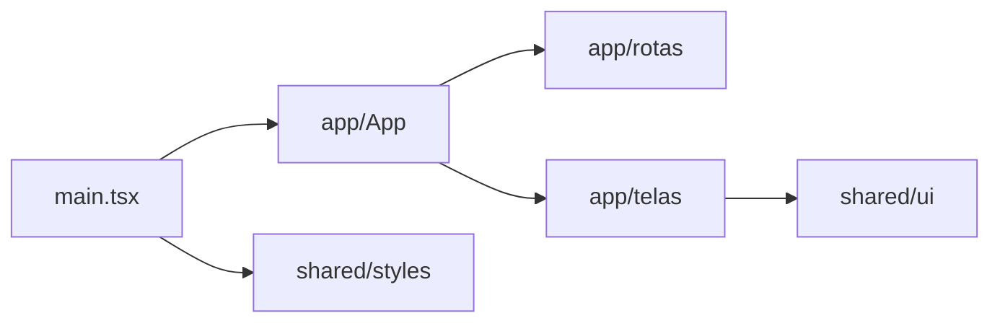

# src

## Cabeçalho

| Campo | Valor |
|---|---|
| Id | DIR-src |
| Título | `src` |
| Tipo | código · app React |
| Data | 2026-11-17 |
| Usuário responsável | TokumoH |
| Status | em construção |
| Commits | commit que introduz este arquivo — `git log --format=%h -- src/README.md` |
| Arquivos | `README.md`, `main.tsx`, `app/`, `shared/` |

## Propósito

Código-fonte do app React do RevoCast Câmeras: ponto de entrada, rotas e telas (`app/`) e o que é compartilhado entre elas (`shared/`).

## Origem

Criado na Tarefa 1 da etapa E0 ([PLA-001](../docs/planos/2026-11-17-e0-fundacao.md)), que substitui o protótipo por um app React com a cara do RevoCast. Desenho: [DES-001](../docs/desenho/2026-11-16-revocast-cameras-desenho.md).

## Organização

- `main.tsx` monta o app; `app/` decide qual tela mostrar pelo caminho da URL; `shared/` guarda estilos e componentes reutilizáveis.
- Pastas por responsabilidade (DDD e Componentes, como manda o `CLAUDE.md`); novos domínios entram em `src/domains/<domínio>/` ([PLA-001](../docs/planos/2026-11-17-e0-fundacao.md)) quando as etapas E1+ os exigirem.

## Por que esta organização

Separar a casca do app (`app/`) do que é reaproveitado (`shared/`) evita telas dependendo umas das outras e deixa cada pasta com um papel só.

## Por que não outras organizações

| Opção | Motivo de descarte |
|---|---|
| Tudo em `src/` sem subpastas | Mistura rotas, telas e estilos; dificulta o reuso |
| Pasta por tipo técnico (`components/`, `pages/`) | Espalha o que muda junto; o DDD pede agrupar por responsabilidade |

## Onde

| Arquivo ou subdiretório | O que contém |
|---|---|
| [`README.md`](README.md) | Este arquivo |
| [`main.tsx`](main.tsx) | Ponto de entrada: monta `<App caminho={window.location.pathname} />` e carrega os estilos |
| [`app/`](app/) | Rotas, `App` e telas provisórias |
| [`shared/`](shared/) | Estilos, componentes e (a partir da Tarefa 2) infraestrutura compartilhados |

## Lógica

O navegador carrega `index.html`, que carrega `main.tsx`; este lê o caminho da URL e entrega ao `App`.

## Exemplo

Para achar onde a rota `/painel` é decidida: `main.tsx` → `app/App.tsx` → `app/rotas.ts`.

## Verificação

- Links relativos, "Onde" e campo "Arquivos" conferidos por `npm run check-docs`.
- Subdiretórios com README próprio (conferido pelo mesmo comando).

## Riscos

- `shared/infra/` (Supabase) ainda não existe; chega na Tarefa 2.
