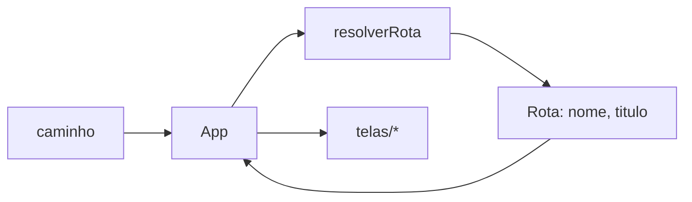
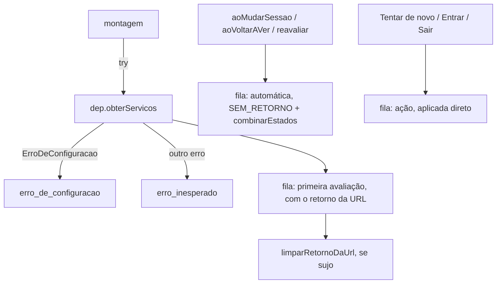
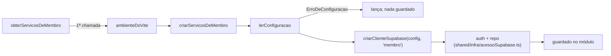
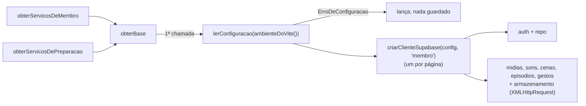
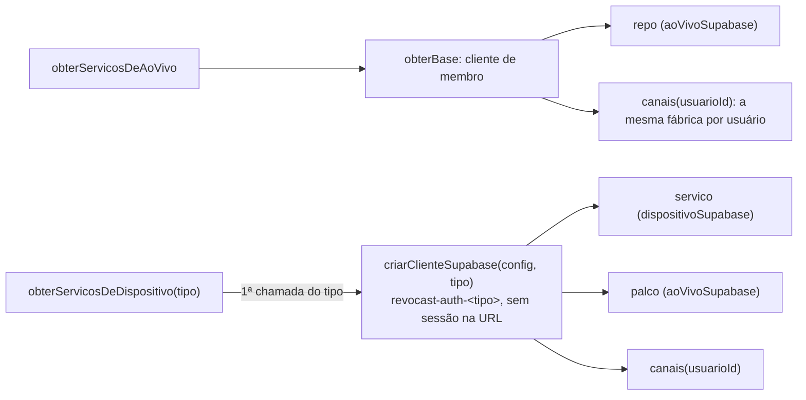

# src/app

## Cabeçalho

| Campo | Valor |
|---|---|
| Id | DIR-src-app |
| Título | `app` |
| Tipo | código · rotas e telas |
| Data | 2026-11-17 |
| Usuário responsável | TokumoH |
| Status | em construção |
| Commits | commit que introduz este arquivo — `git log --format=%h -- src/app/README.md` |
| Arquivos | `README.md`, `rotas.ts`, `rotas.test.ts`, `App.tsx`, `App.test.tsx`, `servicos.ts`, `servicos.test.ts`, `dependencias.ts`, `dependencias.test.ts`, `useAcesso.ts`, `canais.ts`, `canalDeVideoComutavel.ts`, `canalDeVideoComutavel.test.ts`, `useDispositivo.ts`, `useEstudio.ts`, `useAoVivo.ts`, `servicosFalsos.ts`, `servicosFalsos.test.ts`, `lerArquivoDoRepositorio.ts`, `GuardaDeMembro.tsx`, `acesso.test.tsx`, `filaPendurada.test.tsx`, `telas/` |

## Propósito

Casca do app: `resolverRota()` converte o caminho da URL em rota, `App` escolhe a tela, e `telas/` guarda uma tela por rota. Desde a E1, `servicos.ts` é a composição dos serviços de membro: lê a configuração e liga o cliente Supabase de membro aos adaptadores das portas do domínio Acesso; desde a Tarefa 4 da E2, liga o **mesmo** cliente aos adaptadores da Preparação (`obterServicosDePreparacao`); desde a Tarefa 4 da E3, também ao ao vivo (`obterServicosDeAoVivo`), e cria um cliente **por tipo** de dispositivo só para a rota daquele tipo (`obterServicosDeDispositivo`). Desde a Tarefa 4 da E1, `app/` também guarda o estado de tela do acesso (`useAcesso`), a guarda por papel das áreas de membro (`GuardaDeMembro`) e as dependências do navegador (`dependencias.ts`), que as três rotas de membro recebem e, desde a Tarefa 6 da E3, também as três de dispositivo (que só pedem `obterDispositivo(tipo)` e `limparFragmento`). Desde a Tarefa 6 da E3, `useDispositivo.ts` guarda o pareamento das rotas de dispositivo (`useDispositivo`) e o canal `estudio` de um dispositivo pareado (`acompanharEstudio`). Desde a Tarefa 7 da E3, `useEstudio.ts` mantém os canais das telas de membro (`useCanalReaberto`, `useEstudio`) e `useAoVivo.ts` guarda o ao vivo do `/controle` e, desde a Tarefa 9, da aba Ao vivo do painel (episódio ativo, listas, estado no ar, presença do palco e envio dos comandos).

## Origem

Criado na Tarefa 1 da etapa E0 ([PLA-001](../../docs/planos/2026-11-17-e0-fundacao.md)), que substitui o protótipo por um app React com a cara do RevoCast. Desenho: [DES-001](../../docs/desenho/2026-11-16-revocast-cameras-desenho.md). `servicos.ts` entrou na Tarefa 3 da E1 ([PLA-002](../../docs/planos/2026-11-26-e1-entrada-e-membros.md)), que põe a composição em `app/` (restrição global: o cliente de membro só é criado nas rotas de membro, de forma preguiçosa e uma vez por página). `dependencias.ts`, `useAcesso.ts`, `servicosFalsos.ts`, `GuardaDeMembro.tsx` e `acesso.test.tsx` entraram na Tarefa 4 da E1 (registro VER-018), que liga as telas a esses serviços e prova a restrição com `createClient` simulado. `filaPendurada.test.tsx` entrou com o registro [VER-021](../../docs/verificacoes/2026-11-26-021-tempo-limite-supabase.md), que põe tempo-limite de 15 s no `fetch` do cliente Supabase (`shared/infra/tempoLimite.ts`) e destrava a fila pendurada observada no VER-020. Na Tarefa 4 da E2 ([PLA-003](../../docs/planos/2026-11-26-e2-preparar-episodio.md), registro [VER-027](../../docs/verificacoes/2026-11-26-027-e2-adaptadores-preparacao.md)), `servicos.ts` passou a guardar o cliente de membro e a montar sobre ele também os serviços da Preparação, e `dependencias.ts` ganhou `obterPreparacao` (restrição global do PLA-003: os serviços da Preparação reaproveitam o mesmo cliente). Na Tarefa 4 da E3 ([PLA-004](../../docs/planos/2026-11-27-e3-ao-vivo-por-toque.md), registro [VER-038](../../docs/verificacoes/2026-11-27-038-e3-adaptadores-ao-vivo.md)), `servicos.ts` ganhou `obterServicosDeAoVivo` e `obterServicosDeDispositivo(tipo)`, `dependencias.ts` ganhou `obterAoVivo`, `obterDispositivo` e `limparFragmento`, e `servicosFalsos.ts` os falsos do ao vivo e do dispositivo (restrição global do PLA-004 "Rotas e clientes": cada rota de dispositivo cria só o seu cliente). Na Tarefa 6 da E3 (registro [VER-040](../../docs/verificacoes/2026-11-27-040-e3-telas-de-dispositivo.md)), `useDispositivo.ts` entrou e o `App` passou as dependências às rotas de dispositivo (decisões D3, D4, D5 e D15 do PLA-004). Na Tarefa 7 da E3 (registro [VER-041](../../docs/verificacoes/2026-11-27-041-e3-controle.md)), entraram `useEstudio.ts` (I-A do PLA-004: reabertura dos canais de membro) e `useAoVivo.ts` (decisões D5, D9, D14 e D15, N3). Na Tarefa 9 da E3 (registro [VER-043](../../docs/verificacoes/2026-11-27-043-e3-aba-ao-vivo-episodio.md)), `useEstudio.ts` ganhou `useUmaReavaliacaoPorPerda` e `useAoVivo.ts` ganhou `aoPerderCanal` e `recarregar()` (VER-041, Riscos: as duas reavaliações dentro do painel).

## Organização

- `rotas.ts`: tipos `NomeDaRota` e `Rota` e a função `resolverRota`.
- `App.tsx`: escolhe a tela pelo nome da rota.
- `*.test.ts(x)` ao lado do arquivo testado.
- `telas/`: uma tela por rota, mais "Página não encontrada".
- `servicos.ts`: `ambienteDoVite()` (só `VITE_SUPABASE_URL` e `VITE_SUPABASE_PUBLISHABLE_KEY` e, desde a E4, as três opcionais do TURN, `VITE_TURN_URL`, `VITE_TURN_USUARIO` e `VITE_TURN_SENHA`, lidas de `import.meta.env` uma a uma), `criarServicosDeMembro(env)` (lança `ErroDeConfiguracao` antes de criar qualquer cliente; cria um cliente `membro`, com `storageKey: 'revocast-auth-membro'` e `detectSessionInUrl: true`, e devolve `{ auth, repo }`) `criarServicosDePreparacao(cliente, config)` (os cinco repositórios de `shared/infra/preparacaoSupabase.ts` e o armazenamento de `shared/infra/armazenamentoSupabase.ts`, com a URL e a chave pública da configuração), `obterServicosDeMembro()` e `obterServicosDePreparacao()`. Desde a Tarefa 4 da E2, o que fica guardado em módulo é o **cliente** de membro (com a configuração com que foi criado), criado na primeira chamada de qualquer uma das duas; cada conjunto de serviços também é guardado, sobre esse cliente único (uma sessão e um refresh de token por página). Se a configuração falhar, as duas lançam `ErroDeConfiguracao` e nada fica guardado. Nenhum módulo chama essas funções ao ser importado: quem chama `obterServicosDeMembro` é o `useAcesso`, só nas rotas de membro, por meio de `Dependencias.obterServicos`; `obterServicosDePreparacao` só é chamado por `Dependencias.obterPreparacao`, dentro da guarda (telas da Preparação, Tarefas 5 a 7).
- `servicos.ts` (E3): `obterServicosDeAoVivo()` devolve `{ repo, canais }` sobre o **mesmo** cliente de membro (`obterBase`); `obterServicosDeDispositivo(tipo)` devolve `{ servico, palco, canais }` sobre um cliente **do tipo** (`criarClienteSupabase(config, tipo)`: `storageKey` `revocast-auth-<tipo>`, `detectSessionInUrl: false`), criado na primeira chamada daquele tipo e guardado num `Map` (configuração inválida → `ErroDeConfiguracao`, sem cliente e sem guardar nada); nunca o cliente de membro. Em ambos, `canais(usuarioId)` devolve a **mesma** fábrica de canais para o mesmo usuário (`canaisPorUsuario`): a fábrica guarda o registro de um canal por tópico do cliente, e uma segunda fábrica no mesmo cliente faria o `realtime-js` lançar no `on('presence')` (VER-038).
- `servicos.ts` (E4, Tarefa 3; VER-051): `ServicosDoDispositivo` ganha `conexoes` (`criarFabricaDeConexoes({ ice: servidoresIce(config) })`, com a configuração do mesmo `lerConfiguracao`: só o STUN público sem as três variáveis do TURN, D9; nenhum `RTCPeerConnection` antes de a rota pedir uma conexão) e `aparelho` (`AparelhoDoDispositivo`: `camera()` e `tela()` criam os adaptadores de `shared/infra/cameraNavegador.ts`, `bateria()` lê `getBattery` onde existir; desde o VER-052, `videoDireto()` diz se o navegador tem `RTCPeerConnection`, para a câmera avisar a causa em vez de ficar em `conectando`); `canais(usuarioId)` passa a ter o tipo `FabricaDeCanais & FabricaDeCanaisDeVideo` (o canal de vídeo é a mesma fábrica, D1). Continua um cliente por tipo.
- `dependencias.ts`: interface `Dependencias` (o que as telas de membro pedem ao mundo de fora), `caminhoDaArea`, `urlDeRetorno` (origem + `/painel`, `/controle` ou `/entrar`; nenhum parâmetro da URL escolhe o destino) e `dependenciasDoNavegador()` (preguiçosa: não cria o cliente; `obterServicos` e, desde a E2, `obterPreparacao` são as funções de `servicos.ts`, chamadas só quando a tela pede). Desde a E3: `obterAoVivo` (rotas de membro, dentro da guarda), `obterDispositivo(tipo)` (rotas de dispositivo, chamado pelo `useDispositivo` desde a Tarefa 6) e `limparFragmento()` (tira só o fragmento da URL, o código de pareamento, com `history.replaceState`, mantendo caminho, busca e `history.state`; D3).
- `canais.ts` (VER-046, N7): só `REABRIR_CANAIS_MS`, a espera de 5 s de reabertura dos canais, importada por `useEstudio.ts`, `useAoVivo.ts`, `useDispositivo.ts`, pelo `PalcoNoAr` e pelos testes de tela. `acompanharEstudio` continua em `useDispositivo.ts`: é do dispositivo e só as rotas de dispositivo (câmeras e palco) o usam; levá-lo junto encolheria `useDispositivo.ts` para 90 linhas e faria as âncoras do VER-040 (`#L100-L217`) passarem do fim do arquivo.
- `useDispositivo.ts` (E3, Tarefa 6): `useDispositivo(tipo, dependencias)` lê o fragmento **uma vez**, chama `limparFragmento()` antes de `obterDispositivo(tipo)` e de qualquer rede e chama `resolverDispositivo`; devolve `{ estado, servicos, tentarDeNovo, marcarRevogado }` (`estado`: o do domínio, `carregando` ou `configuracao` com o nome da variável); o código fica só numa referência em memória (esquecido depois de qualquer resposta que não seja `falha`) e a avaliação em curso é reaproveitada pelo segundo efeito do `StrictMode`. `acompanharEstudio(opcoes)` é o canal `estudio` de um dispositivo pareado (presença, `revogacao` do próprio usuário → fecha os canais, `sair()` e `marcarRevogado()`; canal `fechado`/`negado` → `resolverDispositivo` sem código: sem dispositivo → revogado, com dispositivo → reabre em 5 s, `REABRIR_CANAIS_MS` de `canais.ts`), usado pelas câmeras e pelo palco. Desde a E4 (Tarefa 4, VER-052; D13 do PLA-005), `atualizarPresenca()` coalesce: depois de cada marcação abre uma janela de `presencaMinimaMs` (padrão `PRESENCA_MINIMA_MS`, 10 s); o que mudar dentro dela sai uma vez, no fim, e um corpo igual ao último marcado nunca é remarcado; `presencaMinimaMs: 0` marca na hora (o palco, que já só remarca quando a situação do OBS muda).
- `canalDeVideoComutavel.ts` (E4, Tarefa 4; VER-052): `criarCanalComutavel()`, o canal de vídeo que a rota liga e desliga por baixo do emissor (que vive a página inteira e guarda o consentimento e as esperas): `ligar(real)` repassa sinais e estados do canal real; `desligar()` avisa `fechado` e devolve o real **sem fechar**, para o `encerrar` sair antes; sem canal real, `enviar` devolve `falhou` sem chamar nada. Usado pela `CameraNoAr` e, desde o VER-053, pela `ObsCameraNoAr` (por baixo do receptor do `/obs/camera`).
- `useEstudio.ts` (E3, Tarefa 7): `useCanalReaberto(abrir, aoPerder)` mantém aberto o canal que `abrir` cria (estável, `useCallback`): `fechado` ou `negado` → `aoPerder()` uma vez e, se o componente continua montado 5 s depois (`REABRIR_CANAIS_MS`, importado de `canais.ts` desde o VER-046; antes, de `useDispositivo.ts`), fecha a alça morta e abre outra; `abrir` diferente troca de alça, nulo fecha, desmontar fecha e cancela a espera. `useEstudio({ canais, papel, reavaliar })` é o `estudio` de uma tela de membro com a presença `{ tipo: 'membro', papel }` (D14); a Tarefa 8 o usa no painel; `canais` nulo não abre nada (para quem recebe o `estudio` de fora). Desde a Tarefa 9, `useUmaReavaliacaoPorPerda(reavaliar)` devolve uma função estável que chama `reavaliar()` no máximo uma vez por janela de 5 s; o painel divide a dele entre o próprio `estudio` e o `useAoVivo` da aba Ao vivo, e o `useAoVivo` sem `aoPerderCanal` usa uma própria. Não reaproveita `acompanharEstudio`: lá a perda refaz `resolverDispositivo` e decide entre revogado, reabrir e tentar de novo (com `sair()`), aqui quem decide é a guarda depois do `reavaliar()` (VER-041, "Por que não outras soluções").
- `useAoVivo.ts` (E3, Tarefa 7): `useAoVivo({ repo, preparacao, canais, usuario, papel, reavaliar, aoVoltarAVer, estudio?, aoPerderCanal? })` (com `estudio`, o do painel na Tarefa 9, não abre outra alça nem cuida da perda dele; com `aoPerderCanal`, a perda do `:controle` usa a janela de quem abriu o `estudio`) consulta `episodio_ativo()` (ao montar, no `episodio_ativo_mudou`, a cada volta do `estudio` a `conectado` e a cada volta à aba), lê o título e as listas do episódio, abre o `:controle` dele (comandos; presença marcada quando o `:estado` está conectado) e, desde o VER-047, o `:estado` (o estado no ar, lido só dali; trocar de episódio troca os dois tópicos e limpa o estado no ar) e devolve `{ carregado, falhaAoCarregar, episodio, estadoNoAr, canal, podeComandar, palcoPresente, listas, estudio, pedidoDoUltimo, enviar, recarregar }` (`podeComandar`, Tarefa 9, rodada 2: canal `conectado` e a última consulta sem falha; o `habilitado` do `/controle` e da aba, e o `enviar` devolve `falhou` sem ele) (`recarregar()` consulta na hora: a aba Ao vivo, depois de mudar o episódio, não depende do aviso, que não volta à alça que o enviou); `canal` é o pior estado entre `estudio`, `:controle` e `:estado` (VER-047; 3 canais por cliente, num socket só); canal perdido → um `reavaliar()` por janela de 5 s (os dois canais caindo juntos contam uma vez); `revogacao` do próprio `usuario.id` → `reavaliar()` (com o `estudio` de fora, não: quem ouve é o painel, Tarefa 9, rodada 1); `revogacao` de outro → o `estado` desse remetente é descartado por 15 min (`Revogados`, como no palco; D5, VER-046 N3); `palcoPresente` conta qualquer presença `obs_palco` em `estudio` (a aba Ao vivo exige, além disso, a sessão atual do dispositivo pela lista, que o `/controle` não lê: VER-046 N2, Riscos de [`telas/README.md`](telas/README.md)); `enviar` gera o `id` por `crypto.randomUUID()`, só envia com o canal `conectado` e chama `reavaliar()` depois de duas respostas `sem_resposta` seguidas (um `ok` e a volta do canal a `conectado` zeram); a consulta antiga que responde depois da nova é descartada; leitura negada ou com sessão vencida → `reavaliar()`, no máximo 3 seguidos (`REAVALIACOES_DA_LEITURA`); toda falha marca nova consulta a 5, 10, 20, 40 s… até 60 s (`ESPERA_MAXIMA_DA_CONSULTA_MS`); um sucesso zera as contagens.
- `useAcesso.ts`: estado de tela do acesso. Avaliações serializadas numa fila; a primeira usa o retorno da URL e só depois dela a URL é limpa; as automáticas (evento de sessão, volta à aba, escrita negada) usam `SEM_RETORNO` + `combinarEstados`; as ações da pessoa (Tentar de novo, Entrar, Sair) entram na mesma fila.
- `GuardaDeMembro.tsx`: guarda de `/painel` e `/controle`; entrega o conteúdo (função `children`) só a membro cujo papel abre a área.
- `servicosFalsos.ts`: **só para testes** (não importa `vitest` nem Supabase); falsos das portas e das dependências, com `sair()` que emite a mudança de sessão antes de resolver, como o supabase-js; desde a Tarefa 4 da E2, `preparacaoVazia()` (Preparação com listas vazias e escritas sem efeito), que as dependências falsas devolvem em `obterPreparacao`; desde a Tarefa 5 da E2, `criarFalsosDePreparacao(inicial)` (Preparação com estado: envio que emite progresso e respeita o `AbortSignal`, `segurarEnvio()` para o teste mandar progredir e concluir, `midias.remover` que recusa som ligado a gesto com `em_uso`, `falharProxima('<porta>.<método>', erro)`, chamadas anotadas, inclusive `previa`) e `arquivoDeTeste(tipo, nome, tamanho?)` (arquivo em memória com os bytes mágicos de PNG, MP3, HTML ou SVG e o `File.type` que o navegador daria pela extensão do nome). Desde a Tarefa 4 da E3 (não importa o supabase-js em tempo de execução, só tipos): `criarCanalFalso()` (o adaptador **real** `criarFabricaDeCanais` sobre o cliente Realtime falso de `shared/infra/realtimeFalso.ts`, conectando sozinho, com ouvintes por `queueMicrotask`; `definirEstado`, `responderEnvio`, `entregar`, `sincronizarPresenca`, `entrarAlguem`, `enviados`, `presencas`, `abertos`), `aoVivoVazio()` (nenhum episódio ativo nem dispositivo; criar código recusa com `outro`) e `criarFalsosDeDispositivo(inicial)` (sessão anônima nova a cada `entrarAnonimo`, pareamento programável, `dispositivoAtual` só com sessão anônima, `sair` que apaga a sessão, `ordem` das chamadas, `falharProxima`, palco com URL assinada falsa e registro anotado; desde a E4, `conexoes` e `aparelho` de `criarVideoFalso`, em `video`); desde a E4 (VER-051), o canal de vídeo do `criarCanalFalso` envia por uma `rpc` falsa (`sinaisDeVideo`, `responderSinal`) e `criarVideoFalso()` imita as conexões (passam sozinhas por `conectando` → `conectado` depois da resposta, `cair`, `falhar`, `fluxoRecebido` no lado que responde, `trocaDaFaixa`), a câmera (uma nova a cada `aparelho.camera()`, como a composição real, contadas em `criadas`; `proxima` recusa, `perder` na última criada, `fluxoDaPrevia` só ligada), a tela (uma nova a cada chamada; `proxima`: `travada` ou `sem_trava`) e a bateria (`definirBateria`); `criarFalsos().dependencias()` devolve um `aoVivoVazio` e um dispositivo por tipo por conjunto de falsos e conta `obterAoVivo`, `obterDispositivo` e `limparFragmento`.

## Por que esta organização

Rotas por **caminho** (`/painel`, `/obs/palco`...) deixam o fragmento `#` livre para o código de pareamento (DES-001). Separar `resolverRota` (função pura) do `App` (React) permite testar as rotas sem DOM.

## Por que não outras organizações

| Opção | Motivo de descarte |
|---|---|
| Roteador pronto (react-router) | Dependência a mais para seis rotas fixas |
| Rotas por fragmento `#` | O `#` é reservado ao código de pareamento |

## Onde

| Arquivo ou subdiretório | O que contém |
|---|---|
| [`README.md`](README.md) | Este arquivo |
| [`rotas.ts`](rotas.ts) | `NomeDaRota`, `Rota` e `resolverRota()` |
| [`rotas.test.ts`](rotas.test.ts) | Onze casos de `resolverRota` (nome e título literais, inclusive barra final e `/painel//`) |
| [`App.tsx`](App.tsx) | Componente `App({ caminho, dependencias? })`: resolve a rota, define o `document.title`, guarda as dependências uma vez (`useState(() => dependencias ?? dependenciasDoNavegador())`) e as passa às três telas de membro e, desde a Tarefa 6 da E3, às três de dispositivo |
| [`App.test.tsx`](App.test.tsx) | Testes de tela: Controle com logo (membro falso), "Página não encontrada" no cartão rosa com o link "Ir para a entrada" para `/entrar` e, para as 7 rotas, o título (heading e `document.title`, a partir de `resolverRota`), a frase própria de cada tela e o logo (desde a Tarefa 7 da E3, o `/controle` sem episódio ativo diz "Nenhum episódio no ar nem em teste."); rotas de membro com membro `equipe` falso (`/entrar` chama `navegar('/painel')`; `/painel` mostra a primeira aba: "Em construção — etapa E2" desde a Tarefa 5 da E1 e, desde a Tarefa 7 da E2, a aba Episódios real, com a nota "Iniciar e encerrar o ao vivo chegam na etapa E3." e, desde a Tarefa 9 da E3, "Iniciar e encerrar o ao vivo ficam na aba Ao vivo."), rotas de dispositivo e `/xyz` sem `obterServicos` (desde a Tarefa 6 da E3, as de dispositivo mostram "Este aparelho não está pareado…" e chamam `obterDispositivo(tipo)` e `limparFragmento` uma vez cada); com `createClient` simulado e o caminho padrão (`dependenciasDoNavegador`), reescrito na E3: `caminho-padrao-nao-cria-cliente-em-dispositivo` (`/camera`, `/obs/palco` e `/obs/camera`, com a tela pedindo sozinha os serviços do tipo desde a Tarefa 6, nunca criam o cliente `revocast-auth-membro` e criam só o do tipo; `/xyz` cria 0; `/painel` cria 1, de membro) e `dispositivo-cria-so-o-proprio-cliente` (cada rota de dispositivo: exatamente 1 `createClient`, com a `storageKey` do tipo e `detectSessionInUrl: false`; `/painel`: só o de membro) |
| [`servicos.ts`](servicos.ts) | `ambienteDoVite`, `criarServicosDeMembro`, `criarServicosDePreparacao`, `obterServicosDeMembro`, `obterServicosDePreparacao` e, desde a E3, `ServicosDeAoVivo`, `ServicosDoDispositivo`, `obterServicosDeAoVivo` e `obterServicosDeDispositivo` (composição dos serviços de membro, da Preparação e do ao vivo sobre o mesmo cliente, um por página; um cliente por tipo de dispositivo) e, desde a E4, `AparelhoDoDispositivo` (com `videoDireto` desde o VER-052) e as conexões e o aparelho do dispositivo |
| [`servicos.test.ts`](servicos.test.ts) | 12 testes com `createClient` simulado (`vi.mock`): configuração ausente lança citando `VITE_SUPABASE_URL` sem criar cliente; com as duas variáveis, 1 `createClient` com as opções de membro e `{ auth, repo }`; `ambienteDoVite` só com as duas chaves; cache de `obterServicosDeMembro` (`vi.resetModules` + `vi.stubEnv`): 2 chamadas → 1 cliente; configuração inválida → lança nas duas e não guarda nada; e 3 da E2: `obterServicosDePreparacao` e `obterServicosDeMembro` na mesma página → 1 `createClient` (nas duas ordens), configuração inválida → as duas lançam `ErroDeConfiguracao` e nenhum cliente; e 4 da E3: `obterServicosDeAoVivo` com membro e Preparação → 1 `createClient` e a mesma fábrica de canais por usuário; configuração inválida → `ErroDeConfiguracao` sem cliente; `obterServicosDeDispositivo('obs_palco')` → 1 cliente `revocast-auth-obs_palco` com `detectSessionInUrl: false`, duas chamadas → 1, outro tipo → outro cliente, nunca o de membro; configuração inválida no dispositivo → lança sem cliente e sem guardar nada; e, desde o VER-051 (15 testes), `ambienteDoVite` com as cinco chaves (Supabase e TURN, nenhuma outra) e 3 da E4: `conexoes-com-turn` (as três variáveis → `RTCPeerConnection` com o STUN e o TURN, `bundlePolicy: 'max-bundle'`, nenhum antes do `criar()`), `conexoes-sem-turn` (uma ausente → só o STUN) e `aparelho e um cliente por tipo` (câmera, tela e bateria; canal de vídeo na fábrica; 1 cliente por tipo) (12 testes até o VER-050) |
| [`dependencias.ts`](dependencias.ts) | `Dependencias` (com `obterPreparacao` desde a E2 e `obterAoVivo`, `obterDispositivo` e `limparFragmento` desde a E3), `caminhoDaArea`, `urlDeRetorno` e `dependenciasDoNavegador` |
| [`dependencias.test.ts`](dependencias.test.ts) | 6 testes (jsdom) de `caminhoDaArea`, `urlDeRetorno` e `dependenciasDoNavegador`: lê a URL, é preguiçosa (`obterServicos`, `obterPreparacao`, `obterAoVivo` e `obterDispositivo` são as funções de `servicos.ts`), `limpar-fragmento-tira-so-o-fragmento` (E3: caminho, busca e `history.state` ficam), `limparRetornoDaUrl` tira só os `PARAMETROS_DE_RETORNO` (outros parâmetros e o `history.state` ficam) e o fragmento só com `fragmentoSujo`; `aoVoltarAVer` só avisa com a aba visível e para depois de cancelar |
| [`canais.ts`](canais.ts) | `REABRIR_CANAIS_MS` (5 s): a espera de reabertura dos canais, comum às telas de membro (`useEstudio`, `useAoVivo`) e às rotas de dispositivo (`useDispositivo`); módulo neutro desde o VER-046 (N7), para as telas de membro não dependerem do arquivo do hook de dispositivo |
| [`useDispositivo.ts`](useDispositivo.ts) | `EstadoDaRotaDeDispositivo`, `DispositivoPareado`, `useDispositivo` (pareamento das rotas de dispositivo, D3, D4, N1) e `acompanharEstudio` (presença, revogação e canal fechado em `estudio`, D5, D15, N3; desde o VER-052, a presença coalescida por `presencaMinimaMs`, D13 do PLA-005); testado pelas telas em `telas/TelaDeDispositivo.test.tsx`, `telas/PalcoNoAr.test.tsx` e, a janela da presença, `telas/CameraNoAr.test.tsx` (`presenca-com-video`) |
| [`lerArquivoDoRepositorio.ts`](lerArquivoDoRepositorio.ts) | Só para testes (VER-052, rodada 2, R2-N3): `lerArquivoDoRepositorio(caminho)`, o leitor de arquivo do repositório por `node:fs` (sem `@types/node`), antes dentro do `telas/PalcoNoAr.test.tsx`; usado por ele, pelo `telas/CameraNoAr.test.tsx` e, desde o VER-053, pelo `telas/ObsCameraNoAr.test.tsx` (o `index.html` e o `base.css`) |
| [`canalDeVideoComutavel.ts`](canalDeVideoComutavel.ts) | `criarCanalComutavel` (VER-052): o canal de vídeo ligado e desligado pela rota por baixo do emissor (D5) |
| [`canalDeVideoComutavel.test.ts`](canalDeVideoComutavel.test.ts) | 4 testes (VER-052): sem canal real (`falhou` sem chamar nada), ligado (repassa estado, sinais e envio), `desligar` (avisa `fechado`, solta os ouvintes e devolve o real sem fechar), ligar outro fecha o anterior e `fechar` fecha o atual |
| [`useEstudio.ts`](useEstudio.ts) | `AlcaReabrivel`, `CanalReaberto`, `useCanalReaberto` (canal de membro que reabre em 5 s depois de `fechado`/`negado`, com `aoPerder()` uma vez) e `useEstudio` (`estudio` com a presença do membro); `useUmaReavaliacaoPorPerda` (um `reavaliar()` por janela de 5 s, Tarefa 9); testado pelo `/controle` em `telas/Controle.test.tsx` e pelo painel em `telas/Painel.test.tsx` |
| [`useAoVivo.ts`](useAoVivo.ts) | `REAVALIACOES_DA_LEITURA`, `ESPERA_MAXIMA_DA_CONSULTA_MS`, `EpisodioDoAoVivo`, `AoVivo` e `useAoVivo` (o ao vivo de uma tela de membro: episódio ativo, listas, `estudio`, `:controle`, estado no ar, palco presente, envio com `ack` e reavaliações, D5, D9, D14, D15, N3; `recarregar` e `aoPerderCanal` desde a Tarefa 9); testado pelo `/controle` em `telas/Controle.test.tsx` e pela aba Ao vivo em `telas/AbaAoVivo.test.tsx` |
| [`useAcesso.ts`](useAcesso.ts) | `EstadoDaTela` e `useAcesso(dep)`: estado, serviços, `reavaliar`, `tentarDeNovo`, `entrar`, `sair` |
| [`GuardaDeMembro.tsx`](GuardaDeMembro.tsx) | Guarda por área: telas de cada estado, "Sem acesso a esta página" e, para membro, cabeçalho + conteúdo |
| [`servicosFalsos.ts`](servicosFalsos.ts) | Só para testes: `criarVideoFalso` (E4, Tarefa 3; `config.videoDireto` desde o VER-052), `criarCanalFalso`, `aoVivoVazio` e `criarFalsosDeDispositivo` (E3, Tarefa 4), `preparacaoVazia` (E2), `criarFalsosDePreparacao` e `arquivoDeTeste` (E2, Tarefa 5), `usuarioGoogle` e `criarFalsos` (portas e dependências falsas, contagem de chamadas, `segurarSair`/`liberarSair`, `ouvintesAtivos`) |
| [`servicosFalsos.test.ts`](servicosFalsos.test.ts) | 7 testes desde o VER-051: 4 dos falsos da E4 (`canal-de-video-falso`, `criarVideoFalso: conexão`, `criarVideoFalso: câmera, tela e bateria`, `dispositivo-falso-com-video`) e 3 dos falsos da E3: `canal-falso-segue-o-adaptador` (conecta sozinho, um canal para duas alças, eco local, entrega inválida descartada, `sem_resposta`, estados e presença), `ao-vivo-vazio-e-dependencias` (mesma instância por conjunto de falsos e contagens) e `dispositivo-falso` (sessão anônima, pareamento, `dispositivoAtual`, `sair`, `ordem`, falha programada, palco) |
| [`acesso.test.tsx`](acesso.test.tsx) | 26 testes de entrada e guarda (PLA-002, Tarefa 4): configuração, erro inesperado, rotas de dispositivo (desde a Tarefa 6 da E3, com a frase "não está pareado"), URL de retorno fixa, fora da lista, sessão anônima e expirada, `sair` lento, retorno do Google, URL limpa depois de resolver (e só se suja), papel, falha e Sair; e, da revisão, erro dentro da fila → falha, `limparRetornoDaUrl` que lança não troca `membro`, desmontagem cancela as assinaturas e não aplica, `sair` aplica `sem_sessao` direto |
| [`filaPendurada.test.tsx`](filaPendurada.test.tsx) | 2 testes de ponta a ponta com o supabase-js **real** (jsdom, sessão guardada no `localStorage`, só o `fetch` global é falso e timers falsos): `rpc/papel_atual` sem resposta → "Conferindo seu acesso…" até 15 s e tela de falha com "Tentar de novo"; com a rede boa, "Tentar de novo" leva ao painel (depois da reavaliação que já esperava na fila, ver "Riscos"); com a rede boa desde o início, painel sem esperar. Falha sem o tempo-limite (VER-021) |
| [`telas/`](telas/) | Uma tela por rota e as telas dos estados de acesso |

## Lógica

`/` leva a `entrar`; barra final é ignorada; caminho desconhecido (incluindo `/obs`) leva a `nao_encontrada`.

Acesso de membro (`useAcesso`, só nas rotas `/entrar`, `/painel` e `/controle`):

A fila (`montagem.fila = montagem.fila.then(...)`) faz cada avaliação começar só depois de a anterior aplicar o resultado: o SIGNED_OUT que o `sair()` emite antes de resolver pede uma reavaliação que roda depois e, por `combinarEstados`, não apaga `sem_papel` nem os avisos fixos.

Composição dos serviços de membro (`servicos.ts`):

Desde a Tarefa 4 da E2, o cliente é guardado à parte e as duas composições o reaproveitam:

Desde a Tarefa 4 da E3, o ao vivo usa o mesmo cliente de membro, e cada tipo de dispositivo tem o seu (só a rota daquele tipo o pede):

## Exemplo

Para criar a rota `/exemplo`: acrescentar o nome em `NomeDaRota` e a entrada em `ROTAS` de `rotas.ts`, uma tela em `telas/` e um `case` no `App.tsx` (com `noImplicitReturns` ligado no `tsconfig.json`, o `case` esquecido dá erro TS7030 no `npm run typecheck`). Se for rota de membro, a tela recebe `dependencias` e envolve o conteúdo em `<GuardaDeMembro area="painel" titulo={titulo} dependencias={dependencias}>{(membro) => …}</GuardaDeMembro>`; num teste, `criarFalsos({ usuario: usuarioGoogle('ana@revocast.test'), papel: 'equipe' })` e `render(<App caminho="/exemplo" dependencias={f.dependencias()} />)`.

## Verificação

- Arquivos de teste desta pasta (fora de `telas/`): 8 arquivos, 82 testes desde o VER-052 (mais os 4 de `canalDeVideoComutavel.test.ts`; `servicos.test.ts` e `servicosFalsos.test.ts` ganharam asserções de `aparelho.videoDireto`, sem teste novo); 7 arquivos, 78 testes desde o VER-051 (15 em `servicos.test.ts`, 7 em `servicosFalsos.test.ts`); 71 testes desde o VER-038 (26 em `acesso.test.tsx`, 11 em `rotas.test.ts`, 11 em `App.test.tsx`, 6 em `dependencias.test.ts`, 12 em `servicos.test.ts`, 3 em `servicosFalsos.test.ts`, 2 em `filaPendurada.test.tsx`; eram 6 arquivos e 62 testes desde o VER-027; continuam 71 no VER-040, que só trocou as frases das rotas de dispositivo em `App.test.tsx` e `acesso.test.tsx`, e no VER-041, que trocou a frase do `/controle` nos mesmos dois arquivos); as sabotagens S15a, S15b, S16, S23, S24, S37 e S38 do registro [VER-038](../../docs/verificacoes/2026-11-27-038-e3-adaptadores-ao-vivo.md) derrubam os testes de clientes por rota, de composição, de `limparFragmento` e dos falsos; a sabotagem "segundo cliente para a Preparação" do VER-027 derruba os dois testes de 1 `createClient`; 25 sabotagens do registro VER-018 derrubam cada uma os testes indicados; a sabotagem "sem o envoltório" do registro [VER-021](../../docs/verificacoes/2026-11-26-021-tempo-limite-supabase.md) derruba `filaPendurada.test.tsx`.
- `npx vitest run src/app/servicos.test.ts`: 12 testes desde o VER-038 (8 desde o VER-027, 5 até então; a célula da tabela "Onde" dizia "8 testes" no começo e "(12 testes)" no fim até o VER-046, N5); sabotagens do cache, de `ambienteDoVite` e do tipo de sessão derrubam cada uma o teste correspondente (registro [VER-017](../../docs/verificacoes/2026-11-26-017-e1-adaptadores-acesso.md)).
- Composição e falsos do vídeo (E4): as sabotagens "ambienteDoVite sem o TURN", "composição sem TURN" e "vídeo falso não conecta sozinho" do registro [VER-051](../../docs/verificacoes/2026-11-28-051-e4-adaptadores-video.md) derrubam `ambienteDoVite`, `conexoes-com-turn` e `criarVideoFalso: conexão`.
- Links relativos, "Onde" e campo "Arquivos" conferidos por `npm run check-docs`.
- Subdiretórios com README próprio (conferido pelo mesmo comando).

## Riscos

- Conteúdo ainda provisório na aba Ao vivo do `/painel` (E3, Tarefas 8 e 9) e no vídeo das câmeras (E4; desde a Tarefa 6 da E3 as rotas de dispositivo pareiam e o palco executa os comandos, e desde a Tarefa 7 o `/controle` manda os comandos por toque); a entrada, a guarda, a aba Membros (Tarefa 5 da E1, registro VER-019) e a aba Biblioteca (Tarefa 5 da E2, registro VER-028) já são reais.
- O login real (Google + Supabase) ainda não foi conferido; a conferência no navegador desta tarefa usou rotas interceptadas pelo Playwright (registro VER-018) e a real fica para a Tarefa 6 da E1.
- Fila pendurada (resolvida no VER-021): as chamadas do cliente Supabase a `/rest/v1/` e `/auth/v1/` têm tempo-limite de 15 s (`shared/infra/tempoLimite.ts`), então uma avaliação sem resposta vira `falha` com "Tentar de novo" e a fila anda. O hook continua sem tempo-limite próprio: cada avaliação que já está na fila paga o seu, então um "Tentar de novo" pode esperar até mais 15 s (no carregamento com sessão, a reavaliação do evento do auth-js já está na fila e começa logo depois da falha; conferido no Chromium: falha em ~15,5 s, painel em ~30,4 s). Com a sessão expirada, o refresh do auth-js tenta duas vezes: até ~30,2 s para a falha. O Storage continua fora do tempo-limite de 15 s: desde a Tarefa 4 da E2, o envio tem acompanhamento próprio (progresso, cancelamento e corte por 30 s sem progresso, em `shared/infra/armazenamentoSupabase.ts`), e a URL assinada da prévia e a remoção seguem sem limite (VER-027, Riscos).
- Erro lançado dentro de uma tarefa da fila (defeito: as portas não lançam) vira `falha` só se a tarefa ainda não aplicou estado; se já aplicou (por exemplo, `limparRetornoDaUrl` lançando depois de `membro`), o estado fica e a URL continua suja.
- Sem fusão de reavaliações repetidas: no carregamento com sessão o auth-js emite um evento depois do `INITIAL_SESSION` e o papel é lido duas vezes (uma leitura a mais, aceita no plano).
- Desde a Tarefa 6 da E3 (VER-040), `dispositivo-cria-so-o-proprio-cliente` e `caminho-padrao-nao-cria-cliente-em-dispositivo` não chamam mais `obterDispositivo` à mão: a tela o chama uma vez; o "uma vez por página" com duas chamadas fica provado em `servicos.test.ts`.
- A fábrica de canais é guardada por usuário em cada cliente; num cliente em que o usuário troca sem recarregar, canais do usuário anterior ainda abertos no mesmo tópico fariam o `realtime-js` lançar na fábrica nova (as telas fecham os canais ao desmontar).
- O cache do cliente de membro (e dos serviços de membro e da Preparação) vale por página (módulo); não há como trocar a configuração sem recarregar, o que é o esperado num app Vite.
- `VITE_TURN_SENHA` entra no bundle como as outras variáveis `VITE_` (D9; DES-001 §13): quem tiver a URL do app pode gastar a cota do TURN; o padrão é sem TURN. `criarVideoFalso` imita só o que muda as telas (estados, faixa perdida, trava); o `RTCPeerConnection` real fica para a Tarefa 7 da E4.
