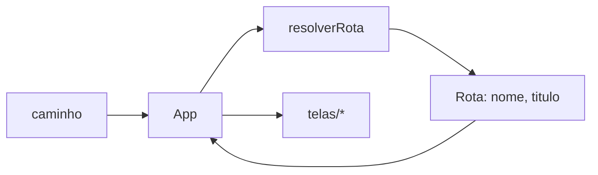

# src/app

## Cabeçalho

| Campo | Valor |
|---|---|
| Id | DIR-src-app |
| Título | `app` |
| Tipo | código · rotas e telas |
| Data | 2026-11-17 |
| Usuário responsável | TokumoH |
| Status | em construção |
| Commits | commit que introduz este arquivo — `git log --format=%h -- src/app/README.md` |
| Arquivos | `README.md`, `rotas.ts`, `rotas.test.ts`, `App.tsx`, `App.test.tsx`, `telas/` |

## Propósito

Casca do app: `resolverRota()` converte o caminho da URL em rota, `App` escolhe a tela, e `telas/` guarda uma tela por rota.

## Origem

Criado na Tarefa 1 da etapa E0 ([PLA-001](../../docs/planos/2026-11-17-e0-fundacao.md)), que substitui o protótipo por um app React com a cara do RevoCast. Desenho: [DES-001](../../docs/desenho/2026-11-16-revocast-cameras-desenho.md).

## Organização

- `rotas.ts`: tipos `NomeDaRota` e `Rota` e a função `resolverRota`.
- `App.tsx`: escolhe a tela pelo nome da rota.
- `*.test.ts(x)` ao lado do arquivo testado.
- `telas/`: uma tela por rota, mais "Página não encontrada".

## Por que esta organização

Rotas por **caminho** (`/painel`, `/obs/palco`...) deixam o fragmento `#` livre para o código de pareamento (DES-001). Separar `resolverRota` (função pura) do `App` (React) permite testar as rotas sem DOM.

## Por que não outras organizações

| Opção | Motivo de descarte |
|---|---|
| Roteador pronto (react-router) | Dependência a mais para seis rotas fixas |
| Rotas por fragmento `#` | O `#` é reservado ao código de pareamento |

## Onde

| Arquivo ou subdiretório | O que contém |
|---|---|
| [`README.md`](README.md) | Este arquivo |
| [`rotas.ts`](rotas.ts) | `NomeDaRota`, `Rota` e `resolverRota()` |
| [`rotas.test.ts`](rotas.test.ts) | Onze casos de `resolverRota` (nome e título literais, inclusive barra final e `/painel//`) |
| [`App.tsx`](App.tsx) | Componente `App({ caminho })`: resolve a rota uma vez, define o `document.title` e escolhe a tela, passando o título |
| [`App.test.tsx`](App.test.tsx) | Testes de tela: Controle com logo, "Página não encontrada" no cartão rosa (classe `cartao--rosa`) com o link "Ir para a entrada" para `/entrar` e, para as 7 rotas, o título (heading e `document.title`, a partir de `resolverRota`), a frase própria de cada tela ("Em construção — etapa E1/E3/E4" ou "Esse endereço não existe.") e o logo; telas da mesma etapa (Entrar/Painel, Controle/ObsPalco, Camera/ObsCamera) mostram o mesmo conteúdo e se distinguem só pelo título, que vem de `resolverRota` |
| [`telas/`](telas/) | Telas provisórias, uma por rota |

## Lógica

`/` leva a `entrar`; barra final é ignorada; caminho desconhecido (incluindo `/obs`) leva a `nao_encontrada`.

## Exemplo

Para criar a rota `/exemplo`: acrescentar o nome em `NomeDaRota` e a entrada em `ROTAS` de `rotas.ts`, uma tela em `telas/` e um `case` no `App.tsx` (com `noImplicitReturns` ligado no `tsconfig.json`, o `case` esquecido dá erro TS7030 no `npm run typecheck`).

## Verificação

- Links relativos, "Onde" e campo "Arquivos" conferidos por `npm run check-docs`.
- Subdiretórios com README próprio (conferido pelo mesmo comando).

## Riscos

- Telas ainda provisórias; o conteúdo real chega nas etapas E1 a E4.
