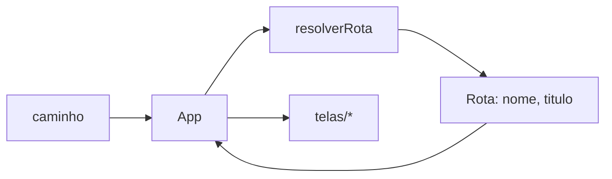
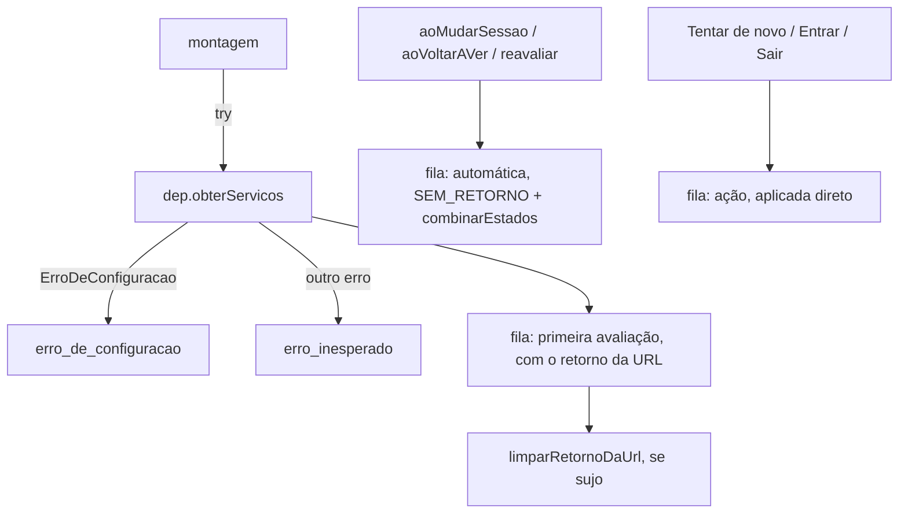
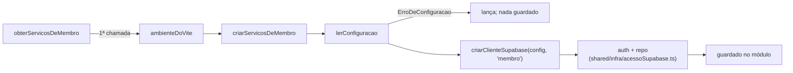
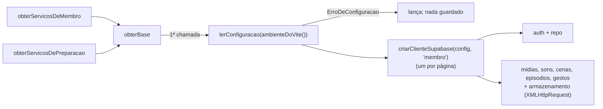

# src/app

## Cabeçalho

| Campo | Valor |
|---|---|
| Id | DIR-src-app |
| Título | `app` |
| Tipo | código · rotas e telas |
| Data | 2026-11-17 |
| Usuário responsável | TokumoH |
| Status | em construção |
| Commits | commit que introduz este arquivo — `git log --format=%h -- src/app/README.md` |
| Arquivos | `README.md`, `rotas.ts`, `rotas.test.ts`, `App.tsx`, `App.test.tsx`, `servicos.ts`, `servicos.test.ts`, `dependencias.ts`, `dependencias.test.ts`, `useAcesso.ts`, `servicosFalsos.ts`, `GuardaDeMembro.tsx`, `acesso.test.tsx`, `filaPendurada.test.tsx`, `telas/` |

## Propósito

Casca do app: `resolverRota()` converte o caminho da URL em rota, `App` escolhe a tela, e `telas/` guarda uma tela por rota. Desde a E1, `servicos.ts` é a composição dos serviços de membro: lê a configuração e liga o cliente Supabase de membro aos adaptadores das portas do domínio Acesso; desde a Tarefa 4 da E2, liga o **mesmo** cliente aos adaptadores da Preparação (`obterServicosDePreparacao`). Desde a Tarefa 4 da E1, `app/` também guarda o estado de tela do acesso (`useAcesso`), a guarda por papel das áreas de membro (`GuardaDeMembro`) e as dependências do navegador (`dependencias.ts`), que só as três rotas de membro recebem.

## Origem

Criado na Tarefa 1 da etapa E0 ([PLA-001](../../docs/planos/2026-11-17-e0-fundacao.md)), que substitui o protótipo por um app React com a cara do RevoCast. Desenho: [DES-001](../../docs/desenho/2026-11-16-revocast-cameras-desenho.md). `servicos.ts` entrou na Tarefa 3 da E1 ([PLA-002](../../docs/planos/2026-11-26-e1-entrada-e-membros.md)), que põe a composição em `app/` (restrição global: o cliente de membro só é criado nas rotas de membro, de forma preguiçosa e uma vez por página). `dependencias.ts`, `useAcesso.ts`, `servicosFalsos.ts`, `GuardaDeMembro.tsx` e `acesso.test.tsx` entraram na Tarefa 4 da E1 (registro VER-018), que liga as telas a esses serviços e prova a restrição com `createClient` simulado. `filaPendurada.test.tsx` entrou com o registro [VER-021](../../docs/verificacoes/2026-11-26-021-tempo-limite-supabase.md), que põe tempo-limite de 15 s no `fetch` do cliente Supabase (`shared/infra/tempoLimite.ts`) e destrava a fila pendurada observada no VER-020. Na Tarefa 4 da E2 ([PLA-003](../../docs/planos/2026-11-26-e2-preparar-episodio.md), registro [VER-027](../../docs/verificacoes/2026-11-26-027-e2-adaptadores-preparacao.md)), `servicos.ts` passou a guardar o cliente de membro e a montar sobre ele também os serviços da Preparação, e `dependencias.ts` ganhou `obterPreparacao` (restrição global do PLA-003: os serviços da Preparação reaproveitam o mesmo cliente).

## Organização

- `rotas.ts`: tipos `NomeDaRota` e `Rota` e a função `resolverRota`.
- `App.tsx`: escolhe a tela pelo nome da rota.
- `*.test.ts(x)` ao lado do arquivo testado.
- `telas/`: uma tela por rota, mais "Página não encontrada".
- `servicos.ts`: `ambienteDoVite()` (só `VITE_SUPABASE_URL` e `VITE_SUPABASE_PUBLISHABLE_KEY`, lidas de `import.meta.env` uma a uma), `criarServicosDeMembro(env)` (lança `ErroDeConfiguracao` antes de criar qualquer cliente; cria um cliente `membro`, com `storageKey: 'revocast-auth-membro'` e `detectSessionInUrl: true`, e devolve `{ auth, repo }`) `criarServicosDePreparacao(cliente, config)` (os cinco repositórios de `shared/infra/preparacaoSupabase.ts` e o armazenamento de `shared/infra/armazenamentoSupabase.ts`, com a URL e a chave pública da configuração), `obterServicosDeMembro()` e `obterServicosDePreparacao()`. Desde a Tarefa 4 da E2, o que fica guardado em módulo é o **cliente** de membro (com a configuração com que foi criado), criado na primeira chamada de qualquer uma das duas; cada conjunto de serviços também é guardado, sobre esse cliente único (uma sessão e um refresh de token por página). Se a configuração falhar, as duas lançam `ErroDeConfiguracao` e nada fica guardado. Nenhum módulo chama essas funções ao ser importado: quem chama `obterServicosDeMembro` é o `useAcesso`, só nas rotas de membro, por meio de `Dependencias.obterServicos`; `obterServicosDePreparacao` só é chamado por `Dependencias.obterPreparacao`, dentro da guarda (telas da Preparação, Tarefas 5 a 7).
- `dependencias.ts`: interface `Dependencias` (o que as telas de membro pedem ao mundo de fora), `caminhoDaArea`, `urlDeRetorno` (origem + `/painel`, `/controle` ou `/entrar`; nenhum parâmetro da URL escolhe o destino) e `dependenciasDoNavegador()` (preguiçosa: não cria o cliente; `obterServicos` e, desde a E2, `obterPreparacao` são as funções de `servicos.ts`, chamadas só quando a tela pede).
- `useAcesso.ts`: estado de tela do acesso. Avaliações serializadas numa fila; a primeira usa o retorno da URL e só depois dela a URL é limpa; as automáticas (evento de sessão, volta à aba, escrita negada) usam `SEM_RETORNO` + `combinarEstados`; as ações da pessoa (Tentar de novo, Entrar, Sair) entram na mesma fila.
- `GuardaDeMembro.tsx`: guarda de `/painel` e `/controle`; entrega o conteúdo (função `children`) só a membro cujo papel abre a área.
- `servicosFalsos.ts`: **só para testes** (não importa `vitest` nem Supabase); falsos das portas e das dependências, com `sair()` que emite a mudança de sessão antes de resolver, como o supabase-js; desde a Tarefa 4 da E2, `preparacaoVazia()` (Preparação com listas vazias e escritas sem efeito), que as dependências falsas devolvem em `obterPreparacao`; desde a Tarefa 5 da E2, `criarFalsosDePreparacao(inicial)` (Preparação com estado: envio que emite progresso e respeita o `AbortSignal`, `segurarEnvio()` para o teste mandar progredir e concluir, `midias.remover` que recusa som ligado a gesto com `em_uso`, `falharProxima('<porta>.<método>', erro)`, chamadas anotadas, inclusive `previa`) e `arquivoDeTeste(tipo, nome, tamanho?)` (arquivo em memória com os bytes mágicos de PNG, MP3, HTML ou SVG e o `File.type` que o navegador daria pela extensão do nome).

## Por que esta organização

Rotas por **caminho** (`/painel`, `/obs/palco`...) deixam o fragmento `#` livre para o código de pareamento (DES-001). Separar `resolverRota` (função pura) do `App` (React) permite testar as rotas sem DOM.

## Por que não outras organizações

| Opção | Motivo de descarte |
|---|---|
| Roteador pronto (react-router) | Dependência a mais para seis rotas fixas |
| Rotas por fragmento `#` | O `#` é reservado ao código de pareamento |

## Onde

| Arquivo ou subdiretório | O que contém |
|---|---|
| [`README.md`](README.md) | Este arquivo |
| [`rotas.ts`](rotas.ts) | `NomeDaRota`, `Rota` e `resolverRota()` |
| [`rotas.test.ts`](rotas.test.ts) | Onze casos de `resolverRota` (nome e título literais, inclusive barra final e `/painel//`) |
| [`App.tsx`](App.tsx) | Componente `App({ caminho, dependencias? })`: resolve a rota, define o `document.title`, guarda as dependências uma vez (`useState(() => dependencias ?? dependenciasDoNavegador())`) e só as passa às três telas de membro |
| [`App.test.tsx`](App.test.tsx) | Testes de tela: Controle com logo (membro falso), "Página não encontrada" no cartão rosa com o link "Ir para a entrada" para `/entrar` e, para as 7 rotas, o título (heading e `document.title`, a partir de `resolverRota`), a frase própria de cada tela e o logo; rotas de membro com membro `equipe` falso (`/entrar` chama `navegar('/painel')`; `/painel` mostra a primeira aba, "Em construção — etapa E2", desde a Tarefa 5 da E1), rotas de dispositivo e `/xyz` sem `obterServicos`; `caminho-padrao-nao-cria-cliente-em-dispositivo`: com `createClient` simulado e o caminho padrão (`dependenciasDoNavegador`), `/camera`, `/obs/palco`, `/obs/camera` e `/xyz` criam 0 clientes e `/painel` cria 1, com `storageKey: 'revocast-auth-membro'` |
| [`servicos.ts`](servicos.ts) | `ambienteDoVite`, `criarServicosDeMembro`, `criarServicosDePreparacao`, `obterServicosDeMembro` e `obterServicosDePreparacao` (composição dos serviços de membro e da Preparação sobre o mesmo cliente, um por página) |
| [`servicos.test.ts`](servicos.test.ts) | 8 testes com `createClient` simulado (`vi.mock`): configuração ausente lança citando `VITE_SUPABASE_URL` sem criar cliente; com as duas variáveis, 1 `createClient` com as opções de membro e `{ auth, repo }`; `ambienteDoVite` só com as duas chaves; cache de `obterServicosDeMembro` (`vi.resetModules` + `vi.stubEnv`): 2 chamadas → 1 cliente; configuração inválida → lança nas duas e não guarda nada; e 3 da E2: `obterServicosDePreparacao` e `obterServicosDeMembro` na mesma página → 1 `createClient` (nas duas ordens), configuração inválida → as duas lançam `ErroDeConfiguracao` e nenhum cliente |
| [`dependencias.ts`](dependencias.ts) | `Dependencias` (com `obterPreparacao` desde a E2), `caminhoDaArea`, `urlDeRetorno` e `dependenciasDoNavegador` |
| [`dependencias.test.ts`](dependencias.test.ts) | 5 testes (jsdom) de `caminhoDaArea`, `urlDeRetorno` e `dependenciasDoNavegador`: lê a URL, é preguiçosa (`obterServicos` e `obterPreparacao` são as funções de `servicos.ts`), `limparRetornoDaUrl` tira só os `PARAMETROS_DE_RETORNO` (outros parâmetros e o `history.state` ficam) e o fragmento só com `fragmentoSujo`; `aoVoltarAVer` só avisa com a aba visível e para depois de cancelar |
| [`useAcesso.ts`](useAcesso.ts) | `EstadoDaTela` e `useAcesso(dep)`: estado, serviços, `reavaliar`, `tentarDeNovo`, `entrar`, `sair` |
| [`GuardaDeMembro.tsx`](GuardaDeMembro.tsx) | Guarda por área: telas de cada estado, "Sem acesso a esta página" e, para membro, cabeçalho + conteúdo |
| [`servicosFalsos.ts`](servicosFalsos.ts) | Só para testes: `preparacaoVazia` (E2), `criarFalsosDePreparacao` e `arquivoDeTeste` (E2, Tarefa 5), `usuarioGoogle` e `criarFalsos` (portas e dependências falsas, contagem de chamadas, `segurarSair`/`liberarSair`, `ouvintesAtivos`) |
| [`acesso.test.tsx`](acesso.test.tsx) | 26 testes de entrada e guarda (PLA-002, Tarefa 4): configuração, erro inesperado, rotas de dispositivo, URL de retorno fixa, fora da lista, sessão anônima e expirada, `sair` lento, retorno do Google, URL limpa depois de resolver (e só se suja), papel, falha e Sair; e, da revisão, erro dentro da fila → falha, `limparRetornoDaUrl` que lança não troca `membro`, desmontagem cancela as assinaturas e não aplica, `sair` aplica `sem_sessao` direto |
| [`filaPendurada.test.tsx`](filaPendurada.test.tsx) | 2 testes de ponta a ponta com o supabase-js **real** (jsdom, sessão guardada no `localStorage`, só o `fetch` global é falso e timers falsos): `rpc/papel_atual` sem resposta → "Conferindo seu acesso…" até 15 s e tela de falha com "Tentar de novo"; com a rede boa, "Tentar de novo" leva ao painel (depois da reavaliação que já esperava na fila, ver "Riscos"); com a rede boa desde o início, painel sem esperar. Falha sem o tempo-limite (VER-021) |
| [`telas/`](telas/) | Uma tela por rota e as telas dos estados de acesso |

## Lógica

`/` leva a `entrar`; barra final é ignorada; caminho desconhecido (incluindo `/obs`) leva a `nao_encontrada`.

Acesso de membro (`useAcesso`, só nas rotas `/entrar`, `/painel` e `/controle`):

A fila (`montagem.fila = montagem.fila.then(...)`) faz cada avaliação começar só depois de a anterior aplicar o resultado: o SIGNED_OUT que o `sair()` emite antes de resolver pede uma reavaliação que roda depois e, por `combinarEstados`, não apaga `sem_papel` nem os avisos fixos.

Composição dos serviços de membro (`servicos.ts`):

Desde a Tarefa 4 da E2, o cliente é guardado à parte e as duas composições o reaproveitam:

## Exemplo

Para criar a rota `/exemplo`: acrescentar o nome em `NomeDaRota` e a entrada em `ROTAS` de `rotas.ts`, uma tela em `telas/` e um `case` no `App.tsx` (com `noImplicitReturns` ligado no `tsconfig.json`, o `case` esquecido dá erro TS7030 no `npm run typecheck`). Se for rota de membro, a tela recebe `dependencias` e envolve o conteúdo em `<GuardaDeMembro area="painel" titulo={titulo} dependencias={dependencias}>{(membro) => …}</GuardaDeMembro>`; num teste, `criarFalsos({ usuario: usuarioGoogle('ana@revocast.test'), papel: 'equipe' })` e `render(<App caminho="/exemplo" dependencias={f.dependencias()} />)`.

## Verificação

- Arquivos de teste desta pasta (fora de `telas/`): 6 arquivos, 62 testes desde o VER-027 (26 em `acesso.test.tsx`, 11 em `rotas.test.ts`, 10 em `App.test.tsx`, 5 em `dependencias.test.ts`, 8 em `servicos.test.ts`, 2 em `filaPendurada.test.tsx`); a sabotagem "segundo cliente para a Preparação" do VER-027 derruba os dois testes de 1 `createClient`; 25 sabotagens do registro VER-018 derrubam cada uma os testes indicados; a sabotagem "sem o envoltório" do registro [VER-021](../../docs/verificacoes/2026-11-26-021-tempo-limite-supabase.md) derruba `filaPendurada.test.tsx`.
- `npx vitest run src/app/servicos.test.ts`: 8 testes desde o VER-027 (5 até então); sabotagens do cache, de `ambienteDoVite` e do tipo de sessão derrubam cada uma o teste correspondente (registro [VER-017](../../docs/verificacoes/2026-11-26-017-e1-adaptadores-acesso.md)).
- Links relativos, "Onde" e campo "Arquivos" conferidos por `npm run check-docs`.
- Subdiretórios com README próprio (conferido pelo mesmo comando).

## Riscos

- Conteúdo ainda provisório nas abas do `/painel` que não são Membros nem Biblioteca (E2 e E3), no `/controle` (E3) e nas rotas de dispositivo (E3 e E4); a entrada, a guarda, a aba Membros (Tarefa 5 da E1, registro VER-019) e a aba Biblioteca (Tarefa 5 da E2, registro VER-028) já são reais.
- O login real (Google + Supabase) ainda não foi conferido; a conferência no navegador desta tarefa usou rotas interceptadas pelo Playwright (registro VER-018) e a real fica para a Tarefa 6 da E1.
- Fila pendurada (resolvida no VER-021): as chamadas do cliente Supabase a `/rest/v1/` e `/auth/v1/` têm tempo-limite de 15 s (`shared/infra/tempoLimite.ts`), então uma avaliação sem resposta vira `falha` com "Tentar de novo" e a fila anda. O hook continua sem tempo-limite próprio: cada avaliação que já está na fila paga o seu, então um "Tentar de novo" pode esperar até mais 15 s (no carregamento com sessão, a reavaliação do evento do auth-js já está na fila e começa logo depois da falha; conferido no Chromium: falha em ~15,5 s, painel em ~30,4 s). Com a sessão expirada, o refresh do auth-js tenta duas vezes: até ~30,2 s para a falha. O Storage continua fora do tempo-limite de 15 s: desde a Tarefa 4 da E2, o envio tem acompanhamento próprio (progresso, cancelamento e corte por 30 s sem progresso, em `shared/infra/armazenamentoSupabase.ts`), e a URL assinada da prévia e a remoção seguem sem limite (VER-027, Riscos).
- Erro lançado dentro de uma tarefa da fila (defeito: as portas não lançam) vira `falha` só se a tarefa ainda não aplicou estado; se já aplicou (por exemplo, `limparRetornoDaUrl` lançando depois de `membro`), o estado fica e a URL continua suja.
- Sem fusão de reavaliações repetidas: no carregamento com sessão o auth-js emite um evento depois do `INITIAL_SESSION` e o papel é lido duas vezes (uma leitura a mais, aceita no plano).
- O cache do cliente de membro (e dos serviços de membro e da Preparação) vale por página (módulo); não há como trocar a configuração sem recarregar, o que é o esperado num app Vite.
