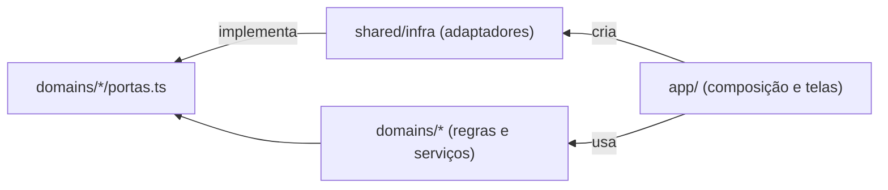

# src/domains

## Cabeçalho

| Campo | Valor |
|---|---|
| Id | DIR-src-domains |
| Título | `domains` |
| Tipo | código · domínios (DDD) |
| Data | 2026-11-26 |
| Usuário responsável | TokumoH |
| Status | em construção |
| Commits | commit que introduz este arquivo — `git log --diff-filter=A --format=%h -- src/domains/README.md` |
| Arquivos | `README.md`, `arquitetura.test.ts`, `acesso/`, `preparacao/`, `aovivo/`, `obs/`, `captura/` |

## Propósito

Guarda os domínios do RevoCast Câmeras (DDD): regras de negócio puras e as **portas** (interfaces) pelas quais cada domínio fala com o mundo de fora. Nada aqui conhece React, Supabase, `src/shared/` ou `src/app/`; quem implementa as portas são os adaptadores de `src/shared/infra/`, e quem os liga às telas é a composição em `src/app/`.

## Origem

Criado na Tarefa 1 da etapa E1 ([PLA-002](../../docs/planos/2026-11-26-e1-entrada-e-membros.md)), que faz nascer o primeiro domínio, `acesso/`. O segundo, `preparacao/`, nasce na Tarefa 1 da E2 ([PLA-003](../../docs/planos/2026-11-26-e2-preparar-episodio.md), decisão D1). O terceiro, `aovivo/`, nasce na Tarefa 1 da E3 ([PLA-004](../../docs/planos/2026-11-27-e3-ao-vivo-por-toque.md), decisão D1), que também põe o pareamento de dispositivos em `acesso/`. O quarto, `obs/` (Integração OBS), nasce na Tarefa 5 da E3 (decisão D1), junto do serviço do palco em `aovivo/palco.ts`. O quinto, `captura/` (sinais do vídeo, portas da câmera e da conexão, emissor e receptor), nasce na Tarefa 1 da E4 ([PLA-005](../../docs/planos/2026-11-27-e4-celular-como-camera.md), decisão D1; [VER-049](../../docs/verificacoes/2026-11-27-049-e4-dominio-captura.md)). A pasta já estava prevista no [DES-001](../../docs/desenho/2026-11-16-revocast-cameras-desenho.md) (§6) e no [PLA-001](../../docs/planos/2026-11-17-e0-fundacao.md) ("novos domínios entram em `src/domains/<domínio>/`").

## Organização

- Uma subpasta por domínio (`acesso/` desde a E1; `preparacao/` desde a E2, com mídias, sons, cenas, gestos, episódios e avisos; o pareamento entra em `acesso/` na E3, como no DES-001 §6.1; `aovivo/` desde a E3, com mensagens validadas dos canais, comandos, estado no ar, registro, portas e o serviço do palco; `obs/` desde a E3, com as portas do OBS, a versão mínima e o executor; `captura/` desde a E4, com os sinais do vídeo validados, as portas da câmera, da conexão WebRTC e da tela ligada, e as máquinas do emissor e do receptor), cada uma com o seu `README.md`.
- Um domínio pode importar **tipos** de outro (`aovivo/` usa `Dispositivo` de `acesso/` e `Cena`, `Som`, `Aviso`, `Episodio` e `AcaoDoGesto` de `preparacao/`); `obs/` usa `AcaoNoObs`, `SituacaoDoObs`, os tipos de resultado e `ExecutorDeAcoes` de `aovivo/`; as setas vão de Integração OBS para Ao vivo e de Ao vivo para Acesso e Preparação (`aovivo/` não importa `obs/`, e nenhum de Acesso e Preparação importa os dois); desde a E4, `captura/` importa de `aovivo/` só o tipo `EstadoDoCanal`, e `aovivo/mensagens.ts` importa de `captura/` o leitor `lerSituacaoDoVideo` (a presença de `camera` e `obs_camera` leva a situação do vídeo; sem ciclo em tempo de execução), e as regras de import de fora continuam valendo para todos.
- Dentro do domínio: um arquivo por conceito ou agregado (`papeis.ts`, `email.ts`, `midia.ts`, `cenas.ts`, …), um arquivo de portas (`portas.ts`) e os serviços de domínio (`resolverAcesso.ts`, `biblioteca.ts`), cada um com o `.test.ts` ao lado.
- `arquitetura.test.ts`, na raiz da pasta, vale para **todos** os domínios: lê o texto de cada arquivo `.ts`, `.tsx`, `.mts`, `.cts`, `.js` ou `.jsx` (menos os `.test.*`) e recusa import de `react`, `@supabase/*`, `shared/` ou `app/` e, desde a E4 (`dominio-sem-navegador`), qualquer citação de `RTC*`, `navigator`, `window`, `document`, `globalThis`, `MediaStream*`, `getUserMedia`, `wakeLock`, `setTimeout`, `setInterval` ou `clear*` fora de comentário (o domínio só usa o `agendar` injetado).

## Por que esta organização

O domínio é a parte que muda menos e que mais precisa de prova: deixá-lo sem dependência de biblioteca permite testá-lo com objetos simples, sem jsdom nem cliente Supabase, e trocar a infraestrutura sem mexer na regra. As portas no domínio e os adaptadores fora (GRASP Pure Fabrication) mantêm a seta de dependência apontando para dentro. O teste de arquitetura transforma essa regra em falha de teste, em vez de depender de revisão.

## Por que não outras organizações

| Opção | Motivo de descarte |
|---|---|
| Regras dentro das telas (`src/app/telas`) | Mistura decisão de acesso com apresentação; só testável com jsdom; repete regra entre telas |
| Regras em `src/shared/` | `shared/` é reuso técnico (estilos, componentes, infraestrutura); misturaria negócio e biblioteca |
| Portas em `src/shared/infra/` junto dos adaptadores | O domínio passaria a importar a infraestrutura, invertendo a dependência que o DDD pede |
| Regra de import só por convenção, sem teste | Um import de Supabase no domínio passaria em revisão sem ninguém notar |

## Onde

| Arquivo ou subdiretório | O que contém |
|---|---|
| [`README.md`](README.md) | Este arquivo |
| [`arquitetura.test.ts`](arquitetura.test.ts) | 5 testes: o glob acha os arquivos; nenhum arquivo de domínio importa React, Supabase, `shared/` ou `app/`; o detector reconhece as formas de import proibidas; desde a E4, `dominio-sem-navegador` (nenhuma API do navegador fora de comentário) e o detector dessas APIs |
| [`acesso/`](acesso/) | Domínio Acesso: papéis, e-mail, lista de acesso, estados da sessão, retorno do login, portas e `resolverAcesso`; desde a E3, dispositivos e pareamento (`dispositivos.ts`, `portasDeDispositivo.ts`, `resolverDispositivo`) |
| [`captura/`](captura/) | Domínio Captura (E4): sinais do vídeo validados (`lerSinalDaCamera`, `lerSinalDaObs`, `conferirSdp`), tópico de vídeo da sessão, situação do vídeo, esperas, as portas do canal de vídeo, da conexão WebRTC, da câmera e da tela ligada (tipos opacos), e as máquinas do emissor (`/camera`) e do receptor (`/obs/camera`) |
| [`aovivo/`](aovivo/) | Domínio Ao vivo: mensagens dos canais `estudio` e `:controle` validadas no recebimento, `Comando`, `EstadoNoAr`, `Revogados`, resolução do comando em ação do OBS, linha do registro, as portas dos canais, dos repositórios do ao vivo e do palco e do executor, e o serviço do palco (`palco.ts`) |
| [`obs/`](obs/) | Domínio Integração OBS (camada anticorrupção): portas `ObsNoNavegador` e `ObsWebsocket`, versão mínima do OBS (30.2.0), o executor das ações (`criarExecutorObs`, o `ExecutorDeAcoes` do palco) e, desde o VER-053, a guarda da saída (`saida.ts`, usada pelo palco e pelo `/obs/camera`) |
| [`preparacao/`](preparacao/) | Domínio Preparação: tipos aceitos pelos bytes, limites de 50 MB e 1 GB, caminho no Storage, cenas, mapa de gestos, episódios e avisos, mídia em uso, portas e o serviço da Biblioteca (`enviarMidia`, `excluirMidia`) |

## Lógica

1. O domínio declara o que precisa (portas) e decide (regras e serviços), sem importar nada de fora.
2. `shared/infra` implementa as portas com o Supabase (Acesso: E1, Tarefa 3; Preparação: E2, Tarefa 4; dispositivos e Ao vivo: E3, Tarefa 4; `window.obsstudio` e obs-websocket da Integração OBS: E3, Tarefa 5; canal de vídeo, `RTCPeerConnection`, câmera e Wake Lock da Captura: E4, Tarefa 3).
3. `app/` cria os adaptadores e entrega ao domínio (composição), e mostra o resultado nas telas.
4. `arquitetura.test.ts` roda no `npm test` e falha se um arquivo de domínio importar React, Supabase, `shared/` ou `app/`, ou citar uma API do navegador fora de comentário.

## Exemplo

Para saber quem pode abrir `/painel`: `acesso/papeis.ts`, função `podeAbrir('painel', papel)`. Para saber se um arquivo pode entrar na Biblioteca: `preparacao/midia.ts`, função `conferirArquivo`. Para saber se uma mensagem do canal pode ter efeito: `aovivo/mensagens.ts`, `lerComando` e os outros leitores. Para saber que nível de controle do OBS cada ação exige: a tabela da seção "Lógica" de `obs/README.md`. Para saber quando a câmera oferece de novo depois de uma falha: `captura/sinais.ts`, `esperaDaTentativa`, e a seção "Lógica" de `captura/README.md`. Para criar um domínio novo: `src/domains/<dominio>/` com `README.md` (11 seções), as regras e as portas; o teste de arquitetura passa a cobri-lo sem configuração.

## Verificação

- `npx vitest run src/domains`: 23 arquivos, 513 testes desde o VER-056 (5 da `captura`: o `pronto` de outro par e o `perderPar`); 508 desde o VER-053 (`obs/saida.test.ts`, 19: a guarda da saída movida do palco); 22 arquivos e 489 no commit do VER-052 (o README dizia 485 desde a E4, sem as 4 do `sem_video_direto` da rodada 1 do VER-052); 485 desde a E4 (322 antes dela, contados no commit do VER-048: os 307 da E3 mais os que os VER-040 a VER-047 somaram em `aovivo/`; na E4, `captura/` soma 3 arquivos e 154, `aovivo/mensagens.test.ts` 7 (`presenca-com-video`) e `arquitetura.test.ts` 2) (7 arquivos e 46 testes até a E1; `preparacao/` soma 6 arquivos e 66 testes; na E3, `acesso/dispositivos.test.ts` soma 52, `aovivo/` 3 arquivos e 126 (`palco.test.ts`, 21, desde a Tarefa 5) e `obs/` 2 arquivos e 17).
- Sabotagem do teste de arquitetura: `import type { SupabaseClient } from '@supabase/supabase-js'` em `acesso/portas.ts` → o teste falha citando `./acesso/portas.ts` (VER-015); o mesmo import em `preparacao/portas.ts` derruba o teste (VER-024), em `aovivo/portas.ts` também (VER-035), e em `obs/portas.ts` também (VER-039, com a leitura `?raw` sabotada em memória). `window.setTimeout` em `captura/emissor.ts`, `globalThis.setTimeout` no emissor e `setTimeout` solto no receptor derrubam `dominio-sem-navegador` (VER-049, numa cópia do repositório).
- Links relativos, "Onde", campo "Arquivos" e README do subdiretório conferidos por `npm run check-docs`.

## Riscos

- O teste de arquitetura lê o texto dos arquivos com expressões regulares: um import montado de forma exótica (por exemplo, o caminho numa variável) escaparia; nenhum arquivo de domínio faz isso hoje.
- O glob lê `./**/*.{ts,tsx,mts,cts,js,jsx}` e pula os `.test.*`; outra extensão de código (por exemplo `.mjs`) ficaria de fora. Conferido: um `.tsx`, um `.mts` e um `.js` com `import { useState } from 'react'` em `acesso/` derrubam o teste; um `.test.tsx` com o mesmo import é pulado.
- `dominio-sem-navegador` também lê texto: tira os comentários por expressão regular (um `//` depois de `:` ou `\`, como numa URL, não é tratado como comentário) e procura os nomes como palavra; uma API alcançada por um nome montado (`self['nav' + 'igator']`) escaparia (desde a rodada 1 da revisão do VER-049, `globalThis` e os relógios do ambiente também são recusados). `captura/falsos.ts` não é teste pelo nome e passa pelas duas regras (só serve aos testes).
