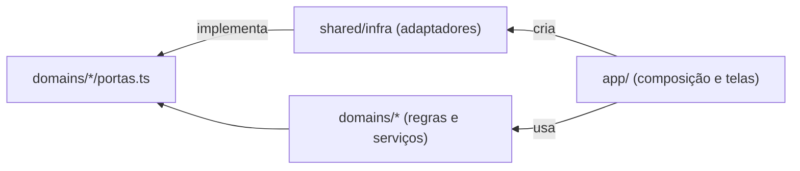

# src/domains

## Cabeçalho

| Campo | Valor |
|---|---|
| Id | DIR-src-domains |
| Título | `domains` |
| Tipo | código · domínios (DDD) |
| Data | 2026-11-26 |
| Usuário responsável | TokumoH |
| Status | em construção |
| Commits | commit que introduz este arquivo — `git log --diff-filter=A --format=%h -- src/domains/README.md` |
| Arquivos | `README.md`, `arquitetura.test.ts`, `acesso/` |

## Propósito

Guarda os domínios do RevoCast Câmeras (DDD): regras de negócio puras e as **portas** (interfaces) pelas quais cada domínio fala com o mundo de fora. Nada aqui conhece React, Supabase, `src/shared/` ou `src/app/`; quem implementa as portas são os adaptadores de `src/shared/infra/`, e quem os liga às telas é a composição em `src/app/`.

## Origem

Criado na Tarefa 1 da etapa E1 ([PLA-002](../../docs/planos/2026-11-26-e1-entrada-e-membros.md)), que faz nascer o primeiro domínio, `acesso/`. A pasta já estava prevista no [DES-001](../../docs/desenho/2026-11-16-revocast-cameras-desenho.md) (§6) e no [PLA-001](../../docs/planos/2026-11-17-e0-fundacao.md) ("novos domínios entram em `src/domains/<domínio>/`").

## Organização

- Uma subpasta por domínio (`acesso/` hoje; episódios, cenas e pareamento nas etapas seguintes), cada uma com o seu `README.md`.
- Dentro do domínio: um arquivo por conceito (`papeis.ts`, `email.ts`, …), um arquivo de portas (`portas.ts`) e os serviços de domínio (`resolverAcesso.ts`), cada um com o `.test.ts` ao lado.
- `arquitetura.test.ts`, na raiz da pasta, vale para **todos** os domínios: lê o texto de cada arquivo `.ts`, `.tsx`, `.mts`, `.cts`, `.js` ou `.jsx` (menos os `.test.*`) e recusa import de `react`, `@supabase/*`, `shared/` ou `app/`.

## Por que esta organização

O domínio é a parte que muda menos e que mais precisa de prova: deixá-lo sem dependência de biblioteca permite testá-lo com objetos simples, sem jsdom nem cliente Supabase, e trocar a infraestrutura sem mexer na regra. As portas no domínio e os adaptadores fora (GRASP Pure Fabrication) mantêm a seta de dependência apontando para dentro. O teste de arquitetura transforma essa regra em falha de teste, em vez de depender de revisão.

## Por que não outras organizações

| Opção | Motivo de descarte |
|---|---|
| Regras dentro das telas (`src/app/telas`) | Mistura decisão de acesso com apresentação; só testável com jsdom; repete regra entre telas |
| Regras em `src/shared/` | `shared/` é reuso técnico (estilos, componentes, infraestrutura); misturaria negócio e biblioteca |
| Portas em `src/shared/infra/` junto dos adaptadores | O domínio passaria a importar a infraestrutura, invertendo a dependência que o DDD pede |
| Regra de import só por convenção, sem teste | Um import de Supabase no domínio passaria em revisão sem ninguém notar |

## Onde

| Arquivo ou subdiretório | O que contém |
|---|---|
| [`README.md`](README.md) | Este arquivo |
| [`arquitetura.test.ts`](arquitetura.test.ts) | 3 testes: o glob acha os arquivos; nenhum arquivo de domínio importa React, Supabase, `shared/` ou `app/`; o detector reconhece as formas de import proibidas |
| [`acesso/`](acesso/) | Domínio Acesso: papéis, e-mail, lista de acesso, estados da sessão, retorno do login, portas e `resolverAcesso` |

## Lógica

1. O domínio declara o que precisa (portas) e decide (regras e serviços), sem importar nada de fora.
2. `shared/infra` implementa as portas com o Supabase (E1, Tarefa 3).
3. `app/` cria os adaptadores e entrega ao domínio (composição), e mostra o resultado nas telas.
4. `arquitetura.test.ts` roda no `npm test` e falha se um arquivo de domínio importar React, Supabase, `shared/` ou `app/`.

## Exemplo

Para saber quem pode abrir `/painel`: `acesso/papeis.ts`, função `podeAbrir('painel', papel)`. Para criar um domínio novo: `src/domains/<dominio>/` com `README.md` (11 seções), as regras e as portas; o teste de arquitetura passa a cobri-lo sem configuração.

## Verificação

- `npx vitest run src/domains`: 7 arquivos, 46 testes.
- Sabotagem do teste de arquitetura: `import type { SupabaseClient } from '@supabase/supabase-js'` em `acesso/portas.ts` → o teste falha citando `./acesso/portas.ts` (VER-015).
- Links relativos, "Onde", campo "Arquivos" e README do subdiretório conferidos por `npm run check-docs`.

## Riscos

- O teste de arquitetura lê o texto dos arquivos com expressões regulares: um import montado de forma exótica (por exemplo, o caminho numa variável) escaparia; nenhum arquivo de domínio faz isso hoje.
- O glob lê `./**/*.{ts,tsx,mts,cts,js,jsx}` e pula os `.test.*`; outra extensão de código (por exemplo `.mjs`) ficaria de fora. Conferido: um `.tsx`, um `.mts` e um `.js` com `import { useState } from 'react'` em `acesso/` derrubam o teste; um `.test.tsx` com o mesmo import é pulado.
