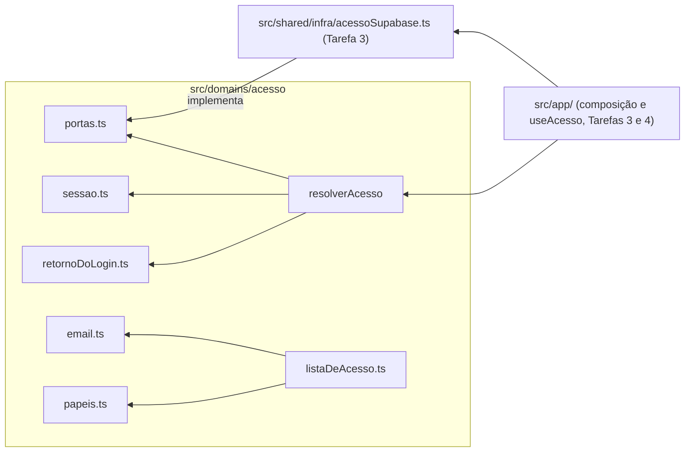

# src/domains/acesso

## Cabeçalho

| Campo | Valor |
|---|---|
| Id | DIR-src-domains-acesso |
| Título | `acesso` |
| Tipo | código · domínio Acesso (regras puras e portas) |
| Data | 2026-11-26 |
| Usuário responsável | TokumoH |
| Status | em construção |
| Commits | commit que introduz este arquivo — `git log --diff-filter=A --format=%h -- src/domains/acesso/README.md` |
| Arquivos | `README.md`, `papeis.ts`, `papeis.test.ts`, `email.ts`, `email.test.ts`, `listaDeAcesso.ts`, `listaDeAcesso.test.ts`, `sessao.ts`, `sessao.test.ts`, `retornoDoLogin.ts`, `retornoDoLogin.test.ts`, `portas.ts`, `resolverAcesso.ts`, `resolverAcesso.test.ts` |

## Propósito

Domínio Acesso, parte das **pessoas** (o pareamento de dispositivos entra na E3): quais papéis existem e o que cada um abre, como um e-mail é normalizado, como a lista de acesso é montada e que mudanças nela são recusadas, que estado de acesso a tela mostra a partir da sessão e do papel lido do banco, como ler o retorno do login Google na URL, e as portas pelas quais o domínio fala com a autenticação e com o banco. A interface só escolhe o que mostrar com isso; quem nega acesso a dado é a RLS do banco.

## Origem

Criado na Tarefa 1 da etapa E1 ([PLA-002](../../../docs/planos/2026-11-26-e1-entrada-e-membros.md)); desenho no [DES-001](../../../docs/desenho/2026-11-16-revocast-cameras-desenho.md), §7–§9. Decisões aplicadas: D1 (nenhum `admin` muda a própria linha; a interface também recusa o último `admin`), D2 (apresentadora vai para `/controle`), D3 (quem não está na lista vê o e-mail e a sessão local é encerrada, com a mensagem fixa) e D6 (repositório do agregado de acesso, sem classe genérica).

## Organização

- Um arquivo por conceito, com o teste ao lado: `papeis.ts`, `email.ts`, `listaDeAcesso.ts`, `sessao.ts`, `retornoDoLogin.ts`.
- `portas.ts`: `ErroDeAcesso` (com `motivo`; a mensagem nunca leva e-mail), `ServicoDeAutenticacao`, `RepositorioDeAcesso` e `ServicosDeMembro`. Sem teste próprio: só tipos e a classe de erro, exercitados por `resolverAcesso.test.ts`.
- `resolverAcesso.ts`: serviço de domínio que junta sessão, papel e retorno do login num `EstadoDeAcesso`.
- Os testes usam serviços falsos escritos no próprio arquivo (objetos que implementam as portas), sem `vi.mock`.

## Por que esta organização

Cada regra perigosa da E1 (Foco da revisão do PLA-002) tem um lugar só e um teste com o nome citado no plano: e-mail em maiúsculas (`normaliza-email`, `propria-linha-com-maiusculas`), sessão anônima ou de outro provedor (`anonima-nunca-membro`, `provedor-nao-google`), mensagem que não pode sumir com o `SIGNED_OUT` do próprio `sair` (`estado-fixo`), retorno do OAuth com erro (`retorno-com-erro`, `retorno-com-erro-no-fragmento`), servidor fora (`falha-ao-ler-sessao`, `falha-de-rede`) e `sair` que falha (`sair-que-falha-nao-derruba`). Separar as portas permite que a Tarefa 3 escreva os adaptadores Supabase e a Tarefa 4 os falsos de tela contra o mesmo contrato.

## Por que não outras organizações

| Opção | Motivo de descarte |
|---|---|
| Um arquivo `acesso.ts` com tudo | Testes e revisões misturados; difícil achar a regra de cada item do Foco da revisão |
| `resolverAcesso` dentro do hook de tela (`useAcesso`) | A ordem das conferências (anônima antes do papel, falha sem sair) só seria testável com jsdom |
| Ler o papel no cliente a partir do e-mail e da lista | A interface decidiria acesso; o papel vem de `papel_atual()`, conferido no banco |
| `RepositorioSupabase<T>` genérico (DES-001 §6.1) | Sem repetição real ainda (D6); nasce se a E2 mostrar necessidade |

## Onde

| Arquivo ou subdiretório | O que contém |
|---|---|
| [`README.md`](README.md) | Este arquivo |
| [`papeis.ts`](papeis.ts) | `PAPEIS`, `Papel`, `Area`, `ROTULO_DO_PAPEL`, `ehPapel`, `podeAbrir`, `areaInicial`, `podeGerenciarMembros` |
| [`papeis.test.ts`](papeis.test.ts) | 9 testes: matriz área × papel (6), área inicial e quem gerencia membros, `ehPapel` só com os três valores exatos, rótulos |
| [`email.ts`](email.ts) | `ResultadoDoEmail`, `normalizarEmail` (aparar, minúsculas, até 254, formato), `mesmoEmail` |
| [`email.test.ts`](email.test.ts) | 4 testes: `normaliza-email`, vazio e formato inválido, limite de 254, `mesmoEmail` |
| [`listaDeAcesso.ts`](listaDeAcesso.ts) | `MembroPermitido`, `PerfilDeMembro`, `LinhaDaLista`, `Mudanca`, `Recusa`, `montarLista`, `conferirInclusao`, `conferirMudanca` |
| [`listaDeAcesso.test.ts`](listaDeAcesso.test.ts) | 8 testes: `monta-lista` (2), `duplicado`, `propria-linha`, `propria-linha-com-maiusculas`, `ultimo-admin`, `sem-mudanca` e `inexistente`, ordem das conferências |
| [`sessao.ts`](sessao.ts) | `UsuarioDaSessao`, `AvisoDeEntrada`, `EstadoDeAcesso`, `AVISOS_FIXOS`, `combinarEstados` |
| [`sessao.test.ts`](sessao.test.ts) | 4 testes: `AVISOS_FIXOS`, `estado-fixo`, aviso do retorno de uma vez só, estados não fixos sempre trocados |
| [`retornoDoLogin.ts`](retornoDoLogin.ts) | `PARAMETROS_DE_RETORNO`, `RetornoDoLogin`, `SEM_RETORNO`, `lerRetornoDoLogin` |
| [`retornoDoLogin.test.ts`](retornoDoLogin.test.ts) | 6 testes: constantes, `retorno-com-erro`, `retorno-com-erro-no-fragmento`, `retorno-com-codigo`, prioridade da busca e `temCodigo` só pela busca, `sb_flow_id` sozinho |
| [`portas.ts`](portas.ts) | `MotivoDoErro`, `ErroDeAcesso`, `ServicoDeAutenticacao`, `RepositorioDeAcesso`, `ServicosDeMembro` |
| [`resolverAcesso.ts`](resolverAcesso.ts) | `resolverAcesso(servicos, retorno)` e o auxiliar `sairSemFalhar` |
| [`resolverAcesso.test.ts`](resolverAcesso.test.ts) | 12 testes: `sem-sessao`, `cancelado-no-google`, `codigo-sem-sessao`, `falha-ao-ler-sessao`, `anonima-nunca-membro`, `provedor-nao-google`, `fora-da-lista`, `membro`, `falha-de-rede`, `sessao-expirada`, `sair-que-falha-nao-derruba`, `so-termina-depois-do-sair` |

## Lógica

Portas e quem as implementa (seta = "depende de"):



Ordem de `resolverAcesso` (cada passo para no primeiro que decide):

| Passo | Situação | Estado | Chama `sair`? |
|---|---|---|---|
| 1 | `usuarioAtual()` lança (servidor fora, `AuthRetryableFetchError`) | `falha` | não |
| 2 | sem sessão | `sem_sessao` com aviso do retorno: `login_cancelado`, `login_falhou`, `login_incompleto` (`?code=` sem sessão) ou nenhum | não |
| 3 | sessão anônima | `sem_sessao` + `sessao_anonima` | sim |
| 4 | provedor diferente de `google` | `sem_sessao` + `provedor_invalido` | sim |
| 5 | `papelAtual()` lança `ErroDeAcesso('sessao_expirada')` | `sem_sessao` + `sessao_expirada` | sim |
| 6 | `papelAtual()` lança outro erro | `falha` | não |
| 7 | papel nulo (fora da lista) | `sem_papel` com o e-mail da sessão | sim |
| 8 | papel | `membro` | não |

Todo `sair` passa por `sairSemFalhar`, que engole a rejeição: o estado decidido vale mesmo sem rede. Nas reavaliações automáticas, a tela combina o estado atual com o novo por `combinarEstados`: `sem_papel` e os avisos de `AVISOS_FIXOS` são **fixos** e não somem com o `sem_sessao` sem aviso (o `SIGNED_OUT` do próprio `sair`) nem com uma `falha`; somem com `membro`, outro `sem_papel` ou outro aviso.

## Exemplo

Um `admin` com a sessão `Adm@Revocast.TEST` tenta remover a própria linha `adm@revocast.test`:

```ts
conferirMudanca(lista, 'adm@revocast.test', { tipo: 'remover' }, 'Adm@Revocast.TEST') // 'propria_linha'
normalizarEmail('  Nova@Revocast.TEST ') // { ok: true, email: 'nova@revocast.test' }
lerRetornoDoLogin('?error=access_denied&error_description=Ligue+para+tal+n%C3%BAmero', '')
// { erro: 'cancelado', temCodigo: false, sujo: true, fragmentoSujo: false } — o texto da URL não sai daqui
```

## Verificação

- `npx vitest run src/domains/acesso`: 6 arquivos, 43 testes (mais 3 de `../arquitetura.test.ts`, que cobre esta pasta).
- Sete sabotagens nas regras, uma de cada vez, cada uma derrubando o teste citado no Foco da revisão (tabela no VER-015).
- Links relativos, "Onde" e campo "Arquivos" conferidos por `npm run check-docs`. Não há subdiretórios.

## Riscos

- As portas ainda não têm adaptador real (Tarefa 3) nem uso em tela (Tarefa 4): o contrato `sair()` "nunca lança e emite SIGNED_OUT antes de resolver" é prometido aqui e provado lá.
- `normalizarEmail` confere só a forma (inclusive domínio sem rótulo vazio), não o RFC inteiro: um endereço exótico válido pode ser recusado, e um inválido com forma comum aceito; o banco e o Google decidem o acesso. Caracteres invisíveis ou de controle (espaço de largura zero U+200B, que `trim` e `\s` não removem; `\u0000`) são aceitos: um e-mail colado com eles entra na lista, nunca casa com o e-mail da sessão Google e não dá acesso (falha fechada).
- `ultimo_admin` depende da lista que está na tela; com a lista antiga, a interface pode recusar ou permitir errado, e quem garante a regra é o banco (D1, Tarefa 2). Dois admins que se removem no mesmo instante continuam sendo o limite da D1.
- O filtro de papel desconhecido vindo do banco fica no adaptador (Tarefa 3); o domínio confia que recebe `Papel | null`.
