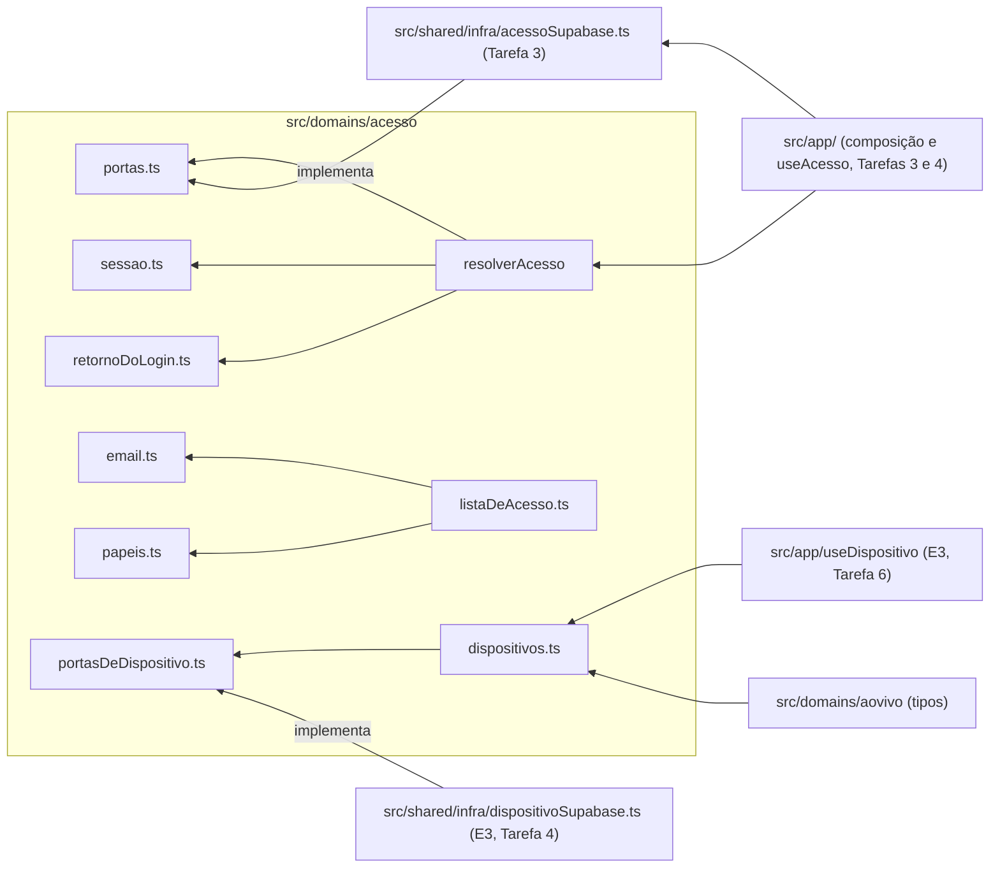

# src/domains/acesso

## Cabeçalho

| Campo | Valor |
|---|---|
| Id | DIR-src-domains-acesso |
| Título | `acesso` |
| Tipo | código · domínio Acesso (regras puras e portas) |
| Data | 2026-11-26 |
| Usuário responsável | TokumoH |
| Status | em construção |
| Commits | commit que introduz este arquivo — `git log --diff-filter=A --format=%h -- src/domains/acesso/README.md` |
| Arquivos | `README.md`, `papeis.ts`, `papeis.test.ts`, `email.ts`, `email.test.ts`, `listaDeAcesso.ts`, `listaDeAcesso.test.ts`, `sessao.ts`, `sessao.test.ts`, `retornoDoLogin.ts`, `retornoDoLogin.test.ts`, `portas.ts`, `resolverAcesso.ts`, `resolverAcesso.test.ts`, `dispositivos.ts`, `dispositivos.test.ts`, `portasDeDispositivo.ts` |

## Propósito

Domínio Acesso: as **pessoas** (desde a E1) e os **dispositivos pareados** (desde a E3). Parte das pessoas: quais papéis existem e o que cada um abre, como um e-mail é normalizado, como a lista de acesso é montada e que mudanças nela são recusadas, que estado de acesso a tela mostra a partir da sessão e do papel lido do banco, como ler o retorno do login Google na URL, e as portas pelas quais o domínio fala com a autenticação e com o banco. Parte dos dispositivos: os três tipos (`camera`, `obs_palco`, `obs_camera`) com rótulo e rota, a forma do código de pareamento lido do fragmento da URL (sem rede), o link de pareamento, o rótulo de um dispositivo, a situação de cada um na lista do painel e a ordem em que a rota de um dispositivo decide entre "pareado", "sem link", "link inválido" e as recusas do pareamento, com a porta da sessão anônima do dispositivo. A interface só escolhe o que mostrar com isso; quem nega acesso a dado é a RLS do banco.

## Origem

Criado na Tarefa 1 da etapa E1 ([PLA-002](../../../docs/planos/2026-11-26-e1-entrada-e-membros.md)); desenho no [DES-001](../../../docs/desenho/2026-11-16-revocast-cameras-desenho.md), §7–§9. Decisões aplicadas: D1 (nenhum `admin` muda a própria linha; a interface também recusa o último `admin`), D2 (apresentadora vai para `/controle`), D3 (quem não está na lista vê o e-mail e a sessão local é encerrada, com a mensagem fixa) e D6 (repositório do agregado de acesso, sem classe genérica).

O pareamento entra na Tarefa 1 da E3 ([PLA-004](../../../docs/planos/2026-11-27-e3-ao-vivo-por-toque.md)), registro VER-035, como o DES-001 §6 pede (`Dispositivo` e `CodigoDePareamento` em Acesso). Decisões do PLA-004 aplicadas: D1 (arquivo e porta próprios, `dispositivos.ts` e `portasDeDispositivo.ts`, sem mexer no que a E1 provou), D2 (código de 43 caracteres base64url), D3 (fragmento lido uma vez e conferido sem rede) e D4 (ordem da avaliação da sessão do dispositivo, com N1 e I2).

## Organização

- Um arquivo por conceito, com o teste ao lado: `papeis.ts`, `email.ts`, `listaDeAcesso.ts`, `sessao.ts`, `retornoDoLogin.ts`.
- `portas.ts`: `ErroDeAcesso` (com `motivo`; a mensagem nunca leva e-mail), `ServicoDeAutenticacao`, `RepositorioDeAcesso` e `ServicosDeMembro`. Sem teste próprio: só tipos e a classe de erro, exercitados por `resolverAcesso.test.ts`.
- `resolverAcesso.ts`: serviço de domínio que junta sessão, papel e retorno do login num `EstadoDeAcesso`.
- `dispositivos.ts` (com o teste ao lado): tipos, rótulos e rotas dos dispositivos, `codigoDoFragmento`, `linkDePareamento`, `conferirRotulo`, `situacaoDoDispositivo` e o serviço de domínio `resolverDispositivo`; `portasDeDispositivo.ts`: `ErroDeDispositivo` e `ServicoDeDispositivo` (sem teste próprio, exercitados por `dispositivos.test.ts`). Separados de `portas.ts` e `resolverAcesso.ts` porque o dispositivo não tem papel nem e-mail e usa um cliente Supabase próprio por tipo.
- Os testes usam serviços falsos escritos no próprio arquivo (objetos que implementam as portas), sem `vi.mock`.

## Por que esta organização

Cada regra perigosa da E1 (Foco da revisão do PLA-002) tem um lugar só e um teste com o nome citado no plano: e-mail em maiúsculas (`normaliza-email`, `propria-linha-com-maiusculas`), sessão anônima ou de outro provedor (`anonima-nunca-membro`, `provedor-nao-google`), mensagem que não pode sumir com o `SIGNED_OUT` do próprio `sair` (`estado-fixo`), retorno do OAuth com erro (`retorno-com-erro`, `retorno-com-erro-no-fragmento`), servidor fora (`falha-ao-ler-sessao`, `falha-de-rede`) e `sair` que falha (`sair-que-falha-nao-derruba`). Separar as portas permite que a Tarefa 3 escreva os adaptadores Supabase e a Tarefa 4 os falsos de tela contra o mesmo contrato.

## Por que não outras organizações

| Opção | Motivo de descarte |
|---|---|
| Um arquivo `acesso.ts` com tudo | Testes e revisões misturados; difícil achar a regra de cada item do Foco da revisão |
| `resolverAcesso` dentro do hook de tela (`useAcesso`) | A ordem das conferências (anônima antes do papel, falha sem sair) só seria testável com jsdom |
| Ler o papel no cliente a partir do e-mail e da lista | A interface decidiria acesso; o papel vem de `papel_atual()`, conferido no banco |
| `RepositorioSupabase<T>` genérico (DES-001 §6.1) | Sem repetição real ainda (D6); nasce se a E2 mostrar necessidade |

## Onde

| Arquivo ou subdiretório | O que contém |
|---|---|
| [`README.md`](README.md) | Este arquivo |
| [`papeis.ts`](papeis.ts) | `PAPEIS`, `Papel`, `Area`, `ROTULO_DO_PAPEL`, `ehPapel`, `podeAbrir`, `areaInicial`, `podeGerenciarMembros` |
| [`papeis.test.ts`](papeis.test.ts) | 9 testes: matriz área × papel (6), área inicial e quem gerencia membros, `ehPapel` só com os três valores exatos, rótulos |
| [`email.ts`](email.ts) | `ResultadoDoEmail`, `normalizarEmail` (aparar, minúsculas, até 254, formato), `mesmoEmail` |
| [`email.test.ts`](email.test.ts) | 4 testes: `normaliza-email`, vazio e formato inválido, limite de 254, `mesmoEmail` |
| [`listaDeAcesso.ts`](listaDeAcesso.ts) | `MembroPermitido`, `PerfilDeMembro`, `LinhaDaLista`, `Mudanca`, `Recusa`, `montarLista`, `conferirInclusao`, `conferirMudanca` |
| [`listaDeAcesso.test.ts`](listaDeAcesso.test.ts) | 8 testes: `monta-lista` (2), `duplicado`, `propria-linha`, `propria-linha-com-maiusculas`, `ultimo-admin`, `sem-mudanca` e `inexistente`, ordem das conferências |
| [`sessao.ts`](sessao.ts) | `UsuarioDaSessao`, `AvisoDeEntrada`, `EstadoDeAcesso`, `AVISOS_FIXOS`, `combinarEstados` |
| [`sessao.test.ts`](sessao.test.ts) | 4 testes: `AVISOS_FIXOS`, `estado-fixo`, aviso do retorno de uma vez só, estados não fixos sempre trocados |
| [`retornoDoLogin.ts`](retornoDoLogin.ts) | `PARAMETROS_DE_RETORNO`, `RetornoDoLogin`, `SEM_RETORNO`, `lerRetornoDoLogin` |
| [`retornoDoLogin.test.ts`](retornoDoLogin.test.ts) | 6 testes: constantes, `retorno-com-erro`, `retorno-com-erro-no-fragmento`, `retorno-com-codigo`, prioridade da busca e `temCodigo` só pela busca, `sb_flow_id` sozinho |
| [`portas.ts`](portas.ts) | `MotivoDoErro`, `ErroDeAcesso`, `ServicoDeAutenticacao`, `RepositorioDeAcesso`, `ServicosDeMembro` |
| [`resolverAcesso.ts`](resolverAcesso.ts) | `resolverAcesso(servicos, retorno)` e o auxiliar `sairSemFalhar` |
| [`resolverAcesso.test.ts`](resolverAcesso.test.ts) | 12 testes: `sem-sessao`, `cancelado-no-google`, `codigo-sem-sessao`, `falha-ao-ler-sessao`, `anonima-nunca-membro`, `provedor-nao-google`, `fora-da-lista`, `membro`, `falha-de-rede`, `sessao-expirada`, `sair-que-falha-nao-derruba`, `so-termina-depois-do-sair` |
| [`dispositivos.ts`](dispositivos.ts) | `TipoDeDispositivo`, `ROTULO_DO_TIPO`, `CAMINHO_DO_TIPO`, `FORMA_DO_CODIGO`, `COLUNAS_DE_MEU_DISPOSITIVO`, `codigoDoFragmento`, `linkDePareamento`, `conferirRotulo`, `Dispositivo`, `situacaoDoDispositivo`, `EstadoDoDispositivo`, `resolverDispositivo` |
| [`dispositivos.test.ts`](dispositivos.test.ts) | 52 testes: constantes; `codigo-do-fragmento` (14); `link-de-pareamento` (10); `rotulo`; `situacao` (3); `resolver-ordem` (22, com `sem-sessao-orfa`, `recarga-nao-diz-revogado`, `nova-sessao-ao-reparear`, `sessao-nao-anonima-sai` e as falhas de cada chamada); `ErroDeDispositivo` |
| [`portasDeDispositivo.ts`](portasDeDispositivo.ts) | `MotivoDoDispositivo`, `ErroDeDispositivo`, `ServicoDeDispositivo` |

## Lógica

Portas e quem as implementa (seta = "depende de"):



Ordem de `resolverAcesso` (cada passo para no primeiro que decide):

| Passo | Situação | Estado | Chama `sair`? |
|---|---|---|---|
| 1 | `usuarioAtual()` lança (servidor fora, `AuthRetryableFetchError`) | `falha` | não |
| 2 | sem sessão | `sem_sessao` com aviso do retorno: `login_cancelado`, `login_falhou`, `login_incompleto` (`?code=` sem sessão) ou nenhum | não |
| 3 | sessão anônima | `sem_sessao` + `sessao_anonima` | sim |
| 4 | provedor diferente de `google` | `sem_sessao` + `provedor_invalido` | sim |
| 5 | `papelAtual()` lança `ErroDeAcesso('sessao_expirada')` | `sem_sessao` + `sessao_expirada` | sim |
| 6 | `papelAtual()` lança outro erro | `falha` | não |
| 7 | papel nulo (fora da lista) | `sem_papel` com o e-mail da sessão | sim |
| 8 | papel | `membro` | não |

Todo `sair` passa por `sairSemFalhar`, que engole a rejeição: o estado decidido vale mesmo sem rede. Nas reavaliações automáticas, a tela combina o estado atual com o novo por `combinarEstados`: `sem_papel` e os avisos de `AVISOS_FIXOS` são **fixos** e não somem com o `sem_sessao` sem aviso (o `SIGNED_OUT` do próprio `sair`) nem com uma `falha`; somem com `membro`, outro `sem_papel` ou outro aviso.

**Pareamento (E3, D3 e D4).** A rota de dispositivo lê `location.hash` uma vez com `codigoDoFragmento` (`''`/`'#'` → nada; `#` + 43 caracteres `[A-Za-z0-9_-]` → código; qualquer outra coisa → inválido, sem rede), apaga o fragmento (Tarefa 6) e chama `resolverDispositivo` com o `ServicoDeDispositivo` do cliente daquele tipo. Ordem (num `try` só: qualquer erro, inclusive de `sair`, → `falha`, sem seguir):

| Passo | Situação | Chamadas, em ordem | Estado |
|---|---|---|---|
| 1 | sessão não anônima neste cliente | `sessaoAtual`, `sair` | segue como sem sessão |
| 2 | sessão anônima com dispositivo deste tipo (`meu_dispositivo()`) | `sessaoAtual`, `dispositivoAtual` | `pareado` (fragmento ignorado; `parear` não é chamado) |
| 3 | sessão anônima sem dispositivo (revogado, nunca pareado, pareamento incompleto) | `sessaoAtual`, `dispositivoAtual`, `sair` | segue como sem sessão: a sessão antiga nunca volta a valer |
| 4 | sem fragmento | — | `sem_link` (nunca `revogado`: depois de recarregar não se sabe se houve revogação, N1) |
| 5 | fragmento inválido | — | `link_invalido` |
| 6 | código | `entrarAnonimo`, `parear(codigo, tipo)` | `pareado` com o usuário do login **novo** |
| 7 | `parear` → `invalido`, `limite` ou `tipo_errado` (ou `pareado` sem dispositivo) | `sair` | `link_invalido`, `limite`, `tipo_errado` (ou `falha`): nenhuma **resposta** de recusa deixa sessão guardada (N1) |

Quando `parear` **lança** depois de `entrarAnonimo` (erro de rede, sem resposta), a avaliação dá `falha` **sem** `sair()`, de propósito: o pareamento pode ter valido no banco (o código foi usado e a resposta se perdeu), e a avaliação seguinte recupera a sessão por `meu_dispositivo()` ou, sem dispositivo, sai (passo 3). `revogado` só aparece pelo aviso do canal `estudio` (`marcarRevogado`, Tarefa 6), nunca por `resolverDispositivo`. `linkDePareamento` monta `<origem do app><caminho do tipo>#<código>` só com origem `https:` (ou `http:` em `localhost`/`127.0.0.1`) e código na forma; o erro nunca leva o código. `situacaoDoDispositivo`: revogado vence a presença; sem `pareadoEm`, nunca pareado; senão conectado ou desconectado pela presença em `estudio`.

## Exemplo

Um `admin` com a sessão `Adm@Revocast.TEST` tenta remover a própria linha `adm@revocast.test`:

```ts
conferirMudanca(lista, 'adm@revocast.test', { tipo: 'remover' }, 'Adm@Revocast.TEST') // 'propria_linha'
normalizarEmail('  Nova@Revocast.TEST ') // { ok: true, email: 'nova@revocast.test' }
lerRetornoDoLogin('?error=access_denied&error_description=Ligue+para+tal+n%C3%BAmero', '')
// { erro: 'cancelado', temCodigo: false, sujo: true, fragmentoSujo: false } — o texto da URL não sai daqui
```

O palco abre `https://app.revocast.test/obs/palco#Ab0_-cdEFghIJklMNopQRstUVwxYZ0123456789abcd` pela primeira vez (sem sessão guardada):

```ts
codigoDoFragmento('#Ab0_-cdEFghIJklMNopQRstUVwxYZ0123456789abcd') // { codigo: 'Ab0_-…abcd' }
codigoDoFragmento('#Ab0_-cdEFghIJklMNopQRstUVwxYZ0123456789ab%2F') // { invalido: true } — sem rede
await resolverDispositivo(servico, 'obs_palco', { codigo })
// sessaoAtual → null; entrarAnonimo; parear(codigo, 'obs_palco') → pareado
// { tipo: 'pareado', dispositivo: { id, tipo: 'obs_palco', rotulo: 'PC do estúdio', usuarioId: <uid do login novo> } }
// recarregado depois: sessaoAtual → anônima; dispositivoAtual → o palco; pareado sem chamar parear
```

## Verificação

- `npx vitest run src/domains/acesso`: 7 arquivos, 95 testes (6 arquivos e 43 testes até a E2; `dispositivos.test.ts` soma 52), mais 3 de `../arquitetura.test.ts`, que cobre esta pasta.
- Sete sabotagens nas regras, uma de cada vez, cada uma derrubando o teste citado no Foco da revisão (tabela no VER-015); as do pareamento (forma do código, ordem da D4, `sair` depois das recusas, nunca `revogado`, link só `https:`, situação) estão no VER-035.
- Links relativos, "Onde" e campo "Arquivos" conferidos por `npm run check-docs`. Não há subdiretórios.

## Riscos

- O contrato `sair()` "nunca lança e emite SIGNED_OUT antes de resolver" é prometido aqui; o adaptador real (Tarefa 3) e os falsos de tela (`src/app/servicosFalsos.ts`, Tarefa 4, que reproduzem a ordem real: o evento antes de o `sair` resolver) o seguem, mas só a Tarefa 6 o confere contra um projeto Supabase real.
- `normalizarEmail` confere só a forma (inclusive domínio sem rótulo vazio), não o RFC inteiro: um endereço exótico válido pode ser recusado, e um inválido com forma comum aceito; o banco e o Google decidem o acesso. Caracteres invisíveis ou de controle (espaço de largura zero U+200B, que `trim` e `\s` não removem; `\u0000`) são aceitos: um e-mail colado com eles entra na lista, nunca casa com o e-mail da sessão Google e não dá acesso (falha fechada).
- `ultimo_admin` depende da lista que está na tela; com a lista antiga, a interface pode recusar ou permitir errado, e quem garante a regra é o banco (D1, Tarefa 2). Dois admins que se removem no mesmo instante continuam sendo o limite da D1.
- O filtro de papel desconhecido vindo do banco fica no adaptador (Tarefa 3); o domínio confia que recebe `Papel | null`.
- **Pareamento:** `resolverDispositivo` confia que o `ServicoDeDispositivo` é o cliente **do tipo da rota** (um `storageKey` por tipo, Tarefa 4); uma sessão anônima com dispositivo de outro tipo nesse cliente é tratada como sem dispositivo (sai). Um `sair` que falhe vira `falha` (com "Tentar de novo"), mesmo depois de uma recusa do pareamento, para nunca seguir com uma sessão que deveria ter saído; o adaptador promete que a saída local não lança.
- `conferirRotulo` apara com o `trim` do JavaScript, que tira mais espaços (tabulação, quebra de linha, espaço não separável) que o `btrim` de `criar_codigo_pareamento` (só o espaço); o domínio é o mais estrito, e o banco continua decidindo. O tamanho conta pontos de código, como o `char_length`.
- **Presença declarada (situação na lista):** a chave (`auth.uid()` informado pelo cliente) e o corpo da presença (`tipo`, `dispositivoId`, `papel`, `obs`) também são declarados pelo cliente; o Realtime só autoriza o tópico. Qualquer membro com papel ou dispositivo não revogado poderia fazer um palco desligado aparecer como conectado. Por isso o "palco conectado" (`situacaoDoDispositivo`) e o checklist (D13) são informativos, só valem para clientes que cooperam, e a presença nunca autoriza nada.
- A forma do código é conferida antes da rede, mas só o banco sabe se ele existe, venceu ou já foi usado (D2, Tarefa 3).
