# src/domains/aovivo

## Cabeçalho

| Campo | Valor |
|---|---|
| Id | DIR-src-domains-aovivo |
| Título | `aovivo` |
| Tipo | código · domínio Ao vivo (mensagens validadas, comandos, registro e portas) |
| Data | 2026-11-27 |
| Usuário responsável | TokumoH |
| Status | em construção |
| Commits | commit que introduz este arquivo — `git log --diff-filter=A --format=%h -- src/domains/aovivo/README.md` |
| Arquivos | `README.md`, `mensagens.ts`, `mensagens.test.ts`, `comandos.ts`, `comandos.test.ts`, `portas.ts`, `palco.ts`, `palco.test.ts` |

## Propósito

Domínio **Ao vivo** do [DES-001](../../../docs/desenho/2026-11-16-revocast-cameras-desenho.md) (§6): o que acontece durante o programa. Define as mensagens dos canais `estudio` e `episodio:<id>:controle` e **valida tudo o que chega por eles** (o Broadcast do Supabase não autentica o remetente nem o conteúdo, DES-001 §8), o `Comando` por toque, o `EstadoNoAr` que o palco publica, como um comando vira uma ação do OBS (ou uma recusa com motivo, sem executar nada) e a linha de `registro_acoes`. Declara as **portas** dos canais, dos repositórios do ao vivo e do palco e do executor das ações, que os adaptadores (`src/shared/infra/`, Tarefa 4) e a Integração OBS (`src/domains/obs/`, Tarefa 5) implementam. Quem decide quem recebe e quem envia em cada canal é a RLS de `realtime.messages` (`pode_usar_canal`, Tarefa 3), nunca a tela.

## Origem

Criado na Tarefa 1 da etapa E3 ([PLA-004](../../../docs/planos/2026-11-27-e3-ao-vivo-por-toque.md)), registro VER-035. Decisões aplicadas: D1 (o pareamento fica em `acesso/`; `aovivo/` guarda mensagens, comandos, estado no ar, registro e, na Tarefa 5, o serviço do palco, que só conhece portas, inclusive `ExecutorDeAcoes`), D5 (descarte de remetente revogado por 15 min), D6 (canais privados, mensagem validada antes de qualquer efeito), D9 (comandos, estado no ar e registro), D14 (presença sem e-mail e sem nome) e D15 (estados do canal e resposta do `ack`). O serviço do palco (`palco.ts`) entra na Tarefa 5, registro [VER-039](../../../docs/verificacoes/2026-11-27-039-e3-integracao-obs-e-palco.md).

## Organização

- `mensagens.ts`: tipos das mensagens (`MensagemDoEstudio`, `PresencaNoEstudio`, `SituacaoDoObs`, `Comando`, `PedidoDeComando` (o `Comando` sem `id`, que a tela pede; desde a Tarefa 7, VER-041), `EstadoNoAr`), as listas fechadas (`MOTIVOS_DO_RESULTADO`, `EVENTOS_DO_CONTROLE`, desde o VER-047 só `comando`, e `EVENTOS_DO_ESTADO`, `UUID`), os tópicos do episódio (`topicoDoControle`, `topicoDoEstado`, VER-047), os leitores (`lerMensagemDoEstudio`, `lerComando`, `lerEstadoNoAr`, `lerPresenca`, `lerRemetente` e, por tópico, `lerMensagemDoControle` (só `comando`) e `lerMensagemDoEstado` (só `estado`), VER-047) e `Revogados`.
- `comandos.ts`: `AcaoNoObs`, `MotivoDaRecusa`, `ListasDoAoVivo` (cenas, sons e avisos do episódio; base de `ContextoDoComando` e tipo das listas das telas de membro, desde a Tarefa 7, VER-041), `resolverComando`, `LinhaDoRegistro` e `linhaDoRegistro`.
- `palco.ts`: `ESTADO_A_CADA_MS`, `COMANDOS_LEMBRADOS`, `DependenciasDoPalco` e `criarPalco` (o serviço do palco, D9; desde a Tarefa 6, com `republicar()`, que a rota chama quando um canal volta a `conectado`, registro [VER-040](../../../docs/verificacoes/2026-11-27-040-e3-telas-de-dispositivo.md)), que só conhece portas: `CanalDoControle`, `CanalDoEstado` (onde publica o estado, desde o VER-047), `RepositorioDoPalco`, `ExecutorDeAcoes` e `Revogados`.
- `portas.ts`: `ErroDoAoVivo` (mensagem só com o motivo), `EstadoDoCanal`, `RespostaDoEnvio`, `CanalDoEstudio`, `CanalDoControle` (só comandos e presença desde o VER-047), `CanalDoEstado` (VER-047), `FabricaDeCanais` (com `estado(episodioId)`), `RepositorioDoAoVivo`, `RepositorioDoPalco` e `ExecutorDeAcoes`. Sem teste próprio: só tipos e a classe de erro, exercitados pelos testes dos adaptadores (Tarefa 4), do palco e do executor do OBS (Tarefa 5).
- Dependência entre domínios **só de tipos**: `aovivo` importa `Dispositivo` e `TipoDeDispositivo` de `acesso/dispositivos.ts` e `Cena`, `Som`, `Aviso`, `Episodio` e `AcaoDoGesto` de `preparacao/`; só `obs/` (Integração OBS) importa tipos de `aovivo` (`AcaoNoObs`, `SituacaoDoObs`, resultados e `ExecutorDeAcoes`), e `aovivo` não conhece OBS, canal concreto nem banco.
- Testes com objetos escritos no próprio arquivo, sem `vi.mock`; o relógio de `Revogados`, do marcador e do palco (`agora`, `agendarRepeticao`) entra por parâmetro.

## Por que esta organização

Cada perigo do "Foco da revisão" do PLA-004 que é do domínio tem um lugar e um teste de nome conhecido: mensagem forjada (`mensagens-validadas`), remetente revogado (`revogados-expiram`), alvo que não existe (`comando-alvo-inexistente`), ordem das cenas e dos avisos (`proxima-cena`, `proximo-aviso`), aviso que não existe no enum (`registro`). Os leitores ficam aqui, e não no adaptador, para que o eco local do canal (Tarefa 4), o palco (Tarefa 5) e o `/controle` (Tarefa 7) passem pela mesma validação. As portas permitem que adaptadores, falsos de tela e o palco sejam escritos contra o mesmo contrato.

## Por que não outras organizações

| Opção | Motivo de descarte |
|---|---|
| Validar a mensagem no adaptador do canal | O eco local, o palco e os testes de tela precisariam repetir a regra; o domínio é o lugar testável sem `realtime-js` |
| Espalhar o `payload` depois de conferir os campos (`{ ...payload }`) | Levaria campos extras (inclusive `__proto__` vindo de `JSON.parse`) para dentro do app; os leitores montam o objeto campo a campo (sabotagem S6) |
| Aceitar campos extras e só ignorá-los | Um estado com campo a mais (texto, senha) passaria adiante se alguém espalhasse o objeto depois; a forma fechada falha antes (sabotagem S13) |
| `motivo` livre no estado no ar | Mensagem de erro do OBS (que pode ter caminho, senha ou texto do servidor) iria para todos os membros; a lista fixa só tem motivos conhecidos (sabotagem S12) |
| Pareamento dentro de `aovivo/` | O DES-001 §6 põe `Dispositivo` e `CodigoDePareamento` em Acesso (D1) |
| Executor do OBS dentro de `aovivo/` | `aovivo` passaria a conhecer `window.obsstudio` e obs-websocket; a Integração OBS é a camada anticorrupção (D1) |

## Onde

| Arquivo ou subdiretório | O que contém |
|---|---|
| [`README.md`](README.md) | Este arquivo |
| [`mensagens.ts`](mensagens.ts) | `UUID` (reexportado de `preparacao/midia.ts` desde o VER-046, N4), `EVENTOS_DO_CONTROLE`, `EVENTOS_DO_ESTADO`, `topicoDoControle`, `topicoDoEstado`, `lerMensagemDoControle`, `lerMensagemDoEstado` (os seis desde o VER-047), `MensagemDoEstudio`, `SituacaoDoObs`, `PresencaNoEstudio`, `Comando`, `PedidoDeComando`, `ResultadoDoComando`, `MOTIVOS_DO_RESULTADO`, `MotivoDoResultado`, `EstadoNoAr`, `lerRemetente`, `lerMensagemDoEstudio`, `lerComando`, `lerEstadoNoAr`, `lerPresenca`, `REVOGACAO_LEMBRADA_MS`, `Revogados` |
| [`mensagens.test.ts`](mensagens.test.ts) | 95 testes (desde o VER-047, com o bloco `mensagens por tópico do episódio`: tópicos, só comando de `:controle`, só estado de `:estado`): constantes; `mensagens-validadas` (cada leitor aceita a forma certa e recusa tipo errado, uuid em maiúsculas ou fora da forma, campo faltando, campo extra, ação desconhecida, `cenaObs` com 201 caracteres, número não finito, `motivo` fora da lista, `__proto__` como chave, chave herdada); `revogados-expiram` (3, inclusive revogar um segundo remetente sem soltar o primeiro) |
| [`comandos.ts`](comandos.ts) | `AcaoNoObs`, `MotivoDaRecusa`, `TAMANHO_DO_MARCADOR`, `ListasDoAoVivo`, `ContextoDoComando`, `resolverComando`, `LinhaDoRegistro`, `linhaDoRegistro` |
| [`comandos.test.ts`](comandos.test.ts) | 13 testes: ações resolvidas, `MotivoDaRecusa` ⊂ `MOTIVOS_DO_RESULTADO`, `comando-alvo-inexistente`, `proxima-cena` (2), `proximo-aviso`, `ocultar-sem-aviso`, `marcador-com-nome`, `registro` (5) |
| [`palco.ts`](palco.ts) | `ESTADO_A_CADA_MS` (30 s), `COMANDOS_LEMBRADOS` (200), `RECUSAS_QUE_RELEEM` e `RELEITURA_MINIMA_MS` (5 s) (VER-046), `DependenciasDoPalco` (com `recarregarDados` opcional desde o VER-046), `criarPalco` (`estado`, `aoMudar`, `republicar` desde a Tarefa 6, `definirCenaObs` e `recarregarListas` desde o VER-046, `parar`) |
| [`palco.test.ts`](palco.test.ts) | 28 testes: do VER-047, `estado-so-em-topico-proprio` (o estado sai pelo `CanalDoEstado`, nada vai ao `:controle`); do VER-046, `releitura-com-intervalo-minimo` (rodada 1), `remetente-fora-da-presenca` (I4), `item-criado-depois-e-relido` e `quem-entra-faz-reler` (I2), `cena-do-obs` (A1); antes, constante, `comando-valido-executa`, `comando-invalido-descartado`, `comando-duplicado`, `remetente-revogado`, `som-inexistente`, `estado-apos-comando`, `clipe-pendente-depois-ok`, `estado-a-cada-30s`, `estado-ao-entrar-alguem`, `republicar` (Tarefa 6), `registro-com-teste`, `registro-falha-nao-para`, `aviso-expira`, `ignora-o-proprio-comando`, `parar-solta-tudo`, `estado-so-muda-com-ok`, `parar-com-acao-pendente`, `executor-que-lanca`, `publicacao-rejeitada-tratada`, `estado-publicado-passa-no-leitor`, `estado-e-copia` |
| [`portas.ts`](portas.ts) | `MotivoDoAoVivo`, `ErroDoAoVivo`, `EstadoDoCanal`, `RespostaDoEnvio`, `CanalDoEstudio`, `CanalDoControle` (com `aoMudarPresentes` desde o VER-046; sem `aoEstado` e `publicarEstado` desde o VER-047), `CanalDoEstado` (VER-047), `FabricaDeCanais` (com `estado`), `RepositorioDoAoVivo`, `RepositorioDoPalco`, `ExecutorDeAcoes` |

## Lógica

Um toque no `/controle` até o estado voltar à tela (seta = mensagem ou chamada; o palco é o único executor, DES-001 §10.1):

```mermaid
flowchart LR
    T["/controle ou aba Ao vivo<br/>toque"] -- "enviarComando(Comando)<br/>broadcast 'comando' + remetente" --> C[("episodio:&lt;id&gt;:controle")]
    C -- payload --> L["palco: lerRemetente + lerComando<br/>(inválido → descartado, sem efeito)"]
    L -- "remetente em Revogados<br/>ou id repetido" --> X[descartado]
    L --> R["resolverComando(listas, estado)"]
    R -- "{ ok: false, motivo }" --> E
    R -- "{ ok: true, acao: AcaoNoObs }" --> O["ExecutorDeAcoes<br/>(Integração OBS: cena, clipe, marcador;<br/>a página: som e aviso)"]
    O -- "resultado + motivo da lista" --> E["EstadoNoAr atualizado"]
    O -- "ok" --> G["linhaDoRegistro → registro_acoes<br/>(falha não desfaz a ação)"]
    E -- "publicarEstado: broadcast 'estado'<br/>(e a cada 30 s e quando alguém entra)" --> S[("episodio:&lt;id&gt;:estado<br/>(VER-047: só o palco envia)")]
    S -- payload --> V["/controle: lerMensagemDoEstado<br/>(outro evento ou inválido → ignorado)"]
```



O lado do palco (validar de novo, ignorar o próprio eco, revogados, quem não está na presença do `:controle` (desde o VER-046, I4) e repetidos, resolver (relendo as listas uma vez se o item é desconhecido, I2), executar, publicar e registrar) é o `criarPalco` de `palco.ts`; o clipe publica `pendente` antes da espera de 5 s e o resultado depois.

Ordem de cada leitor de `mensagens.ts`:

| Passo | Conferência | Falha |
|---|---|---|
| 1 | `payload` é objeto simples (protótipo `Object.prototype` ou nulo; nunca lista ou classe) | `null` |
| 2 | toda chave própria está na forma (campos da mensagem, `remetente`; na presença, `presence_ref`), inclusive símbolos e `__proto__` | `null` |
| 3 | campos obrigatórios presentes como chave própria (nada herdado) | `null` |
| 4 | cada campo no tipo, no tamanho e na lista fechada; uuid em minúsculas; números finitos | `null` |
| 5 | objeto **novo** montado campo a campo | — |

Resolução (`resolverComando`): `cena`/`som`/`aviso` procuram o `id` na lista do tipo (ausente → `cena_inexistente`, `som_inexistente`, `aviso_inexistente`); `proxima_cena` segue a `ordem` a partir de `estado.cenaObs` (nome exato do OBS; desconhecida → a primeira; volta ao início; sem cenas → `sem_cenas`); `proximo_aviso` segue a `ordem` a partir de `estado.avisoId` (nenhum ou desconhecido → o primeiro; depois do último, ou lista vazia → `fim_dos_avisos`); `ocultar_aviso` sem aviso no ar → `sem_aviso_no_ar`; `marcador` → `<título> HH:MM:SS` (hora local), até 100 caracteres, cortando o título e nunca a hora.

Registro (`linhaDoRegistro`, D9): `origem = 'toque'`, `membroId` = remetente declarado, `teste` = modo teste; `aviso` e `proximo_aviso` gravam `acao = 'proximo_aviso'` com o `avisoId` mostrado (o enum `acao_gesto` não tem "mostrar o aviso X"); o alvo vem da ação resolvida (na `proxima_cena`, a cena para onde foi); nunca `nenhuma`.

## Exemplo

```ts
lerComando({ id: '0b6e2b8a-3c1d-4f2a-9e5b-1a2b3c4d5e6f', acao: 'clipe', remetente: 'c0ffee00-1111-4111-8111-11111111abcd' })
// { id: '0b6e2b8a-…', acao: 'clipe' } — objeto novo, sem o remetente
lerComando(JSON.parse('{"__proto__":{"admin":true},"id":"0b6e2b8a-3c1d-4f2a-9e5b-1a2b3c4d5e6f","acao":"marcador"}')) // null
lerEstadoNoAr({ ...estado, ultimo: { ...estado.ultimo, motivo: 'Erro: senha do OBS é 123' } }) // null
resolverComando({ id, acao: 'proxima_cena' }, { cenas: [A(0), B(1), C(2)], estado: { cenaObs: 'C', avisoId: null }, … })
// { ok: true, acao: { tipo: 'trocar_cena', nomeObs: 'A', cenaId: … } }
```

## Verificação

- `npx vitest run src/domains/aovivo`: 3 arquivos, 136 testes desde o VER-047 (132 desde o VER-046, 127 desde o VER-040, 126 até então; mais 3 de `../arquitetura.test.ts`, que cobre esta pasta sem configuração); `palco.test.ts` (28: 21 desde a Tarefa 5, `republicar` desde a Tarefa 6, os 5 do VER-046 e 1 do VER-047).
- Sabotagens do VER-046 (presença do `:controle`, releitura no item desconhecido e na entrada, cena do OBS), com `--cache=false` e `sha256sum` igual antes e depois, na tabela do [VER-046](../../../docs/verificacoes/2026-11-27-046-e3-correcoes-revisao-final.md).
- Sabotagens do serviço do palco (deduplicação, executar antes de resolver, registrar recusas, não republicar na entrada e outras) na tabela do VER-039.
- Sabotagens nos leitores, na resolução e no registro, uma de cada vez, cada uma derrubando o teste citado (tabela no VER-035), inclusive importar `@supabase/supabase-js` em `portas.ts` (derruba `arquitetura.test.ts`).
- Links relativos, "Onde" e campo "Arquivos" conferidos por `npm run check-docs`. Não há subdiretórios.

## Riscos

- **Remetente declarado:** o `remetente` é o que o cliente diz ser; um membro pode se passar por outro membro ou pelo palco no conteúdo (DES-001 §8). O descarte de `Revogados` só vale para clientes que cooperam; o corte garantido é a revalidação do Realtime com o JWT de 10 min.
- **Dispositivo comandando (revisão final da E3, I4; VER-046):** a RLS do canal não separa `comando` de `estado` (o Realtime autoriza por tópico e extensão, com a resposta guardada por conexão; o `event` não chega à autorização), então um `obs_palco` pode enviar `comando` em `:controle` (um segundo `obs_palco` criado por RPC direta por alguém da equipe, ou a sessão antiga de um palco trocado que não coopere, por até 10 min). Desde o VER-046 o palco só aceita comando de quem está na presença do `:controle`, onde só membros marcam presença (RLS); como a chave e o remetente são declarados, esse `obs_palco` ainda passa se declarar o `uid` de um membro presente. O `obs_palco` **recebe** a presença do `:controle` (pode receber nesse tópico), então conhecer um `uid` presente é trivial: a defesa só para o cliente ingênuo, não o malicioso. Um segundo `obs_palco` (ou a sessão antiga que não coopera) também publica `estado` falso, que o `/controle` e a aba aceitam (só descartam revogados avisados, e o segundo palco nunca é revogado). O furo do comando fecha no VER-047, que separa o estado num tópico próprio e deixa o `:controle` só para comandos de membros; o `estado` falso de outro `obs_palco` fica para o desenho desse tópico no VER-047.
- **Presença declarada:** a chave (`auth.uid()` informado pelo cliente) e o corpo da presença (`tipo`, `dispositivoId`, `papel`, `obs`) também são declarados pelo cliente; o Realtime só autoriza o tópico. Qualquer membro com papel ou dispositivo não revogado poderia fazer um palco desligado aparecer como conectado. Por isso o "palco conectado" (`situacaoDoDispositivo`) e o checklist (D13) são informativos, só valem para clientes que cooperam, e a presença nunca autoriza nada.
- **Forma fechada:** os leitores recusam qualquer chave fora da forma, tolerando só `remetente` (todas as mensagens) e `presence_ref` (presença) e um `evento` igual ao do Broadcast em `estudio`. Se o `realtime-js` ou o servidor passarem a acrescentar outra chave ao `payload` ou ao registro de presença, as mensagens serão descartadas (falha fechada); o adaptador da Tarefa 4 confere com o `realtime-js` 2.119.0.
- **Lista de motivos:** `MOTIVOS_DO_RESULTADO` já traz os motivos que a Tarefa 5 prevê para o executor (`cena_inexistente_no_obs`, `sem_permissao`, `replay_desligado`, `sem_websocket`, `sem_gravacao`, `obs_ausente`); um motivo novo do executor precisa entrar na lista, senão o estado com ele é descartado pelo `/controle` (o tipo `MotivoDoResultado` em `ExecutorDeAcoes` faz o compilador acusar).
- **`marcador` usa a hora local** do computador do OBS (o capítulo é da gravação daquele computador); sem `agora`, `resolverComando` lê o relógio (`new Date()`).
- **`proximo_aviso` com a lista vazia** responde `fim_dos_avisos` (não há `sem_avisos` na lista do plano).
- **Palco:** começa com `cenaObs` nulo e, desde o VER-046 (VER-044 A1), recebe da rota a cena atual lida do OBS (`definirCenaObs`, `getCurrentScene` com nível READ_USER, na releitura periódica e no evento `obsSceneChanged`); sem permissão ou sem resposta, a cena fica a última conhecida (`null` não muda nada), e uma `proxima_cena` antes da primeira leitura ainda vai à primeira cena. Registra só `ok` (recusa, falha e o clipe repetido ignorado não entram em `registro_acoes`). O `/controle` só vê `pendente` no clipe (a única ação que espera de propósito). Só resultado `ok` muda o estado (cena, aviso). O estado publicado passa por `lerEstadoNoAr`: uma cena do OBS com mais de 200 caracteres (o banco não limita `nome_obs`; a trava no banco fica como pendência de migração) vai como `null`, e um estado que o leitor recusaria não é publicado. Dois toques rápidos em "próxima" resolvem contra o mesmo estado e dão um passo só (aceito; serializar faria o clipe de 5 s atrasar as cenas). Um clipe pedido antes de `parar()` só é cancelado se a rota chamar também `executor.parar()` (desde a Tarefa 6, o `PalcoNoAr` chama os dois juntos; teste `palco-troca-de-episodio`).
- Não verificado: as telas do painel e do `/controle` (Tarefas 7 a 9; as de dispositivo, desde a Tarefa 6, com falsos) e os canais reais e o OBS real (Tarefa 10); os adaptadores (Tarefa 4) e o palco (Tarefa 5) foram testados com falsos.
