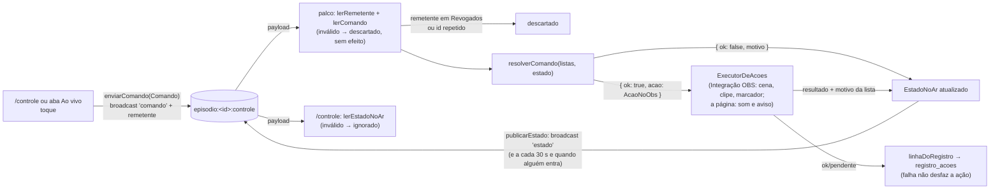

# src/domains/aovivo

## Cabeçalho

| Campo | Valor |
|---|---|
| Id | DIR-src-domains-aovivo |
| Título | `aovivo` |
| Tipo | código · domínio Ao vivo (mensagens validadas, comandos, registro e portas) |
| Data | 2026-11-27 |
| Usuário responsável | TokumoH |
| Status | em construção |
| Commits | commit que introduz este arquivo — `git log --diff-filter=A --format=%h -- src/domains/aovivo/README.md` |
| Arquivos | `README.md`, `mensagens.ts`, `mensagens.test.ts`, `comandos.ts`, `comandos.test.ts`, `portas.ts` |

## Propósito

Domínio **Ao vivo** do [DES-001](../../../docs/desenho/2026-11-16-revocast-cameras-desenho.md) (§6): o que acontece durante o programa. Define as mensagens dos canais `estudio` e `episodio:<id>:controle` e **valida tudo o que chega por eles** (o Broadcast do Supabase não autentica o remetente nem o conteúdo, DES-001 §8), o `Comando` por toque, o `EstadoNoAr` que o palco publica, como um comando vira uma ação do OBS (ou uma recusa com motivo, sem executar nada) e a linha de `registro_acoes`. Declara as **portas** dos canais, dos repositórios do ao vivo e do palco e do executor das ações, que os adaptadores (`src/shared/infra/`, Tarefa 4) e a Integração OBS (`src/domains/obs/`, Tarefa 5) implementam. Quem decide quem recebe e quem envia em cada canal é a RLS de `realtime.messages` (`pode_usar_canal`, Tarefa 3), nunca a tela.

## Origem

Criado na Tarefa 1 da etapa E3 ([PLA-004](../../../docs/planos/2026-11-27-e3-ao-vivo-por-toque.md)), registro VER-035. Decisões aplicadas: D1 (o pareamento fica em `acesso/`; `aovivo/` guarda mensagens, comandos, estado no ar, registro e, na Tarefa 5, o serviço do palco, que só conhece portas, inclusive `ExecutorDeAcoes`), D5 (descarte de remetente revogado por 15 min), D6 (canais privados, mensagem validada antes de qualquer efeito), D9 (comandos, estado no ar e registro), D14 (presença sem e-mail e sem nome) e D15 (estados do canal e resposta do `ack`).

## Organização

- `mensagens.ts`: tipos das mensagens (`MensagemDoEstudio`, `PresencaNoEstudio`, `SituacaoDoObs`, `Comando`, `EstadoNoAr`), as listas fechadas (`MOTIVOS_DO_RESULTADO`, `EVENTOS_DO_CONTROLE`, `UUID`), os leitores (`lerMensagemDoEstudio`, `lerComando`, `lerEstadoNoAr`, `lerPresenca`, `lerRemetente`) e `Revogados`.
- `comandos.ts`: `AcaoNoObs`, `MotivoDaRecusa`, `resolverComando`, `LinhaDoRegistro` e `linhaDoRegistro`.
- `portas.ts`: `ErroDoAoVivo` (mensagem só com o motivo), `EstadoDoCanal`, `RespostaDoEnvio`, `CanalDoEstudio`, `CanalDoControle`, `FabricaDeCanais`, `RepositorioDoAoVivo`, `RepositorioDoPalco` e `ExecutorDeAcoes`. Sem teste próprio: só tipos e a classe de erro, exercitados pelos testes dos adaptadores (Tarefa 4) e do palco (Tarefa 5).
- Dependência entre domínios **só de tipos**: `aovivo` importa `Dispositivo` e `TipoDeDispositivo` de `acesso/dispositivos.ts` e `Cena`, `Som`, `Aviso`, `Episodio` e `AcaoDoGesto` de `preparacao/`; ninguém importa `aovivo`, e `aovivo` não conhece OBS, canal concreto nem banco.
- Testes com objetos escritos no próprio arquivo, sem `vi.mock`; o relógio de `Revogados` e do marcador entra por parâmetro.

## Por que esta organização

Cada perigo do "Foco da revisão" do PLA-004 que é do domínio tem um lugar e um teste de nome conhecido: mensagem forjada (`mensagens-validadas`), remetente revogado (`revogados-expiram`), alvo que não existe (`comando-alvo-inexistente`), ordem das cenas e dos avisos (`proxima-cena`, `proximo-aviso`), aviso que não existe no enum (`registro`). Os leitores ficam aqui, e não no adaptador, para que o eco local do canal (Tarefa 4), o palco (Tarefa 5) e o `/controle` (Tarefa 7) passem pela mesma validação. As portas permitem que adaptadores, falsos de tela e o palco sejam escritos contra o mesmo contrato.

## Por que não outras organizações

| Opção | Motivo de descarte |
|---|---|
| Validar a mensagem no adaptador do canal | O eco local, o palco e os testes de tela precisariam repetir a regra; o domínio é o lugar testável sem `realtime-js` |
| Espalhar o `payload` depois de conferir os campos (`{ ...payload }`) | Levaria campos extras (inclusive `__proto__` vindo de `JSON.parse`) para dentro do app; os leitores montam o objeto campo a campo (sabotagem S6) |
| Aceitar campos extras e só ignorá-los | Um estado com campo a mais (texto, senha) passaria adiante se alguém espalhasse o objeto depois; a forma fechada falha antes (sabotagem S13) |
| `motivo` livre no estado no ar | Mensagem de erro do OBS (que pode ter caminho, senha ou texto do servidor) iria para todos os membros; a lista fixa só tem motivos conhecidos (sabotagem S12) |
| Pareamento dentro de `aovivo/` | O DES-001 §6 põe `Dispositivo` e `CodigoDePareamento` em Acesso (D1) |
| Executor do OBS dentro de `aovivo/` | `aovivo` passaria a conhecer `window.obsstudio` e obs-websocket; a Integração OBS é a camada anticorrupção (D1) |

## Onde

| Arquivo ou subdiretório | O que contém |
|---|---|
| [`README.md`](README.md) | Este arquivo |
| [`mensagens.ts`](mensagens.ts) | `UUID`, `EVENTOS_DO_CONTROLE`, `MensagemDoEstudio`, `SituacaoDoObs`, `PresencaNoEstudio`, `Comando`, `ResultadoDoComando`, `MOTIVOS_DO_RESULTADO`, `MotivoDoResultado`, `EstadoNoAr`, `lerRemetente`, `lerMensagemDoEstudio`, `lerComando`, `lerEstadoNoAr`, `lerPresenca`, `REVOGACAO_LEMBRADA_MS`, `Revogados` |
| [`mensagens.test.ts`](mensagens.test.ts) | 92 testes: constantes; `mensagens-validadas` (cada leitor aceita a forma certa e recusa tipo errado, uuid em maiúsculas ou fora da forma, campo faltando, campo extra, ação desconhecida, `cenaObs` com 201 caracteres, número não finito, `motivo` fora da lista, `__proto__` como chave, chave herdada); `revogados-expiram` (3, inclusive revogar um segundo remetente sem soltar o primeiro) |
| [`comandos.ts`](comandos.ts) | `AcaoNoObs`, `MotivoDaRecusa`, `TAMANHO_DO_MARCADOR`, `ContextoDoComando`, `resolverComando`, `LinhaDoRegistro`, `linhaDoRegistro` |
| [`comandos.test.ts`](comandos.test.ts) | 13 testes: ações resolvidas, `MotivoDaRecusa` ⊂ `MOTIVOS_DO_RESULTADO`, `comando-alvo-inexistente`, `proxima-cena` (2), `proximo-aviso`, `ocultar-sem-aviso`, `marcador-com-nome`, `registro` (5) |
| [`portas.ts`](portas.ts) | `MotivoDoAoVivo`, `ErroDoAoVivo`, `EstadoDoCanal`, `RespostaDoEnvio`, `CanalDoEstudio`, `CanalDoControle`, `FabricaDeCanais`, `RepositorioDoAoVivo`, `RepositorioDoPalco`, `ExecutorDeAcoes` |

## Lógica

Um toque no `/controle` até o estado voltar à tela (seta = mensagem ou chamada; o palco é o único executor, DES-001 §10.1):



Ordem de cada leitor de `mensagens.ts`:

| Passo | Conferência | Falha |
|---|---|---|
| 1 | `payload` é objeto simples (protótipo `Object.prototype` ou nulo; nunca lista ou classe) | `null` |
| 2 | toda chave própria está na forma (campos da mensagem, `remetente`; na presença, `presence_ref`), inclusive símbolos e `__proto__` | `null` |
| 3 | campos obrigatórios presentes como chave própria (nada herdado) | `null` |
| 4 | cada campo no tipo, no tamanho e na lista fechada; uuid em minúsculas; números finitos | `null` |
| 5 | objeto **novo** montado campo a campo | — |

Resolução (`resolverComando`): `cena`/`som`/`aviso` procuram o `id` na lista do tipo (ausente → `cena_inexistente`, `som_inexistente`, `aviso_inexistente`); `proxima_cena` segue a `ordem` a partir de `estado.cenaObs` (nome exato do OBS; desconhecida → a primeira; volta ao início; sem cenas → `sem_cenas`); `proximo_aviso` segue a `ordem` a partir de `estado.avisoId` (nenhum ou desconhecido → o primeiro; depois do último, ou lista vazia → `fim_dos_avisos`); `ocultar_aviso` sem aviso no ar → `sem_aviso_no_ar`; `marcador` → `<título> HH:MM:SS` (hora local), até 100 caracteres, cortando o título e nunca a hora.

Registro (`linhaDoRegistro`, D9): `origem = 'toque'`, `membroId` = remetente declarado, `teste` = modo teste; `aviso` e `proximo_aviso` gravam `acao = 'proximo_aviso'` com o `avisoId` mostrado (o enum `acao_gesto` não tem "mostrar o aviso X"); o alvo vem da ação resolvida (na `proxima_cena`, a cena para onde foi); nunca `nenhuma`.

## Exemplo

```ts
lerComando({ id: '0b6e2b8a-3c1d-4f2a-9e5b-1a2b3c4d5e6f', acao: 'clipe', remetente: 'c0ffee00-1111-4111-8111-11111111abcd' })
// { id: '0b6e2b8a-…', acao: 'clipe' } — objeto novo, sem o remetente
lerComando(JSON.parse('{"__proto__":{"admin":true},"id":"0b6e2b8a-3c1d-4f2a-9e5b-1a2b3c4d5e6f","acao":"marcador"}')) // null
lerEstadoNoAr({ ...estado, ultimo: { ...estado.ultimo, motivo: 'Erro: senha do OBS é 123' } }) // null
resolverComando({ id, acao: 'proxima_cena' }, { cenas: [A(0), B(1), C(2)], estado: { cenaObs: 'C', avisoId: null }, … })
// { ok: true, acao: { tipo: 'trocar_cena', nomeObs: 'A', cenaId: … } }
```

## Verificação

- `npx vitest run src/domains/aovivo`: 2 arquivos, 105 testes (mais 3 de `../arquitetura.test.ts`, que cobre esta pasta sem configuração).
- Sabotagens nos leitores, na resolução e no registro, uma de cada vez, cada uma derrubando o teste citado (tabela no VER-035), inclusive importar `@supabase/supabase-js` em `portas.ts` (derruba `arquitetura.test.ts`).
- Links relativos, "Onde" e campo "Arquivos" conferidos por `npm run check-docs`. Não há subdiretórios.

## Riscos

- **Remetente declarado:** o `remetente` é o que o cliente diz ser; um membro pode se passar por outro membro ou pelo palco no conteúdo (DES-001 §8). O descarte de `Revogados` só vale para clientes que cooperam; o corte garantido é a revalidação do Realtime com o JWT de 10 min.
- **Presença declarada:** a chave (`auth.uid()` informado pelo cliente) e o corpo da presença (`tipo`, `dispositivoId`, `papel`, `obs`) também são declarados pelo cliente; o Realtime só autoriza o tópico. Qualquer membro com papel ou dispositivo não revogado poderia fazer um palco desligado aparecer como conectado. Por isso o "palco conectado" (`situacaoDoDispositivo`) e o checklist (D13) são informativos, só valem para clientes que cooperam, e a presença nunca autoriza nada.
- **Forma fechada:** os leitores recusam qualquer chave fora da forma, tolerando só `remetente` (todas as mensagens) e `presence_ref` (presença) e um `evento` igual ao do Broadcast em `estudio`. Se o `realtime-js` ou o servidor passarem a acrescentar outra chave ao `payload` ou ao registro de presença, as mensagens serão descartadas (falha fechada); o adaptador da Tarefa 4 confere com o `realtime-js` 2.119.0.
- **Lista de motivos:** `MOTIVOS_DO_RESULTADO` já traz os motivos que a Tarefa 5 prevê para o executor (`cena_inexistente_no_obs`, `sem_permissao`, `replay_desligado`, `sem_websocket`, `sem_gravacao`, `obs_ausente`); um motivo novo do executor precisa entrar na lista, senão o estado com ele é descartado pelo `/controle` (o tipo `MotivoDoResultado` em `ExecutorDeAcoes` faz o compilador acusar).
- **`marcador` usa a hora local** do computador do OBS (o capítulo é da gravação daquele computador); sem `agora`, `resolverComando` lê o relógio (`new Date()`).
- **`proximo_aviso` com a lista vazia** responde `fim_dos_avisos` (não há `sem_avisos` na lista do plano).
- Não verificado nesta tarefa: os adaptadores reais (Tarefa 4), o palco e o executor (Tarefa 5), as telas (Tarefas 6 a 9) e os canais reais (Tarefa 10).
