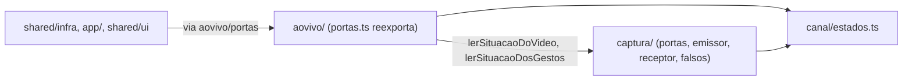

# src/domains/canal

## Cabeçalho

| Campo | Valor |
|---|---|
| Id | DIR-src-domains-canal |
| Título | `canal` |
| Tipo | código · núcleo comum dos tipos de canal |
| Data | 2026-11-28 |
| Usuário responsável | TokumoH |
| Status | ativo |
| Commits | commit que introduz este arquivo — `git log --diff-filter=A --format=%h -- src/domains/canal/README.md` |
| Arquivos | `README.md`, `estados.ts` |

## Propósito

Núcleo comum dos **tipos de canal** usados por mais de um domínio: hoje só `EstadoDoCanal` (`conectando`, `conectado`, `reconectando`, `fechado`, `negado`), o estado de um canal privado do Realtime que as portas de `aovivo/` (`CanalDoEstudio`, `CanalDoControle`, `CanalDoEstado`) e de `captura/` (`CanalDeVideo`, `CanalDeGestos`) expõem. Não é um domínio de negócio: não tem regra, serviço nem porta; existe para que `captura/` não precise importar `aovivo/`.

## Origem

Criado na Tarefa 1 da etapa E5 ([PLA-006](../../../docs/planos/2026-11-28-e5-gestos.md), decisão D1), registro [VER-058](../../../docs/verificacoes/2026-11-28-058-e5-dominio-gestos.md). Fecha o N6 do [VER-056](../../../docs/verificacoes/2026-11-28-056-e4-correcoes-revisao-final.md): na E4, `captura/portas.ts` importava o tipo `EstadoDoCanal` de `aovivo/portas.ts`, e `aovivo/mensagens.ts` importava `lerSituacaoDoVideo` de `captura/sinais.ts`, um ciclo só de tipo (Riscos do [VER-049](../../../docs/verificacoes/2026-11-27-049-e4-dominio-captura.md)). A E5 põe os gestos em `captura/` e o ciclo cresceria; o tipo saiu antes.

## Organização

- `estados.ts`: `EstadoDoCanal`, sem nenhum import.
- `aovivo/portas.ts` reexporta o tipo (`export type { EstadoDoCanal } from '../canal/estados'`): os importadores de fora de `domains` (`canalSupabase.ts`, `useDispositivo.ts`, `PainelDeComandos.tsx`) não mudam. `captura/` o importa direto daqui.
- Regras testadas em [`../arquitetura.test.ts`](../arquitetura.test.ts): `canal-nao-importa-dominio` (nenhum import fora da própria pasta) e `captura-nao-importa-aovivo`.

## Por que esta organização

Um tipo que dois domínios usam igual não pertence a nenhum dos dois. Uma pasta de núcleo, sem dependência nenhuma, deixa as setas de dependência num sentido só (`aovivo` → `captura` → `canal`; `aovivo` → `canal`) e o teste de arquitetura impede que o núcleo passe a puxar um domínio, o que recriaria o ciclo por outro caminho.

## Por que não outras organizações

| Opção | Motivo de descarte |
|---|---|
| Manter `EstadoDoCanal` em `aovivo/portas.ts` e acrescentar os gestos | O ciclo de tipos `aovivo` ↔ `captura` cresceria (VER-049, Riscos; VER-056, N6) |
| `EstadoDoCanal` em `src/shared/` | `shared/` é infraestrutura e interface; o domínio não importa `shared/` (`arquitetura.test.ts`) |
| Repetir o tipo em `captura/` | Duas uniões iguais que podem divergir; os adaptadores teriam de traduzir uma na outra |
| `EstadoDoCanal` em `captura/` e `aovivo/` importando de lá | Ao vivo dependeria da Captura por um tipo que não é dela |

## Onde

| Arquivo ou subdiretório | O que contém |
|---|---|
| [`README.md`](README.md) | Este arquivo |
| [`estados.ts`](estados.ts) | `EstadoDoCanal` |

## Lógica

1. Um adaptador de canal (`canalSupabase.ts`) traduz o estado do `realtime-js` para `EstadoDoCanal` e o entrega a cada `aoMudarEstado`.
2. As máquinas de `captura/` (emissor, receptor) e as telas reagem ao estado sem saber de onde ele veio.
3. `arquitetura.test.ts` roda no `npm test` e falha se `canal/` importar qualquer coisa de fora da pasta ou se `captura/` importar `aovivo/`.

## Exemplo

Para ver o tipo: `src/domains/canal/estados.ts`. Para usá-lo num domínio novo: `import type { EstadoDoCanal } from '../canal/estados'`. Fora de `domains`, os importadores antigos continuam com `import type { EstadoDoCanal } from '../../domains/aovivo/portas'`.

## Verificação

- `npx tsc --noEmit` sem erro com o tipo movido e reexportado (nenhum importador de fora mudou).
- `canal-nao-importa-dominio` e `captura-nao-importa-aovivo` em `../arquitetura.test.ts`; sabotagens numa cópia do repositório (cache do Vitest desligado, `sha256sum` igual antes e depois): um import de `../preparacao/gestos` em `estados.ts` derruba o primeiro, e `captura/portas.ts` importando de `../aovivo/portas` derruba o segundo ([VER-058](../../../docs/verificacoes/2026-11-28-058-e5-dominio-gestos.md)).
- Links relativos, "Onde" e campo "Arquivos" conferidos por `npm run check-docs`. Não há subdiretórios.

## Riscos

- `aovivo/mensagens.ts` continua importando valores de `captura/` (`lerSituacaoDoVideo`, `lerSituacaoDosGestos`); a seta é de Ao vivo para Captura, sem volta, e o teste a mantém assim.
- O teste de arquitetura lê o texto dos imports por expressão regular (o mesmo limite registrado em [`../README.md`](../README.md#riscos)).
