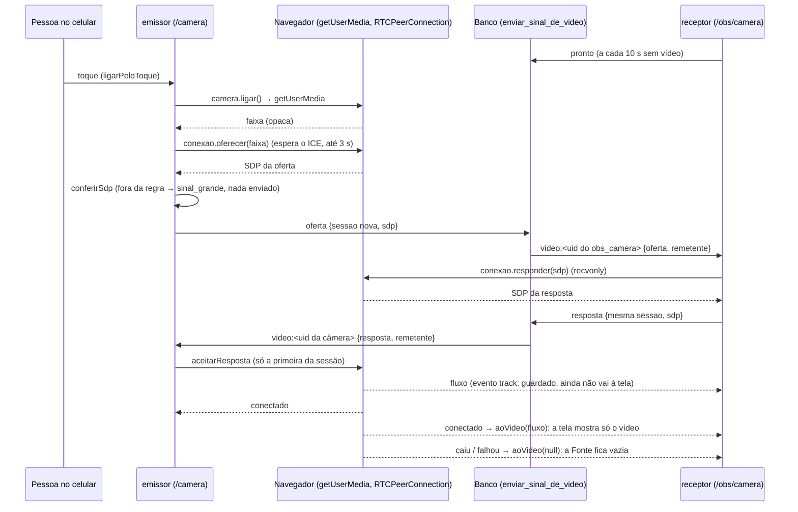
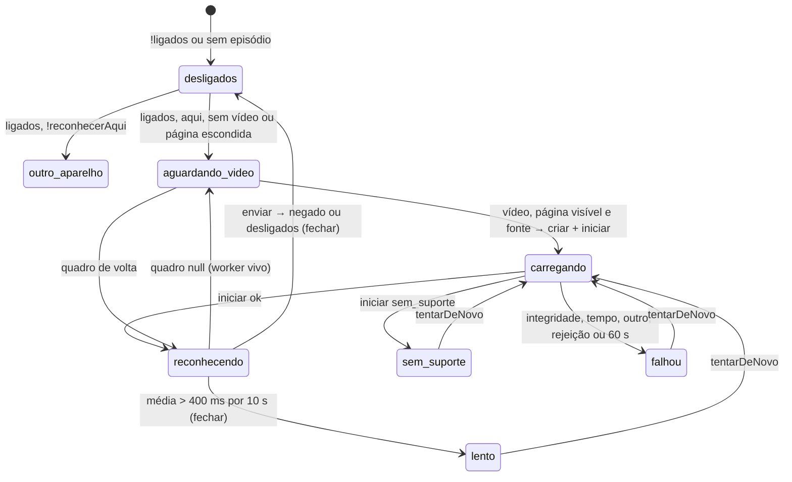

# src/domains/captura

## Cabeçalho

| Campo | Valor |
|---|---|
| Id | DIR-src-domains-captura |
| Título | `captura` |
| Tipo | código · domínio Captura (sinais do vídeo, portas, emissor e receptor; desde a E5, gestos, confirmador e laço do reconhecimento) |
| Data | 2026-11-27 |
| Usuário responsável | TokumoH |
| Status | em construção |
| Commits | commit que introduz este arquivo — `git log --diff-filter=A --format=%h -- src/domains/captura/README.md` |
| Arquivos | `README.md`, `sinais.ts`, `sinais.test.ts`, `portas.ts`, `agenda.ts`, `emissor.ts`, `emissor.test.ts`, `receptor.ts`, `receptor.test.ts`, `falsos.ts`, `gestos.ts`, `gestos.test.ts`, `confirmador.ts`, `confirmador.test.ts`, `reconhecimento.ts`, `reconhecimento.test.ts` |

## Propósito

Domínio **Captura** do [DES-001](../../../docs/desenho/2026-11-16-revocast-cameras-desenho.md) (§6): o celular como câmera. Define os **sinais do vídeo** (oferta, resposta, `pronto`, `encerrar`) e os valida no recebimento, o tópico de vídeo da própria sessão, a situação do vídeo que vai na presença, as esperas da reconexão, as **portas** do canal de vídeo, da conexão WebRTC, da câmera e da tela ligada, e as duas máquinas de estado: o **emissor** (no `/camera`, oferece) e o **receptor** (no `/obs/camera`, responde). Nada aqui conhece o navegador: a faixa e o fluxo de vídeo são tipos opacos, e quem fala com `RTCPeerConnection`, `getUserMedia` e a Wake Lock são os adaptadores de `src/shared/infra/` (Tarefa 3 da E4). Quem decide quem recebe e quem envia os sinais é o banco (função `enviar_sinal_de_video` e `pode_usar_canal`, Tarefa 2), nunca a tela.

Desde a E5 ([PLA-006](../../../docs/planos/2026-11-28-e5-gestos.md)), também os **gestos** (DES-001 §6: "reconhecimento de gesto, confirmação"): as constantes de segurar 1 s e do intervalo de 3 s (com a margem de 500 ms do banco e do palco), o tópico de gestos da sessão, os leitores do gesto que chega ao palco e do aviso `gestos_mudaram`, a situação dos gestos que vai na presença, o **confirmador** (puro) e o **laço do reconhecimento** (quadros → reconhecedor → confirmador → `enviar_gesto`, com taxa adaptativa e corte quando o aparelho não aguenta), só sobre portas: nenhum quadro, ponto da mão ou pontuação passa pelo domínio (D8).

## Origem

Criado na Tarefa 1 da etapa E4 ([PLA-005](../../../docs/planos/2026-11-27-e4-celular-como-camera.md)), registro [VER-049](../../../docs/verificacoes/2026-11-27-049-e4-dominio-captura.md). Decisões aplicadas: D1 (onde fica cada coisa; tipos opacos; na E4, `captura` importava de `aovivo` só o tipo `EstadoDoCanal`, que desde a E5 vem de [`../canal/`](../canal/README.md); a lista de revogados chega como função), D2 (tópico da própria sessão; envio só pela função do banco), D3 (a câmera sempre oferece; o `pronto` não fura as esperas), D4 (sinais, tamanhos, a mesma regra do SDP no leitor e na função), D5 (o vídeo segue o episódio ativo), D6 (queda, falha, prazo da conexão, espera crescente, `sem_conexao_direta`, `limite`, `sinal_grande`), D7 (a câmera só liga depois do toque) e D13 (situação do vídeo na presença). Os gestos entram na Tarefa 1 da E5, registro [VER-058](../../../docs/verificacoes/2026-11-28-058-e5-dominio-gestos.md), com as decisões D1 (núcleo `canal/`; `captura` não importa `aovivo`), D2 (gesto só pela função do banco, tópico da sessão do palco), D3 (segurar, intervalo, tolerância, soltar, confiança), D4 (aviso sem valor), D8 (nenhum quadro sai do aparelho), D11 (taxa, degrau, `lento`, prazo do carregamento) e D12 (situação dos gestos na presença).

## Organização

- `sinais.ts`: `EVENTO_DO_SINAL`, `topicoDoVideo`, `TAMANHO_MAXIMO_DO_SDP`, `SinalDaCamera`, `SinalDaObs`, `conferirSdp`, os leitores `lerSinalDaCamera` e `lerSinalDaObs` (cada um só com os tipos do lado que envia), `EstadoDoVideo`, `SituacaoDoVideo`, `lerSituacaoDoVideo` e as esperas (`ESPERA_DO_ICE_MS`, `ESPERA_DA_RESPOSTA_MS`, `ESPERA_DA_QUEDA_MS`, `ESPERA_DA_CONEXAO_MS`, `ESPERAS_DE_RECONEXAO_MS`, `esperaDaTentativa`, `FALHAS_PARA_SEM_CONEXAO_DIRETA`, `PRONTO_A_CADA_MS`, `PRESENCA_MINIMA_MS`).
- `portas.ts`: `FaixaDeVideo` e `FluxoDeVideo` (opacos), `RespostaDoSinal`, `CanalDeVideo`, `FabricaDeCanaisDeVideo`, `EstadoDaConexao`, `ConexaoDeVideo`, `FabricaDeConexoes`, `FalhaDaCamera`, `CameraDoAparelho`, `ManterTelaLigada`. Sem teste próprio: só tipos, exercitados pelos falsos e, na Tarefa 3, pelos adaptadores.
- `agenda.ts`: `criarAgenda`, a regra comum do emissor e do receptor para o `agendar` injetado: um único agendamento por motivo e o `depois` (0 ms) para os ouvintes de porta.
- `emissor.ts` (`criarEmissorDeVideo`) e `receptor.ts` (`criarReceptorDeVideo`): as máquinas de estado, que só conhecem portas e o relógio injetado.
- `falsos.ts`: os falsos das portas (canal, conexões, câmera) e o relógio falso, usados só por `emissor.test.ts` e `receptor.test.ts`; nenhum código do app o importa.
- `gestos.ts` (E5): `SEGURAR_MS`, `INTERVALO_MS`, `INTERVALO_DO_SERVIDOR_MS`, `TOLERANCIA_MS`, `SOLTAR_MS`, `CONFIANCA_MINIMA`, `QUADROS_POR_SEGUNDO`, `QUADROS_REDUZIDOS`, `JANELA_DA_MEDIA`, `MS_PARA_REDUZIR`, `MS_PARA_PARAR`, `TEMPO_LENTO_MS`, `ESPERA_DO_RECONHECEDOR_MS`, `topicoDosGestos`, `EVENTOS_DOS_GESTOS`, `GestoRecebido`, `ehGesto`, `lerGestoParaOPalco`, `lerAvisoDosGestos`, `LeituraDoGesto`, `EstadoDosGestos`, `SituacaoDosGestos`, `lerSituacaoDosGestos`, `RespostaDoGesto`. Os leitores usam `objetoComChaves`, `campo`, `ehUuid` e `extrasValidos` de `sinais.ts` (exportados desde a E5, a mesma regra).
- `confirmador.ts` (E5): `criarConfirmador` (`ler`, `zerar`), puro; `zerar` recomeça a contagem e mantém o intervalo e o "ainda não solto" (VER-058, rodada 1, I1).
- `reconhecimento.ts` (E5): `DependenciasDoReconhecimento`, `CondicoesDoReconhecimento`, `criarReconhecimento` (`definir`, `tentarDeNovo`, `parar`), sobre `criarAgenda` (motivos `quadro` e `carga`).
- `portas.ts` ganha na E5: `QuadroDeVideo` (opaco), `FonteDeQuadros`, `FalhaDoReconhecedor`, `ReconhecedorDeGestos`, `FabricaDeReconhecedores`, `CanalDeGestos`, `FabricaDeCanaisDeGestos`, `RepositorioDosGestos`.
- Dependência entre domínios: `captura` importa `EstadoDoCanal` de `canal/` (desde a E5; antes, de `aovivo/`), o `UUID` de `preparacao/midia.ts` e `Gesto` e `GESTOS` de `preparacao/gestos.ts`; **não importa `aovivo`**, nem tipo (`arquitetura.test.ts`, `captura-nao-importa-aovivo`); `aovivo/mensagens.ts` importa de `captura` o `lerSituacaoDoVideo` (a presença de `camera` e `obs_camera` leva `video`, D13) e, desde a E5, o `lerSituacaoDosGestos` (`gestos`, D12 do PLA-006).

## Por que esta organização

Cada perigo do "Foco da revisão" do PLA-005 que é do domínio tem um lugar e um teste de nome conhecido: sinalização forjada ou do lado errado (`sinais-validados`, `sinal-do-lado-errado`), câmera ligada sem o usuário saber (`emissor-so-liga-depois-do-toque`, `emissor-desliga-sem-episodio`), sessão antiga ou revogada (`emissor-primeira-resposta-vale`, `emissor-descarta-revogado`, `emissor-revoga-par`, `receptor-revoga-par`), NAT que impede a conexão (`emissor-sem-conexao-direta`, `emissor-prazo-da-conexao`, `emissor-espera-crescente`), reconexão (`emissor-queda-breve`, `emissor-canal-volta`, `receptor-oferta-nova-fecha-a-antiga`) e consumo (`emissor-pronto-respeita-a-espera`). As máquinas só conhecem portas, então o mesmo código roda com os adaptadores do navegador (Tarefa 3), com os falsos de tela (Tarefas 4 e 5) e com os falsos deste diretório, e o relógio injetado deixa provar cada prazo em milissegundos, sem esperar de verdade.

## Por que não outras organizações

| Opção | Motivo de descarte |
|---|---|
| Máquinas de estado dentro das telas (`CameraNoAr.tsx`, `ObsCameraNoAr.tsx`) | Só testáveis com jsdom e falsos do navegador; a regra das esperas e do consentimento ficaria misturada com a apresentação |
| `RTCPeerConnection` e `MediaStreamTrack` nas portas | O domínio passaria a depender do navegador (o teste `dominio-sem-navegador` recusa); os tipos opacos bastam para o domínio passar a faixa e o fluxo adiante |
| Captura dentro de `aovivo/` | O DES-001 §6 separa Captura (câmera, envio de vídeo, gestos) de Ao vivo (comandos, estado no ar) |
| Depender da classe `Revogados` de `aovivo` | Acoplaria os dois domínios por valor; uma função `revogado(usuario)` injetada basta (D1) |
| Uma negociação dos dois lados ("perfect negotiation") | A câmera sempre oferece e o `obs_camera` só responde (D3): menos estados, e a função do banco recusa o tipo do outro lado |
| Repetir os falsos em cada teste | Os dois lados seriam provados contra falsos que podem divergir; `falsos.ts` é um só |
| Confirmador dentro do laço (`reconhecimento.ts`) | A regra de 1 s, 3 s, tolerância e soltar ficaria testável só com o laço e um relógio; separado, é puro e provado leitura a leitura |
| Gestos em `aovivo/` | O formato do tópico de gestos é de quem produz (Captura); `aovivo` só consome o leitor (D1 do PLA-006) |
| O laço criando o worker e esperando o vídeo sozinho | O laço não conhece o vídeo nem a página: a rota diz `video` e `visivel` em `definir`, e a fonte vem por função |

## Onde

| Arquivo ou subdiretório | O que contém |
|---|---|
| [`README.md`](README.md) | Este arquivo |
| [`sinais.ts`](sinais.ts) | Tópico, evento, sinais e leitores, `conferirSdp`, situação do vídeo e esperas (D2–D4, D6, D13); desde a E5, os auxiliares de validação exportados para `gestos.ts` |
| [`sinais.test.ts`](sinais.test.ts) | 86 testes (desde o VER-052, rodada 1, também `sem_video_direto` aceito em `lerSituacaoDoVideo`, com espaço ou maiúsculas recusados) (protótipo diferente de `Object.prototype` e instância de classe recusados desde a rodada 1 da revisão): constantes; `topico-do-video`; `conferir-sdp`; `sinais-validados` (`test.each` com os dois leitores); `sinal-do-lado-errado`; `situacao-do-video`; `espera-da-tentativa` |
| [`portas.ts`](portas.ts) | `FaixaDeVideo`, `FluxoDeVideo`, `RespostaDoSinal`, `CanalDeVideo`, `FabricaDeCanaisDeVideo`, `EstadoDaConexao`, `ConexaoDeVideo`, `FabricaDeConexoes`, `FalhaDaCamera`, `CameraDoAparelho`, `ManterTelaLigada`; desde a E5, `QuadroDeVideo`, `FonteDeQuadros`, `FalhaDoReconhecedor`, `ReconhecedorDeGestos`, `FabricaDeReconhecedores`, `CanalDeGestos`, `FabricaDeCanaisDeGestos`, `RepositorioDosGestos` |
| [`agenda.ts`](agenda.ts) | `criarAgenda`: um agendamento por motivo, `depois` (0 ms), `parar` |
| [`emissor.ts`](emissor.ts) | `DependenciasDoEmissor`, `criarEmissorDeVideo` (`ligarPeloToque`, `definirEpisodio`, `revogarPar`, `voltarAVer`, `parar`); desde o VER-056 (I2), um `pronto` de remetente diferente do par aceito fecha a sessão com o par antigo e oferece de novo (só o `obs_camera` atual consegue mandar `pronto`) |
| [`emissor.test.ts`](emissor.test.ts) | 50 testes (desde o VER-056, `pronto-de-outro-par-troca-o-par`, 4: a sonda I2 da revisão final, o `pronto` de outro antes da resposta ou na espera, o de remetente revogado e o `limite` da oferta nova; desde o VER-051, rodada 1, também `emissor-criar-que-lanca`: a fábrica de conexões que lança conta como falha, sem rejeição solta; desde a rodada 1 da revisão também `ouvinte-adiado`, `emissor-encerrar-so-do-par`, `emissor-sem-faixa-velha`, `emissor-sem-par-zera-falhas` e a faixa que chega atrasada depois do fim do episódio e do `parar`): `emissor-so-liga-depois-do-toque`, `emissor-desliga-sem-episodio`, `emissor-oferece`, `emissor-oferece-ao-pronto`, `emissor-pronto-respeita-a-espera`, `emissor-sdp-grande`, `emissor-sem-par`, `emissor-limite`, `emissor-primeira-resposta-vale`, `emissor-descarta-revogado`, `emissor-ignora-oferta`, `emissor-revoga-par`, `emissor-queda-breve`, `emissor-espera-crescente`, `emissor-sem-resposta`, `emissor-sem-conexao-direta`, `emissor-prazo-da-conexao`, `emissor-canal-volta`, `emissor-falha-da-camera`, `faixa-terminada-religa`, `emissor-voltar-a-ver`, `emissor-parar` |
| [`receptor.ts`](receptor.ts) | `DependenciasDoReceptor`, `criarReceptorDeVideo` (`definirEpisodio`, `revogarPar`, `perderPar` desde o VER-056, I1: o tópico negado com episódio fecha a sessão na hora, sem `encerrar`, `parar`) |
| [`receptor.test.ts`](receptor.test.ts) | 26 testes (desde o VER-056, `receptor-perde-o-par`; desde o VER-051, rodada 1, também `receptor-criar-que-lanca`; desde a rodada 1 da revisão também `receptor-video-so-conectado` (3, com o fluxo novo trocando o antigo desde a rodada 2), `ouvinte-adiado` e `receptor-falha-so-depois-de-responder`): `receptor-pronto`, `receptor-responde`, `receptor-oferta-nova-fecha-a-antiga`, `receptor-oferta-repetida`, `receptor-ignora-resposta`, `receptor-encerrar`, `receptor-revoga-par`, `receptor-sem-episodio`, `receptor-falhou`, `receptor-sem-conexao-direta`, `receptor-sdp-grande`, `receptor-limite`, `receptor-parar` |
| [`falsos.ts`](falsos.ts) | Só para os testes: `criarRelogioFalso`, `criarCanalFalso` (entrega pelo leitor real), `criarConexoesFalsas` (com o registro `criar#n`/`fechar#n` e respostas que podem ficar seguras), `criarCameraFalsa` (com o registro `ligar#n`/`faixa#n`/`desligar` e o `ligar` que pode demorar), SDPs de teste com IP da RFC 5737; desde a E5, `criarReconhecedoresFalsos` (registro `criar#n`/`iniciar#n`/`fechar#n`, `iniciar` seguro ou com falha, leitura depois de `msPorQuadro` no relógio), `criarFonteFalsa` e `criarRepoDosGestosFalso` |
| [`gestos.ts`](gestos.ts) | Constantes da D3 e da D11, tópico e eventos dos gestos, `lerGestoParaOPalco`, `lerAvisoDosGestos`, `LeituraDoGesto`, situação dos gestos e `RespostaDoGesto` (E5) |
| [`gestos.test.ts`](gestos.test.ts) | 62 testes: constantes; `topico-dos-gestos`; `le-gesto-para-o-palco` (`test.each`: o `id` do `realtime.send` ignorado, evento, `tipo`, gesto fora dos 7 e `None`, uuid em maiúsculas, `gesto_id` faltando, chave extra, `__proto__`, protótipo de classe); `le-aviso-dos-gestos` (um `ligados` → `null`); `situacao-dos-gestos` |
| [`confirmador.ts`](confirmador.ts) | `criarConfirmador`: segurar 1 s, tolerância `max(300, 2 × período)`, confiança 0,7, intervalo de 3 s e soltar 500 ms (E5) |
| [`confirmador.test.ts`](confirmador.test.ts) | 26 testes (desde a rodada 1 do VER-058, `zerar não conta como soltar` e `soltar-recomeca-a-contagem`): `confirma-depois-de-1s`, `nao-confirma-antes`, `troca-de-gesto-recomeca`, `buraco-dentro-da-tolerancia`, `buraco-maior-que-a-tolerancia-zera`, `tolerancia-a-5-quadros`, `none-e-baixa-confianca-nao-contam`, `mantido-confirma-uma-vez`, `soltar-e-mostrar-de-novo`, `intervalo-de-3s`, `margem-do-intervalo`, `zerar` |
| [`reconhecimento.ts`](reconhecimento.ts) | `criarReconhecimento`: o laço (um quadro por vez, 10 → 5 quadros/s, `lento`, prazo de 60 s do carregamento, envio sem segurar o laço, `negado`/`desligados` param) (E5) |
| [`reconhecimento.test.ts`](reconhecimento.test.ts) | 50 testes (desde a rodada 1 do VER-058, o bloco `rodada 1 da revisão`, 12: punho mantido com uma piscada do vídeo confirma uma vez, reinício zera a contagem, leitura `null` do worker não para o laço, período do confirmador a 5 quadros/s, quadro que chega depois de parar ou desligar, `parar`/`desligar` de dentro do `aoMudarSituacao(carregando)`, bloqueio antes do vídeo, situação sem repetição, `max(ms do worker, ida e volta)` nos dois sentidos): `laco-parado-com-desligados`, `outro-aparelho`, `aguardando-video`, `carrega-uma-vez`, `laco-um-quadro-por-vez`, `laco-10-por-segundo`, `laco-reduz-para-5`, `laco-para-quando-lento`, `gesto-confirmado-vai-ao-repo`, `resposta-do-repo-nao-trava`, `desligados-reavalia`, `negado-reavalia`, `falha-do-iniciar`, `pagina-escondida-para`, `laco-parar-nao-deixa-agendamento` |

## Lógica

Do toque ao vídeo no OBS (o banco escolhe o destinatário de cada sinal e põe o remetente, D2):



Estados do vídeo (`EstadoDoVideo`), em ordem de precedência no emissor (o receptor usa os marcados com R):

| Estado | Quando | Lado |
|---|---|---|
| `sem_permissao`, `sem_camera`, `inseguro` | a câmera recusou; só um novo toque tenta de novo | câmera |
| `aguardando_toque` | antes do toque, ou depois de uma falha `outro` da câmera | câmera |
| `aguardando_episodio` | sem episódio ativo: câmera desligada, conexão fechada | câmera, R |
| `sinal_grande` | o próprio SDP fora da regra: nada enviado, câmera desligada, sem tentativa sozinha | câmera, R |
| `conectado` | a conexão em `conectado` | câmera, R |
| `sem_conexao_direta` | duas falhas seguidas depois de resposta aceita (ou respondida, no receptor); segue tentando a cada 30 s | câmera, R |
| `aguardando_par` | `sem_par`, 15 s sem resposta, ou o par encerrou (câmera); nenhuma oferta (receptor) | câmera, R |
| `conectando` | o resto: oferta montada ou enviada, resposta aceita, queda breve, espera crescente | câmera, R |
| `sem_video_direto` | o navegador não tem `RTCPeerConnection` (VER-052, rodada 1, I2): **publicada pela rota**, nunca pelo emissor nem pelo receptor; a aba Ao vivo (Tarefa 6) mostra a causa | rota da câmera e, desde o VER-053, a do `obs_camera` (no selo e na presença) |

Vídeo no receptor (D3, D8): o fluxo do evento `track` fica guardado e só vai à tela (`aoVideo(fluxo)`) com a conexão em `conectado`; ao sair de `conectado` (`caiu`, `conectando`, `falhou`, fechamento) sai `aoVideo(null)`, e o mesmo fluxo volta com o `conectado`.

Regras de tempo do emissor (D6): `caiu` → 5 s de espera e, se não voltar, oferta nova na hora (sem espera crescente); `falhou`, 15 s sem resposta, 20 s sem `conectado` depois da resposta, `sem_par` e `limite` → nova oferta depois de 2, 4, 8, 16, 30, 30… s (zera no `conectado`); só `falhou` e o prazo da conexão depois de resposta aceita contam para `sem_conexao_direta`. O `pronto` só gera oferta sem sessão pendente e fora da espera. Cada ouvinte de porta passa pelo `agendar` com 0 ms (`agenda.depois`) e cada prazo tem um agendamento só por motivo.

Gestos (E5): estados do reconhecimento (`EstadoDosGestos`) em `reconhecimento.ts`. Cada `definir` reavalia na ordem abaixo; `negado` e `desligados` do banco param o laço até a próxima `definir`; `lento`, `sem_suporte` e `falhou` só saem com `tentarDeNovo` ou com os gestos desligados e ligados de novo:



Linha do tempo do confirmador (leituras a cada 100 ms; faixas inclusivas): o mesmo gesto do começo da contagem até agora por 1 s, 3 s desde a última confirmação e o gesto solto (uma leitura sem ele 500 ms depois da última vez visto) antes de repetir:

| Instante (ms) | Leitura | Contagem desde | Confirma? | Por quê |
|---|---|---|---|---|
| 0 a 900 | ✌️ | 0 | não | menos de 1 s |
| 1000 | ✌️ | 0 | **✌️** | 1 s segurando; primeira confirmação |
| 1100 a 1500 | nada | — | não | em 1500, 500 ms sem ✌️: solto |
| 1600 a 3900 | ✌️ | 1600 | não | segurou 1 s em 2600, mas o intervalo vai até 4000 |
| 4000 | ✌️ | 1600 | **✌️** | 3 s desde 1000, solto e segurando |
| 4100 a 10 000 | ✌️ | 1600 | não | não foi solto de novo (mantido confirma uma vez) |

Buraco: entre duas leituras **com** o gesto, até `max(300, 2 × período)` não zera (300 ms a 10 quadros/s; 400 ms a 5); acima disso a contagem recomeça na leitura nova. O laço pede um quadro por vez (o próximo só depois da resposta), a cada 100 ms, ou 200 ms com a média dos últimos 20 acima de 120 ms; o gesto confirmado vai a `repo.enviar({ id, gesto })` sem segurar o laço.


## Exemplo

```ts
lerSinalDaObs('sinal', { tipo: 'resposta', sessao: '0b6e2b8a-3c1d-4f2a-9e5b-1a2b3c4d5e6f', sdp: 'v=0\r\n…', remetente: 'c0ffee00-…', id: 'aaaaaaaa-…' })
// { tipo: 'resposta', sessao: '0b6e2b8a-…', sdp: 'v=0\r\n…' } — objeto novo, sem remetente nem id
lerSinalDaCamera('sinal', { tipo: 'resposta', sessao: '0b6e2b8a-…', sdp: 'v=0\r\n…' }) // null (a câmera não manda resposta)
conferirSdp('v=0\na=x') // 'forma' (v=0 seguido só de \n)
esperaDaTentativa(9) // 30000
```

Gestos (E5):

```ts
lerGestoParaOPalco('gesto', { tipo: 'gesto', gesto_id: '5d1e8a2c-…', gesto: 'Victory', dispositivo: '9a8b7c6d-…', remetente: 'c0ffee00-…', id: 'aaaaaaaa-…' })
// { id: '5d1e8a2c-…', gesto: 'Victory', dispositivoId: '9a8b7c6d-…' } — o id do realtime.send fica de fora
lerAvisoDosGestos('gestos_mudaram', { tipo: 'gestos_mudaram', ligados: true }) // null (o aviso não leva valor, D4)
const c = criarConfirmador()
c.ler({ gesto: 'Victory', confianca: 0.9 }, 900, 100) // null; …; em 1000 → 'Victory'
```

Para seguir um caso no emissor: `emissor.test.ts`, `emissor-prazo-da-conexao` (resposta aceita, conexão parada em `conectando` por 20 000 ms → falha, nova oferta em 2 000 ms; o segundo prazo vencido → `sem_conexao_direta`).

## Verificação

- `npx vitest run src/domains/captura`: 6 arquivos, 300 testes desde a rodada 1 do VER-058 (E5: `gestos.test.ts` 62, `confirmador.test.ts` 26, `reconhecimento.test.ts` 50; 286 na primeira versão); 3 arquivos, 162 testes desde o VER-056 (4 do emissor e 1 do receptor); 157 desde o VER-052, rodada 1 (`sem_video_direto` em `EstadoDoVideo`); 156 desde o VER-051, rodada 1 (`emissor.ts` e `receptor.ts` protegem `conexoes.criar()`; `portas.ts` documenta `criar`, `enviar` com a alça fechada e o `ligar` que para o fluxo atual); 154 testes (139 antes da rodada 1 da revisão, 153 antes da rodada 2; mais 5 de `../arquitetura.test.ts`, que cobre esta pasta sem configuração, inclusive `dominio-sem-navegador`).
- TDD: os testes foram escritos antes do código (o primeiro `npx vitest run src/domains` falhou com os módulos inexistentes, o campo `video` recusado e `./captura/emissor.ts` fora do glob).
- E5 (VER-058): 46 sabotagens numa cópia do repositório (cache desligado, `sha256sum` igual antes e depois), as 14 do brief, 19 a mais e 13 da rodada 1 da revisão; todas derrubam o teste citado (tabela no [VER-058](../../../docs/verificacoes/2026-11-28-058-e5-dominio-gestos.md)).
- 52 sabotagens, uma de cada vez, numa cópia do repositório, com o cache do Vitest desligado e `sha256sum` igual antes e depois: as 16 do brief (17 corridas, com a S7 em duas), 22 a mais na primeira versão, 12 da rodada 1 da revisão e 1 da rodada 2 (X4); todas derrubam o teste citado (tabela no [VER-049](../../../docs/verificacoes/2026-11-27-049-e4-dominio-captura.md)).
- Links relativos, "Onde" e campo "Arquivos" conferidos por `npm run check-docs`. Não há subdiretórios.

## Riscos

- **Só falsos:** o domínio foi provado contra falsos das portas; o comportamento real do `RTCPeerConnection`, do `getUserMedia` e da Wake Lock vem nas Tarefas 3 (adaptadores) e 7 (Chromium real), e no aparelho real só o responsável (D14).
- **Ciclo de tipos entre domínios: fechado na E5** ([VER-058](../../../docs/verificacoes/2026-11-28-058-e5-dominio-gestos.md)): `EstadoDoCanal` mora em `../canal/estados.ts`, e `captura-nao-importa-aovivo` impede a volta. Histórico: na E4, `captura/portas.ts` importava o tipo `EstadoDoCanal` de `aovivo`, e `aovivo/mensagens.ts` importa `lerSituacaoDoVideo` de `captura` (valor). Não há ciclo em tempo de execução (`sinais.ts` não importa `aovivo`), mas mover o leitor da presença para `captura` sem cuidado criaria um. Decisão registrada no [VER-056](../../../docs/verificacoes/2026-11-28-056-e4-correcoes-revisao-final.md) (N6): fica como está na E4 (só tipo, apagado na compilação); antes da E5, que põe os gestos em `captura`, mover `EstadoDoCanal` para um núcleo compartilhado de tipos de canal tira o ciclo (sugestão da rodada 1 da revisão).
- **`outro` da câmera:** sem um estado próprio na lista fechada, uma falha `outro` no primeiro toque volta a `aguardando_toque`; ao religar uma faixa perdida (página escondida), o emissor guarda a faixa como perdida, fica sem estado novo e tenta de novo em `voltarAVer`. A tela (Tarefa 4) decide o texto.
- **Piscada no ar numa queda breve do ICE** (re-revisão da rodada 2, N6): `conectado` → `caiu` → `conectado` em menos de 1 s tira o vídeo da Fonte (`aoVideo(null)`) e o põe de volta, uma piscada na transmissão. Segue a D3 ("sem vídeo" é conexão fora de `conectado`) e a D8, e no `disconnected` a mídia em geral já parou (o quadro mostrado seria um congelado). A Tarefa 7 confere o caso no Chromium; manter o último quadro durante uma queda curta exigiria mudar a D3: **pendência para o responsável decidir**.
- **`pronto` com `limite` no receptor:** o próximo `pronto` sai depois de `max(10 s, espera crescente)`, nunca antes do ciclo normal de 10 s (decisão desta tarefa; o brief só exige "depois da espera crescente").
- **`sem_conexao_direta` no receptor:** contado pelas falhas que o `obs_camera` vê (`falhou` depois de responder, ou oferta nova sem a anterior ter conectado); a câmera pode chegar ao estado antes ou depois dele. A resposta conta como dada antes de o `enviar` terminar, então uma resposta que se perdeu no caminho (a câmera nunca a recebeu e oferece de novo) também conta como falha e pode adiantar o selo.
- Não verificado: a composição nas rotas (Tarefas 4 e 5), a presença coalescida a cada 10 s (`PRESENCA_MINIMA_MS` só é declarada aqui; quem a usa é `useDispositivo`, Tarefa 4).
- **Gestos só com falsos:** o confirmador e o laço foram provados contra falsos das portas e um relógio falso; o reconhecedor real (worker, MediaPipe, integridade) vem na Tarefa 6 da E5, a composição nas rotas na Tarefa 8, e o gesto de verdade no Chromium (Tarefa 9) e no aparelho real (responsável).
- **Soltar medido por leituras:** o gesto confirmado só conta como solto numa leitura sem ele pelo menos 500 ms depois da última vez visto; a 5 quadros/s isso pede três leituras sem o gesto. `zerar` (o laço parou) **não** conta como soltar e mantém o intervalo (VER-058, rodada 1, I1): quem segurou o gesto durante uma parada precisa baixá-lo antes de repetir.
- **Fonte trocada com o laço vivo:** a fonte de quadros é pedida só quando o worker nasce; se a rota trocar o fluxo sem passar `video: false`, o laço segue com a fonte antiga até a próxima parada. A rota (Tarefa 8) passa `video: false` ao perder o fluxo.
- **Quadro pedido e descartado (A4):** um quadro que chega depois de o laço parar não vai ao worker (testado desde a rodada 1); o domínio não tem como liberá-lo (`FonteDeQuadros` não tem `liberar`; o `ImageBitmap` fica com o coletor de lixo). Fica para a Tarefa 6.
- **Reconhecedor que só falha (A3):** um worker que devolve `null` em todo quadro mantém o laço a 10 quadros/s sem confirmar nada e sem ir a `falhou` nem a `lento`; a média não anda (só leituras válidas contam). O laço não congela (testado desde a rodada 1); a Tarefa 6 decide se falhas seguidas viram erro.
