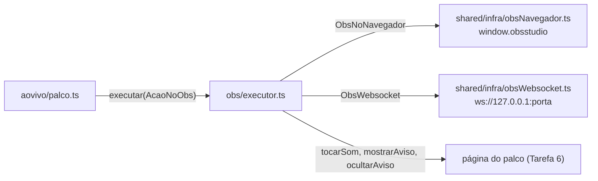

# src/domains/obs

## Cabeçalho

| Campo | Valor |
|---|---|
| Id | DIR-src-domains-obs |
| Título | `obs` |
| Tipo | código · domínio Integração OBS (camada anticorrupção: portas, versão mínima e executor) |
| Data | 2026-11-27 |
| Usuário responsável | TokumoH |
| Status | em construção |
| Commits | commit que introduz este arquivo — `git log --diff-filter=A --format=%h -- src/domains/obs/README.md` |
| Arquivos | `README.md`, `portas.ts`, `versao.ts`, `versao.test.ts`, `executor.ts`, `executor.test.ts` |

## Propósito

Contexto **Integração OBS** do [DES-001](../../../docs/desenho/2026-11-16-revocast-cameras-desenho.md) (§6): a camada anticorrupção entre o palco e o OBS. Declara as portas do OBS como o app as quer ver (`ObsNoNavegador`, sobre o `window.obsstudio` do obs-browser, e `ObsWebsocket`, sobre o obs-websocket v5), a versão mínima do OBS para o marcador e o **executor** (`criarExecutorObs`), que implementa o `ExecutorDeAcoes` de [`../aovivo/portas.ts`](../aovivo/portas.ts): troca de cena, clipe e marcador no OBS; som e aviso na própria página. O executor confere nível de controle, lista de cenas, Replay Buffer e gravação **antes** de chamar o OBS e devolve sempre um motivo da lista fixa (`MOTIVOS_DO_RESULTADO`), nunca texto do OBS.

## Origem

Criado na Tarefa 5 da etapa E3 ([PLA-004](../../../docs/planos/2026-11-27-e3-ao-vivo-por-toque.md)), registro [VER-039](../../../docs/verificacoes/2026-11-27-039-e3-integracao-obs-e-palco.md). Decisões aplicadas: D1 (`obs/` implementa o executor e importa de `aovivo/` só tipos; `aovivo/` não conhece o OBS), D9 (clipe: um pendente por vez, espera de 5 s), D10 (obs-websocket sem biblioteca; saída no ar por `getStatus` e pelos eventos do obs-browser, nunca `obsSourceActiveChanged`) e D13 (versão do OBS ≥ 30.2 no checklist). As chamadas e os níveis foram conferidos no README do obs-browser e no `protocol.md` do obs-websocket (fontes no VER-039).

## Organização

- `portas.ts`: `NIVEL_DE_CONTROLE` (0 NONE … 5 ALL), `StatusDaSaida`, `ObsNoNavegador` e `ObsWebsocket`. Sem teste próprio: só tipos e a constante, exercitados pelos testes do executor e dos adaptadores.
- `versao.ts`: `VERSAO_MINIMA_DO_OBS` e `versaoAtende` (com o teste ao lado).
- `executor.ts`: `ESPERA_DO_CLIPE_MS`, `ExecutorObs` (o `ExecutorDeAcoes` mais `atualizarSituacao` e `parar`), `DependenciasDoExecutor` e `criarExecutorObs` (com o teste ao lado, com OBS, websocket e relógio falsos escritos no próprio arquivo).
- Adaptadores fora do domínio: [`../../shared/infra/obsNavegador.ts`](../../shared/infra/obsNavegador.ts) e [`../../shared/infra/obsWebsocket.ts`](../../shared/infra/obsWebsocket.ts).

## Por que esta organização

O OBS tem dois caminhos com regras diferentes (a Fonte de navegador com níveis de permissão e callbacks; o obs-websocket com senha e requisições), e a API dele pode mudar; isolando os dois atrás de portas pequenas, o palco (`aovivo/palco.ts`) e as telas só veem `ExecutorDeAcoes`, `SituacaoDoObs` e motivos fixos. As regras perigosas (cena que não existe no OBS, clipe repetido, nível insuficiente, senha) ficam num lugar testável sem OBS real, cada uma com um teste de nome conhecido.

## Por que não outras organizações

| Opção | Motivo de descarte |
|---|---|
| Executor dentro de `aovivo/` | `aovivo` passaria a conhecer `window.obsstudio` e obs-websocket (D1) |
| Chamar `window.obsstudio` direto no palco ou na tela | Sem teste sem OBS; níveis e conferências espalhados; texto do OBS chegaria ao estado |
| `obs-websocket-js` | 7 dependências para 2 requisições (D10) |
| Uma porta só para os dois caminhos | Misturaria nível de controle da Fonte com conexão e senha do websocket; o marcador precisa saber se há websocket (`sem_websocket`) |

## Onde

| Arquivo ou subdiretório | O que contém |
|---|---|
| [`README.md`](README.md) | Este arquivo |
| [`portas.ts`](portas.ts) | `NIVEL_DE_CONTROLE`, `StatusDaSaida`, `ObsNoNavegador`, `ObsWebsocket` (com `conectado()` e `aoFechar(f)` para saber da queda) |
| [`versao.ts`](versao.ts) | `VERSAO_MINIMA_DO_OBS` (`'30.2.0'`), `versaoAtende` |
| [`versao.test.ts`](versao.test.ts) | 1 teste: `versao-minima` (os casos da interface, pré-lançamento — inclusive `30.2.0-rc1` —, forma errada e tamanho) |
| [`executor.ts`](executor.ts) | `ESPERA_DO_CLIPE_MS`, `ExecutorObs`, `DependenciasDoExecutor`, `criarExecutorObs` |
| [`executor.test.ts`](executor.test.ts) | 17 testes: constante, `trocar-cena-existente`, `cena-inexistente-no-obs`, `sem-permissao`, `clipe-espera-5s`, `clipe-repetido-ignorado`, `clipe-sem-replay-buffer`, `marcador-sem-websocket`, `marcador-sem-gravacao`, `marcador-ok`, `obs-ausente`, `websocket-cai-depois`, `websocket-cai-durante-o-pedido`, `parar-cancela-o-clipe-pendente`, `som-que-nao-toca-falha-sem-motivo`, `situacao`, `estado-do-websocket-por-funcao` (Tarefa 6, rodada 1) |

## Lógica

Ação do palco → chamada do OBS → nível exigido (níveis do README do obs-browser):

| Ação (`AcaoNoObs`) | Conferências antes | Chamada | Nível exigido | Resultado |
|---|---|---|---|---|
| `trocar_cena` | `getControlLevel` (NONE); `getScenes` (READ_USER) contém o nome exato | `setCurrentScene(nome)` | ADVANCED (4) | `ok`; nível menor ou desconhecido → `recusado`/`sem_permissao`; nome fora da lista (ou lista desconhecida) → `recusado`/`cena_inexistente_no_obs` |
| `salvar_clipe` | `getControlLevel`; `getStatus` (READ_OBS) com `replaybuffer` | `saveReplayBuffer()` depois de 5 s | BASIC (3) | `ok` na hora do salvamento; repetido durante a espera → `pendente` (ignorado); Replay Buffer desligado ou status desconhecido → `falhou`/`replay_desligado` |
| `marcar` | websocket conectado (`conectado()`); com nível ≥ READ_OBS, `getStatus` com `recording` | obs-websocket `CreateRecordChapter` (`chapterName`) | — (websocket; o OBS exige 30.2 e Hybrid MP4) | `ok`; sem websocket ou websocket caído (antes ou durante o pedido) → `falhou`/`sem_websocket`; sem gravação ou capítulo recusado → `falhou`/`sem_gravacao` |
| `tocar_som` | — | `tocarSom` da página | — | `ok`, ou `falhou` sem motivo |
| `mostrar_aviso`, `ocultar_aviso` | — | `mostrarAviso`/`ocultarAviso` da página | — | `ok` |

Sem `window.obsstudio`, cena, clipe e marcador → `falhou`/`obs_ausente` (som e aviso continuam). A situação (`situacao()`, para o estado no ar e a presença, D13) junta o que é lido na hora (`navegador`, `versaoDoPlugin`) com a última leitura de nível, saídas e versão do OBS (`atualizarSituacao()` e cada execução); o websocket aparece como `conectado` enquanto `conectado()` for verdadeiro, `sem_conexao` depois de cair, ou, sem objeto, o estado informado pela rota (`desligado`, `senha_errada`, `sem_conexao`), nunca a senha. Desde a Tarefa 6 (rodada 1, registro [VER-040](../../../docs/verificacoes/2026-11-27-040-e3-telas-de-dispositivo.md)), `estadoDoWebsocket` também aceita uma **função**, lida a cada situação com ou sem objeto, enquanto o websocket não está conectado: a rota do palco muda o estado (desligado, senha recusada, sem conexão) sem recriar o executor. Depois de `parar()`, toda ação responde `falhou` sem chamar nada, e o clipe que esperava não é salvo.



## Exemplo

```ts
const executor = criarExecutorObs({ obs, ws: null, tocarSom, mostrarAviso, ocultarAviso, agendar: (f, ms) => setTimeout(f, ms) })
await executor.executar({ tipo: 'trocar_cena', nomeObs: 'Conversa ', cenaId }) // { resultado: 'recusado', motivo: 'cena_inexistente_no_obs' } (o OBS tem "Conversa")
await executor.executar({ tipo: 'marcar', nome: 'Episódio 21:03:10' })          // { resultado: 'falhou', motivo: 'sem_websocket' }
versaoAtende('30.1.2') // false — o checklist mostra "versão do OBS abaixo de 30.2"
```

## Verificação

- `npx vitest run src/domains/obs`: 2 arquivos, 18 testes desde o VER-040 (17 até então) (mais 3 de `../arquitetura.test.ts`, que cobre esta pasta sem configuração).
- Sabotagens em memória, uma de cada vez, cada uma derrubando o teste citado (tabela no VER-039).
- Links relativos, "Onde" e campo "Arquivos" conferidos por `npm run check-docs`. Não há subdiretórios.

## Riscos

- **Sem OBS real:** níveis, nomes de função e eventos vêm do README do obs-browser e do `protocol.md` do obs-websocket (lidos em 2026-11-27); a conferência num OBS real é da Tarefa 10 (passo do responsável).
- **`sem_gravacao` cobre mais de uma causa:** o `CreateRecordChapter` recusado (gravação parada, formato que não é Hybrid MP4, OBS anterior a 30.2) e o pedido sem resposta em 5 s com a conexão de pé viram o mesmo motivo (a queda da conexão vira `sem_websocket`); a lista fixa não tem um motivo para cada caso.
- **Situação lida por último:** `nivel`, `replayBuffer`, `gravando` e `versaoObs` são da última leitura; quem chama `atualizarSituacao()` periodicamente é a rota do palco (Tarefa 6).
- **Websocket que cai:** o executor consulta `ws.conectado()` a cada marcador e a cada leitura da situação (marcador `sem_websocket`, situação `sem_conexao`), sem ser recriado e sem perder a guarda do clipe; reconectar é da rota (Tarefa 6), que ouve `aoFechar` e chama `conectar` no mesmo objeto.
- **`parar()`:** cancela o clipe que espera e barra ações novas; a rota (Tarefa 6) chama `executor.parar()` junto com `palco.parar()`, senão um clipe pedido antes de trocar de episódio ainda sai 5 s depois.
- **Clipe:** a espera de 5 s é fixa (DES-001 §16 fala em "configurável"); o Replay Buffer é conferido antes da espera, não depois.
