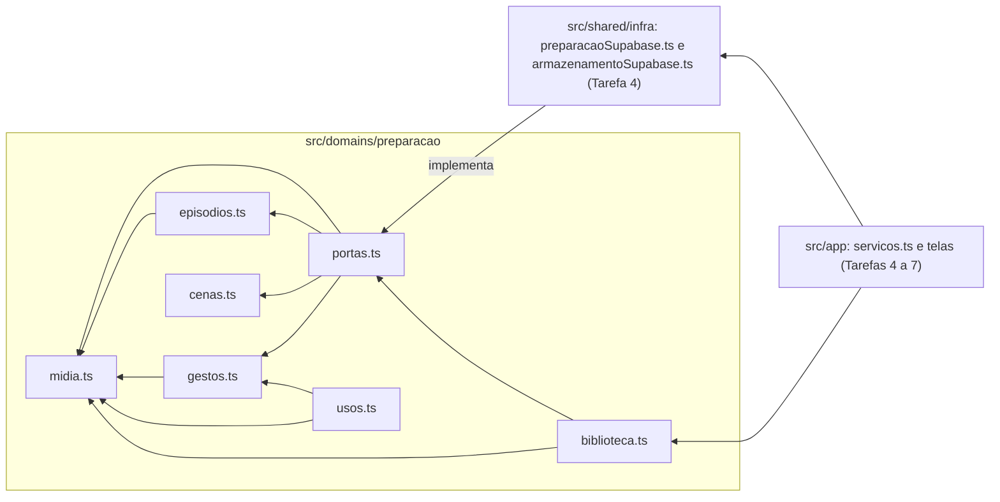
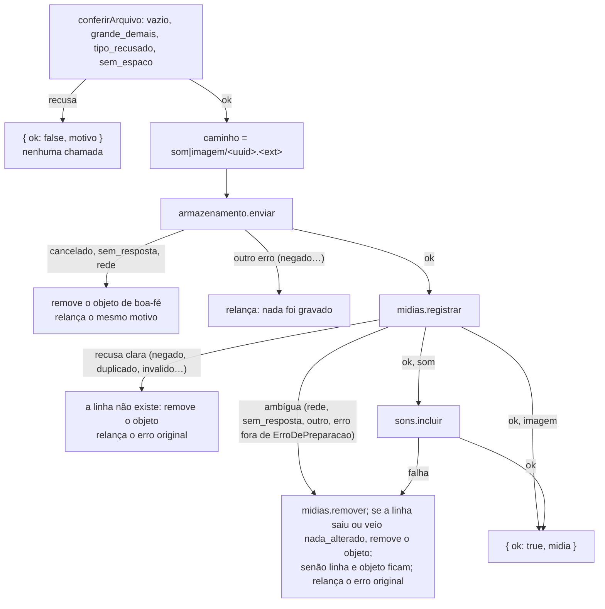

# src/domains/preparacao

## Cabeçalho

| Campo | Valor |
|---|---|
| Id | DIR-src-domains-preparacao |
| Título | `preparacao` |
| Tipo | código · domínio Preparação (regras puras, portas e serviço da Biblioteca) |
| Data | 2026-11-26 |
| Usuário responsável | TokumoH |
| Status | em construção |
| Commits | commit que introduz este arquivo — `git log --diff-filter=A --format=%h -- src/domains/preparacao/README.md` |
| Arquivos | `README.md`, `midia.ts`, `midia.test.ts`, `cenas.ts`, `cenas.test.ts`, `gestos.ts`, `gestos.test.ts`, `episodios.ts`, `episodios.test.ts`, `usos.ts`, `usos.test.ts`, `portas.ts`, `biblioteca.ts`, `biblioteca.test.ts` |

## Propósito

Domínio **Preparação** do [DES-001](../../../docs/desenho/2026-11-16-revocast-cameras-desenho.md) (§6): o que a equipe prepara antes do ao vivo. Decide que arquivos entram na Biblioteca (tipo pelos **primeiros bytes**, 50 MB por arquivo, 1 GB no total), em que caminho do Storage eles ficam (sem o nome do arquivo do computador), como o nome aparece na tela, quando uma cena, um gesto, um episódio ou um aviso pode ser gravado, onde uma mídia ou cena está em uso, e em que ordem o envio e a exclusão de uma mídia falam com o Storage e com o banco. Declara as **portas** (um repositório por agregado e o armazenamento de arquivos) que os adaptadores Supabase implementam. A interface só escolhe o que mostrar com isso; quem nega acesso a dado é a RLS do banco e as políticas de `storage.objects`.

## Origem

Criado na Tarefa 1 da etapa E2 ([PLA-003](../../../docs/planos/2026-11-26-e2-preparar-episodio.md)), registro VER-024. Decisões aplicadas: D1 (um domínio só, `preparacao`, com um arquivo por agregado), D4 (8 tipos aceitos, detectados pelos bytes), D6 (ordem do envio e da exclusão, com compensação), D7 (uso pela soma de `midias.tamanho_bytes`, limite de 10⁹ bytes, alerta a 80 %), D9 (sem dependência nova: tabela fixa de bytes mágicos), D11 (mídia em uso) e D12 (mapa de gestos e a sugestão de som).

## Organização

- Um arquivo por agregado, com o teste ao lado: `midia.ts` (mídia e som), `cenas.ts`, `gestos.ts` (mapa de gestos), `episodios.ts` (episódio → aviso).
- `usos.ts`: regras que atravessam agregados (mídia usada por gesto ou aviso; cena usada por gesto).
- `portas.ts`: `ErroDePreparacao` (com `motivo`; a mensagem nunca leva nome de arquivo, token ou texto do servidor), os repositórios por agregado (D10 do PLA-003: sem classe genérica), `ArmazenamentoDeMidia` e `ServicosDePreparacao`. Sem teste próprio: só tipos e a classe de erro, exercitados por `biblioteca.test.ts`.
- `biblioteca.ts`: serviço de domínio (GRASP Pure Fabrication) que junta Storage e banco no envio e na exclusão.
- Os testes montam os bytes no próprio arquivo (nenhum binário versionado) e usam portas falsas escritas no próprio teste, sem `vi.mock`.

## Por que esta organização

Os agregados se referenciam (gesto → cena ou som; som → mídia; aviso → imagem), e a regra de "mídia em uso" atravessa todos: um domínio só evita importações cruzadas entre pastas (D1). Um arquivo por agregado deixa cada item do "Foco da revisão" do PLA-003 com um lugar e um teste de nome conhecido (`tipo-pelos-bytes`, `mp3-que-e-png`, `caminho-sem-nome-do-arquivo`, `link-so-https`, `gesto-som-sem-som`, `envio-compensa`, `envio-interrompido-remove`, …). Separar as portas permite que a Tarefa 4 escreva os adaptadores Supabase e a Tarefa 5 os falsos de tela contra o mesmo contrato.

## Por que não outras organizações

| Opção | Motivo de descarte |
|---|---|
| Domínios `biblioteca/` e `episodios/` separados | Os agregados se referenciam e "mídia em uso" atravessa os dois; o DES-001 §6 tem um contexto só (D1) |
| Um arquivo `preparacao.ts` com tudo | Testes e revisões misturados; difícil achar a regra de cada item do Foco da revisão |
| Envio e exclusão dentro da tela (`AbaBiblioteca`) | A ordem Storage ↔ banco e a compensação só seriam testáveis com jsdom |
| Tipo do arquivo pela extensão ou pelo `File.type` | Ambos vêm do computador de quem envia; um HTML chamado `.png` passaria (D4) |
| `RepositorioSupabase<T>` genérico | Campos e conversões diferentes por tabela; a classe esconderia nomes de coluna (D10) |

## Onde

| Arquivo ou subdiretório | O que contém |
|---|---|
| [`README.md`](README.md) | Este arquivo |
| [`midia.ts`](midia.ts) | `TipoDeMidia`, `TipoAceito`, `TIPOS_ACEITOS`, `LIMITE_POR_ARQUIVO_BYTES`, `LIMITE_TOTAL_BYTES`, `BYTES_PARA_DETECTAR`, `detectarTipo`, `RecusaDoArquivo`, `ConferenciaDoArquivo`, `conferirArquivo`, `caminhoDaMidia`, `nomeDeExibicao`, `Midia`, `usoDaBiblioteca`, `Som`, `conferirSom`; `UUID` (exportado desde o VER-046, N4: o único uuid do app, reexportado por `aovivo/mensagens.ts` e usado pelo caminho seguro de `shared/infra/armazenamentoSupabase.ts`) |
| [`midia.test.ts`](midia.test.ts) | 31 testes: constantes, `tipo-pelos-bytes` (22 casos), `mp3-que-e-png`, `svg-e-html-recusados`, `limite-50mb`, `sem-espaco`, `caminho-sem-nome-do-arquivo`, `nome-de-exibicao`, `uso-da-biblioteca`, `conferir-som` |
| [`cenas.ts`](cenas.ts) | `Cena`, `RecusaDaCena`, `conferirCena` (nome no OBS comparado exato) |
| [`cenas.test.ts`](cenas.test.ts) | 2 testes: `nome-obs-exato`, `nomes-vazios` |
| [`gestos.ts`](gestos.ts) | `Gesto`, `AcaoDoGesto`, `GESTOS`, `ACOES`, `LinhaDoMapa`, `normalizarGesto`, `conferirGesto`, `sugestoesDeSom` |
| [`gestos.test.ts`](gestos.test.ts) | 4 testes: `gesto-som-sem-som`, `gesto-zera-alvo`, `sete-gestos`, `sugestao-de-som` |
| [`episodios.ts`](episodios.ts) | `EstadoDoEpisodio`, `Episodio`, `Aviso`, `conferirEpisodio`, `podeExcluirEpisodio`, `normalizarLink`, `conferirAviso`, `trocarOrdem` |
| [`episodios.test.ts`](episodios.test.ts) | 5 testes: `link-so-https`, `conferir-aviso`, `conferir-episodio`, `excluir-so-rascunho`, `trocar-ordem` |
| [`usos.ts`](usos.ts) | `usosDaMidia`, `usosDaCena` |
| [`usos.test.ts`](usos.test.ts) | 2 testes: `usos-da-midia`, `usos-da-cena` |
| [`portas.ts`](portas.ts) | `MotivoDaPreparacao`, `ErroDePreparacao`, `NovaMidia`, `RepositorioDeMidias`, `RepositorioDeSons`, `RepositorioDeCenas`, `RepositorioDeEpisodios`, `RepositorioDeGestos`, `OpcoesDoEnvio`, `ArmazenamentoDeMidia`, `ServicosDePreparacao` |
| [`biblioteca.ts`](biblioteca.ts) | `ArquivoEscolhido`, `ResultadoDoEnvio`, `enviarMidia`, `excluirMidia` |
| [`biblioteca.test.ts`](biblioteca.test.ts) | 22 testes: `envio-ok-imagem`, `envio-ok-som` (2), `mp3-que-e-png`, `envio-recusado`, `envio-compensa` (4), `envio-compensa: registro ambíguo` (4 casos), `tamanho-do-corpo`, `envio-interrompido-remove` (3 motivos), `envio-negado-nao-remove`, id fora do formato, `excluir-ordem`, `excluir-em-uso`, `excluir-arquivo-ficou` |

## Lógica

Portas e quem as implementa (seta = "depende de"):



Ordem do envio (`enviarMidia`, D6; sem transação entre Storage e banco):



Ordem da exclusão (`excluirMidia`, D6):

| Passo | Chamada | Se falhar |
|---|---|---|
| 1 | `midias.remover(id)` | relança (`em_uso` quando o som está num gesto); o objeto fica intacto |
| 2 | `armazenamento.remover(caminho)` | resolve com `{ arquivoFicou: true }`: a linha já saiu, a tela avisa que o arquivo ficou |

A ordem inversa deixaria uma linha apontando para um arquivo apagado. Pelo mesmo motivo, quando a linha de `midias` pode existir (registro com falha ambígua, em que o servidor pode ter gravado e a resposta se perdeu, ou som que não entra), a compensação tenta tirar a linha primeiro e só remove o objeto se ela sair ou se nunca existiu (`nada_alterado`). O tamanho usado no limite, no uso e em `midias.tamanho_bytes` é sempre `corpo.size`, o do `Blob` que é enviado.

O tipo do arquivo sai de uma tabela fixa de assinaturas (`{ deslocamento, bytes, mascara? }`) por extensão; o MP3 é aceito pela etiqueta `ID3` v2.3/v2.4 (byte 3 = `03` ou `04`) ou por um cabeçalho de quadro MPEG camada III (`FF FA/FB`, `FF F2/F3`, `FF E2/E3`), o que deixa de fora o `FF FE` de um texto UTF-16 e não colide com o JPEG (`FF D8 FF`).

## Exemplo

Um membro escolhe `../../etc/aplauso.mp3`, que na verdade é um PNG de 10 bytes:

```ts
conferirArquivo({ tamanho: 10, inicio: bytesDoPng }, 0) // { ok: true, tipo: { tipo: 'imagem', mime: 'image/png', extensao: 'png' } }
caminhoDaMidia(tipoPng, '0b6e2b8a-3c1d-4f2a-9e5b-1a2b3c4d5e6f') // 'imagem/0b6e2b8a-3c1d-4f2a-9e5b-1a2b3c4d5e6f.png'
nomeDeExibicao('../../etc/aplauso.mp3') // 'aplauso.mp3' (só texto na tela; nunca no caminho)
normalizarLink('javascript:alert(1)') // { ok: false }
normalizarLink('HTTPS://revocast.test') // { ok: true, link: 'https://revocast.test/' }
```

## Verificação

- `npx vitest run src/domains/preparacao`: 6 arquivos, 66 testes (mais 3 de `../arquitetura.test.ts`, que cobre esta pasta).
- Sabotagens nas regras e no serviço, uma de cada vez, cada uma derrubando o teste citado (tabela no VER-024), inclusive importar `@supabase/supabase-js` em `portas.ts` (derruba `arquitetura.test.ts`).
- Links relativos, "Onde" e campo "Arquivos" conferidos por `npm run check-docs`. Não há subdiretórios.

## Riscos

- **Objetos órfãos:** se a compensação ou a remoção de boa-fé (envio `cancelado`, `sem_resposta` ou `rede`) não alcançar o Storage, o objeto fica sem linha em `midias` e fora da soma do uso (D7); se a linha de `midias` não sair na compensação (registro ambíguo ou som que não entra), linha e objeto ficam juntos de propósito (para não haver linha sem arquivo), e no caso do som a mídia fica sem a linha de `sons`. Um erro do envio que não seja `ErroDePreparacao` não dispara a remoção de boa-fé.
- **Tipos reconhecidos:** o M4A só é reconhecido pela marca `ftypM4A `; áudio AAC com marca `ftypmp42`, `ftypisom` ou `ftypM4B ` (comum em gravadores de celular) é recusado, e quem envia precisa converter. O MP3 com `ID3` v2.2 (byte 3 = `02`), antigo, só passa se tiver um quadro de camada III no começo (o que não acontece com a etiqueta na frente), então é recusado.
- **Bytes mágicos:** só o começo do arquivo é conferido; um arquivo com a assinatura certa e o resto de outro tipo passa no domínio. O dano fica contido pelo bucket privado e pelo uso só em `<audio>` e `` (D4); o servidor do Storage confia no `Content-Type` declarado.
- **`trocarOrdem` com empate** (o caso comum no começo, porque `cenas.ordem` e `avisos.ordem` têm `default 0`) devolve a **lista inteira** renumerada, não só o par: as Tarefas 6 e 7 precisam gravar todos os itens devolvidos.
- **`trocarOrdem` com a lista desatualizada** grava ordens calculadas sobre o que a tela tem; duas pessoas reordenando ao mesmo tempo podem gerar empate, que a próxima troca renumera.
- `nomeDeExibicao` tira controles C0/C1 e os de direção do texto, mas não outros caracteres invisíveis (por exemplo, espaço de largura zero); o nome é só texto React e nunca entra no caminho.
- Os rótulos de `GESTOS` e `ACOES` são texto de tela escolhido aqui; o DES-001 só fixa os valores e os emojis.
