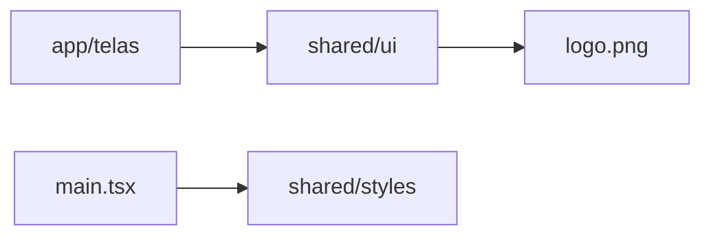

# src/shared

## Cabeçalho

| Campo | Valor |
|---|---|
| Id | DIR-src-shared |
| Título | `shared` |
| Tipo | código · compartilhado |
| Data | 2026-11-17 |
| Usuário responsável | TokumoH |
| Status | em construção |
| Commits | commit que introduz este arquivo — `git log --format=%h -- src/shared/README.md` |
| Arquivos | `README.md`, `styles/`, `ui/` |

## Propósito

Código reaproveitado por mais de uma tela: estilos (`styles/`) e componentes visuais (`ui/`).

## Origem

Criado na Tarefa 1 da etapa E0 ([PLA-001](../../docs/planos/2026-11-17-e0-fundacao.md)), que substitui o protótipo por um app React com a cara do RevoCast. Desenho: [DES-001](../../docs/desenho/2026-11-16-revocast-cameras-desenho.md).

## Organização

- `styles/`: tokens e base visual do RevoCast.
- `ui/`: componentes visuais e o logo.
- A Tarefa 2 acrescenta `infra/` (configuração e cliente Supabase).

## Por que esta organização

Nada em `shared/` conhece telas; as telas é que dependem dele (referências independentes).

## Por que não outras organizações

| Opção | Motivo de descarte |
|---|---|
| Estilos e componentes dentro de cada tela | Duplica o visual e quebra a identidade |
| Pacote npm separado | Excesso para um app só |

## Onde

| Arquivo ou subdiretório | O que contém |
|---|---|
| [`README.md`](README.md) | Este arquivo |
| [`styles/`](styles/) | Tokens (claro e escuro) e base visual |
| [`ui/`](ui/) | `Cartao`, `Logo`, `TelaProvisoria` e `logo.png` |

## Lógica

## Exemplo

Para mudar a cor de destaque: editar `--pink` em `styles/tokens.css`.

## Verificação

- Links relativos, "Onde" e campo "Arquivos" conferidos por `npm run check-docs`.
- Subdiretórios com README próprio (conferido pelo mesmo comando).

## Riscos

- `infra/` ainda não existe.
