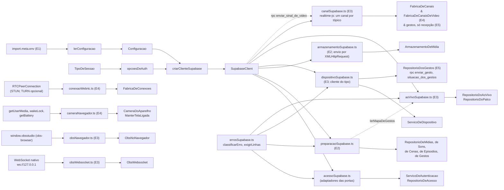
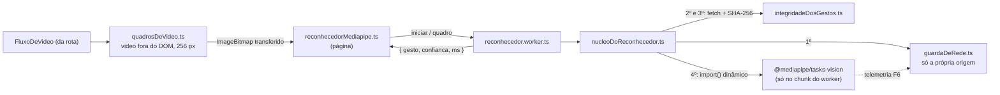

# src/shared/infra

## Cabeçalho

| Campo | Valor |
|---|---|
| Id | DIR-src-shared-infra |
| Título | `infra` |
| Tipo | código · infraestrutura (fabricações puras) |
| Data | 2026-11-17 |
| Usuário responsável | TokumoH |
| Status | em construção |
| Commits | commit que introduz este arquivo — `git log --format=%h -- src/shared/infra/README.md` |
| Arquivos | `README.md`, `configuracao.ts`, `configuracao.test.ts`, `supabase.ts`, `supabase.test.ts`, `tempoLimite.ts`, `tempoLimite.test.ts`, `acessoSupabase.ts`, `acessoSupabase.test.ts`, `errosSupabase.ts`, `errosSupabase.test.ts`, `preparacaoSupabase.ts`, `preparacaoSupabase.test.ts`, `armazenamentoSupabase.ts`, `armazenamentoSupabase.test.ts`, `dispositivoSupabase.ts`, `dispositivoSupabase.test.ts`, `aoVivoSupabase.ts`, `aoVivoSupabase.test.ts`, `canalSupabase.ts`, `canalSupabase.test.ts`, `realtimeFalso.ts`, `realtimeContrato.test.ts`, `conexaoWebrtc.ts`, `conexaoWebrtc.test.ts`, `cameraNavegador.ts`, `cameraNavegador.test.ts`, `obsNavegador.ts`, `obsNavegador.test.ts`, `obsWebsocket.ts`, `obsWebsocket.test.ts`, `qr.ts`, `qr.test.ts`, `integridadeDosGestos.ts`, `integridadeDosGestos.test.ts`, `modelos/`, `guardaDeRede.ts`, `guardaDeRede.test.ts`, `nucleoDoReconhecedor.ts`, `nucleoDoReconhecedor.test.ts`, `reconhecedor.worker.ts`, `reconhecedorMediapipe.ts`, `reconhecedorMediapipe.test.ts`, `quadrosDeVideo.ts`, `quadrosDeVideo.test.ts` |

## Propósito

Ler e validar as variáveis de ambiente públicas do app (`lerConfiguracao`), criar o cliente Supabase com as opções de autenticação certas para cada tipo de sessão e um `fetch` com tempo-limite de 15 s para o PostgREST e o Auth (`criarClienteSupabase`, `tempoLimite.ts`) e, desde a E1, implementar sobre esse cliente as portas do domínio Acesso (`acessoSupabase.ts`: `criarAutenticacaoSupabase`, `criarRepositorioDeAcessoSupabase` e `traduzirErro`) e, desde a E2, as portas do domínio Preparação (`preparacaoSupabase.ts`: os cinco repositórios; `armazenamentoSupabase.ts`: o envio ao Storage por `XMLHttpRequest`, a remoção e a prévia por URL assinada), com a tradução de erros do PostgREST num lugar só (`errosSupabase.ts`) e, desde a E3, as portas do dispositivo e do ao vivo (`dispositivoSupabase.ts`: sessão anônima e pareamento; `aoVivoSupabase.ts`: funções do episódio, códigos, revogação, dispositivos e o repositório do palco; `canalSupabase.ts`: os canais privados do Realtime, um por tópico por cliente) e as portas da Integração OBS (`obsNavegador.ts`: `window.obsstudio` do obs-browser; `obsWebsocket.ts`: obs-websocket v5 com o `WebSocket` nativo) e, desde a Tarefa 8 da E3, a matriz do QR de pareamento (`qr.ts`, sobre o `lean-qr`) e, desde a Tarefa 3 da E4, as portas da Captura (`conexaoWebrtc.ts`: a `ConexaoDeVideo` sobre o `RTCPeerConnection`, com STUN e o TURN opcional; `cameraNavegador.ts`: a câmera por `getUserMedia`, a tela ligada pela Wake Lock API e a bateria; `canalSupabase.ts`: o canal de vídeo, que só recebe no tópico da própria sessão e envia pela `rpc('enviar_sinal_de_video')`) e, desde a Tarefa 4 da E5 ([VER-061](../../../docs/verificacoes/2026-11-28-061-e5-adaptadores-gestos.md)), os adaptadores dos gestos (`canalSupabase.ts`: o tópico `gestos:<uid da sessão>`, só de recebimento, para o palco e para o aparelho que reconhece; `dispositivoSupabase.ts`: `situacao_dos_gestos` e `enviar_gesto`; `aoVivoSupabase.ts`: `definir_gestos_ligados`, `definir_reconhecimento` e a carga do palco com o mapa de gestos e o interruptor) e, desde a Tarefa 5 da E5 ([VER-062](../../../docs/verificacoes/2026-11-28-062-e5-dependencia-e-modelo.md)), os SHA-256 fixos do WASM do `@mediapipe/tasks-vision` 1.2.3 e do modelo de gestos com a conferência (`integridadeDosGestos.ts`) e o modelo versionado com a licença e o aviso (`modelos/`) e, desde a Tarefa 6 da E5 ([VER-063](../../../docs/verificacoes/2026-11-28-063-e5-reconhecedor.md)), o reconhecedor de gestos: a guarda de rede do worker (`guardaDeRede.ts`: só a própria origem; a telemetria do MediaPipe é bloqueada), o núcleo e o worker de módulo (`nucleoDoReconhecedor.ts`, `reconhecedor.worker.ts`: guarda, SHA-256, MediaPipe), a porta `ReconhecedorDeGestos` do lado da página (`reconhecedorMediapipe.ts`) e a `FonteDeQuadros` sobre um `<video>` fora do DOM (`quadrosDeVideo.ts`). Nenhuma tela é conhecida aqui.

## Origem

Criado na Tarefa 2 da etapa E0 ([PLA-001](../../../docs/planos/2026-11-17-e0-fundacao.md)). Desenho: [DES-001](../../../docs/desenho/2026-11-16-revocast-cameras-desenho.md). Nesta etapa o cliente ainda não é usado por nenhuma tela; passa a ser na E1. `acessoSupabase.ts` nasceu na Tarefa 3 da E1 ([PLA-002](../../../docs/planos/2026-11-26-e1-entrada-e-membros.md)): adaptadores das portas `ServicoDeAutenticacao` e `RepositorioDeAcesso` de [`src/domains/acesso/portas.ts`](../../domains/acesso/portas.ts) (Pure Fabrication; decisão D6, sem repositório genérico); quem os compõe é [`src/app/servicos.ts`](../../app/servicos.ts). `tempoLimite.ts` nasceu no registro [VER-021](../../../docs/verificacoes/2026-11-26-021-tempo-limite-supabase.md) (opção 3 da "fila pendurada" do [VER-020](../../../docs/verificacoes/2026-11-26-020-e1-conferencia-e-guia.md)). `errosSupabase.ts`, `preparacaoSupabase.ts` e `armazenamentoSupabase.ts` nasceram na Tarefa 4 da E2 ([PLA-003](../../../docs/planos/2026-11-26-e2-preparar-episodio.md), registro [VER-027](../../../docs/verificacoes/2026-11-26-027-e2-adaptadores-preparacao.md)): adaptadores das portas de [`src/domains/preparacao/portas.ts`](../../domains/preparacao/portas.ts), decisões D8 (envio por `XMLHttpRequest`) e D10 (repositórios por agregado, erros num lugar só) do plano. `dispositivoSupabase.ts`, `aoVivoSupabase.ts`, `canalSupabase.ts` e `realtimeFalso.ts` nasceram na Tarefa 4 da E3 ([PLA-004](../../../docs/planos/2026-11-27-e3-ao-vivo-por-toque.md), registro [VER-038](../../../docs/verificacoes/2026-11-27-038-e3-adaptadores-ao-vivo.md)): adaptadores das portas de [`src/domains/acesso/portasDeDispositivo.ts`](../../domains/acesso/portasDeDispositivo.ts) e [`src/domains/aovivo/portas.ts`](../../domains/aovivo/portas.ts) (decisões D4, D6, D7, D9, D14 a D16, I2, I3, I-A e I-B do plano). `obsNavegador.ts` e `obsWebsocket.ts` nasceram na Tarefa 5 da E3 (registro [VER-039](../../../docs/verificacoes/2026-11-27-039-e3-integracao-obs-e-palco.md)): adaptadores das portas de [`src/domains/obs/portas.ts`](../../domains/obs/portas.ts) (decisão D10; sem Supabase). `qr.ts` nasceu na Tarefa 8 da E3 (registro [VER-042](../../../docs/verificacoes/2026-11-27-042-e3-aba-ao-vivo-dispositivos.md)): a única dependência nova da E3, `lean-qr` 2.7.4 (decisão D11, instalada pelo procedimento da decisão (c) do plano), fica atrás desta função. `conexaoWebrtc.ts` e `cameraNavegador.ts` nasceram na Tarefa 3 da E4 ([PLA-005](../../../docs/planos/2026-11-27-e4-celular-como-camera.md), registro [VER-051](../../../docs/verificacoes/2026-11-28-051-e4-adaptadores-video.md)): adaptadores das portas de [`src/domains/captura/portas.ts`](../../domains/captura/portas.ts) (decisões D2, D4, D6, D7, D9 e D11 do plano; nenhuma dependência nova); na mesma tarefa, `canalSupabase.ts` ganhou o canal de vídeo e `realtimeContrato.test.ts` o tópico de vídeo e a mensagem publicada pelo banco. `integridadeDosGestos.ts` e `modelos/` nasceram na Tarefa 5 da E5 ([PLA-006](../../../docs/planos/2026-11-28-e5-gestos.md), decisão D9 e revisão 1, N8; registro [VER-062](../../../docs/verificacoes/2026-11-28-062-e5-dependencia-e-modelo.md)), com a dependência nova `@mediapipe/tasks-vision` 1.2.3 (Apache-2.0), instalada com o npm 11 e `--ignore-scripts`; o worker que os usa vem na Tarefa 6. `guardaDeRede.ts`, `nucleoDoReconhecedor.ts`, `reconhecedor.worker.ts`, `reconhecedorMediapipe.ts` e `quadrosDeVideo.ts` nasceram na Tarefa 6 da E5 (PLA-006, decisões D8 a D11 e revisão 1, I5 a I7, N11 e N12; registro [VER-063](../../../docs/verificacoes/2026-11-28-063-e5-reconhecedor.md)): adaptadores das portas `FabricaDeReconhecedores` e `FonteDeQuadros` de [`src/domains/captura/portas.ts`](../../domains/captura/portas.ts) (nenhuma dependência nova).

## Organização

- Um arquivo por responsabilidade: `configuracao.ts` (variáveis de ambiente), `supabase.ts` (cliente) e `tempoLimite.ts` (tempo-limite do `fetch` do cliente); cada um com seu `.test.ts` ao lado.
- `lerConfiguracao` recebe o objeto de ambiente como argumento (nos testes, um objeto simples; no app, a partir da E1, `import.meta.env`), sem ler o ambiente por conta própria.
- Variáveis obrigatórias: `VITE_SUPABASE_URL` e `VITE_SUPABASE_PUBLISHABLE_KEY`. Valor ausente, vazio ou só com espaços lança `ErroDeConfiguracao` que cita o nome da variável; espaços nas pontas são removidos. A URL passa por três checagens, nesta ordem: (1) o texto começa com `https://` (sem diferenciar maiúsculas; `https:abc...`, `https:/abc...` e `xhttps://` são recusadas); (2) `new URL()` a aceita (`https://` sem host e espaço no host, como `https://abc supabase.co`, não); (3) o texto, sem uma barra final e em minúsculas, é igual a `url.origin` em minúsculas, o que recusa caminho (inclusive com espaço; erro comum: colar `https://<projeto>.supabase.co/rest/v1`, que o supabase-js transformaria em `/rest/v1/rest/v1`), `?`, `#`, credenciais, barra invertida, tab e quebra de linha no meio (o `URL` remove tab e quebra de linha) e a porta padrão `:443` (o `origin` a descarta, então o texto difere; portas como `:8443` passam). `supabaseUrl` devolvido é `url.origin` (minúsculas, sem barra final). Todas as recusas lançam `ErroDeConfiguracao` citando `VITE_SUPABASE_URL`. Os valores TURN também têm as pontas aparadas. `VITE_SUPABASE_PUBLISHABLE_KEY` que comece com `sb_secret_` (sem diferenciar maiúsculas) é recusada com `ErroDeConfiguracao` que cita a variável, sem repetir o valor. Opcionais: `VITE_TURN_URL`, `VITE_TURN_USUARIO`, `VITE_TURN_SENHA`; o campo `turn` só existe se as três estiverem preenchidas.
- Quatro tipos de sessão (`membro`, `camera`, `obs_palco`, `obs_camera`); cada um usa a chave de armazenamento `revocast-auth-<tipo>`, para que sessões de tipos diferentes no mesmo navegador não se sobrescrevam.
- Todos os clientes usam `flowType: 'pkce'`, `persistSession: true` e `autoRefreshToken: true`; `detectSessionInUrl` só é `true` para `membro`.
- Tempo-limite (`tempoLimite.ts`, desde o VER-021): `criarClienteSupabase` passa ao `createClient` a opção `global.fetch` = `fetchComTempoLimite(fetch da página, TEMPO_LIMITE_SUPABASE_MS, limitarRestEAuth(supabaseUrl))`, para os quatro tipos de sessão. Regras:
  - `TEMPO_LIMITE_SUPABASE_MS` = 15 000 ms (15 s), constante comentada no próprio arquivo.
  - Só têm tempo-limite as URLs da **mesma origem** do projeto com caminho `/rest/v1` ou `/auth/v1` (ou abaixo deles). **Storage (`/storage/v1/`) fica fora**: os envios de vídeo da E2 vão até 50 MB (DES-001 §15) e levam mais que 15 s numa rede comum. Functions, o broadcast REST do Realtime e outros hosts também ficam fora; o WebSocket do Realtime não usa `fetch`.
  - Estourado o tempo, a chamada é abortada com `DOMException` `TimeoutError`. O que vira no app (lido no código instalado do supabase-js 2.119.0): no `postgrest-js`, `{ code: '', status: 0 }` → `traduzirErro` → `rede`; no `auth-js`, `AuthRetryableFetchError` → `usuarioAtual` → `ErroDeAcesso('rede')`. O `postgrest-js` repete GET (listas) depois de um `TimeoutError` que não veio do sinal de quem chamou (até 3 vezes, esperando 1, 2 e 4 s): uma lista sem resposta vira `rede` em ~67 s; `rpc` (POST) não repete (~15 s). O refresh do `auth-js` repete enquanto cabe na janela de 30 s: sessão expirada com rede pendurada → `rede` em ~30,2 s.
  - O sinal de quem chama (`init.signal` ou o do `Request`) continua abortando, com o motivo dele; o timer e o ouvinte desse sinal são soltos quando o `fetch` termina. Feito com `AbortController` + `setTimeout` (sem `AbortSignal.any`, que falta no Safari < 17.4, e testável com timers falsos). O tempo conta até chegarem os cabeçalhos; a leitura do corpo não é limitada e, depois dos cabeçalhos, o abort de quem chama também deixa de valer para ela (o ouvinte já foi solto). Hoje nenhum código do app usa `abortSignal`.
  - O `fetch` da página é lido a cada chamada (`globalThis.fetch(entrada, init)`), sem `this`.
- Os nomes das variáveis estão em [`.env.example`](../../../.env.example), sem valores.
- `acessoSupabase.ts` recebe o `SupabaseClient` pronto (não cria cliente nem lê ambiente) e devolve objetos que implementam as portas do domínio. Regras que importam:
  - `usuarioAtual()` lança `ErroDeAcesso('rede')` quando `getSession()` devolve `error` ou lança (com a sessão expirada e a rede caída, o `auth-js` 2.119.0 devolve `session: null` **e** `AuthRetryableFetchError`, mas a sessão continua guardada); nunca devolve `null` nesse caso.
  - `entrarComGoogle(url)` chama `signInWithOAuth({ provider: 'google', options: { redirectTo: url, queryParams: { prompt: 'select_account' } } })`.
  - `sair()` usa `signOut({ scope: 'local' })` e **nunca lança**: o `auth-js` apaga a sessão local antes do pedido de revogação, então um erro (devolvido ou lançado) é só do servidor; vai para `console.warn` só o texto fixo "sair: o servidor não confirmou a saída; a sessão local foi apagada", sem e-mail, token nem o objeto de erro.
  - `aoMudarSessao(ouvinte)` ignora `INITIAL_SESSION` e só **agenda** o ouvinte com `setTimeout(..., 0)` (nunca chama o Supabase dentro do callback do `onAuthStateChange`); devolve a função que cancela: desliga a flag `ativo` (um agendamento já feito não chama mais o ouvinte) e chama `subscription.unsubscribe()`.
  - Repositório: `rpc('papel_atual')`, listas ordenadas por e-mail, `insert` sem normalizar (quem normaliza é o domínio; o banco recusa maiúsculas por `CHECK`), `update`/`delete` com `.eq('email', e).select('email')` (vira `RETURNING`); 0 linhas → `ErroDeAcesso('nada_alterado')` (a RLS filtrou, inclusive a própria linha, D1). Papel desconhecido vindo do banco (`ehPapel` falso) vira `null` em `papelAtual` e descarta a linha em `listarPermitidos`.
  - `traduzirErro(erro, status)` (desde a E2, por `classificarErro`, sem mudar o comportamento; teste `e1-traduzir-erro-sem-mudanca`), nesta ordem: 401 ou `PGRST301`/`PGRST303` → `sessao_expirada` (antes do `42501`, que o PostgREST manda com 401 quando a requisição sai como `anon`); `23505` → `duplicado`; `23514` → `invalido`; `42501` → `negado`; sem código e status 0 (falha do `fetch` no `postgrest-js` 2.119.0) → `rede`; o resto → `outro`. A mensagem do servidor nunca passa para o `ErroDeAcesso`. `23503` e `22P02`, que a classificação comum chama de `em_uso` e `invalido`, continuam `outro` na E1.
- `errosSupabase.ts` (E2, D10): `classificarErro(erro, status)`, nesta ordem: (1) 401, `PGRST301` ou `PGRST303` → `sessao_expirada` (mesmo com `42501`); (2) `23505` → `duplicado` (inclusive o índice `episodios_um_ao_vivo`); (3) `23503` → `em_uso` (som ou cena num gesto); (4) `23514` ou `22P02` → `invalido`; (5) `42501` → `negado`; (6) sem código (ou `''`) e status 0 → `rede`; (7) o resto → `outro`. `exigirLinhas(data)`: vazio ou `null` → `ErroDePreparacao('nada_alterado')`.
- `preparacaoSupabase.ts` (E2, D10): `criarRepositoriosDePreparacao(cliente)` devolve `midias`, `sons`, `cenas`, `episodios` (com os avisos) e `gestos`, um objeto por agregado, sem classe genérica. Regras que importam:
  - listas com `select` das colunas usadas e ordem fixa (`midias` por `nome`, `sons` e `cenas` por `ordem`, `episodios` por `data` desc, avisos de um episódio por `ordem`, `mapa_gestos` por `gesto`), convertidas para camelCase; linha com `tipo` de mídia, `estado` de episódio, `gesto` ou `acao` fora do domínio é descartada (enum novo no banco antes do app);
  - todo `update`/`delete` termina em `.select(<chave>)` (vira `RETURNING`) e 0 linhas → `nada_alterado`;
  - episódio: `update({ titulo, data })`, montado campo a campo (nunca `estado`, `gestos_ligados` nem `criado_por`, D2); gesto: `normalizarGesto` antes do `update` (o alvo que não corresponde à ação vai nulo); `registrar` de mídia manda os valores recebidos, sem reconverter;
  - `contarAvisosComImagem`: `select('id', { count: 'exact', head: true })`; sem contagem → `outro` (a tela não pode dizer "nenhum aviso" sem saber);
  - **todo** erro vira `ErroDePreparacao` (o devolvido, por `classificarErro`; um lançado, como `outro`), para a compensação do envio (`biblioteca.ts`) sempre decidir sobre um motivo;
  - desde o [VER-061](../../../docs/verificacoes/2026-11-28-061-e5-adaptadores-gestos.md), o leitor do mapa sai da função `listar` para `lerMapaDeGestos(data)` e `COLUNAS_DO_MAPA`, exportados e usados também pela carga do palco (`aoVivoSupabase.ts`): um leitor só; além do gesto ou ação desconhecidos, descarta linha que não é objeto.
- `armazenamentoSupabase.ts` (E2, D8): `criarArmazenamentoSupabase(cliente, supabaseUrl, chavePublica, criarXhr?)`. Regras que importam:
  - envio por `XMLHttpRequest` (o `upload()` do `storage-js` 2.119.0 não aceita `AbortSignal` nem informa progresso): `POST <origem>/storage/v1/object/midias/<caminho>` (origem por `new URL(supabaseUrl).origin`, nunca `//storage`), cabeçalhos `authorization: Bearer <access_token>`, `apikey`, `x-upsert: false` (D5), `cache-control: max-age=3600` e `content-type: <tipo detectado>`; corpo = o `Blob`; caminho fora da forma do domínio e da política de envio (`som/<uuid>.(mp3|wav|ogg|m4a)` ou `imagem/<uuid>.(png|jpg|webp|gif)`, uuid em minúsculas; recusa `.`/`..`) → lança antes de abrir;
  - o `access_token` é lido com `auth.getSession()` **na hora de cada envio** (nunca guardado); sem sessão → `sessao_expirada`; erro ou exceção do `getSession` → `rede`; nada registra token em `console`;
  - cancelamento pelo `AbortSignal` (inclusive o que chega enquanto a sessão é lida: o sinal é conferido de novo depois do `await`) → `xhr.abort()` e `cancelado`; corte por **inatividade** (`INATIVIDADE_DO_ENVIO_MS` = 30 000 ms sem `upload.onprogress`, zerado a cada progresso) → `sem_resposta`; o corte para em `upload.onload` (bytes todos enviados); guarda de fim único (evento depois do fim não muda nada nem rearma o corte); o ouvinte do sinal e o timer são soltos em todo fim;
  - resposta de erro (`motivoDaResposta`): primeiro o JWT inválido (`error` ou `code` do corpo igual a `InvalidJWT`, sem diferenciar maiúsculas → `sessao_expirada`, com prioridade sobre o `statusCode`; a `message` nunca decide; VER-032), depois o `statusCode` texto, não vazio, do corpo JSON (o caso que o `storage-js` recebe; outro `code` do corpo não é usado), depois o status HTTP; 401 → `sessao_expirada`, 403 → `negado`, 409 → `duplicado`, 400/413/415/422 → `invalido`, o resto → `outro`; `onerror` → `rede`; o texto do corpo nunca vai para o erro;
  - `remover(caminho)`: `storage.from('midias').remove([caminho])`; `urlDePrevia(caminho)`: `createSignedUrl(caminho, VALIDADE_DA_PREVIA_S)` (600 s); erro (devolvido ou lançado) → `ErroDePreparacao` (`StorageUnknownError` → `rede`; `StorageApiError`: `InvalidJWT` em `code` ou `statusCode` → `sessao_expirada`, depois pelo `statusCode`, depois pelo `status`). Essas duas passam pelo `fetch` do cliente, **sem** tempo-limite (o Storage fica fora de `limitarRestEAuth`; teste `storage-fora-do-tempo-limite`).

- `dispositivoSupabase.ts` (E3, D4): `criarServicoDeDispositivoSupabase(cliente)` sobre o cliente **do tipo** do dispositivo. Regras que importam:
  - `sessaoAtual()`: `auth.getSession()`; anônima só com `is_anonymous === true`; erro devolvido ou lançado → `ErroDeDispositivo('rede')` (nunca "sem sessão");
  - `entrarAnonimo()`: `signInAnonymously()`; 422, `anonymous_provider_disabled` ou "Anonymous sign-ins are disabled" → `negado`; `AuthRetryableFetchError`, status 0 ou exceção → `rede`; o resto (por exemplo, 429 do limite por IP) ou resposta sem usuário → `outro`;
  - `parear(codigo, tipo)`: `rpc('parear_dispositivo', { p_codigo, p_tipo })`, primeira linha `(resultado, dispositivo, nome)`; resultado fora de `pareado`/`invalido`/`tipo_errado`/`limite` → `invalido`; o código só vai no corpo do `rpc`, nunca para `console` ou mensagem de erro;
  - `dispositivoAtual()`: `rpc('meu_dispositivo')` (nunca `dispositivo_atual`, que não tem o rótulo, I2), lido pelos nomes de `COLUNAS_DE_MEU_DISPOSITIVO`; sem linha, rótulo ausente ou tipo fora da lista → `null`;
  - `sair()`: `signOut({ scope: 'local' })`, nunca lança (aviso fixo em `console.warn`, como na E1);
  - erros do PostgREST: `42501` → `negado`, falha do `fetch` → `rede`, o resto (inclusive exceção) → `outro`.
  - desde o [VER-061](../../../docs/verificacoes/2026-11-28-061-e5-adaptadores-gestos.md) (E5, D2, D5, D8), `criarRepositorioDosGestosSupabase(cliente)` (porta `RepositorioDosGestos` da Captura): `enviar(g)` chama `rpc('enviar_gesto', { p_id, p_gesto })` com **exatamente** essas duas chaves, montadas aqui (nenhum quadro, ponto, confiança ou campo a mais sai do aparelho); id fora de uuid minúsculo ou gesto fora dos 7 → `falhou` sem rede; `enviado`/`intervalo`/`desligados`/`sem_palco` → iguais; `54000` → `limite`; `42501` ou `55000` → `negado` (revisão 1, N3); qualquer outro erro, exceção, rede, tempo-limite ou forma → `falhou`. `situacao()` chama `rpc('situacao_dos_gestos')` e devolve `{ ligados, reconhecerAqui }` só com dois booleanos; forma errada → a promessa falha com `outro` (a rota a trata como tudo falso, Tarefa 8); erros como acima (`negado`, `rede`, `outro`).
- `aoVivoSupabase.ts` (E3, D2, D5, D7, D9, D16): desde o VER-046 (I5), `criarCodigo` confere o rótulo com `conferirRotulo` (domínio) antes da rede: fora do limite → `invalido`, sem chamar o banco. `VALIDADE_NO_PALCO_S` = 3600; `traduzirErroDoAoVivo(erro, status)`: sessão expirada primeiro; `55000` → `estado_invalido`; `22023` → `invalido`; o resto por `classificarErro`, com `em_uso` → `outro` (sem mudar `errosSupabase.ts`). `criarRepositorioDoAoVivo(cliente)` (cliente de membro): `episodio_ativo` (id fora da forma ou modo fora da lista → `null`), `iniciar_ao_vivo`/`encerrar_ao_vivo`/`definir_modo_teste` com `{ p_episodio }`, `criar_codigo_pareamento { p_tipo, p_rotulo, p_dispositivo, p_camera }` → `{ dispositivoId, codigo, expiraEm }` a partir de `(dispositivo, codigo, expira)` (linha incompleta → `outro`, nunca código vazio), `revogar_dispositivo { p_dispositivo }` → `{ usuario }` (o `uuid` devolvido ou `null`; outra forma → `invalido`) e a lista de `dispositivos` ordenada por `tipo`, com tipo desconhecido descartado. `criarRepositorioDoPalco(cliente)` (cliente `obs_palco`): episódio por id (ausente ou com estado desconhecido → `invalido`), cenas por `ordem`, sons com `midias(caminho)` (som sem caminho fica de fora), avisos do episódio por `ordem` com `midias(caminho)` da imagem, `createSignedUrl(caminho, 3600)` no bucket `midias` (`StorageUnknownError` → `rede`, o resto → `outro`) e `insert` em `registro_acoes` com exatamente as colunas da D9 (`episodio_id`, `origem`, `acao`, `cena_id`, `som_id`, `aviso_id`, `membro_id`, `teste`), **sem** `select` depois (o palco só insere).
  - desde o [VER-061](../../../docs/verificacoes/2026-11-28-061-e5-adaptadores-gestos.md) (E5, D4, D5, D6): `traduzirErroDoAoVivo` traduz `54000` → `limite` (motivo novo de `MotivoDoAoVivo`); `definirGestosLigados(episodioId, ligado)` → `rpc('definir_gestos_ligados', { p_episodio, p_ligado })`, devolve o booleano gravado (outra forma → `outro`); `definirReconhecimento(cameraId, local)` → `rpc('definir_reconhecimento', { p_dispositivo, p_local })`. No palco, a carga lê `gestos_ligados` junto com o episódio e o `mapa_gestos` (por `gesto`, pelo leitor da Preparação) e `gestosLigados(episodioId)` lê só a coluna do episódio dado; sem linha ou valor que não é booleano → `invalido` (nunca "desligado" nem "ligado"); rede e o tempo-limite de 15 s do `fetch` → `rede` (o palco tenta de novo, VER-059). Os valores neutros da Tarefa 2 saíram daqui.
- `canalSupabase.ts` (E3, D6, D14, D15, I3, I-A, I-B): `criarFabricaDeCanais(cliente, usuarioId, agendar?)`. Desde o VER-046 (I4), o `:controle` tem `aoMudarPresentes(f)`: as chaves uuid com ao menos um registro na presença (`sync`), adiadas como os outros ouvintes, e a lista atual para quem se inscreve com o canal conectado (o palco aceita comando só de quem está nela). Regras que importam:
  - canais privados: `{ private: true, broadcast: { ack: true, self: false }, presence: { key: usuarioId } }`; tópicos `estudio`, `episodio:<id>:controle` (só comandos e presença dos membros, leitor `lerMensagemDoControle`) e, desde o VER-047, `episodio:<id>:estado` (`estado(episodioId)`: o estado no ar que só o palco publica, leitor `lerMensagemDoEstado`, sem presença; o mesmo registro por tópico, contagem de referências, eco local e saída do mapa em fechado/negado). Cada cliente do ao vivo fica com 3 canais num socket só (`estudio`, `:controle`, `:estado`);
  - **um canal por tópico por cliente**, com contagem de referências: o primeiro `estudio()`/`controle(id)` cria o canal (num microtask) e registra `broadcast` (`*`), presença `sync` e `join` **antes** do `subscribe()`; cada chamada devolve uma alça própria; uma alça aberta depois recebe o estado atual; `fechar()` (idempotente) solta os ouvintes da alça e só faz `untrack` (com o canal `conectado` e uma presença marcada) e `removeChannel` quando a última alça fecha;
  - estados: `SUBSCRIBED` → `conectado`; `TIMED_OUT` e `CHANNEL_ERROR` → `reconectando`; `CHANNEL_ERROR` com "unauthorized" na mensagem → `negado`; `CLOSED` → `fechado`. `fechado` e `negado` tiram o registro do mapa na hora (o próximo `abrir` cria um canal novo); o negado é removido do cliente (`removeChannel`), o fechado não (já saiu da lista, e a remoção, que filtra pelo tópico, levaria o canal novo); um `abrir` durante uma remoção pendente espera ela terminar;
  - mensagens recebidas: `lerRemetente` e o leitor do domínio (`lerMensagemDoEstudio`, `lerComando`, `lerEstadoNoAr`, `lerPresenca`); inválida ou sem remetente → descartada; presença com chave fora da forma de uuid → descartada;
  - todo ouvinte é chamado por `agendar` (padrão `setTimeout(..., 0)`), nunca dentro do callback do `realtime-js`, e só se ainda estiver inscrito;
  - envio: só com o canal `conectado` (fora dele, `falhou` sem chamar `send`, que cairia para o REST); `payload` = campos da mensagem + `remetente`; `'ok'` → `ok`, `'timed out'` → `sem_resposta`, o resto → `falhou`; **eco local** para as outras alças do tópico neste cliente, pelo mesmo leitor, com qualquer resposta do `ack`, nunca para quem enviou;
  - presença: `marcarPresenca` guarda a última presença do tópico e a remarca a cada volta a `conectado` (a reconexão entra de novo no canal); em `:controle`, o corpo é `{}`; quem se inscreve em `aoMudarPresenca` com o canal já conectado recebe logo a presença atual (`presenceState`), adiada (rodada 1 do VER-038);
  - falhas (rodada 1 do VER-038): o `channel()` que devolve um canal que não é novo (`state` diferente de `closed` ou `joinedOnce`: inscrito por outro código ou fábrica do mesmo cliente, saindo, com erro) e o `on`/`subscribe` que lança viram `fechado` para as alças, sem rejeição solta e sem registrar nem remover nada no canal alheio; as remoções pendentes (a janela é o `untrack`, que espera a resposta do servidor com o canal ainda inscrito) ficam por **cliente** (`WeakMap` no módulo), e toda fábrica do mesmo cliente espera a remoção do tópico antes de criar o canal.
  - **vídeo (E4, D1, D2; VER-051):** `videoDaCamera()` e `videoDaObs()` abrem pelo mesmo registro só `video:<usuarioId da fábrica>` (`topicoDoVideo` do domínio; uuid fora da forma lança antes de abrir), com a mesma configuração privada, só para **receber**: nenhuma presença marcada, nenhum `canal.send` e nenhum eco local. Leitor do lado: a câmera lê com `lerSinalDaObs` (`pronto`, `resposta`, `encerrar`), o `obs_camera` com `lerSinalDaCamera` (`oferta`, `encerrar`); sem `remetente` uuid, evento diferente de `sinal` ou fora da forma → descartado; o `id` que o `realtime.send` acrescenta é aceito e não entra no sinal. `enviar(s)` = `cliente.rpc('enviar_sinal_de_video', { p_tipo, p_sessao, p_sdp })` (`p_sdp` nulo em `pronto` e `encerrar`), sem depender do estado do canal, mas com a alça fechada → `falhou` sem chamar a função (rodada 1, N1); `enviado` → `ok`, `sem_par` → `sem_par`, erro `54000` → `limite`, qualquer outro erro (`42501`, `55000`, `22023`, rede, tempo-limite de 15 s do `fetch`), exceção ou resposta fora da forma → `falhou`. A fábrica tem o tipo `FabricaDeCanais & FabricaDeCanaisDeVideo`.
  - **gestos (E5, D2, D4; [VER-061](../../../docs/verificacoes/2026-11-28-061-e5-adaptadores-gestos.md)):** `gestosDoPalco()` (porta nova `FabricaDeCanaisDeGestosDoPalco`) e `gestos()` (porta `FabricaDeCanaisDeGestos` da Captura) abrem pelo mesmo registro só `gestos:<usuarioId da fábrica>` (`topicoDosGestos`; uuid fora da forma lança antes de abrir), com a mesma configuração privada, só para receber: o palco recebe o gesto (`lerGestoParaOPalco`, com o remetente e o dispositivo postos pelo banco) e o aviso `gestos_mudaram` (`lerAvisoDosGestos`, sem valor); o aparelho que reconhece, só o aviso. As alças não têm `enviar` nem `marcarPresenca`: nenhum `send`, `track` ou `untrack` nesses tópicos (o banco publica com `realtime.send`; o gesto sai pela `rpc` de `dispositivoSupabase.ts`).
- `conexaoWebrtc.ts` (E4, D3, D4, D6, D7, D9; VER-051): `STUN_PUBLICO` (`stun:stun.l.google.com:19302`), `BITRATE_MAXIMO` (2 500 000), `servidoresIce(config)` e `criarFabricaDeConexoes({ ice, criarPc?, agendar? })`. Regras que importam:
  - `servidoresIce`: o STUN sempre; o TURN só com URL válida (`urlDeTurnValida`, desde a rodada 1 do VER-051: forma da RFC 7065, `turn:`/`turns:` em minúsculas, host por nome, IPv4 ou IPv6 entre colchetes, porta de 1 a 65535, `?transport=udp|tcp`) e usuário e senha não vazios; outra forma (`https:`, `stun:`, maiúsculas, espaço, `//`, caminho, usuário no host) é ignorada;
  - construção protegida (rodada 1, I2): se o construtor do `RTCPeerConnection` lançar, tenta de novo só com os servidores STUN; se lançar de novo, `criar()` devolve uma conexão cujas descrições rejeitam com frase fixa (o emissor e o receptor tratam como falha) — `criar()` nunca lança;
  - cada `criar()` monta um `RTCPeerConnection` com `{ iceServers, bundlePolicy: 'max-bundle' }` (nenhum antes de a rota pedir uma conexão); `oferecer(faixa)`: `addTransceiver(faixa, { direction: 'sendonly' })`, `createOffer`, `setLocalDescription`; `responder(oferta)`: `setRemoteDescription` da oferta e `createAnswer` (nada de `addTrack`: o transceptor vem `recvonly`); `aceitarResposta(sdp)`: `setRemoteDescription` da resposta e `setParameters` com `encodings[0].maxBitrate = BITRATE_MAXIMO` (sem `encodings` ou com a lista vazia, um é criado; falha ignorada);
  - **ICE não incremental (D4):** a espera começa antes do `setLocalDescription` e termina no `icegatheringstatechange` com `complete` ou em `ESPERA_DO_ICE_MS` (3 000 ms), soltando o ouvinte e o prazo em todo caso; devolve `localDescription.sdp`; `fechar()` durante a espera a interrompe e a descrição rejeita (rodada 1, N3);
  - estados: `new`/`connecting` → `conectando`, `connected` → `conectado`, `disconnected` → `caiu`, `failed` e `closed` sem pedido → `falhou`; cada aviso (estado e vídeo) por `agendar(..., 0)`, nunca dentro do evento; depois de `fechar()` (idempotente) nada é avisado, nem o que já estava agendado;
  - `track` → `aoVideo` com `streams[0]` ou, sem fluxo (o outro lado usa `addTransceiver` sem `streams`), um `new MediaStream([track])`; `trocarFaixa` = `replaceTrack` (`false` sem oferta ou se recusado, F8);
  - **sem SDP, candidato nem credencial em `console` ou erro:** toda rejeição ou exceção do navegador (inclusive a de `addTransceiver`) vira `Error` com frase fixa (`conexão de vídeo: falha em <passo>`), sem a mensagem original (que pode citar a descrição).
- `cameraNavegador.ts` (E4, D7, D13; F5, F7; VER-051): `RESTRICOES_DE_CAPTURA` (só vídeo, traseira de preferência, 1280×720 a 30 quadros, congelado), `MUDO_TOLERADO_MS` (3 000), `ESPERA_DA_CAMERA_MS` (30 000), `criarCameraDoAparelho(nav?, seguro?, agendar?)`, `criarManterTelaLigada(nav?, doc?)` e `lerBateria(nav?)`. Os padrões (`navigator`, `isSecureContext`, `document`) são lidos na hora de cada uso. Regras que importam:
  - câmera: fora de contexto seguro ou sem `mediaDevices.getUserMedia` → `inseguro` sem chamar nada; só o `name` do erro decide (`NotAllowedError`/`SecurityError` → `sem_permissao`; `NotFoundError`/`OverconstrainedError` → `sem_camera`; o resto → `outro`); sem resposta em 30 s → `sem_permissao` e o fluxo que chegar depois é parado na hora; fluxo sem faixa de vídeo → parado e `sem_camera`; religar para o fluxo anterior **antes** do pedido novo (o emissor só pede a câmera sem faixa boa; solta a câmera em aparelhos que não a abrem duas vezes); `desligar` para todas as faixas e solta os ouvintes (idempotente); `fluxoDaPrevia` devolve o fluxo ligado, sem segundo `getUserMedia`;
  - faixa perdida: `ended`, ou `mute` por 3 000 ms sem `unmute`, avisa uma vez por faixa, adiado; faixa parada por nós não avisa;
  - tela: `wakeLock.request('screen')`; sem `wakeLock` ou recusado → `sem_trava`; solta pelo sistema (página escondida) → pedida de novo no `visibilitychange` para `visible`; **um pedido por vez, uma sentinela só** (rodada 1, I1): `travar` com a trava ativa devolve `travada` sem pedir, e com um pedido em curso (de outro `travar` ou da visibilidade) reaproveita a promessa dele; `soltar` libera, para de ouvir a visibilidade, e a sentinela que chegar depois (sem um `travar` novo) é solta na hora;
  - bateria: `getBattery().level` finito de 0 a 1; sem `getBattery` (fora do `lib.dom` do TypeScript 7.0.2: interface local mínima), recusado ou fora da faixa → `null`.
- `realtimeFalso.ts` (E3): **só para testes** (não importa `vitest` nem o supabase-js em tempo de execução). `criarRealtimeFalso({ conectarSozinho? })` imita o pedaço do `realtime-js` 2.119.0 que muda `canalSupabase.ts`: `channel()` devolve o canal da lista com o mesmo tópico (inclusive saindo ou com erro); `on('presence')` depois do `subscribe()` lança; `subscribe()` só age com o canal fechado e lança "tried to join multiple times" num canal que já entrou; `removeChannel` que fecha o canal **na hora** (o `leave()` do phoenix põe `leaving` antes do `canPush()`, então o `ok` sai localmente: `phoenix.cjs.js:461-470`), com a saída da lista filtrando pelo tópico e `CLOSED` no callback; a janela de remoção pendente é o `untrack()` (que espera o servidor com o canal ainda inscrito), segurável por `segurarUntrack`/`liberarUntracks`; `send` de `broadcast` sem `ack` resolve `'ok'`; `state` e `joinedOnce` públicos. Usado por `canalSupabase.test.ts`, `realtimeContrato.test.ts` e por `criarCanalFalso` de `src/app/servicosFalsos.ts`.
- `obsNavegador.ts` (E3, D10): `criarObsNoNavegador(janela = window)`. Desde a rodada 1 do VER-046, `aoMudarSaida` passa ao ouvinte o tipo (`fim` para `*Stopped`, `inicio` para o resto) e a saída, tirados do nome do evento. Desde o VER-046 (A1), `aoMudarCena(f)` ouve só `obsSceneChanged` (`EVENTO_DE_CENA`, do README do obs-browser) e não lê o `detail`: a cena vem de `getCurrentScene`, pela conferência de nível do executor. Regras que importam:
  - `window.obsstudio` lido a cada chamada (a Fonte pode não ter o objeto: `disponivel()` falso, leituras `null`, ações sem efeito);
  - cada leitura por callback (`getControlLevel`, `getScenes`, `getCurrentScene`, `getStatus`) vira promessa com tempo-limite de `TEMPO_DO_OBS_MS` (3 s); sem resposta, função que lança ou resposta fora da forma → `null` (nível inteiro de 0 a 5; cenas só lista de texto; status só com os quatro booleanos `recording`, `replaybuffer`, `streaming`, `virtualcam`);
  - `setCurrentScene` e `saveReplayBuffer` nunca lançam para fora (o erro do OBS não vai para `console`);
  - `aoMudarSaida` ouve em `window` os 11 eventos de `EVENTOS_DE_SAIDA` (início, inclusive os `Starting`, e fim de transmissão, gravação, Replay Buffer e câmera virtual) e devolve a função que solta os 11; nunca `obsSourceActiveChanged` (I5).
- `obsWebsocket.ts` (E3, D10): `criarObsWebsocket(criarSocket = (url) => new WebSocket(url, 'obswebsocket.json'))`. Regras que importam:
  - só `ws://127.0.0.1:<porta>`; `Hello` (op 0) → `Identify` (op 1: `rpcVersion: 1`, `eventSubscriptions: 0` e, se o `Hello` pede, `authentication` = base64(SHA-256(base64(SHA-256(senha + salt)) + challenge)) por `crypto.subtle`) → `Identified` (op 2) → `conectado`; fechamento `4009` → `senha_errada`; erro, outro fechamento, socket que não abre ou `ESPERA_DO_OBS_MS` (5 s) sem `Identified` → `sem_conexao`;
  - a senha só vive dentro de `conectar` até o `Hello`; nunca é guardada no objeto, enviada em claro nem passada a `console` (teste `senha-nunca-sai`);
  - `conectado()` só depois do `Identified` e até a conexão cair ou ser fechada; nenhum pedido sai antes do `Identified`; `aoFechar(f)` avisa quando uma conexão identificada cai (pelo OBS ou pela rede; não por `fechar()` nem antes do `Identified`), depois de resolver os pedidos pendentes, e um ouvinte que lança não impede os outros; `fechar()` também os resolve na hora;
  - pedidos (op 6) com `requestId` único por conexão, respondidos pelo `requestId` (op 7); só `requestStatus.result === true` vale; sem conexão, conexão que cai ou 5 s sem resposta → `null`/`false`; `GetVersion` devolve `obsVersion` (texto até 40 caracteres) e `CreateRecordChapter` leva `chapterName`.
- `qr.ts` (E3, D11): `matrizDoQr(texto)` chama só o `generate(texto, { minCorrectionLevel: correction.M })` do `lean-qr` e devolve `boolean[][]` (`[y][x]`, verdadeiro = módulo escuro, sem a zona quieta); texto vazio ou com mais de `TAMANHO_MAXIMO_DO_TEXTO_DO_QR` (300) caracteres lança, e a mensagem nunca repete o texto (o link leva o código de pareamento). Nenhum `extras` da biblioteca (SVG em texto, React, canvas) é usado: o desenho é do `CodigoQr` (`src/shared/ui`).
- `integridadeDosGestos.ts` (E5, D9; VER-062): `SHA256_DO_WASM` (o `vision_wasm_module_internal.wasm` do `@mediapipe/tasks-vision` 1.2.3, F3) e `SHA256_DO_MODELO` (o `modelos/gesture_recognizer.task`, F10), e `conferirSha256(bytes, esperado, digest?)`: `true` só se o SHA-256 dos bytes for exatamente o esperado; falha fechada (esperado fora da forma de 64 caracteres hexadecimais minúsculos → `false`; sem `crypto.subtle`, a promessa rejeita, e a Tarefa 6 trata isso como `falhou`/`integridade`); `digest` injetável, o padrão é `crypto.subtle.digest('SHA-256', …)`. Trocar a versão do pacote ou o modelo exige trocar a constante no mesmo commit ([`modelos/README.md`](modelos/README.md)).
- `guardaDeRede.ts` (E5, D9; revisão 1, I5 e N11; [VER-063](../../../docs/verificacoes/2026-11-28-063-e5-reconhecedor.md)): `permitida(url, origem)` resolve texto, `URL` ou `Request` com `new URL(…, origem)` e aceita só a própria origem (relativa, absoluta da origem e `blob:` da origem); `//host`, outra porta, outro host, `data:`, `ws:`, `file:` e origem inválida ou opaca → `false`. `instalarGuardaDeRede(escopo, origem, aoBloquear?)` troca, no escopo do worker, `fetch`, `XMLHttpRequest.prototype.open`, `importScripts` e `self.import` (sempre definido; embrulha o do escopo ou o `import()` nativo, com a URL já resolvida pela origem) por versões que conferem antes; fora da origem → `TypeError` sem chamar o original; `WebSocket` e `EventSource` (e, desde a rodada 1 do VER-063, N3, `Worker`, `SharedWorker`, `WebTransport` e `WebSocketStream`) viram construtores que sempre lançam; `Cache.prototype.add`/`addAll`, se existirem, só aceitam a própria origem. Regras que importam:
  - o texto da entrada é lido **uma vez** e é ele que vai ao original (um `toString` que muda não engana a guarda); um `Request` vai como o mesmo objeto;
  - as propriedades trocadas ficam travadas (`writable: false`, `configurable: false`): código no worker não as desfaz;
  - `aoBloquear` é chamado sem argumentos, uma vez por tentativa; a mensagem do erro é fixa, sem a URL (N11).
- `nucleoDoReconhecedor.ts` (E5, D8, D9, D11; revisão 1, I6 e N12; [VER-063](../../../docs/verificacoes/2026-11-28-063-e5-reconhecedor.md)): `criarNucleoDoReconhecedor(d)` (tudo injetado). `iniciar()` (uma vez): 1º a guarda; 2º o WASM e o modelo pelo `fetch` já guardado; 3º o SHA-256 dos dois (`conferirSha256`; diferente ou `digest` que rejeita, como sem `crypto.subtle` → `integridade`, nada do MediaPipe roda); 4º `carregarTarefas()` e `GestureRecognizer.createFromOptions` com o WASM como `blob:` de tipo `application/wasm` (N12) e o modelo como `modelAssetBuffer`, `runningMode: 'VIDEO'`, `numHands: 1`, a lista dos 7 gestos e `delegate: 'GPU'`, e `'CPU'` uma vez se a GPU falhar (as duas → `sem_suporte`); busca que falha → `outro`; a URL `blob:` do WASM é revogada depois das tentativas (rodada 1, N4); o núcleo não tem `fechar`: quem encerra é o `terminate` da página (rodada 1, N2). Antes de cada `createFromOptions`, importa o carregador pelo `self.import` guardado e devolve o `ModuleFactory` ao escopo: o `Wh` do MediaPipe o apaga depois de criar o módulo, e a tentativa com CPU acharia "ModuleFactory not set." (achado desta tarefa, no registro). `reconhecer(q, em)`: `recognizeForVideo`, a maior pontuação (finita, de 0 a 1) entre as categorias; `None`, nome fora dos 7 ou abaixo de `CONFIANCA_MINIMA` → gesto `null`; `ms` medido no worker; o quadro é fechado sempre (inclusive quando o MediaPipe lança, que propaga). `atenderMensagens(nucleo, postar)`: as mensagens do worker uma por vez, em ordem (`iniciar` → `pronto`/`falha`; `quadro` → `leitura` ou `sem_leitura`). Nenhum `console`.
- `reconhecedor.worker.ts` (E5, D9; [VER-063](../../../docs/verificacoes/2026-11-28-063-e5-reconhecedor.md)): o Web Worker de módulo, fino: as URLs do carregador de módulo, do WASM e do modelo por `?url` (mesma origem, hash no nome) e o pacote só por `import('@mediapipe/tasks-vision')`, passado ao núcleo; nenhum import estático do MediaPipe (teste `worker-sem-import-estatico`). Sem teste próprio: o comportamento está no núcleo.
- `reconhecedorMediapipe.ts` (E5, D8, D11; [VER-063](../../../docs/verificacoes/2026-11-28-063-e5-reconhecedor.md)): `criarFabricaDeReconhecedores(d?)`, a porta `ReconhecedorDeGestos` do lado da página. Regras que importam:
  - `criar()` não cria worker; `iniciar` sem `Worker` ou `WebAssembly` → `sem_suporte` sem criar nada; depois de `fechar` → `outro` sem criar nada (VER-058, Riscos); senão `new Worker(new URL('./reconhecedor.worker.ts', import.meta.url), { type: 'module' })` e `{ tipo: 'iniciar' }`, com `ESPERA_DO_RECONHECEDOR_MS` (60 s) → `tempo`; qualquer falha encerra o worker;
  - o quadro vai na lista de transferíveis; as respostas resolvem por `agendar(0)`, nunca dentro do `onmessage`; a leitura do worker é conferida (gesto entre os 7 ou `null`, confiança de 0 a 1, `ms` ≥ 0) e copiada campo a campo;
  - `fechar()`: `terminate` uma vez, cancela o prazo, pendentes resolvem `null` (`outro` no `iniciar`); idempotente;
  - erro do worker depois do `pronto` (`onerror`/`onmessageerror`): `terminate`, e os pendentes e todo `reconhecer` seguinte **rejeitam** (o quadro é fechado), para o laço chegar a `falhou` (rodada 1, I1 e N6); `postMessage` que lança → quadro fechado e `null`.
- `quadrosDeVideo.ts` (E5, D10; revisão 1, I7; [VER-063](../../../docs/verificacoes/2026-11-28-063-e5-reconhecedor.md)): `criarFonteDeQuadros(fluxo, d?)` e `LARGURA_DO_QUADRO` (256). Um `<video>` `muted`, `playsInline`, `srcObject` = o fluxo, **nunca anexado ao documento**, com `play()` explícito; `play()` rejeitado ou `paused` → `null` e nova tentativa no máximo a cada `INTERVALO_DO_PLAY_MS` (1 s); sem o quadro atual (`readyState` abaixo de 2) ou sem dimensões → `null`; senão desenha num canvas de 256 px de largura (altura proporcional; `OffscreenCanvas` ou `<canvas>` fora do DOM) e devolve `createImageBitmap(canvas)`; `fechar()` → `pause()` e `srcObject = null`; um bitmap que chega depois do `fechar` é fechado.
- `realtimeContrato.test.ts` (rodada 1 do VER-038): teste de contrato com o `realtime-js` 2.119.0 — os mesmos casos contra o cliente **real** (`createClient`, com o `connect` do socket anulado: sem rede) e contra `realtimeFalso.ts`; se o falso divergir do real numa premissa de que o adaptador depende, o caso do falso cai.

## Por que esta organização

Receber o ambiente como argumento torna `lerConfiguracao` testável sem mexer em variáveis globais. Separar a chave de armazenamento por tipo evita que a sessão anônima de uma câmera apague a de um membro aberta no mesmo navegador, ou que as Fontes `obs_palco` e `obs_camera`, que dividem o perfil do OBS, se sobrescrevam. PKCE evita expor tokens no fragmento da URL de retorno do login. Só o membro faz login por redirecionamento, por isso só ele lê a sessão da URL.

## Por que não outras organizações

| Opção | Motivo de descarte |
|---|---|
| Ler `import.meta.env` direto dentro do módulo | Não testável sem manipular o ambiente global |
| Uma única chave de armazenamento para todos | Sessões de tipos diferentes no mesmo navegador (ex.: membro e câmera) se sobrescreveriam |
| Cliente Supabase criado na carga do módulo | Falharia ao importar quando faltasse variável, antes de a tela poder mostrar o erro |

## Onde

| Arquivo ou subdiretório | O que contém |
|---|---|
| [`README.md`](README.md) | Este arquivo |
| [`configuracao.ts`](configuracao.ts) | `Configuracao`, `ErroDeConfiguracao` e `lerConfiguracao(env)` |
| [`configuracao.test.ts`](configuracao.test.ts) | 11 testes: obrigatórias, variável ausente, vazia ou só espaços, espaços nas pontas, URL sem https (incl. malformadas), origens aceitas e devolvidas como `url.origin`, URL inválida, URL que não é só a origem, TURN completo e aparado, chave secreta recusada, nome do erro |
| [`supabase.ts`](supabase.ts) | `TipoDeSessao`, `chaveDeArmazenamento`, `opcoesDeAuth` e `criarClienteSupabase` |
| [`supabase.test.ts`](supabase.test.ts) | 8 testes: chaves distintas, formato da chave, PKCE e sessão na URL só para membro, todas as opções por tipo, repasse ao `createClient` (mockado) com as opções literais dos 4 tipos e um `global.fetch`, clientes de tipos diferentes com chaves diferentes, e o `fetch` entregue ao `createClient` com tempo-limite em `rest/v1` e `auth/v1` e sem ele em `storage/v1` (timers falsos); e `storage-fora-do-tempo-limite` (E2): `limitarRestEAuth` dá `false` para o envio e a URL assinada do Storage e `true` para `/rest/v1/midias` |
| [`tempoLimite.ts`](tempoLimite.ts) | `TEMPO_LIMITE_SUPABASE_MS`, `limitarRestEAuth(supabaseUrl)` e `fetchComTempoLimite(fetchBase, ms, deveLimitar)` |
| [`tempoLimite.test.ts`](tempoLimite.test.ts) | 16 testes com `fetch` falso pendurado e timers falsos: valor de 15 s; quais URLs têm tempo-limite (rest/auth sim; storage, functions, realtime, caminhos parecidos, outro host, outro esquema e texto que não é URL não); rest e auth rejeitam com `TimeoutError` em 15 s e nem 1 ms antes; URL e `Request` como entrada; storage e outro host sem timer e com o `init` intacto; sinal do chamador (de `init` e de `Request`, já abortado ou não) respeitado, com o motivo dele conferido por identidade; resposta a tempo limpa o timer e solta o ouvinte; `init` preservado; `fetch` que lança na hora ou falha de rede não deixa timer |
| [`acessoSupabase.ts`](acessoSupabase.ts) | `traduzirErro`, `criarAutenticacaoSupabase` e `criarRepositorioDeAcessoSupabase` (adaptadores das portas do domínio Acesso) |
| [`acessoSupabase.test.ts`](acessoSupabase.test.ts) | 15 testes com um cliente Supabase falso escrito no arquivo (registra a cadeia `from`/`select`/`insert`/`update`/`delete`/`eq`/`order`/`rpc`): `usuario-da-sessao`, `usuario-da-sessao-com-erro`, `usuario-da-sessao-que-lanca`, `entrar-com-google`, `sair-local`, `sair-sem-rede`, `aoMudarSessao-adia-e-cancela`, `aoMudarSessao-cancelado-nao-chama-agendado`, `papel-atual`, `listar`, `incluir`, `alterar-e-remover-com-retorno`, `traduz-erros`, `e1-traduzir-erro-sem-mudanca` (E2) e a mensagem sem e-mail |
| [`errosSupabase.ts`](errosSupabase.ts) | `MotivoComum`, `classificarErro` e `exigirLinhas` (E2, D10) |
| [`errosSupabase.test.ts`](errosSupabase.test.ts) | 2 testes: `traduz-erros-da-preparacao` (a ordem, um caso por linha, inclusive `23505` com `episodios_um_ao_vivo` e `23503` → `em_uso`) e `exigirLinhas` |
| [`preparacaoSupabase.ts`](preparacaoSupabase.ts) | `criarRepositoriosDePreparacao` (repositórios de mídias, sons, cenas, episódios e avisos, e gestos); desde o [VER-061](../../../docs/verificacoes/2026-11-28-061-e5-adaptadores-gestos.md), `COLUNAS_DO_MAPA` e `lerMapaDeGestos`, também usados pela carga do palco |
| [`preparacaoSupabase.test.ts`](preparacaoSupabase.test.ts) | 10 testes com um cliente falso no padrão de `acessoSupabase.test.ts` (desde a rodada 1 do VER-061, `mapa-descarta-linha-que-nao-e-objeto`): `listar-converte`, `episodio-so-titulo-e-data`, `gesto-manda-alvos-normalizados`, `escrita-com-retorno`, `inclusoes`, `registrar-midia`, `contar-avisos-com-imagem`, `erros-traduzidos`, `erro-lancado-vira-erro-de-preparacao` |
| [`armazenamentoSupabase.ts`](armazenamentoSupabase.ts) | `BUCKET_DE_MIDIAS`, `INATIVIDADE_DO_ENVIO_MS`, `VALIDADE_DA_PREVIA_S`, `motivoDaResposta` e `criarArmazenamentoSupabase` (E2, D8) |
| [`armazenamentoSupabase.test.ts`](armazenamentoSupabase.test.ts) | 62 testes com um `XMLHttpRequest` falso injetado e timers falsos: constantes, `envio-cabecalhos`, `envio-token-na-hora`, `envio-com-progresso`, `envio-cancelado`, `cancelar-durante-sessao`, `envio-solta-ouvinte`, `envio-sem-progresso-corta`, `decide-o-fim-antes-do-abort`, `corte-para-no-fim-do-envio`, `envio-respostas` (23 casos por `motivoDaResposta` e os mesmos 23 pelo XHR, mais o `onerror`; 6 deles de `InvalidJWT`, VER-032), `envio-sem-sessao`, `falha-ao-montar-o-envio-solta-tudo` e `remover-e-previa` |
| [`dispositivoSupabase.ts`](dispositivoSupabase.ts) | `criarServicoDeDispositivoSupabase` (porta `ServicoDeDispositivo`, E3) e, desde o [VER-061](../../../docs/verificacoes/2026-11-28-061-e5-adaptadores-gestos.md), `criarRepositorioDosGestosSupabase` (porta `RepositorioDosGestos`, E5) |
| [`dispositivoSupabase.test.ts`](dispositivoSupabase.test.ts) | 24 testes com um cliente falso (`auth` e `rpc`): `sessao-atual`, `entrar-anonimo`, `parear-chama-rpc`, `parear-sem-console` (todos os métodos de `console` espionados nunca recebem o código, nem em erro), `dispositivo-atual` (`meu_dispositivo`, nunca `dispositivo_atual`; o rótulo vem da coluna `rotulo`) e `sair-local`; desde o [VER-061](../../../docs/verificacoes/2026-11-28-061-e5-adaptadores-gestos.md), `rpc-so-com-gesto-e-id`, `respostas-do-gesto` (15 casos de `test.each` e a `rpc` que lança) e `situacao-dos-gestos` |
| [`aoVivoSupabase.ts`](aoVivoSupabase.ts) | `VALIDADE_NO_PALCO_S`, `traduzirErroDoAoVivo`, `criarRepositorioDoAoVivo` e `criarRepositorioDoPalco` (E3; desde o [VER-059](../../../docs/verificacoes/2026-11-28-059-e5-palco-com-gestos.md), `registrar` grava `membro_id` no toque e `dispositivo_id` no gesto; desde o [VER-061](../../../docs/verificacoes/2026-11-28-061-e5-adaptadores-gestos.md), `definirGestosLigados`, `definirReconhecimento`, `54000` → `limite`, e a carga e `gestosLigados` leem o interruptor e o mapa de verdade, no lugar dos valores neutros) |
| [`aoVivoSupabase.test.ts`](aoVivoSupabase.test.ts) | 11 testes com um cliente falso (PostgREST, `rpc` e Storage, respostas em fila por tabela/função): `rpcs-e-parametros`, `listar-dispositivos`, `erros-do-ao-vivo`, `palco-carrega`, `palco-url-de-arquivo`, `palco-registra` e, desde o VER-059, `palco-registra-gesto`; desde o [VER-061](../../../docs/verificacoes/2026-11-28-061-e5-adaptadores-gestos.md), `definir-gestos-ligados`, `definir-reconhecimento`, `carregar-com-mapa-e-interruptor` e `gestos-ligados` (no lugar de `palco-gestos-neutros`) |
| [`canalSupabase.ts`](canalSupabase.ts) | `criarFabricaDeCanais` (porta `FabricaDeCanais`, E3; o `CanalAoVivo` do DES-001 §6.1; desde a E4, também `FabricaDeCanaisDeVideo`: `videoDaCamera` e `videoDaObs`; desde o [VER-061](../../../docs/verificacoes/2026-11-28-061-e5-adaptadores-gestos.md), `FabricaDeCanaisDeGestos` e `FabricaDeCanaisDeGestosDoPalco`: `gestos` e `gestosDoPalco`) |
| [`canalSupabase.test.ts`](canalSupabase.test.ts) | 35 testes com `realtimeFalso.ts` e fila de agendamento manual (desde o [VER-061](../../../docs/verificacoes/2026-11-28-061-e5-adaptadores-gestos.md), o bloco do canal de gestos: `gestos-topico-da-sessao`, `gestos-sem-envio-pelo-canal`, `gestos-recebe-valida`, `gestos-um-canal-por-topico`, `gestos-fechar`; desde o VER-051, o bloco do canal de vídeo, com uma `rpc` falsa: `video-topico-da-sessao`, `video-envia-pela-rpc`, `video-recebe-valida`, `video-um-canal-por-topico`, `video-fechar`, `video-enviar-depois-de-fechar` (rodada 1), `video-sem-presenca`): `estado-em-topico-proprio` (VER-047; e, desde ele, `recebe-valida` descarta estado vindo de `:controle`, comando vindo de `:estado` e, desde a rodada 1, um evento que não é `estado` no `:estado` com payload de estado válido), `presentes-no-controle` (VER-046, I4), `untrack-so-conectado-com-presenca`, `presenca-para-quem-chega-depois`, `criar-canal-que-falha-vira-fechado`, `outra-fabrica-espera-a-remocao` (rodada 1; `abrir-durante-remocao` e `outra-fabrica-espera-a-remocao` sobre a janela do `untrack` desde a rodada 2), `canal-privado`, `envia-com-remetente`, `recebe-valida`, `estados-do-canal`, `ack`, `presenca`, `entrar-alguem`, `ouvinte-adiado`, `fechar-remove-canal`, `um-canal-por-topico`, `fechar-um-nao-derruba-o-outro`, `presence-antes-do-subscribe`, `canal-fechado-sai-do-registro`, `reabrir-depois-de-fechado`, `abrir-durante-remocao`, `negado-remove-o-canal`, `eco-local` |
| [`conexaoWebrtc.ts`](conexaoWebrtc.ts) | `STUN_PUBLICO`, `BITRATE_MAXIMO`, `urlDeTurnValida` (rodada 1), `servidoresIce` e `criarFabricaDeConexoes` (porta `FabricaDeConexoes`, E4) |
| [`conexaoWebrtc.test.ts`](conexaoWebrtc.test.ts) | 15 testes com `RTCPeerConnection` falso (registra chamadas, emite `icegatheringstatechange`, `connectionstatechange` e `track`) e timers falsos: `servidores-ice`, `turn-url-malformada`, `construtor-que-lanca` e `fechar-durante-o-ice` (os três da rodada 1), `configuracao-do-pc`, `oferta-sendonly`, `ice-nao-incremental`, `resposta-recvonly`, `estados-da-conexao`, `aviso-adiado`, `video-recebido`, `trocar-faixa`, `bitrate-maximo`, `sdp-nunca-no-console` (inclusive nas rejeições, com o SDP na mensagem do navegador), `turn-nunca-no-console` |
| [`cameraNavegador.ts`](cameraNavegador.ts) | `RESTRICOES_DE_CAPTURA`, `MUDO_TOLERADO_MS`, `ESPERA_DA_CAMERA_MS`, `criarCameraDoAparelho`, `criarManterTelaLigada` e `lerBateria` (portas `CameraDoAparelho` e `ManterTelaLigada`, E4) |
| [`cameraNavegador.test.ts`](cameraNavegador.test.ts) | 17 testes com `mediaDevices`, faixas, `wakeLock`, `document` e `getBattery` falsos e timers falsos (rodada 1: `tela-dois-travar`, `tela-travar-e-visibilidade`, `tela-soltar-durante-pedido`): `restricoes-de-captura`, `erros-da-camera` (6 casos de `test.each` e o `inseguro` sem chamar nada), `camera-que-nao-responde`, `faixa-perdida`, `desligar-para-tudo`, `previa-sem-segundo-getusermedia`, `tela-ligada`, `bateria` |
| [`obsNavegador.ts`](obsNavegador.ts) | `TEMPO_DO_OBS_MS`, `EVENTOS_DE_SAIDA`, `EVENTO_DE_CENA` (VER-046), `JanelaDoObs` e `criarObsNoNavegador` (porta `ObsNoNavegador`, E3) |
| [`obsNavegador.test.ts`](obsNavegador.test.ts) | 7 testes (desde o VER-046, `aoMudarCena` e, na rodada 1, o tipo e a saída de `aoMudarSaida`) (jsdom, `window.obsstudio` falso): `sem-obsstudio`, `callbacks-viram-promessas` (tempo-limite de 3 s com timers falsos), `resposta-solta-o-tempo-limite`, `nivel`, `status-da-saida` (campos e os 11 eventos; `obsSourceActiveChanged` ignorado; a função devolvida solta) |
| [`obsWebsocket.ts`](obsWebsocket.ts) | `ESPERA_DO_OBS_MS`, `SocketDoObs` e `criarObsWebsocket` (porta `ObsWebsocket`, E3) |
| [`qr.ts`](qr.ts) | `TAMANHO_MAXIMO_DO_TEXTO_DO_QR` (300) e `matrizDoQr(texto)` (D11) |
| [`integridadeDosGestos.ts`](integridadeDosGestos.ts) | `SHA256_DO_WASM`, `SHA256_DO_MODELO` e `conferirSha256` (E5, D9; [VER-062](../../../docs/verificacoes/2026-11-28-062-e5-dependencia-e-modelo.md)) |
| [`integridadeDosGestos.test.ts`](integridadeDosGestos.test.ts) | 4 testes: `integridade-do-wasm` (o `.wasm` instalado, por `node:crypto` e por `conferirSha256`), `integridade-do-modelo` (o `.task` versionado: SHA-256 e 8 373 440 bytes), `conferir-sha256` (vetor "abc"; um byte trocado; esperado fora da forma; digest injetado; hash diferente só no último ou só no primeiro caractere) e `licenca-junto-dos-arquivos` (a licença, com o SHA-256 do texto baixado, e o `NOTICE.txt` com o pacote, a versão e o modelo) |
| [`modelos/`](modelos/README.md) | O modelo `gesture_recognizer.task` versionado, a licença Apache-2.0 e o `NOTICE.txt` (README próprio) |
| [`guardaDeRede.ts`](guardaDeRede.ts) | `EscopoDoWorker`, `permitida` e `instalarGuardaDeRede` (E5, D9; [VER-063](../../../docs/verificacoes/2026-11-28-063-e5-reconhecedor.md)) |
| [`guardaDeRede.test.ts`](guardaDeRede.test.ts) | 44 testes com escopo falso (desde a rodada 1 do VER-063, mais o `toString` lido uma vez no `importScripts` e no `self.import`, `guarda-bloqueia-outros-caminhos` (4) e `guarda-bloqueia-cache-externo`; desde a rodada 2, o `toString` lido uma vez no `Cache.add`/`addAll`): `permitida` (15 URLs, `URL` e `Request`, origem inválida ou opaca), `guarda-bloqueia-rede-externa` (6 entradas de fora → `TypeError` sem o `fetch` original; 5 da origem passam com o mesmo texto; `Request` da origem como o mesmo objeto; `toString` lido uma vez; entrada que não vira texto rejeita sem lançar), `guarda-bloqueia-xhr-externo`, `guarda-bloqueia-importscripts-e-import` (2), `guarda-bloqueia-websocket-e-eventsource`, `guarda-conta-bloqueios` e `guarda-nao-pode-ser-desfeita` |
| [`nucleoDoReconhecedor.ts`](nucleoDoReconhecedor.ts) | `criarNucleoDoReconhecedor`, `atenderMensagens` e os tipos das mensagens do worker (E5; [VER-063](../../../docs/verificacoes/2026-11-28-063-e5-reconhecedor.md)) |
| [`nucleoDoReconhecedor.test.ts`](nucleoDoReconhecedor.test.ts) | 35 testes com MediaPipe, `fetch`, `digest` e escopo falsos (o modelo real não roda): `guarda-antes-do-import`, `worker-sem-import-estatico` (o worker, o núcleo e a guarda por `?raw`), `nucleo-confere-antes-de-usar`, `blob-do-wasm-com-tipo`, `nucleo-recusa-hash-diferente` (3), busca que falha, `delegado-gpu-e-depois-cpu`, `opcoes-do-reconhecedor`, `leitura-do-resultado` (10), `quadro-fechado-sempre`, `nucleo-sem-fechar`, `blob-revogado` (4), iniciar duas vezes, `quadro-nunca-no-console` e `atenderMensagens` (5, com a fila); `leitura-do-resultado` com 12 casos desde a rodada 1 (pontuação acima de 1 e negativa) |
| [`reconhecedor.worker.ts`](reconhecedor.worker.ts) | O Web Worker de módulo do reconhecedor: URLs por `?url`, MediaPipe por `import()` dinâmico (E5; [VER-063](../../../docs/verificacoes/2026-11-28-063-e5-reconhecedor.md)) |
| [`reconhecedorMediapipe.ts`](reconhecedorMediapipe.ts) | `criarFabricaDeReconhecedores` (porta `FabricaDeReconhecedores`, lado da página; E5; [VER-063](../../../docs/verificacoes/2026-11-28-063-e5-reconhecedor.md)) |
| [`reconhecedorMediapipe.test.ts`](reconhecedorMediapipe.test.ts) | 17 testes com `Worker` falso e `agendar` manual (desde a rodada 1, mais `worker-morto-depois-do-pronto` (2), `postMessage` que lança e `ms` negativo): preguiçoso, `sem-suporte` (2), `iniciar-com-prazo`, pronto e falhas, `um-quadro-transferido`, `resposta-adiada`, leituras em ordem, reconhecer sem pronto, `fechar-encerra-o-worker` (2), iniciar duas vezes e o worker que não nasce |
| [`quadrosDeVideo.ts`](quadrosDeVideo.ts) | `LARGURA_DO_QUADRO`, `INTERVALO_DO_PLAY_MS` e `criarFonteDeQuadros` (porta `FonteDeQuadros`; E5, D10; [VER-063](../../../docs/verificacoes/2026-11-28-063-e5-reconhecedor.md)) |
| [`quadrosDeVideo.test.ts`](quadrosDeVideo.test.ts) | 10 testes com vídeo, canvas e `createImageBitmap` falsos: `video-fora-do-dom` (documento falso: nenhuma anexação), `video-tocando` (3), `quadro-de-256`, `sem-video-sem-quadro` (2: sem dimensões; só os metadados, `readyState` 1), bitmap que rejeita, `fechar-solta-o-fluxo` e o bitmap que chega depois do `fechar` |
| [`qr.test.ts`](qr.test.ts) | 2 testes: `qr-matriz` (link de 80 caracteres → matriz quadrada de 25 a 177 módulos com os três padrões de posição; 300 aceito, 301 lança) e `qr-erro-sem-o-texto` |
| [`obsWebsocket.test.ts`](obsWebsocket.test.ts) | 12 testes com `WebSocket` falso: `autenticacao` (vetor calculado com `node:crypto`), `subprotocolo-padrao`, `identify-sem-senha`, `senha-errada` (4009), `sem-conexao`, `get-version`, `create-record-chapter`, `queda-depois-de-conectado`, `ouvinte-de-queda-que-lanca`, `fechar-resolve-pendentes`, `nenhum-pedido-antes-do-identified`, `senha-nunca-sai` |
| [`realtimeFalso.ts`](realtimeFalso.ts) | Só para testes: `criarRealtimeFalso` (cliente Realtime falso fiel ao 2.119.0 no que muda o adaptador) |
| [`realtimeContrato.test.ts`](realtimeContrato.test.ts) | 56 testes desde o [VER-061](../../../docs/verificacoes/2026-11-28-061-e5-adaptadores-gestos.md) (mais o `gestos-contrato`: o gesto e o aviso publicados pelo banco, em quadro de texto e binário no real, chegam ao ouvinte `broadcast` com o `event` e o `id` e às alças do palco e do aparelho validados, sem `push` de `broadcast` nem `fetch`); 53 desde o VER-051: os 12 casos × cliente real e falso × tópicos `estudio` e `video:<uuid>` (48), mais o `video-contrato` (a mensagem publicada pelo banco, em quadro de texto e binário no real, chega ao ouvinte `broadcast` com o `id` e ao `aoSinal` com o remetente; o envio do canal de vídeo é só a `rpc`, sem `fetch` nem `push` de `broadcast`) (antes, 24 testes: 12 casos × cliente real sem rede e falso; no real, o socket do phoenix é controlado pelo teste para provar o canal `joined`): `remover-fecha-na-hora-com-canal-joined`, `untrack-pendente-ate-o-servidor`, `channel-devolve-o-existente`, `canal-novo-fechado-e-nunca-entrou`, `presence-depois-do-subscribe-lanca`, `fechado-pelo-servidor-sai-da-lista-e-nao-entra-de-novo`, `remocao-filtra-pelo-topico`, `remover-fecha-na-hora`, `remover-tira-da-lista`, `adaptador-sobre-o-cliente`, `topico-alheio-vira-fechado`, `fechar-e-reabrir` |

## Lógica



O reconhecedor de gestos (E5, [VER-063](../../../docs/verificacoes/2026-11-28-063-e5-reconhecedor.md)): a página cria o worker só no `iniciar` (`reconhecedorMediapipe.ts`); dentro dele, o núcleo instala a guarda antes de tudo, busca e confere o WASM e o modelo e só então importa o MediaPipe; cada quadro (`quadrosDeVideo.ts`: `<video>` fora do DOM → canvas de 256 px → `ImageBitmap`) vai transferido e volta só `{ gesto, confianca, ms }`.



A composição (`src/app/servicos.ts`) é quem liga as duas pontas: `lerConfiguracao` → `criarClienteSupabase(config, 'membro')` → `criarAutenticacaoSupabase(cliente)` e `criarRepositorioDeAcessoSupabase(cliente)`; desde a E2, o mesmo cliente → `criarRepositoriosDePreparacao(cliente)` e `criarArmazenamentoSupabase(cliente, config.supabaseUrl, config.supabaseChavePublica)` (`obterServicosDePreparacao`); desde a E3, o mesmo cliente de membro → `criarRepositorioDoAoVivo(cliente)` e a fábrica de canais por usuário (`obterServicosDeAoVivo`), e um cliente **por tipo** de dispositivo → `criarServicoDeDispositivoSupabase`, `criarRepositorioDoPalco` e a fábrica de canais (`obterServicosDeDispositivo`); desde a E5, o mesmo cliente do tipo → `criarRepositorioDosGestosSupabase` (`gestos`), e a mesma fábrica de canais dá os tópicos de gestos.

`criarClienteSupabase(config, tipo)` chama `createClient(config.supabaseUrl, config.supabaseChavePublica, { auth: opcoesDeAuth(tipo), global: { fetch: fetchComTempoLimite(...) } })` (o `global.fetch` desde o VER-021).

## Exemplo

```ts
const config = lerConfiguracao(import.meta.env)
const supabase = criarClienteSupabase(config, 'camera') // chave de armazenamento: revocast-auth-camera
```

Sem `VITE_SUPABASE_PUBLISHABLE_KEY`, `lerConfiguracao` lança `ErroDeConfiguracao` com a mensagem "Variável de ambiente ausente ou vazia: VITE_SUPABASE_PUBLISHABLE_KEY".

## Verificação

- `npx vitest run src/shared/infra`: 21 arquivos, 413 testes desde a rodada 2 do [VER-063](../../../docs/verificacoes/2026-11-28-063-e5-reconhecedor.md) (guarda 44); 412 desde a rodada 1 (guarda 43, núcleo 35, página 17); 395 testes desde o [VER-063](../../../docs/verificacoes/2026-11-28-063-e5-reconhecedor.md) (mais os 37 de `guardaDeRede.test.ts`, os 28 de `nucleoDoReconhecedor.test.ts`, os 13 de `reconhecedorMediapipe.test.ts` e os 10 de `quadrosDeVideo.test.ts`); 17 arquivos, 307 testes desde o [VER-062](../../../docs/verificacoes/2026-11-28-062-e5-dependencia-e-modelo.md) (mais os 4 de `integridadeDosGestos.test.ts`); 16 arquivos, 303 testes desde a rodada 1 do [VER-061](../../../docs/verificacoes/2026-11-28-061-e5-adaptadores-gestos.md) (`preparacaoSupabase.test.ts` de 9 para 10; 302 antes dela: `aoVivoSupabase.test.ts` de 8 para 11, `canalSupabase.test.ts` de 30 para 35, `dispositivoSupabase.test.ts` de 6 para 24, `realtimeContrato.test.ts` de 53 para 56); 2 testes a mais em `aoVivoSupabase.test.ts` desde o VER-059 (`palco-registra-gesto`, `palco-gestos-neutros`); 16 arquivos, 271 testes desde a rodada 1 do VER-051 (mais 3 em `conexaoWebrtc.test.ts`, 3 em `cameraNavegador.test.ts` e 1 em `canalSupabase.test.ts`); 264 testes desde o VER-051 (`conexaoWebrtc.test.ts` 12, `cameraNavegador.test.ts` 14, o bloco de vídeo de `canalSupabase.test.ts` 6 e `realtimeContrato.test.ts` de 24 para 53); 14 arquivos, 203 testes desde o VER-047 (`estado-em-topico-proprio`); 202 desde a rodada 1 do VER-046 (201 antes dela) (`presentes-no-controle` em `canalSupabase.test.ts` e `aoMudarCena` em `obsNavegador.test.ts`; `rpcs-e-parametros` de `aoVivoSupabase.test.ts` ganhou o rótulo recusado antes da rede); 199 desde o VER-042 (`qr.test.ts`, 2); 13 arquivos, 197 testes desde o VER-039 (`obsNavegador.test.ts`, 5, e `obsWebsocket.test.ts`, 12); 11 arquivos e 180 testes desde a C3 do VER-038 (57 novos no VER-038; antes dele eram 7 arquivos e 123 testes: o número 111, do VER-027, não tinha sido atualizado depois dos casos acrescentados a `armazenamentoSupabase.test.ts`; eram 4 arquivos e 48 testes desde o VER-021).
- `dispositivoSupabase.ts`, `aoVivoSupabase.ts`, `canalSupabase.ts` e `realtimeFalso.ts`: 38 sabotagens, mais 13 na rodada 1 (uma, a C12, retirada na rodada 2 com o teste dela) 8 na rodada 2 e 2 na C3, executadas em memória (cache do Vitest desligado), cada uma derrubando ao menos um teste; as premissas do `realtime-js` real estão em `realtimeContrato.test.ts` (tabela e sondas no registro [VER-038](../../../docs/verificacoes/2026-11-27-038-e3-adaptadores-ao-vivo.md)).
- `conexaoWebrtc.ts`, `cameraNavegador.ts` e o canal de vídeo de `canalSupabase.ts`: 44 sabotagens (32 e, na rodada 1, mais 12) numa cópia do repositório (cache do Vitest desligado, `sha256sum` igual antes e depois), cada uma derrubando ao menos um teste (tabela no registro [VER-051](../../../docs/verificacoes/2026-11-28-051-e4-adaptadores-video.md)).
- Adaptadores dos gestos (`canalSupabase.ts`, `dispositivoSupabase.ts`, `aoVivoSupabase.ts`, o leitor do mapa de `preparacaoSupabase.ts` e os falsos de `src/app/servicosFalsos.ts`): 22 sabotagens (21 e, na rodada 1, a S21) numa cópia do repositório (`npx vitest run --no-cache --no-fsModuleCache`, `sha256sum` igual antes e depois), cada uma derrubando ao menos um teste (tabela no registro [VER-061](../../../docs/verificacoes/2026-11-28-061-e5-adaptadores-gestos.md)).
- `errosSupabase.ts`, `preparacaoSupabase.ts`, `armazenamentoSupabase.ts` e a mudança de `acessoSupabase.ts`: 27 sabotagens executadas (23 do implementador e 4 da revisão 1), cada uma derrubando ao menos um teste, com o arquivo restaurado e conferido por `sha256sum` (tabela no registro [VER-027](../../../docs/verificacoes/2026-11-26-027-e2-adaptadores-preparacao.md)).
- `tempoLimite.ts` e o `global.fetch` de `supabase.ts`: 14 sabotagens executadas (13 do implementador e a S-A do revisor), cada uma derrubando ao menos um teste (tabela no registro [VER-021](../../../docs/verificacoes/2026-11-26-021-tempo-limite-supabase.md)).
- Cada teste foi comprovado contra uma sabotagem real em cópia fora do repositório (tabela teste → sabotagem → falha no registro [VER-009](../../../docs/verificacoes/2026-11-17-009-e0-supabase-cliente.md)).
- `acessoSupabase.test.ts`: cada teste derrubado por ao menos uma sabotagem executada, com o arquivo restaurado e conferido por `sha256sum` (tabela no registro [VER-017](../../../docs/verificacoes/2026-11-26-017-e1-adaptadores-acesso.md)).
- `obsNavegador.ts` e `obsWebsocket.ts`: sabotagens em memória (cache do Vitest desligado, `sha256sum` igual antes e depois), cada uma derrubando ao menos um teste, inclusive a senha no `Identify` em vez do hash (tabela no registro [VER-039](../../../docs/verificacoes/2026-11-27-039-e3-integracao-obs-e-palco.md)).
- Reconhecedor (`guardaDeRede.ts`, `nucleoDoReconhecedor.ts`, `reconhecedor.worker.ts`, `reconhecedorMediapipe.ts`, `quadrosDeVideo.ts` e a composição em `src/app/servicos.ts`): 30 sabotagens (S1–S27, com as variantes S2b, S4b e S11b) e, na rodada 1, mais 15 (C1-S1 a C1-S15; as 30 repetidas sobre o código da rodada) e, na rodada 2, mais 3 (C2-S1 a C2-S3) numa cópia do repositório (`npx vitest run --no-cache --no-fsModuleCache`, `sha256sum` igual antes e depois), cada uma derrubando ao menos um teste (tabela no [VER-063](../../../docs/verificacoes/2026-11-28-063-e5-reconhecedor.md)); `vite build` com `--outDir` fora do repositório: o MediaPipe (`vision_bundle`), o carregador, o WASM e o modelo só no chunk do worker, o chunk principal com 3 106 bytes a mais (1 142 com `gzip -9`; 3 254 e 1 202 depois da rodada 1).
- `integridadeDosGestos.ts`, o modelo, a licença e o aviso: as sabotagens S1–S3, S6–S10 e S14–S16 do [VER-062](../../../docs/verificacoes/2026-11-28-062-e5-dependencia-e-modelo.md), numa cópia do repositório (`npx vitest run --no-cache --no-fsModuleCache`, `sha256sum` igual antes e depois), derrubam cada uma ao menos um teste de `integridadeDosGestos.test.ts`, exceto a S8 (mutante equivalente: a guarda da forma vem antes da comparação); na rodada 1, a C1-S7 (comparação sem o último caractere) derruba `conferir-sha256`.
- `qr.ts`: sabotagem em memória do limite de tamanho derruba os dois testes (tabela no registro [VER-042](../../../docs/verificacoes/2026-11-27-042-e3-aba-ao-vivo-dispositivos.md)).
- Links relativos, "Onde" e campo "Arquivos" conferidos por `npm run check-docs`.
- Subdiretório `modelos/` com README próprio (conferido pelo mesmo comando).

## Riscos

- A exigência de `https` recusa o Supabase local da CLI (`http://127.0.0.1:54321`); desenvolvimento local contra ele exigiria afrouxar a regra (decisão futura).
- A `storageKey` não inclui a referência do projeto Supabase: dois projetos na mesma origem do navegador (ex.: `localhost` alternando dev e produção) dividem a sessão.
- A chave é por tipo, não por dispositivo: dois dispositivos do mesmo tipo (duas `camera`) no mesmo navegador dividem a sessão `revocast-auth-camera`.
- `VITE_TURN_SENHA`, como toda variável `VITE_`, é embutida no bundle do navegador (o DES-001 reconhece); não serve para segredo de verdade.
- Domínio próprio com acento precisa ser escrito em punycode (`xn--...`): `url.origin` vem em punycode e a comparação recusa a forma acentuada.
- A recusa de chave secreta só reconhece o prefixo novo `sb_secret_`; chaves antigas JWT `service_role` não são detectadas.
- Desde a Tarefa 4 da E1, `/entrar`, `/painel` e `/controle` mostram o `ErroDeConfiguracao` na tela "Configuração incompleta" (a mensagem só cita o nome da variável); as rotas de dispositivo não leem a configuração de membro.
- Os adaptadores de `acessoSupabase.ts` foram testados só com um cliente falso, que imita as respostas do supabase-js 2.119.0 lidas no código dele (`getSession`, `signOut`, falha de `fetch` do `postgrest-js`); não rodaram contra um projeto Supabase real (conferência real na Tarefa 6 da E1). Uma atualização do supabase-js pode mudar essas respostas.
- `criarClienteSupabase` não foi exercitado contra um projeto Supabase real: o teste mocka `createClient` (o tempo-limite foi exercitado com o supabase-js real e `fetch` falso, e no Chromium com o Supabase interceptado; VER-021).
- O tempo-limite de 15 s pode cortar uma chamada legítima muito lenta (rede ruim): vira tela de falha com "Tentar de novo". Listas (GET) só viram erro em ~67 s por causa das repetições do `postgrest-js`, e o refresh de sessão em ~30 s.
- O Storage continua fora do tempo-limite de 15 s, de propósito: o envio (E2) tem acompanhamento próprio (progresso, cancelamento e corte por 30 s de inatividade); a URL assinada da prévia e a remoção seguem **sem** limite: uma prévia que não carrega só deixa a prévia vazia, e uma remoção pendurada segura a tela até a rede responder (risco aceito no PLA-003, registrado no VER-027).
- Os adaptadores da Preparação foram testados só com um cliente falso e um `XMLHttpRequest` falso, que imitam as respostas do supabase-js 2.119.0 e do Storage lidas no código (`handleError` do `storage-js`, falha de `fetch` do `postgrest-js`); não rodaram contra um projeto real (conferência na Tarefa 8 da E2). O formato da resposta de erro do servidor do Storage (`statusCode` texto no corpo) pode mudar numa versão futura do serviço: o status HTTP fica como reserva.
- JWT expirado recusado pelo Storage (`InvalidJWT`, `statusCode` "400" ou "403") virava `invalido`/`negado` (revisão 1 do VER-027, N2); resolvido no [VER-032](../../../docs/verificacoes/2026-11-27-032-jwt-expirado-sessao-expirada.md): `InvalidJWT` em `error`/`code` vira `sessao_expirada`. O formato real ainda deve ser confirmado na conferência real do guia (VER-031); o SDK descarta o campo `error` do corpo, então em `remover`/`urlDePrevia` só `code` ou `statusCode` `InvalidJWT` são vistos.
- Depois de `upload.onload`, a espera pela resposta do Storage não tem corte: só a resposta, um erro de rede ou o "Cancelar" a terminam (D8).
- Uma atualização do supabase-js pode mudar como o `fetch` personalizado chega ao auth-js, ao postgrest-js e ao storage-js, ou como um `TimeoutError` é tratado (conferido na 2.119.0).
- Os adaptadores da E3 foram testados só com clientes falsos (`realtimeFalso.ts` imita o `realtime-js` 2.119.0 lido no código) e com o teste de contrato `realtimeContrato.test.ts` (as premissas contra o `realtime-js` real sem rede, com o socket do phoenix controlado para o canal `joined`, no `npm test`); o servidor do Realtime (texto de "Unauthorized", fechamento na renovação do token, presença depois da reconexão) só é conferido na Tarefa 10 da E3. `negado` depende do texto "unauthorized" no `CHANNEL_ERROR`: outro texto vira `reconectando` (VER-038, Riscos).
- A fábrica de canais guarda um registro por cliente e usuário (as remoções pendentes, por cliente); outra fábrica no mesmo cliente, com o mesmo tópico ainda aberto, recebe `fechado` até o dono fechar o canal (por isso `src/app/servicos.ts` reaproveita a fábrica por usuário).
- `urlDoArquivo` do palco não passa o caminho pela forma de `armazenamentoSupabase.ts` (vem do banco; a política do bucket decide) e só separa `rede` de `outro`.
- **OBS sem conferência real:** `obsNavegador.ts` e `obsWebsocket.ts` foram testados com `window.obsstudio` e `WebSocket` falsos, escritos a partir do README do obs-browser e do `protocol.md` do obs-websocket (VER-039); um OBS real (Tarefa 10) pode responder diferente (por exemplo, `getStatus` sem algum campo, que aqui vira `null`). O `ws://127.0.0.1` a partir de uma página `https` depende de o Chromium da Fonte permitir o endereço local (o DES-001 escolheu a Fonte justamente por não ter a pergunta de rede local do Chrome); só a Tarefa 10 confirma.
- A chave publicável vai para o navegador por definição; a proteção dos dados depende da RLS (Tarefa 3), não do sigilo da chave.
- **`lean-qr` sem leitor real:** `qr-matriz` confere forma, tamanho e os padrões de posição, não a leitura por uma câmera; a leitura por um celular de verdade fica para a conferência da Tarefa 10 (VER-042). A biblioteca entra com `--ignore-scripts` e só o `generate()` é importado; ela traz um `cli.mjs` (`node_modules/.bin/lean-qr`) que o app não usa.
- **WebRTC, câmera e Wake Lock sem navegador real (E4):** `conexaoWebrtc.ts` e `cameraNavegador.ts` foram testados só com falsos das APIs do navegador, escritos a partir do `lib.dom.d.ts` do TypeScript 7.0.2 e das páginas do MDN (F5, F7, F8 do PLA-005); o `RTCPeerConnection` real entre duas páginas, a câmera falsa do Chromium e o `setParameters` real ficam para a Tarefa 7, e o iPhone, o Android e o OBS para o passo do responsável. O fluxo montado com `new MediaStream([track])` (evento `track` sem `streams`) não roda no jsdom; o teste usa um `MediaStream` falso.
- **Canal de vídeo sem servidor real (E4):** a forma da mensagem publicada pelo banco (`event = 'sinal'`, `payload` com o `id`) foi conferida no serializer e no phoenix instalados (`realtimeContrato.test.ts`, quadro de texto e binário) e na função copiada da fonte para a simulação (VER-050); se o servidor do Realtime entregar a mensagem do banco num formato diferente (por exemplo, o `id` só em `meta`), o leitor continua aceitando (o `id` é opcional) e a conferência real da Tarefa 7 mostra o vídeo conectando.
- **Gestos sem servidor real (E5, [VER-061](../../../docs/verificacoes/2026-11-28-061-e5-adaptadores-gestos.md)):** a forma das mensagens do banco nos tópicos de gestos (`event` `gesto` e `gestos_mudaram`, `payload` com o `id`) foi conferida no serializer e no phoenix instalados (`gestos-contrato`) e na migração da Tarefa 3 (VER-060); as quatro `rpc` foram testadas com um cliente falso e em PGlite (Tarefa 3), não contra um projeto real (conferência na Tarefa 9). O palco ainda não abre o tópico de gestos (a rota usa um canal que nunca entrega nada até a Tarefa 7), e nenhuma tela chama `definirGestosLigados` antes da Tarefa 7.
- **Dependência e arquivos do MediaPipe (E5, [VER-062](../../../docs/verificacoes/2026-11-28-062-e5-dependencia-e-modelo.md)):** o `@mediapipe/tasks-vision` 1.2.3 traz um registrador que envia métricas a `odml.pa.googleapis.com` a cada 60 s (F6); nesta tarefa nada importa o pacote, e o bloqueio é da guarda de rede do worker (Tarefa 6). Desde o [VER-063](../../../docs/verificacoes/2026-11-28-063-e5-reconhecedor.md), a guarda bloqueia (provado só com falsos; a conferência no Chromium, com o modelo real, é da Tarefa 9). Os SHA-256 só protegem o WASM e o modelo; o carregador JS e o `vision_bundle.mjs` entram no bundle como o resto do código. Uma versão nova do pacote ou do modelo exige trocar as constantes e o `modelos/NOTICE.txt` no mesmo commit.
- **Reconhecedor (E5, [VER-063](../../../docs/verificacoes/2026-11-28-063-e5-reconhecedor.md)):** o modelo real, o WASM e o worker de módulo só rodam na Tarefa 9 (Chromium); aqui tudo é falso. O `import()` nativo não é interceptável: o worker não pode ganhar import estático do MediaPipe (teste `worker-sem-import-estatico`). A tentativa com CPU depois da GPU depende de devolver o `ModuleFactory` ao escopo (comportamento do `Wh` 1.2.3; uma versão nova do pacote pode mudar); o módulo criado na tentativa com GPU que falhou não tem como ser fechado (a referência fica com o MediaPipe) e só sai da memória no `terminate`. A URL `blob:` do WASM é revogada depois das tentativas desde a rodada 1. O `fetch` guardado segue redirecionamento de uma URL da própria origem para fora (`redirect: 'follow'`), e a cobertura da guarda é a dos caminhos conferidos na fonte 1.2.3 e dos que o worker tem (rodada 1, N3). Uma CSP futura precisa de `'wasm-unsafe-eval'` e `worker-src 'self' blob:` (PLA-006, D9). O `<video>` fora do DOM tocando no iPhone (F13) e o delegado GPU no worker (F11), **só o responsável**.
