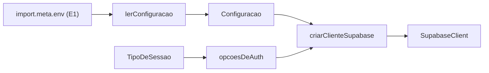

# src/shared/infra

## Cabeçalho

| Campo | Valor |
|---|---|
| Id | DIR-src-shared-infra |
| Título | `infra` |
| Tipo | código · infraestrutura (fabricações puras) |
| Data | 2026-11-17 |
| Usuário responsável | TokumoH |
| Status | em construção |
| Commits | commit que introduz este arquivo — `git log --format=%h -- src/shared/infra/README.md` |
| Arquivos | `README.md`, `configuracao.ts`, `configuracao.test.ts`, `supabase.ts`, `supabase.test.ts` |

## Propósito

Ler e validar as variáveis de ambiente públicas do app (`lerConfiguracao`) e criar o cliente Supabase com as opções de autenticação certas para cada tipo de sessão (`criarClienteSupabase`). Nenhuma tela é conhecida aqui.

## Origem

Criado na Tarefa 2 da etapa E0 ([PLA-001](../../../docs/planos/2026-11-17-e0-fundacao.md)). Desenho: [DES-001](../../../docs/desenho/2026-11-16-revocast-cameras-desenho.md). Nesta etapa o cliente ainda não é usado por nenhuma tela; passa a ser na E1.

## Organização

- Um arquivo por responsabilidade: `configuracao.ts` (variáveis de ambiente) e `supabase.ts` (cliente); cada um com seu `.test.ts` ao lado.
- `lerConfiguracao` recebe o objeto de ambiente como argumento (nos testes, um objeto simples; no app, a partir da E1, `import.meta.env`), sem ler o ambiente por conta própria.
- Variáveis obrigatórias: `VITE_SUPABASE_URL` e `VITE_SUPABASE_PUBLISHABLE_KEY`. Valor ausente, vazio ou só com espaços lança `ErroDeConfiguracao` que cita o nome da variável; espaços nas pontas são removidos. A URL passa por três checagens, nesta ordem: (1) o texto começa com `https://` (sem diferenciar maiúsculas; `https:abc...`, `https:/abc...` e `xhttps://` são recusadas); (2) `new URL()` a aceita (`https://` sem host e espaço no host, como `https://abc supabase.co`, não); (3) o texto, sem uma barra final e em minúsculas, é igual a `url.origin` em minúsculas, o que recusa caminho (inclusive com espaço; erro comum: colar `https://<projeto>.supabase.co/rest/v1`, que o supabase-js transformaria em `/rest/v1/rest/v1`), `?`, `#`, credenciais, barra invertida, tab e quebra de linha no meio (o `URL` remove tab e quebra de linha) e a porta padrão `:443` (o `origin` a descarta, então o texto difere; portas como `:8443` passam). `supabaseUrl` devolvido é `url.origin` (minúsculas, sem barra final). Todas as recusas lançam `ErroDeConfiguracao` citando `VITE_SUPABASE_URL`. Os valores TURN também têm as pontas aparadas. `VITE_SUPABASE_PUBLISHABLE_KEY` que comece com `sb_secret_` (sem diferenciar maiúsculas) é recusada com `ErroDeConfiguracao` que cita a variável, sem repetir o valor. Opcionais: `VITE_TURN_URL`, `VITE_TURN_USUARIO`, `VITE_TURN_SENHA`; o campo `turn` só existe se as três estiverem preenchidas.
- Quatro tipos de sessão (`membro`, `camera`, `obs_palco`, `obs_camera`); cada um usa a chave de armazenamento `revocast-auth-<tipo>`, para que sessões de tipos diferentes no mesmo navegador não se sobrescrevam.
- Todos os clientes usam `flowType: 'pkce'`, `persistSession: true` e `autoRefreshToken: true`; `detectSessionInUrl` só é `true` para `membro`.
- Os nomes das variáveis estão em [`.env.example`](../../../.env.example), sem valores.

## Por que esta organização

Receber o ambiente como argumento torna `lerConfiguracao` testável sem mexer em variáveis globais. Separar a chave de armazenamento por tipo evita que a sessão anônima de uma câmera apague a de um membro aberta no mesmo navegador, ou que as Fontes `obs_palco` e `obs_camera`, que dividem o perfil do OBS, se sobrescrevam. PKCE evita expor tokens no fragmento da URL de retorno do login. Só o membro faz login por redirecionamento, por isso só ele lê a sessão da URL.

## Por que não outras organizações

| Opção | Motivo de descarte |
|---|---|
| Ler `import.meta.env` direto dentro do módulo | Não testável sem manipular o ambiente global |
| Uma única chave de armazenamento para todos | Sessões de tipos diferentes no mesmo navegador (ex.: membro e câmera) se sobrescreveriam |
| Cliente Supabase criado na carga do módulo | Falharia ao importar quando faltasse variável, antes de a tela poder mostrar o erro |

## Onde

| Arquivo ou subdiretório | O que contém |
|---|---|
| [`README.md`](README.md) | Este arquivo |
| [`configuracao.ts`](configuracao.ts) | `Configuracao`, `ErroDeConfiguracao` e `lerConfiguracao(env)` |
| [`configuracao.test.ts`](configuracao.test.ts) | 11 testes: obrigatórias, variável ausente, vazia ou só espaços, espaços nas pontas, URL sem https (incl. malformadas), origens aceitas e devolvidas como `url.origin`, URL inválida, URL que não é só a origem, TURN completo e aparado, chave secreta recusada, nome do erro |
| [`supabase.ts`](supabase.ts) | `TipoDeSessao`, `chaveDeArmazenamento`, `opcoesDeAuth` e `criarClienteSupabase` |
| [`supabase.test.ts`](supabase.test.ts) | 6 testes: chaves distintas, formato da chave, PKCE e sessão na URL só para membro, todas as opções por tipo, repasse ao `createClient` (mockado) com as opções literais dos 4 tipos, clientes de tipos diferentes com chaves diferentes |

## Lógica



`criarClienteSupabase(config, tipo)` chama `createClient(config.supabaseUrl, config.supabaseChavePublica, { auth: opcoesDeAuth(tipo) })`.

## Exemplo

```ts
const config = lerConfiguracao(import.meta.env)
const supabase = criarClienteSupabase(config, 'camera') // chave de armazenamento: revocast-auth-camera
```

Sem `VITE_SUPABASE_PUBLISHABLE_KEY`, `lerConfiguracao` lança `ErroDeConfiguracao` com a mensagem "Variável de ambiente ausente ou vazia: VITE_SUPABASE_PUBLISHABLE_KEY".

## Verificação

- `npx vitest run src/shared/infra`: 2 arquivos, 17 testes.
- Cada teste foi comprovado contra uma sabotagem real em cópia fora do repositório (tabela teste → sabotagem → falha no registro [VER-009](../../../docs/verificacoes/2026-11-17-009-e0-supabase-cliente.md)).
- Links relativos, "Onde" e campo "Arquivos" conferidos por `npm run check-docs`.
- Não há subdiretórios.

## Riscos

- A exigência de `https` recusa o Supabase local da CLI (`http://127.0.0.1:54321`); desenvolvimento local contra ele exigiria afrouxar a regra (decisão futura).
- A `storageKey` não inclui a referência do projeto Supabase: dois projetos na mesma origem do navegador (ex.: `localhost` alternando dev e produção) dividem a sessão.
- A chave é por tipo, não por dispositivo: dois dispositivos do mesmo tipo (duas `camera`) no mesmo navegador dividem a sessão `revocast-auth-camera`.
- `VITE_TURN_SENHA`, como toda variável `VITE_`, é embutida no bundle do navegador (o DES-001 reconhece); não serve para segredo de verdade.
- Domínio próprio com acento precisa ser escrito em punycode (`xn--...`): `url.origin` vem em punycode e a comparação recusa a forma acentuada.
- A recusa de chave secreta só reconhece o prefixo novo `sb_secret_`; chaves antigas JWT `service_role` não são detectadas.
- Nenhuma tela mostra ainda o `ErroDeConfiguracao` ao usuário (fica para a E1).
- `criarClienteSupabase` não foi exercitado contra um projeto Supabase real: o teste mocka `createClient`.
- A chave publicável vai para o navegador por definição; a proteção dos dados depende da RLS (Tarefa 3), não do sigilo da chave.
