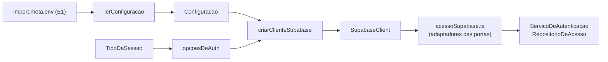

# src/shared/infra

## Cabeçalho

| Campo | Valor |
|---|---|
| Id | DIR-src-shared-infra |
| Título | `infra` |
| Tipo | código · infraestrutura (fabricações puras) |
| Data | 2026-11-17 |
| Usuário responsável | TokumoH |
| Status | em construção |
| Commits | commit que introduz este arquivo — `git log --format=%h -- src/shared/infra/README.md` |
| Arquivos | `README.md`, `configuracao.ts`, `configuracao.test.ts`, `supabase.ts`, `supabase.test.ts`, `tempoLimite.ts`, `tempoLimite.test.ts`, `acessoSupabase.ts`, `acessoSupabase.test.ts` |

## Propósito

Ler e validar as variáveis de ambiente públicas do app (`lerConfiguracao`), criar o cliente Supabase com as opções de autenticação certas para cada tipo de sessão e um `fetch` com tempo-limite de 15 s para o PostgREST e o Auth (`criarClienteSupabase`, `tempoLimite.ts`) e, desde a E1, implementar sobre esse cliente as portas do domínio Acesso (`acessoSupabase.ts`: `criarAutenticacaoSupabase`, `criarRepositorioDeAcessoSupabase` e `traduzirErro`). Nenhuma tela é conhecida aqui.

## Origem

Criado na Tarefa 2 da etapa E0 ([PLA-001](../../../docs/planos/2026-11-17-e0-fundacao.md)). Desenho: [DES-001](../../../docs/desenho/2026-11-16-revocast-cameras-desenho.md). Nesta etapa o cliente ainda não é usado por nenhuma tela; passa a ser na E1. `acessoSupabase.ts` nasceu na Tarefa 3 da E1 ([PLA-002](../../../docs/planos/2026-11-26-e1-entrada-e-membros.md)): adaptadores das portas `ServicoDeAutenticacao` e `RepositorioDeAcesso` de [`src/domains/acesso/portas.ts`](../../domains/acesso/portas.ts) (Pure Fabrication; decisão D6, sem repositório genérico); quem os compõe é [`src/app/servicos.ts`](../../app/servicos.ts). `tempoLimite.ts` nasceu no registro [VER-021](../../../docs/verificacoes/2026-11-26-021-tempo-limite-supabase.md) (opção 3 da "fila pendurada" do [VER-020](../../../docs/verificacoes/2026-11-26-020-e1-conferencia-e-guia.md)).

## Organização

- Um arquivo por responsabilidade: `configuracao.ts` (variáveis de ambiente), `supabase.ts` (cliente) e `tempoLimite.ts` (tempo-limite do `fetch` do cliente); cada um com seu `.test.ts` ao lado.
- `lerConfiguracao` recebe o objeto de ambiente como argumento (nos testes, um objeto simples; no app, a partir da E1, `import.meta.env`), sem ler o ambiente por conta própria.
- Variáveis obrigatórias: `VITE_SUPABASE_URL` e `VITE_SUPABASE_PUBLISHABLE_KEY`. Valor ausente, vazio ou só com espaços lança `ErroDeConfiguracao` que cita o nome da variável; espaços nas pontas são removidos. A URL passa por três checagens, nesta ordem: (1) o texto começa com `https://` (sem diferenciar maiúsculas; `https:abc...`, `https:/abc...` e `xhttps://` são recusadas); (2) `new URL()` a aceita (`https://` sem host e espaço no host, como `https://abc supabase.co`, não); (3) o texto, sem uma barra final e em minúsculas, é igual a `url.origin` em minúsculas, o que recusa caminho (inclusive com espaço; erro comum: colar `https://<projeto>.supabase.co/rest/v1`, que o supabase-js transformaria em `/rest/v1/rest/v1`), `?`, `#`, credenciais, barra invertida, tab e quebra de linha no meio (o `URL` remove tab e quebra de linha) e a porta padrão `:443` (o `origin` a descarta, então o texto difere; portas como `:8443` passam). `supabaseUrl` devolvido é `url.origin` (minúsculas, sem barra final). Todas as recusas lançam `ErroDeConfiguracao` citando `VITE_SUPABASE_URL`. Os valores TURN também têm as pontas aparadas. `VITE_SUPABASE_PUBLISHABLE_KEY` que comece com `sb_secret_` (sem diferenciar maiúsculas) é recusada com `ErroDeConfiguracao` que cita a variável, sem repetir o valor. Opcionais: `VITE_TURN_URL`, `VITE_TURN_USUARIO`, `VITE_TURN_SENHA`; o campo `turn` só existe se as três estiverem preenchidas.
- Quatro tipos de sessão (`membro`, `camera`, `obs_palco`, `obs_camera`); cada um usa a chave de armazenamento `revocast-auth-<tipo>`, para que sessões de tipos diferentes no mesmo navegador não se sobrescrevam.
- Todos os clientes usam `flowType: 'pkce'`, `persistSession: true` e `autoRefreshToken: true`; `detectSessionInUrl` só é `true` para `membro`.
- Tempo-limite (`tempoLimite.ts`, desde o VER-021): `criarClienteSupabase` passa ao `createClient` a opção `global.fetch` = `fetchComTempoLimite(fetch da página, TEMPO_LIMITE_SUPABASE_MS, limitarRestEAuth(supabaseUrl))`, para os quatro tipos de sessão. Regras:
  - `TEMPO_LIMITE_SUPABASE_MS` = 15 000 ms (15 s), constante comentada no próprio arquivo.
  - Só têm tempo-limite as URLs da **mesma origem** do projeto com caminho `/rest/v1` ou `/auth/v1` (ou abaixo deles). **Storage (`/storage/v1/`) fica fora**: os envios de vídeo da E2 vão até 50 MB (DES-001 §15) e levam mais que 15 s numa rede comum. Functions, o broadcast REST do Realtime e outros hosts também ficam fora; o WebSocket do Realtime não usa `fetch`.
  - Estourado o tempo, a chamada é abortada com `DOMException` `TimeoutError`. O que vira no app (lido no código instalado do supabase-js 2.119.0): no `postgrest-js`, `{ code: '', status: 0 }` → `traduzirErro` → `rede`; no `auth-js`, `AuthRetryableFetchError` → `usuarioAtual` → `ErroDeAcesso('rede')`. O `postgrest-js` repete GET (listas) depois de um `TimeoutError` que não veio do sinal de quem chamou (até 3 vezes, esperando 1, 2 e 4 s): uma lista sem resposta vira `rede` em ~67 s; `rpc` (POST) não repete (~15 s). O refresh do `auth-js` repete enquanto cabe na janela de 30 s: sessão expirada com rede pendurada → `rede` em ~30,2 s.
  - O sinal de quem chama (`init.signal` ou o do `Request`) continua abortando, com o motivo dele; o timer e o ouvinte desse sinal são soltos quando o `fetch` termina. Feito com `AbortController` + `setTimeout` (sem `AbortSignal.any`, que falta no Safari < 17.4, e testável com timers falsos). O tempo conta até chegarem os cabeçalhos; a leitura do corpo não é limitada e, depois dos cabeçalhos, o abort de quem chama também deixa de valer para ela (o ouvinte já foi solto). Hoje nenhum código do app usa `abortSignal`.
  - O `fetch` da página é lido a cada chamada (`globalThis.fetch(entrada, init)`), sem `this`.
- Os nomes das variáveis estão em [`.env.example`](../../../.env.example), sem valores.
- `acessoSupabase.ts` recebe o `SupabaseClient` pronto (não cria cliente nem lê ambiente) e devolve objetos que implementam as portas do domínio. Regras que importam:
  - `usuarioAtual()` lança `ErroDeAcesso('rede')` quando `getSession()` devolve `error` ou lança (com a sessão expirada e a rede caída, o `auth-js` 2.119.0 devolve `session: null` **e** `AuthRetryableFetchError`, mas a sessão continua guardada); nunca devolve `null` nesse caso.
  - `entrarComGoogle(url)` chama `signInWithOAuth({ provider: 'google', options: { redirectTo: url, queryParams: { prompt: 'select_account' } } })`.
  - `sair()` usa `signOut({ scope: 'local' })` e **nunca lança**: o `auth-js` apaga a sessão local antes do pedido de revogação, então um erro (devolvido ou lançado) é só do servidor; vai para `console.warn` só o texto fixo "sair: o servidor não confirmou a saída; a sessão local foi apagada", sem e-mail, token nem o objeto de erro.
  - `aoMudarSessao(ouvinte)` ignora `INITIAL_SESSION` e só **agenda** o ouvinte com `setTimeout(..., 0)` (nunca chama o Supabase dentro do callback do `onAuthStateChange`); devolve a função que cancela: desliga a flag `ativo` (um agendamento já feito não chama mais o ouvinte) e chama `subscription.unsubscribe()`.
  - Repositório: `rpc('papel_atual')`, listas ordenadas por e-mail, `insert` sem normalizar (quem normaliza é o domínio; o banco recusa maiúsculas por `CHECK`), `update`/`delete` com `.eq('email', e).select('email')` (vira `RETURNING`); 0 linhas → `ErroDeAcesso('nada_alterado')` (a RLS filtrou, inclusive a própria linha, D1). Papel desconhecido vindo do banco (`ehPapel` falso) vira `null` em `papelAtual` e descarta a linha em `listarPermitidos`.
  - `traduzirErro(erro, status)`, nesta ordem: 401 ou `PGRST301`/`PGRST303` → `sessao_expirada` (antes do `42501`, que o PostgREST manda com 401 quando a requisição sai como `anon`); `23505` → `duplicado`; `23514` → `invalido`; `42501` → `negado`; sem código e status 0 (falha do `fetch` no `postgrest-js` 2.119.0) → `rede`; o resto → `outro`. A mensagem do servidor nunca passa para o `ErroDeAcesso`.

## Por que esta organização

Receber o ambiente como argumento torna `lerConfiguracao` testável sem mexer em variáveis globais. Separar a chave de armazenamento por tipo evita que a sessão anônima de uma câmera apague a de um membro aberta no mesmo navegador, ou que as Fontes `obs_palco` e `obs_camera`, que dividem o perfil do OBS, se sobrescrevam. PKCE evita expor tokens no fragmento da URL de retorno do login. Só o membro faz login por redirecionamento, por isso só ele lê a sessão da URL.

## Por que não outras organizações

| Opção | Motivo de descarte |
|---|---|
| Ler `import.meta.env` direto dentro do módulo | Não testável sem manipular o ambiente global |
| Uma única chave de armazenamento para todos | Sessões de tipos diferentes no mesmo navegador (ex.: membro e câmera) se sobrescreveriam |
| Cliente Supabase criado na carga do módulo | Falharia ao importar quando faltasse variável, antes de a tela poder mostrar o erro |

## Onde

| Arquivo ou subdiretório | O que contém |
|---|---|
| [`README.md`](README.md) | Este arquivo |
| [`configuracao.ts`](configuracao.ts) | `Configuracao`, `ErroDeConfiguracao` e `lerConfiguracao(env)` |
| [`configuracao.test.ts`](configuracao.test.ts) | 11 testes: obrigatórias, variável ausente, vazia ou só espaços, espaços nas pontas, URL sem https (incl. malformadas), origens aceitas e devolvidas como `url.origin`, URL inválida, URL que não é só a origem, TURN completo e aparado, chave secreta recusada, nome do erro |
| [`supabase.ts`](supabase.ts) | `TipoDeSessao`, `chaveDeArmazenamento`, `opcoesDeAuth` e `criarClienteSupabase` |
| [`supabase.test.ts`](supabase.test.ts) | 7 testes: chaves distintas, formato da chave, PKCE e sessão na URL só para membro, todas as opções por tipo, repasse ao `createClient` (mockado) com as opções literais dos 4 tipos e um `global.fetch`, clientes de tipos diferentes com chaves diferentes, e o `fetch` entregue ao `createClient` com tempo-limite em `rest/v1` e `auth/v1` e sem ele em `storage/v1` (timers falsos) |
| [`tempoLimite.ts`](tempoLimite.ts) | `TEMPO_LIMITE_SUPABASE_MS`, `limitarRestEAuth(supabaseUrl)` e `fetchComTempoLimite(fetchBase, ms, deveLimitar)` |
| [`tempoLimite.test.ts`](tempoLimite.test.ts) | 16 testes com `fetch` falso pendurado e timers falsos: valor de 15 s; quais URLs têm tempo-limite (rest/auth sim; storage, functions, realtime, caminhos parecidos, outro host, outro esquema e texto que não é URL não); rest e auth rejeitam com `TimeoutError` em 15 s e nem 1 ms antes; URL e `Request` como entrada; storage e outro host sem timer e com o `init` intacto; sinal do chamador (de `init` e de `Request`, já abortado ou não) respeitado, com o motivo dele conferido por identidade; resposta a tempo limpa o timer e solta o ouvinte; `init` preservado; `fetch` que lança na hora ou falha de rede não deixa timer |
| [`acessoSupabase.ts`](acessoSupabase.ts) | `traduzirErro`, `criarAutenticacaoSupabase` e `criarRepositorioDeAcessoSupabase` (adaptadores das portas do domínio Acesso) |
| [`acessoSupabase.test.ts`](acessoSupabase.test.ts) | 14 testes com um cliente Supabase falso escrito no arquivo (registra a cadeia `from`/`select`/`insert`/`update`/`delete`/`eq`/`order`/`rpc`): `usuario-da-sessao`, `usuario-da-sessao-com-erro`, `usuario-da-sessao-que-lanca`, `entrar-com-google`, `sair-local`, `sair-sem-rede`, `aoMudarSessao-adia-e-cancela`, `aoMudarSessao-cancelado-nao-chama-agendado`, `papel-atual`, `listar`, `incluir`, `alterar-e-remover-com-retorno`, `traduz-erros` e a mensagem sem e-mail |

## Lógica



A composição (`src/app/servicos.ts`) é quem liga as duas pontas: `lerConfiguracao` → `criarClienteSupabase(config, 'membro')` → `criarAutenticacaoSupabase(cliente)` e `criarRepositorioDeAcessoSupabase(cliente)`.

`criarClienteSupabase(config, tipo)` chama `createClient(config.supabaseUrl, config.supabaseChavePublica, { auth: opcoesDeAuth(tipo) })`.

## Exemplo

```ts
const config = lerConfiguracao(import.meta.env)
const supabase = criarClienteSupabase(config, 'camera') // chave de armazenamento: revocast-auth-camera
```

Sem `VITE_SUPABASE_PUBLISHABLE_KEY`, `lerConfiguracao` lança `ErroDeConfiguracao` com a mensagem "Variável de ambiente ausente ou vazia: VITE_SUPABASE_PUBLISHABLE_KEY".

## Verificação

- `npx vitest run src/shared/infra`: 4 arquivos, 48 testes (desde o VER-021).
- `tempoLimite.ts` e o `global.fetch` de `supabase.ts`: 14 sabotagens executadas (13 do implementador e a S-A do revisor), cada uma derrubando ao menos um teste (tabela no registro [VER-021](../../../docs/verificacoes/2026-11-26-021-tempo-limite-supabase.md)).
- Cada teste foi comprovado contra uma sabotagem real em cópia fora do repositório (tabela teste → sabotagem → falha no registro [VER-009](../../../docs/verificacoes/2026-11-17-009-e0-supabase-cliente.md)).
- `acessoSupabase.test.ts`: cada teste derrubado por ao menos uma sabotagem executada, com o arquivo restaurado e conferido por `sha256sum` (tabela no registro [VER-017](../../../docs/verificacoes/2026-11-26-017-e1-adaptadores-acesso.md)).
- Links relativos, "Onde" e campo "Arquivos" conferidos por `npm run check-docs`.
- Não há subdiretórios.

## Riscos

- A exigência de `https` recusa o Supabase local da CLI (`http://127.0.0.1:54321`); desenvolvimento local contra ele exigiria afrouxar a regra (decisão futura).
- A `storageKey` não inclui a referência do projeto Supabase: dois projetos na mesma origem do navegador (ex.: `localhost` alternando dev e produção) dividem a sessão.
- A chave é por tipo, não por dispositivo: dois dispositivos do mesmo tipo (duas `camera`) no mesmo navegador dividem a sessão `revocast-auth-camera`.
- `VITE_TURN_SENHA`, como toda variável `VITE_`, é embutida no bundle do navegador (o DES-001 reconhece); não serve para segredo de verdade.
- Domínio próprio com acento precisa ser escrito em punycode (`xn--...`): `url.origin` vem em punycode e a comparação recusa a forma acentuada.
- A recusa de chave secreta só reconhece o prefixo novo `sb_secret_`; chaves antigas JWT `service_role` não são detectadas.
- Desde a Tarefa 4 da E1, `/entrar`, `/painel` e `/controle` mostram o `ErroDeConfiguracao` na tela "Configuração incompleta" (a mensagem só cita o nome da variável); as rotas de dispositivo não leem a configuração de membro.
- Os adaptadores de `acessoSupabase.ts` foram testados só com um cliente falso, que imita as respostas do supabase-js 2.119.0 lidas no código dele (`getSession`, `signOut`, falha de `fetch` do `postgrest-js`); não rodaram contra um projeto Supabase real (conferência real na Tarefa 6 da E1). Uma atualização do supabase-js pode mudar essas respostas.
- `criarClienteSupabase` não foi exercitado contra um projeto Supabase real: o teste mocka `createClient` (o tempo-limite foi exercitado com o supabase-js real e `fetch` falso, e no Chromium com o Supabase interceptado; VER-021).
- O tempo-limite de 15 s pode cortar uma chamada legítima muito lenta (rede ruim): vira tela de falha com "Tentar de novo". Listas (GET) só viram erro em ~67 s por causa das repetições do `postgrest-js`, e o refresh de sessão em ~30 s.
- Envio ao Storage sem resposta (E2) continua sem tempo-limite, de propósito; a E2 decide como acompanhar e cancelar o envio.
- Uma atualização do supabase-js pode mudar como o `fetch` personalizado chega ao auth-js, ao postgrest-js e ao storage-js, ou como um `TimeoutError` é tratado (conferido na 2.119.0).
- A chave publicável vai para o navegador por definição; a proteção dos dados depende da RLS (Tarefa 3), não do sigilo da chave.
