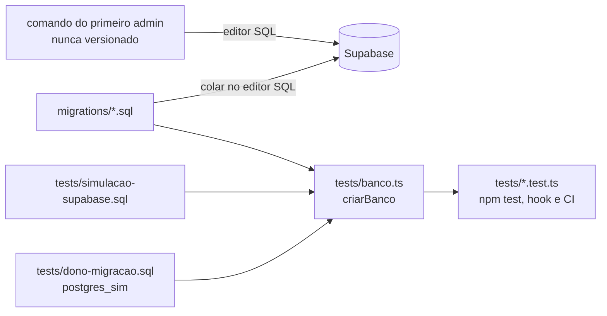

# supabase

## Cabeçalho

| Campo | Valor |
|---|---|
| Id | DIR-supabase |
| Título | `supabase` |
| Tipo | banco de dados · migrações e testes de RLS |
| Data | 2026-11-17 |
| Usuário responsável | TokumoH |
| Status | em construção |
| Commits | commit que introduz este arquivo — `git log --format=%h -- supabase/README.md` |
| Arquivos | `README.md`, `migrations/`, `tests/` |

## Propósito

Tudo o que é do banco Postgres do Supabase: as migrações versionadas (tipos, tabelas, funções, gatilho, RLS e dados iniciais) e os testes que provam a RLS e as restrições sem precisar de conta nem de Docker. Este README também é o manual de aplicação: como levar a migração ao projeto Supabase e como inserir o primeiro `admin`.

## Origem

Criado na Tarefa 3 da etapa E0 ([PLA-001](../docs/planos/2026-11-17-e0-fundacao.md)), registro VER-010. Modelo de dados e segurança: [DES-001](../docs/desenho/2026-11-16-revocast-cameras-desenho.md), seções 7 e 8. Duas decisões do responsável (PLA-001, "Decisões sobre divergências do desenho", 1 e 2) mudaram o DES-001 (seções 7, 11 e 12, "ajustado no VER-010"):

1. A migração **não contém e-mail**: o primeiro `admin` é inserido à mão no editor SQL (comando abaixo), para que nenhum dado pessoal fique no repositório.
2. A migração fica no formato da Supabase CLI, mas na E0 é aplicada pelo **editor SQL**; os testes de RLS rodam em PGlite com uma simulação do Supabase.

## Organização

- `migrations/`: uma migração por arquivo, `AAAAMMDDHHMMSS_nome.sql` (formato da Supabase CLI). Migração já aplicada **nunca é editada**: correção vai numa migração nova.
- `tests/`: testes Vitest que carregam a simulação do Supabase e as migrações num Postgres em memória (PGlite); as migrações são aplicadas por um dono sem superusuário (`tests/dono-migracao.sql`), como no Supabase.
- Não há `config.toml` nem `.gitignore` da CLI: só nascem se a CLI for usada (ver "Exemplo"), e então entram neste README.

## Por que esta organização

- O formato da CLI deixa o caminho aberto para `supabase db push` sem obrigar ninguém a guardar a senha do banco agora.
- Testes em PGlite rodam no `npm test` (e, por ele, no hook `pre-push` e na CI), sem conta e sem Docker; localmente os três arquivos de teste (493 testes) levam cerca de 10 s (medido em 2026-11-21 com 4 núcleos: `npx vitest run supabase/tests` em 7,3 a 9,7 s; 11,7 s com um worker só), bem dentro do limite de 5 min do job da CI; a simulação é pequena e fica ao lado dos testes, longe das migrações (nunca é aplicada no Supabase).

## Por que não outras organizações

| Opção | Motivo de descarte |
|---|---|
| Aplicar pela Supabase CLI já na E0 | Exige `supabase login` e a senha do banco na sessão; o editor SQL faz o mesmo sem guardar segredo |
| Testes de RLS no Supabase real | Exigem conta e rede na CI e mexem em dados reais |
| Testes com o Supabase local (Docker) | Docker pesa no hook e consome minutos da CI |
| Primeiro `admin` na migração | Colocaria um e-mail real (dado pessoal) no repositório |
| Simulação dentro de `migrations/` | A CLI aplicaria a simulação no Supabase real |

## Onde

| Arquivo ou subdiretório | O que contém |
|---|---|
| [`README.md`](README.md) | Este arquivo |
| [`migrations/`](migrations/README.md) | Migrações SQL versionadas (hoje: `20261117000000_fundacao.sql`) |
| [`tests/`](tests/README.md) | Simulação do Supabase, `banco.ts`, testes de RLS e de restrições e a matriz de permissões papel × tabela × operação do DES-001 (seção 8) |

## Lógica



1. **Aplicar a migração (editor SQL, caminho da E0):** no painel do Supabase, abrir *SQL Editor*, colar o conteúdo inteiro de [`migrations/20261117000000_fundacao.sql`](migrations/20261117000000_fundacao.sql) e executar. Não exige a senha do banco nem login da CLI.
2. **Inserir o primeiro `admin`** (uma vez, no editor SQL, trocando `<e-mail>` pelo e-mail Google do responsável; o comando preenchido nunca é salvo no repositório):

   ```sql
   insert into public.membros_permitidos (email, papel) values (lower('<e-mail>'), 'admin');
   ```

   Os demais membros são adicionados pelo próprio `admin` (aba Membros, E1).
3. **Testar localmente:** `npx vitest run supabase/tests` (também roda dentro do `npm test`).

## Exemplo

Alternativa pela **Supabase CLI** (quando ela passar a ser usada):

1. `supabase login`.
2. `supabase init`, respondendo **"não"** às perguntas de gerar configurações do VS Code e do IntelliJ (senão nascem as pastas `.vscode/` ou `.idea/` rastreadas, sem README).
3. `supabase link --project-ref <ref>` (pede a senha do banco).
4. Só se a migração já tiver sido aplicada pelo editor SQL (o editor não a registra em `supabase_migrations.schema_migrations`): `supabase migration repair --status applied 20261117000000` (exige o projeto ligado no passo 3).
5. `supabase db push`.
6. Antes do commit: apagar do `supabase/config.toml` gerado as duas linhas comentadas `admin_email` (são e-mails de exemplo que o `check-doc-secrets` acusa) e acrescentar `config.toml` e `.gitignore` em "Onde" e no campo "Arquivos" deste README.

## Verificação

- Links relativos, "Onde" e campo "Arquivos" conferidos por `npm run check-docs`; os dois subdiretórios têm README próprio.
- A migração foi aplicada e testada em PGlite (Postgres 18.6) com a simulação: 493 testes (51 em `rls.test.ts`, 32 em `restricoes.test.ts` e 410 em `matriz.test.ts`, que cobre as 396 células da matriz de permissões), com a migração aplicada por `postgres_sim`, um dono sem superusuário, como o `postgres` do Supabase; o que eles provam, o que só as checagens de banco cobrem e o que não tem teste está em [`migrations/README.md`](migrations/README.md), "Verificação"; detalhes e sabotagens no registro VER-010.

## Riscos

- A migração **não foi aplicada num Supabase real** nesta tarefa: a simulação reproduz só o que a migração usa (papéis `anon`, `authenticated`, `service_role` e `supabase_auth_admin`, privilégios padrão no padrão vigente desde 2026-10-30, nas variantes com a exposição automática de tabelas desligada e ligada, `auth.users` com seis colunas, `auth.jwt()` e `auth.uid()`). Diferenças de versão do Postgres do projeto (por exemplo, `on delete set null (coluna)` exige Postgres 15 ou mais novo) só aparecem ao aplicar.
- Privilégios de tabela (Correção 13 da Tarefa 3): desde 2026-10-30 o Supabase não dá mais `select`, `insert`, `update` e `delete` automáticos em tabelas novas de `public` ([changelog](https://supabase.com/changelog/45329-breaking-change-tables-not-exposed-to-data-and-graphql-api-automatically)); a migração dá `grant` explícito a `authenticated` só do que as políticas usam e revoga o resto (detalhes em [`migrations/README.md`](migrations/README.md)). A premissa veio do changelog e da documentação, não de um projeto real. `service_role` não tem nenhum privilégio de tabela nem de sequência (a migração revoga dele o que os privilégios padrão do Supabase dariam: hoje `truncate`, `references`, `trigger` e `maintain`; com "Automatically expose new tables" ligado, tudo) nem `EXECUTE` nas 3 funções (Correção 14). A chave de serviço continua passando por cima da RLS (`BYPASSRLS`), mas sem privilégio não acessa nada: um uso futuro no servidor (por exemplo, uma Edge Function com a chave secreta) pede decisão própria, com o `grant` explícito a `service_role` na migração que precisar dele e, a partir do VER-011, o ajuste do `data-api:check`, que acusa qualquer privilégio de `service_role`; tabela criada por outro papel que não o das migrações (por exemplo, pelo painel com outro dono) recebe os privilégios padrão do projeto, também para `service_role`.
- O editor SQL não registra a migração para a CLI: esquecer o `migration repair` faz o `db push` tentar aplicá-la de novo (e falhar em objetos que já existem).
- No Supabase real, as funções `security definer` rodam como o dono `postgres`, que não é superusuário e tem `BYPASSRLS` (`ALTER ROLE postgres NOSUPERUSER ... BYPASSRLS` no repositório `supabase/postgres`). Nos testes e nas checagens de banco, o dono é `postgres_sim` ([`tests/dono-migracao.sql`](tests/dono-migracao.sql)), com os mesmos atributos (`CREATEDB`, `CREATEROLE`) e, de propósito, sem `BYPASSRLS` (mais restrito), com os privilégios do `postgres` lidos nesse repositório (membro de `anon`, `authenticated` e `service_role`, todos os privilégios em `auth.users`, privilégios padrão de `public`). Assim a leitura de `auth.users` por `papel_atual()`, o gatilho em `auth.users` e a RLS do dono são testados com dono comum, mas os privilégios reais do `postgres` num projeto só se confirmam ao aplicar.
- O gatilho cria perfil também para cadastro com e-mail não confirmado. Com o provedor Email desligado (DES-001, seção 12, item 1), pelo app só entram contas Google; mesmo assim `papel_atual()` devolve nulo sem confirmação.
- `estudio_estado.atualizado_em` só recebe `now()` no insert (`default`); não há gatilho, então um `update` mantém o carimbo antigo, a menos que o cliente o envie (revisão 12, N2). O DES-001 lista a coluna sem dizer como ela muda; decidir na E1/E3 entre um gatilho `before update` e o envio pelo cliente.
- `criado_por`, `enviado_por` e `atualizado_por` são declarados pelo cliente (como a autoria de `registro_acoes`, DES-001 seção 8); uma migração futura pode prendê-los a `auth.uid()` com `with check`.
- Uma cena ou um som usado em `mapa_gestos` não pode ser apagado (chave estrangeira sem ação): é preciso trocar o gesto antes.
- O comando do primeiro `admin` depende de o e-mail ser digitado certo; um erro deixa o responsável sem papel até corrigir a linha pelo editor SQL.
