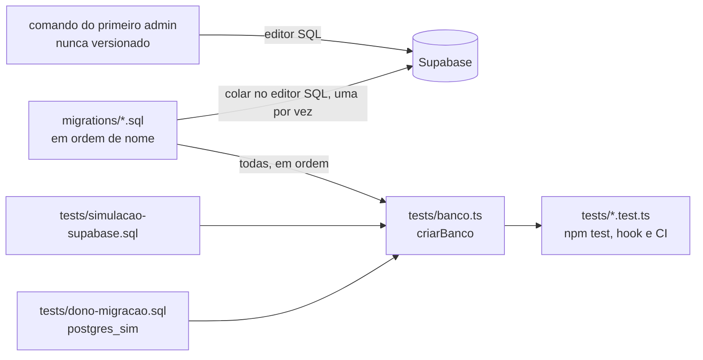

# supabase

## Cabeçalho

| Campo | Valor |
|---|---|
| Id | DIR-supabase |
| Título | `supabase` |
| Tipo | banco de dados · migrações e testes de RLS |
| Data | 2026-11-17 |
| Usuário responsável | TokumoH |
| Status | em construção |
| Commits | commit que introduz este arquivo — `git log --format=%h -- supabase/README.md` |
| Arquivos | `README.md`, `migrations/`, `tests/` |

## Propósito

Tudo o que é do banco Postgres do Supabase: as migrações versionadas (tipos, tabelas, funções, gatilho, RLS, dados iniciais e, desde a E2, o bucket `midias` do Storage com as políticas de `storage.objects`) e os testes que provam a RLS e as restrições sem precisar de conta nem de Docker. Este README também é o manual de aplicação: como levar as migrações ao projeto Supabase, sempre em ordem, como inserir (ou recuperar) o primeiro `admin`, como ligar o login Google (Supabase Auth, Google Cloud e Vercel; "Login Google (E1)", em "Lógica") e como ligar e conferir a Biblioteca no Storage ("Biblioteca no Storage (E2)", em "Lógica").

## Origem

Criado na Tarefa 3 da etapa E0 ([PLA-001](../docs/planos/2026-11-17-e0-fundacao.md)), registro VER-010. Modelo de dados e segurança: [DES-001](../docs/desenho/2026-11-16-revocast-cameras-desenho.md), seções 7 e 8. Duas decisões do responsável (PLA-001, "Decisões sobre divergências do desenho", 1 e 2) mudaram o DES-001 (seções 7, 11 e 12, "ajustado no VER-010"):

1. A migração **não contém e-mail**: o primeiro `admin` é inserido à mão no editor SQL (comando abaixo), para que nenhum dado pessoal fique no repositório.
2. A migração fica no formato da Supabase CLI, mas na E0 é aplicada pelo **editor SQL**; os testes de RLS rodam em PGlite com uma simulação do Supabase.

## Organização

- `migrations/`: uma migração por arquivo, `AAAAMMDDHHMMSS_nome.sql` (formato da Supabase CLI). Migração já aplicada **nunca é editada**: correção vai numa migração nova.
- `tests/`: testes Vitest que carregam a simulação do Supabase e as migrações num Postgres em memória (PGlite); as migrações são aplicadas por um dono sem superusuário (`tests/dono-migracao.sql`), como no Supabase.
- Não há `config.toml` nem `.gitignore` da CLI: só nascem se a CLI for usada (ver "Exemplo"), e então entram neste README.

## Por que esta organização

- O formato da CLI deixa o caminho aberto para `supabase db push` sem obrigar ninguém a guardar a senha do banco agora.
- Testes em PGlite rodam no `npm test` (e, por ele, no hook `pre-push` e na CI), sem conta e sem Docker; localmente os três arquivos de teste (523 testes desde a E2; 501 na E1; 493 na E0) levam cerca de 10 s (medido em 2026-11-21 com 4 núcleos, ainda com 493: `npx vitest run supabase/tests` em 7,3 a 9,7 s; 11,7 s com um worker só; com 501, 9,0 s em 2026-11-26), bem dentro do limite de 5 min do job da CI; a simulação é pequena e fica ao lado dos testes, longe das migrações (nunca é aplicada no Supabase).

## Por que não outras organizações

| Opção | Motivo de descarte |
|---|---|
| Aplicar pela Supabase CLI já na E0 | Exige `supabase login` e a senha do banco na sessão; o editor SQL faz o mesmo sem guardar segredo |
| Testes de RLS no Supabase real | Exigem conta e rede na CI e mexem em dados reais |
| Testes com o Supabase local (Docker) | Docker pesa no hook e consome minutos da CI |
| Primeiro `admin` na migração | Colocaria um e-mail real (dado pessoal) no repositório |
| Simulação dentro de `migrations/` | A CLI aplicaria a simulação no Supabase real |

## Onde

| Arquivo ou subdiretório | O que contém |
|---|---|
| [`README.md`](README.md) | Este arquivo |
| [`migrations/`](migrations/README.md) | Migrações SQL versionadas, aplicadas em ordem de nome (hoje, em ordem: `20261117000000_fundacao.sql`, `20261126142500_membros_sem_autoalteracao.sql` e `20261126190407_biblioteca_storage.sql`) |
| [`tests/`](tests/README.md) | Simulação do Supabase, `banco.ts`, testes de RLS e de restrições e a matriz de permissões papel × tabela × operação do DES-001 (seção 8) |

## Lógica



1. **Aplicar as migrações (editor SQL, caminho da E0, da E1 e da E2), sempre em ordem de nome e cada uma uma vez só:** no painel do Supabase, abrir *SQL Editor*, colar o conteúdo inteiro de [`migrations/20261117000000_fundacao.sql`](migrations/20261117000000_fundacao.sql) e executar; depois, numa nova consulta, o de [`migrations/20261126142500_membros_sem_autoalteracao.sql`](migrations/20261126142500_membros_sem_autoalteracao.sql) (E1, decisão D1 do PLA-002: nenhum `admin` altera nem remove a própria linha). Depois, numa nova consulta, o de [`migrations/20261126190407_biblioteca_storage.sql`](migrations/20261126190407_biblioteca_storage.sql) (E2, decisões D3 a D5 do [PLA-003](../docs/planos/2026-11-26-e2-preparar-episodio.md): bucket privado `midias`, 50 MB por arquivo, só os 8 tipos de som e imagem, e as políticas de `storage.objects`); aplicá-la é passo pendente do responsável, com a conferência descrita em "Biblioteca no Storage (E2)", abaixo. Quem já aplicou a de fundação aplica só as seguintes, na mesma ordem; quem já aplicou as duas primeiras aplica só a terceira (aplicar a segunda é passo pendente do responsável desde a Tarefa 6 do PLA-002, passo 1 de "Login Google (E1)", abaixo). Não exige a senha do banco nem login da CLI.
2. **Inserir o primeiro `admin`** (uma vez, no editor SQL, trocando `<e-mail>` pelo e-mail Google do responsável; o comando preenchido nunca é salvo no repositório):

   ```sql
   insert into public.membros_permitidos (email, papel) values (lower('<e-mail>'), 'admin');
   ```

   Os demais membros são adicionados pelo próprio `admin` (aba Membros, E1).

   **Recuperação do último `admin`:** nenhum `admin` altera nem remove a própria linha (segunda migração), então sempre sobra um no uso normal; só dois admins que se removem um ao outro no mesmo instante podem zerar os admins. Nesse caso, o dono roda no editor SQL o mesmo comando acima (se o e-mail saiu da lista) ou, se o e-mail ainda está na lista com outro papel, `update public.membros_permitidos set papel = 'admin' where email = lower('<e-mail>');` (também nunca salvo preenchido).
3. **Testar localmente:** `npx vitest run supabase/tests` (também roda dentro do `npm test`).

### Login Google (E1)

Passo do responsável para ligar o login de verdade (Tarefa 6 do [PLA-002](../docs/planos/2026-11-26-e1-entrada-e-membros.md); nenhum agente consegue fazer). Os nomes de menu são os do painel em 2026-11 e podem mudar; `<ref>` é o identificador do projeto Supabase e `<domínio da Vercel>` o domínio de produção do app. Nenhum e-mail, chave ou domínio real entra neste repositório. Em ordem:

1. **Banco (editor SQL), nesta ordem:** se a E0 ainda estiver pendente, aplicar [`migrations/20261117000000_fundacao.sql`](migrations/20261117000000_fundacao.sql) e rodar o comando do primeiro `admin` (passo 2 acima) com o próprio e-mail Google; depois, numa nova consulta, colar inteira e rodar [`migrations/20261126142500_membros_sem_autoalteracao.sql`](migrations/20261126142500_membros_sem_autoalteracao.sql). Conferir em *Authentication → Policies* (ou *Database → Policies*) que `membros_permitidos` tem quatro políticas e que as de update e delete trazem a condição `email <> (select lower(auth.jwt() ->> 'email'))`.
2. **Google Cloud Console** (sem faturamento), em *APIs e serviços → Tela de consentimento OAuth* (no console novo, *Google Auth Platform*: *Branding*, *Audience*, *Data Access (Scopes)*, *Clients*):
   - tipo de usuário **Externo**; escopos `openid`, `email` e `profile` (não sensíveis);
   - **Domínios autorizados:** `<ref>.supabase.co` e `<domínio da Vercel>`;
   - **publicar em produção** (em "Teste" só entram os usuários de teste cadastrados); enviar um logotipo pode exigir a verificação da marca pelo Google, então ele é opcional;
   - *Credenciais → Criar ID do cliente OAuth → Aplicativo da Web*: em **Origens JavaScript autorizadas**, `https://<domínio da Vercel>` e `http://localhost:5173` (dispensáveis, porque o retorno passa pelo Supabase, mas inofensivas); em **URIs de redirecionamento autorizados**, **só** `https://<ref>.supabase.co/auth/v1/callback` (quem volta do Google é o Supabase, não o app);
   - guardar o ID e a chave secreta do cliente só para o passo 3: a chave secreta nunca vai para o repositório nem para a Vercel.
3. **Supabase → Authentication → Sign In / Providers** (na documentação, *Authentication → Providers → Google*): **Google** ligado, com o ID e a chave secreta do cliente; provedor **Email desligado** (vem ligado); **"Confirm email" ligado** (só tem efeito se o provedor Email for religado; fica ligado como pede o DES-001 §12); **vinculação manual de identidades desligada** (assim uma sessão anônima não se apropria do e-mail de um membro); login anônimo pode ficar desligado até a E3 (decisão D5 do PLA-002; se já estiver ligado, nada quebra).
4. **Supabase → Authentication → URL Configuration:** **Site URL** `https://<domínio da Vercel>`; **Redirect URLs** só `https://<domínio da Vercel>/**`, `http://localhost:5173/**` (desenvolvimento) e `http://localhost:4173/**` (prévia local, `npm run preview`), como no DES-001 §12. O `/**` é curinga de **caminho** (o login volta a `/painel`, `/controle` ou `/entrar`); **nenhum curinga de host**, como `https://*-<time>.vercel.app/**`:
   - por quê: qualquer pessoa cria na Vercel um projeto `x-<time>`, cujo domínio casa com o padrão, começa ela mesma o login com o próprio `code_challenge` e manda o link a um membro; o Supabase devolve o código ao domínio dela (que está na lista), que tem o verificador PKCE, e ela troca o código pela sessão do membro (de um `admin`, inclusive). O PKCE não protege um fluxo começado pelo atacante;
   - para testar o login num deploy de prévia, acrescentar a URL **exata** daquela prévia (`https://<url exata da prévia>/**`), testar e **tirá-la depois**;
   - um endereço fora da lista faz o retorno cair na Site URL (produção), mesmo em desenvolvimento.
5. **Supabase → validade do token de acesso (JWT): 10 min** (600 s; DES-001 §8, Revogação). Pela documentação do Supabase (guia de sessões), fica em *Authentication → Settings → Sessions*; em painéis mais antigos, nas configurações de JWT do projeto (*Project Settings → JWT Keys* ou *Settings → API → JWT Settings*). **Realtime:** acesso público desligado (*Realtime → Settings*); pode esperar a E3, quando os canais entram.
6. **Vercel → Settings → Environment Variables**, em **Production** e **Preview**: `VITE_SUPABASE_URL` (só a origem, `https://<ref>.supabase.co`) e `VITE_SUPABASE_PUBLISHABLE_KEY` (a chave publicável `sb_publishable_...`; nunca a `sb_secret_...`, que o app recusa). Fazer um **novo deploy**: as variáveis entram no build (sem elas, `/entrar`, `/painel` e `/controle` mostram "Configuração incompleta").
7. **Conferência real** (anotar o resultado para o registro seguinte em `docs/verificacoes/`):
   - entrar em `/entrar` com a conta do primeiro `admin` → vai para `/painel` com a aba **Membros**; a própria linha aparece como "Você", sem controles (o `admin` não altera nem remove a si mesmo; no banco, a política da segunda migração);
   - incluir uma segunda conta Google sua como `equipe`; entrar com ela em outro navegador → `/painel` sem a aba Membros;
   - trocar o papel dela para `apresentadora` e voltar à aba do outro navegador → "Sem acesso a esta página" com o link para `/controle`;
   - remover a conta e voltar à aba → "Acesso não liberado";
   - entrar com uma conta fora da lista → "Acesso não liberado" com o e-mail dela;
   - cancelar a tela do Google → "O login com o Google foi cancelado."

### Biblioteca no Storage (E2)

Passo do responsável para ligar a Biblioteca de verdade (Tarefa 8 do [PLA-003](../docs/planos/2026-11-26-e2-preparar-episodio.md); nenhum agente consegue fazer). Mesmas convenções do guia anterior: `<ref>` e `<domínio da Vercel>` são marcadores, nomes de menu de 2026-11, e nenhum e-mail, chave ou domínio real entra neste repositório. Em ordem:

1. **Pendências anteriores:** se ainda não feitos, a migração de fundação, o primeiro `admin` (passo 2 acima), a migração `membros_sem_autoalteracao` e a configuração do login (passos 1 a 6 de "Login Google (E1)"). Sem login real, a Biblioteca não tem quem envie.
2. **Banco (editor SQL):** numa nova consulta, colar inteira e rodar [`migrations/20261126190407_biblioteca_storage.sql`](migrations/20261126190407_biblioteca_storage.sql), **depois** das duas anteriores (`20261117000000_fundacao.sql` e `20261126142500_membros_sem_autoalteracao.sql`, nessa ordem; quem já aplicou as duas aplica só esta). Se o editor recusar com `must be owner of table objects` ou qualquer outro erro `42501` (*permission denied*), **não contornar** (não desligar RLS, não trocar de papel, não criar as políticas por outro caminho): anotar a mensagem exata para o registro seguinte em `docs/verificacoes/`. A simulação dos testes supõe que o `postgres` do projeto cria políticas em `storage.objects` pela extensão `supautils` (`policy_grants`) sem ser dono da tabela (D13 do PLA-003, VER-025); se o projeto real negar, as políticas passam a ser criadas em *Storage → Policies* com o mesmo texto, decisão de um item próprio. Se a execução parar no meio (erro depois de parte do arquivo), **não** rode o arquivo de novo às cegas: rode antes as consultas do passo 3 para ver o que ficou e anote o resultado.
3. **Conferência por consulta (editor SQL):**

   ```sql
   select id, public, file_size_limit, allowed_mime_types from storage.buckets where id = 'midias';
   select policyname, cmd, roles from pg_policies where schemaname = 'storage' and tablename = 'objects';
   ```

   - a primeira devolve uma linha: `public` = `false`, `file_size_limit` = `52428800` e os 8 tipos `audio/mpeg`, `audio/wav`, `audio/ogg`, `audio/mp4`, `image/png`, `image/jpeg`, `image/webp` e `image/gif` (nenhum `image/svg+xml`);
   - a segunda devolve as três políticas `midias_storage_le` (`SELECT`), `midias_storage_insere` (`INSERT`) e `midias_storage_apaga` (`DELETE`), todas com `roles` = `{authenticated}` e **nenhuma** de `UPDATE` ou `ALL`. Se aparecerem outras políticas em `storage.objects` (por exemplo, criadas antes pelo painel), anotar os nomes e não apagar sem decisão: as permissivas se somam por OR e podem abrir o bucket;
   - em *Storage*, o bucket `midias` aparece como **privado** (sem "Public"). Não criar políticas pelo painel nem marcar o bucket como público.
4. **Por que é assim (D3 a D5 do PLA-003):**

   | Decisão | O que vale | Por quê |
   |---|---|---|
   | D3, políticas | lê: `equipe`, `admin` e o dispositivo `obs_palco`; envia: `equipe` e `admin`, só no caminho `som/<uuid>.<mp3, wav, ogg ou m4a>` ou `imagem/<uuid>.<png, jpg, webp ou gif>`; apaga: `equipe` e `admin`; `apresentadora`, contas fora da lista, sessões anônimas sem dispositivo e `anon` não leem nem escrevem | a `apresentadora` vê os avisos no palco, não a Biblioteca (DES-001 §8); o caminho gerado pelo app nunca leva o nome do arquivo do computador, que fica só em `midias.nome` |
   | D4, tipos | detectados pelos primeiros bytes no app, conferidos de novo pelo bucket (`allowed_mime_types`, 50 MB) e pela extensão na política de envio; sem SVG, HTML, PDF nem vídeo | SVG e HTML carregam script; o servidor confia no `Content-Type` declarado, então a conferência pelos bytes fica no app e o bucket é privado |
   | D5, sem sobrescrita | cada envio tem um `uuid` novo; trocar um som é enviar outro e excluir o antigo; não há política de `update` | o *upsert* exigiria `update`; um envio nunca troca o arquivo que outra tela está tocando |

5. **Nada de dado pessoal:** não enviar à Biblioteca fotos de pessoas sem autorização delas, nem documentos; para a conferência, usar sons e imagens genéricos.
6. **Conferência real** (anotar o resultado para o registro seguinte em `docs/verificacoes/`), em `https://<domínio da Vercel>/painel`. Ela cobre `equipe` e `apresentadora`; `admin` tem o mesmo acesso de `equipe` à Biblioteca (D3), e a leitura pelo `obs_palco` só pode ser conferida na E3; a recusa da `apresentadora` aparece na tela (a conferência direta da política de leitura é a consulta do passo 3 e os testes de banco):
   - com uma conta `equipe`, na aba **Biblioteca**, enviar um som (MP3) e uma imagem (PNG): a barra de progresso aparece e termina em "Arquivo enviado."; "Ouvir" toca o som e "Ver" mostra a imagem; o uso aparece em MB "de 1 GB";
   - recusas: um arquivo SVG (ou HTML) renomeado para `.png` → "Tipo não aceito." e nenhum envio; um arquivo acima de 50 MB → "Arquivo acima de 50 MB."; enviar um arquivo grande e clicar "Cancelar" no meio → "Envio cancelado." e, em *Storage → midias*, nenhum arquivo novo (o app remove de boa-fé o que tiver chegado);
   - na aba **Gestos**, "Ligar 👍 ao som aplauso" (com um som de rótulo "aplauso"); na **Biblioteca**, tentar excluir esse som → bloqueado ("Troque o gesto antes de excluir."); excluir a imagem de teste → some da lista e do *Storage* (se ela já estiver num aviso, a tela antes pede confirmação dizendo quantos avisos perdem a imagem);
   - na aba **Cenas**, criar uma cena com o nome **exato** de uma cena do OBS; na aba **Episódios**, criar um episódio com dois avisos (um com link `https://` e imagem);
   - em *Storage → midias*, os arquivos têm nomes `som/<uuid>.mp3` e `imagem/<uuid>.png`, nunca o nome do arquivo do computador;
   - com uma conta `apresentadora`, abrir `/painel` → "Sem acesso a esta página" (a aba Biblioteca não existe para ela; a política de leitura também a nega).
7. **O que só o projeto real confirma** (anotar no mesmo registro; nenhum foi conferido sem o Supabase):
   - **CORS do envio:** o envio usa `XMLHttpRequest` com os cabeçalhos `authorization`, `apikey`, `x-upsert`, `cache-control` e `content-type`. Se o envio falhar logo no início, abrir as ferramentas do navegador (F12), aba *Rede* (*Network*): um pedido `OPTIONS` ou `POST` para `https://<ref>.supabase.co/storage/v1/object/midias/...` marcado como erro de CORS indica cabeçalho recusado; anotar o pedido e a mensagem do *Console* (sem copiar o token do cabeçalho `authorization`);
   - **corpo de erro:** o app lê o `statusCode` (texto) do corpo JSON do Storage antes do status HTTP. Numa recusa (por exemplo, a mensagem "A biblioteca ou o seu papel mudou" ou "Não foi possível concluir" ao enviar com uma conta `equipe`), anotar, na aba *Rede*, o status HTTP e os campos `statusCode` e `error` da resposta (não a mensagem inteira, se ela trouxer dados);
   - **JWT expirado:** deixar a aba aberta além da validade do token (10 min, passo 5 do guia anterior) com o computador suspenso e enviar um arquivo ao voltar. O esperado é o app renovar a sessão antes do envio; se aparecer "Não foi possível concluir" ou "A biblioteca ou o seu papel mudou", anotar o status e o `error` da resposta (por exemplo, `InvalidJWT`): na conferência com o Storage simulado (VER-031), `InvalidJWT` com `statusCode` "400" vira "Não foi possível concluir", com "403" vira "A biblioteca ou o seu papel mudou", e só um 401 vira "A sessão expirou". Mapear `InvalidJWT` para sessão expirada é decisão de um item próprio.

## Exemplo

Alternativa pela **Supabase CLI** (quando ela passar a ser usada):

1. `supabase login`.
2. `supabase init`, respondendo **"não"** às perguntas de gerar configurações do VS Code e do IntelliJ (senão nascem as pastas `.vscode/` ou `.idea/` rastreadas, sem README).
3. `supabase link --project-ref <ref>` (pede a senha do banco).
4. Só para as migrações já aplicadas pelo editor SQL (o editor não as registra em `supabase_migrations.schema_migrations`): `supabase migration repair --status applied <versão>` para cada uma, por exemplo `20261117000000`, `20261126142500` e `20261126190407` (exige o projeto ligado no passo 3).
5. `supabase db push`.
6. Antes do commit: apagar do `supabase/config.toml` gerado as duas linhas comentadas `admin_email` (são e-mails de exemplo que o `check-doc-secrets` acusa) e acrescentar `config.toml` e `.gitignore` em "Onde" e no campo "Arquivos" deste README.

## Verificação

- Links relativos, "Onde" e campo "Arquivos" conferidos por `npm run check-docs`; os dois subdiretórios têm README próprio.
- As migrações foram aplicadas em ordem e testadas em PGlite (Postgres 18.6) com a simulação: 523 testes (81 em `rls.test.ts`, 8 deles do bloco da E1 e 22 do bloco da E2; 32 em `restricoes.test.ts`; e 410 em `matriz.test.ts`, que cobre as 396 células da matriz de permissões), com as migrações aplicadas por `postgres_sim`, um dono sem superusuário, como o `postgres` do Supabase; o que eles provam, o que só as checagens de banco cobrem e o que não tem teste está em [`migrations/README.md`](migrations/README.md), "Verificação"; detalhes e sabotagens nos registros VER-010 (fundação), VER-016 (segunda migração) e VER-026 (terceira migração).

## Riscos

- A segunda migração (`20261126142500_membros_sem_autoalteracao.sql`) também **não foi aplicada num Supabase real**: aplicá-la depois da de fundação é passo do responsável (Tarefa 6 do PLA-002, passo 1 de "Login Google (E1)"); até lá, no banco real um `admin` ainda consegue remover a própria linha. O limite da corrida de dois admins e a recuperação estão acima (passo 2 de "Lógica") e em [`migrations/README.md`](migrations/README.md).
- A terceira migração (`20261126190407_biblioteca_storage.sql`, E2) também **não foi aplicada num Supabase real**: aplicá-la depois das duas anteriores é passo do responsável (passo 1 de "Lógica"; guia "Biblioteca no Storage (E2)"). Até lá, o bucket `midias` não existe no projeto e os envios da Biblioteca falham. Se o bucket já tiver sido criado à mão pelo painel, o `on conflict` da migração o deixa privado e com os limites. A simulação do Storage, os limites que sobram (`Content-Type` declarado, objetos órfãos) e o que só o servidor do Storage aplica estão em [`migrations/README.md`](migrations/README.md) e [`tests/README.md`](tests/README.md).
- A migração **não foi aplicada num Supabase real** nesta tarefa: a simulação reproduz só o que a migração usa (papéis `anon`, `authenticated`, `service_role` e `supabase_auth_admin`, privilégios padrão no padrão vigente desde 2026-10-30, nas variantes com a exposição automática de tabelas desligada e ligada, `auth.users` com seis colunas, `auth.jwt()` e `auth.uid()`). Diferenças de versão do Postgres do projeto (por exemplo, `on delete set null (coluna)` exige Postgres 15 ou mais novo) só aparecem ao aplicar.
- Privilégios de tabela (Correção 13 da Tarefa 3): desde 2026-10-30 o Supabase não dá mais `select`, `insert`, `update` e `delete` automáticos em tabelas novas de `public` ([changelog](https://supabase.com/changelog/45329-breaking-change-tables-not-exposed-to-data-and-graphql-api-automatically)); a migração dá `grant` explícito a `authenticated` só do que as políticas usam e revoga o resto (detalhes em [`migrations/README.md`](migrations/README.md)). A premissa veio do changelog e da documentação, não de um projeto real. `service_role` não tem nenhum privilégio de tabela nem de sequência (a migração revoga dele o que os privilégios padrão do Supabase dariam: hoje `truncate`, `references`, `trigger` e `maintain`; com "Automatically expose new tables" ligado, tudo) nem `EXECUTE` nas 3 funções (Correção 14). A chave de serviço continua passando por cima da RLS (`BYPASSRLS`), mas sem privilégio não acessa nada: um uso futuro no servidor (por exemplo, uma Edge Function com a chave secreta) pede decisão própria, com o `grant` explícito a `service_role` na migração que precisar dele e, a partir do VER-011, o ajuste do `data-api:check`, que acusa qualquer privilégio de `service_role`; tabela criada por outro papel que não o das migrações (por exemplo, pelo painel com outro dono) recebe os privilégios padrão do projeto, também para `service_role`.
- O editor SQL não registra a migração para a CLI: esquecer o `migration repair` faz o `db push` tentar aplicá-la de novo (e falhar em objetos que já existem).
- No Supabase real, as funções `security definer` rodam como o dono `postgres`, que não é superusuário e tem `BYPASSRLS` (`ALTER ROLE postgres NOSUPERUSER ... BYPASSRLS` no repositório `supabase/postgres`). Nos testes e nas checagens de banco, o dono é `postgres_sim` ([`tests/dono-migracao.sql`](tests/dono-migracao.sql)), com os mesmos atributos (`CREATEDB`, `CREATEROLE`) e, de propósito, sem `BYPASSRLS` (mais restrito), com os privilégios do `postgres` lidos nesse repositório (membro de `anon`, `authenticated` e `service_role`, todos os privilégios em `auth.users`, privilégios padrão de `public`). Assim a leitura de `auth.users` por `papel_atual()`, o gatilho em `auth.users` e a RLS do dono são testados com dono comum, mas os privilégios reais do `postgres` num projeto só se confirmam ao aplicar.
- O gatilho cria perfil também para cadastro com e-mail não confirmado. Com o provedor Email desligado (DES-001, seção 12, item 1), pelo app só entram contas Google; mesmo assim `papel_atual()` devolve nulo sem confirmação.
- `estudio_estado.atualizado_em` só recebe `now()` no insert (`default`); não há gatilho, então um `update` mantém o carimbo antigo, a menos que o cliente o envie (revisão 12, N2). O DES-001 lista a coluna sem dizer como ela muda; decidir na E1/E3 entre um gatilho `before update` e o envio pelo cliente.
- `criado_por`, `enviado_por` e `atualizado_por` são declarados pelo cliente (como a autoria de `registro_acoes`, DES-001 seção 8); uma migração futura pode prendê-los a `auth.uid()` com `with check`.
- Uma cena ou um som usado em `mapa_gestos` não pode ser apagado (chave estrangeira sem ação): é preciso trocar o gesto antes.
- O comando do primeiro `admin` depende de o e-mail ser digitado certo; um erro deixa o responsável sem papel até corrigir a linha pelo editor SQL.
- O guia "Biblioteca no Storage (E2)" também foi escrito sem acesso a um projeto Supabase: as respostas do Storage (CORS, corpo de erro, JWT expirado), os nomes de menu e o comportamento do `supautils` vêm da documentação, do código do `storage-js` 2.119.0 e do repositório do `supabase/storage`, e a conferência no navegador usou o Storage simulado (registro VER-031). A conferência real (passos 6 e 7) é do responsável.
- O guia "Login Google (E1)" foi escrito sem acesso a um projeto Supabase, a um console do Google Cloud nem à Vercel: os nomes de menu vêm da documentação e podem ter mudado, e nenhuma das configurações foi conferida num projeto real. A conferência real (passo 7) é do responsável; até ela, o login de verdade, o papel lido do banco real e a política da segunda migração não foram exercitados fora dos testes (registro VER-020).
