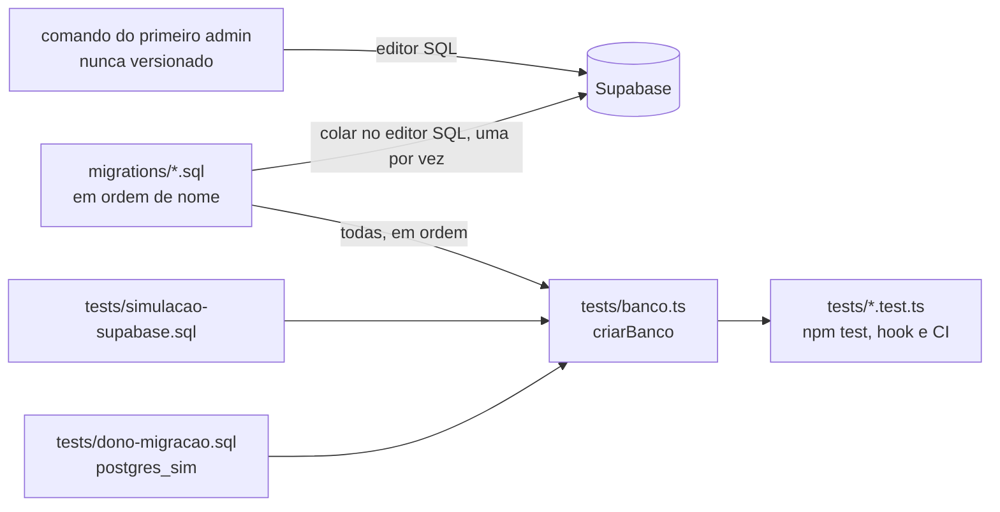

# supabase

## Cabeçalho

| Campo | Valor |
|---|---|
| Id | DIR-supabase |
| Título | `supabase` |
| Tipo | banco de dados · migrações e testes de RLS |
| Data | 2026-11-17 |
| Usuário responsável | TokumoH |
| Status | em construção |
| Commits | commit que introduz este arquivo — `git log --format=%h -- supabase/README.md` |
| Arquivos | `README.md`, `migrations/`, `tests/` |

## Propósito

Tudo o que é do banco Postgres do Supabase: as migrações versionadas (tipos, tabelas, funções, gatilho, RLS, dados iniciais, desde a E2, o bucket `midias` do Storage com as políticas de `storage.objects` e, desde a E3, o pareamento de dispositivos, o estado do episódio só por função e as políticas dos canais do Realtime em `realtime.messages`) e os testes que provam a RLS e as restrições sem precisar de conta nem de Docker. Este README também é o manual de aplicação: como levar as migrações ao projeto Supabase, sempre em ordem, como inserir (ou recuperar) o primeiro `admin`, como ligar o login Google (Supabase Auth, Google Cloud e Vercel; "Login Google (E1)", em "Lógica"), como ligar e conferir a Biblioteca no Storage ("Biblioteca no Storage (E2)", em "Lógica"), como ligar o ao vivo e o pareamento ("Ao vivo e pareamento (E3)", em "Lógica") e como ligar o celular como câmera ("Vídeo da câmera (E4)", em "Lógica").

## Origem

Criado na Tarefa 3 da etapa E0 ([PLA-001](../docs/planos/2026-11-17-e0-fundacao.md)), registro VER-010. Modelo de dados e segurança: [DES-001](../docs/desenho/2026-11-16-revocast-cameras-desenho.md), seções 7 e 8. Duas decisões do responsável (PLA-001, "Decisões sobre divergências do desenho", 1 e 2) mudaram o DES-001 (seções 7, 11 e 12, "ajustado no VER-010"):

1. A migração **não contém e-mail**: o primeiro `admin` é inserido à mão no editor SQL (comando abaixo), para que nenhum dado pessoal fique no repositório.
2. A migração fica no formato da Supabase CLI, mas na E0 é aplicada pelo **editor SQL**; os testes de RLS rodam em PGlite com uma simulação do Supabase.

## Organização

- `migrations/`: uma migração por arquivo, `AAAAMMDDHHMMSS_nome.sql` (formato da Supabase CLI). Migração já aplicada **nunca é editada**: correção vai numa migração nova.
- `tests/`: testes Vitest que carregam a simulação do Supabase e as migrações num Postgres em memória (PGlite); as migrações são aplicadas por um dono sem superusuário (`tests/dono-migracao.sql`), como no Supabase.
- Não há `config.toml` nem `.gitignore` da CLI: só nascem se a CLI for usada (ver "Exemplo"), e então entram neste README.

## Por que esta organização

- O formato da CLI deixa o caminho aberto para `supabase db push` sem obrigar ninguém a guardar a senha do banco agora.
- Testes em PGlite rodam no `npm test` (e, por ele, no hook `pre-push` e na CI), sem conta e sem Docker; localmente os três arquivos de teste (583 testes desde a E3; 523 na E2; 501 na E1; 493 na E0) levam cerca de 10 s (medido em 2026-11-21 com 4 núcleos, ainda com 493: `npx vitest run supabase/tests` em 7,3 a 9,7 s; 11,7 s com um worker só; com 501, 9,0 s em 2026-11-26), bem dentro do limite de 5 min do job da CI; a simulação é pequena e fica ao lado dos testes, longe das migrações (nunca é aplicada no Supabase).

## Por que não outras organizações

| Opção | Motivo de descarte |
|---|---|
| Aplicar pela Supabase CLI já na E0 | Exige `supabase login` e a senha do banco na sessão; o editor SQL faz o mesmo sem guardar segredo |
| Testes de RLS no Supabase real | Exigem conta e rede na CI e mexem em dados reais |
| Testes com o Supabase local (Docker) | Docker pesa no hook e consome minutos da CI |
| Primeiro `admin` na migração | Colocaria um e-mail real (dado pessoal) no repositório |
| Simulação dentro de `migrations/` | A CLI aplicaria a simulação no Supabase real |

## Onde

| Arquivo ou subdiretório | O que contém |
|---|---|
| [`README.md`](README.md) | Este arquivo |
| [`migrations/`](migrations/README.md) | Migrações SQL versionadas, aplicadas em ordem de nome (hoje, em ordem: `20261117000000_fundacao.sql`, `20261126142500_membros_sem_autoalteracao.sql`, `20261126190407_biblioteca_storage.sql`, `20261127124303_ao_vivo_e_pareamento.sql`, `20261127200000_episodio_em_teste_nao_se_apaga.sql`, `20261127220000_estado_do_palco_em_topico_proprio.sql` e `20261127230000_video_da_camera.sql`, da E4, aplicada pelo guia "Vídeo da câmera (E4)", em "Lógica") |
| [`tests/`](tests/README.md) | Simulação do Supabase, `banco.ts`, testes de RLS e de restrições e a matriz de permissões papel × tabela × operação do DES-001 (seção 8) |

## Lógica



1. **Aplicar as migrações (editor SQL, caminho da E0 à E4), sempre em ordem de nome e cada uma uma vez só:** no painel do Supabase, abrir *SQL Editor*, colar o conteúdo inteiro de [`migrations/20261117000000_fundacao.sql`](migrations/20261117000000_fundacao.sql) e executar; depois, numa nova consulta, o de [`migrations/20261126142500_membros_sem_autoalteracao.sql`](migrations/20261126142500_membros_sem_autoalteracao.sql) (E1, decisão D1 do PLA-002: nenhum `admin` altera nem remove a própria linha). Depois, numa nova consulta, o de [`migrations/20261126190407_biblioteca_storage.sql`](migrations/20261126190407_biblioteca_storage.sql) (E2, decisões D3 a D5 do [PLA-003](../docs/planos/2026-11-26-e2-preparar-episodio.md): bucket privado `midias`, 50 MB por arquivo, só os 8 tipos de som e imagem, e as políticas de `storage.objects`); aplicá-la é passo pendente do responsável, com a conferência descrita em "Biblioteca no Storage (E2)", abaixo. Depois, numa nova consulta, o de [`migrations/20261127124303_ao_vivo_e_pareamento.sql`](migrations/20261127124303_ao_vivo_e_pareamento.sql) (E3, decisões D2 e D4 a D7 do [PLA-004](../docs/planos/2026-11-27-e3-ao-vivo-por-toque.md): pareamento de dispositivos com código guardado só em hash, revogação, episódio ativo, estado do episódio e modo teste só por função e as duas políticas dos canais privados em `realtime.messages`); aplicá-la é passo pendente do responsável, com o login anônimo e o Realtime configurados e a conferência real em "Ao vivo e pareamento (E3)", abaixo. Depois, numa nova consulta, o de [`migrations/20261127200000_episodio_em_teste_nao_se_apaga.sql`](migrations/20261127200000_episodio_em_teste_nao_se_apaga.sql) (correção da revisão final da E3, [VER-046](../docs/verificacoes/2026-11-27-046-e3-correcoes-revisao-final.md), I3: o episódio do modo teste não se apaga). Depois, numa nova consulta, o de [`migrations/20261127220000_estado_do_palco_em_topico_proprio.sql`](migrations/20261127220000_estado_do_palco_em_topico_proprio.sql) ([VER-047](../docs/verificacoes/2026-11-27-047-e3-estado-em-topico-proprio.md), I4: o estado do palco num tópico próprio, comandos só de membros e um palco ativo só). Depois, numa nova consulta, o de [`migrations/20261127230000_video_da_camera.sql`](migrations/20261127230000_video_da_camera.sql) (E4, [VER-050](../docs/verificacoes/2026-11-27-050-e4-banco-video.md): a função `enviar_sinal_de_video`, o tópico de vídeo da própria sessão em `pode_usar_canal` e um `obs_camera` ativo só), com a contagem antes e a conferência de "Vídeo da câmera (E4)", abaixo. Quem já aplicou a de fundação aplica só as seguintes, na mesma ordem; quem já aplicou as duas primeiras aplica só da terceira à sétima; quem já aplicou as três, só da quarta à sétima; quem já aplicou as quatro, só da quinta à sétima; quem já aplicou as cinco, só a sexta e a sétima; quem já aplicou as seis, só a sétima (aplicar a segunda é passo pendente do responsável desde a Tarefa 6 do PLA-002, passo 1 de "Login Google (E1)", abaixo). Não exige a senha do banco nem login da CLI.
2. **Inserir o primeiro `admin`** (uma vez, no editor SQL, trocando `<e-mail>` pelo e-mail Google do responsável; o comando preenchido nunca é salvo no repositório):

   ```sql
   insert into public.membros_permitidos (email, papel) values (lower('<e-mail>'), 'admin');
   ```

   Os demais membros são adicionados pelo próprio `admin` (aba Membros, E1).

   **Recuperação do último `admin`:** nenhum `admin` altera nem remove a própria linha (segunda migração), então sempre sobra um no uso normal; só dois admins que se removem um ao outro no mesmo instante podem zerar os admins. Nesse caso, o dono roda no editor SQL o mesmo comando acima (se o e-mail saiu da lista) ou, se o e-mail ainda está na lista com outro papel, `update public.membros_permitidos set papel = 'admin' where email = lower('<e-mail>');` (também nunca salvo preenchido).
3. **Testar localmente:** `npx vitest run supabase/tests` (também roda dentro do `npm test`).

### Login Google (E1)

Passo do responsável para ligar o login de verdade (Tarefa 6 do [PLA-002](../docs/planos/2026-11-26-e1-entrada-e-membros.md); nenhum agente consegue fazer). Os nomes de menu são os do painel em 2026-11 e podem mudar; `<ref>` é o identificador do projeto Supabase e `<domínio da Vercel>` o domínio de produção do app. Nenhum e-mail, chave ou domínio real entra neste repositório. Em ordem:

1. **Banco (editor SQL), nesta ordem:** se a E0 ainda estiver pendente, aplicar [`migrations/20261117000000_fundacao.sql`](migrations/20261117000000_fundacao.sql) e rodar o comando do primeiro `admin` (passo 2 acima) com o próprio e-mail Google; depois, numa nova consulta, colar inteira e rodar [`migrations/20261126142500_membros_sem_autoalteracao.sql`](migrations/20261126142500_membros_sem_autoalteracao.sql). Conferir em *Authentication → Policies* (ou *Database → Policies*) que `membros_permitidos` tem quatro políticas e que as de update e delete trazem a condição `email <> (select lower(auth.jwt() ->> 'email'))`.
2. **Google Cloud Console** (sem faturamento), em *APIs e serviços → Tela de consentimento OAuth* (no console novo, *Google Auth Platform*: *Branding*, *Audience*, *Data Access (Scopes)*, *Clients*):
   - tipo de usuário **Externo**; escopos `openid`, `email` e `profile` (não sensíveis);
   - **Domínios autorizados:** `<ref>.supabase.co` e `<domínio da Vercel>`;
   - **publicar em produção** (em "Teste" só entram os usuários de teste cadastrados); enviar um logotipo pode exigir a verificação da marca pelo Google, então ele é opcional;
   - *Credenciais → Criar ID do cliente OAuth → Aplicativo da Web*: em **Origens JavaScript autorizadas**, `https://<domínio da Vercel>` e `http://localhost:5173` (dispensáveis, porque o retorno passa pelo Supabase, mas inofensivas); em **URIs de redirecionamento autorizados**, **só** `https://<ref>.supabase.co/auth/v1/callback` (quem volta do Google é o Supabase, não o app);
   - guardar o ID e a chave secreta do cliente só para o passo 3: a chave secreta nunca vai para o repositório nem para a Vercel.
3. **Supabase → Authentication → Sign In / Providers** (na documentação, *Authentication → Providers → Google*): **Google** ligado, com o ID e a chave secreta do cliente; provedor **Email desligado** (vem ligado); **"Confirm email" ligado** (só tem efeito se o provedor Email for religado; fica ligado como pede o DES-001 §12); **vinculação manual de identidades desligada** (assim uma sessão anônima não se apropria do e-mail de um membro); login anônimo pode ficar desligado até a E3 (decisão D5 do PLA-002; se já estiver ligado, nada quebra).
4. **Supabase → Authentication → URL Configuration:** **Site URL** `https://<domínio da Vercel>`; **Redirect URLs** só `https://<domínio da Vercel>/**`, `http://localhost:5173/**` (desenvolvimento) e `http://localhost:4173/**` (prévia local, `npm run preview`), como no DES-001 §12. O `/**` é curinga de **caminho** (o login volta a `/painel`, `/controle` ou `/entrar`); **nenhum curinga de host**, como `https://*-<time>.vercel.app/**`:
   - por quê: qualquer pessoa cria na Vercel um projeto `x-<time>`, cujo domínio casa com o padrão, começa ela mesma o login com o próprio `code_challenge` e manda o link a um membro; o Supabase devolve o código ao domínio dela (que está na lista), que tem o verificador PKCE, e ela troca o código pela sessão do membro (de um `admin`, inclusive). O PKCE não protege um fluxo começado pelo atacante;
   - para testar o login num deploy de prévia, acrescentar a URL **exata** daquela prévia (`https://<url exata da prévia>/**`), testar e **tirá-la depois**;
   - um endereço fora da lista faz o retorno cair na Site URL (produção), mesmo em desenvolvimento.
5. **Supabase → validade do token de acesso (JWT): 10 min** (600 s; DES-001 §8, Revogação). Pela documentação do Supabase (guia de sessões), fica em *Authentication → Settings → Sessions*; em painéis mais antigos, nas configurações de JWT do projeto (*Project Settings → JWT Keys* ou *Settings → API → JWT Settings*). **Realtime:** acesso público desligado (*Realtime → Settings*); pode esperar a E3, quando os canais entram.
6. **Vercel → Settings → Environment Variables**, em **Production** e **Preview**: `VITE_SUPABASE_URL` (só a origem, `https://<ref>.supabase.co`) e `VITE_SUPABASE_PUBLISHABLE_KEY` (a chave publicável `sb_publishable_...`; nunca a `sb_secret_...`, que o app recusa). Fazer um **novo deploy**: as variáveis entram no build (sem elas, `/entrar`, `/painel` e `/controle` mostram "Configuração incompleta").
7. **Conferência real** (anotar o resultado para o registro seguinte em `docs/verificacoes/`):
   - entrar em `/entrar` com a conta do primeiro `admin` → vai para `/painel` com a aba **Membros**; a própria linha aparece como "Você", sem controles (o `admin` não altera nem remove a si mesmo; no banco, a política da segunda migração);
   - incluir uma segunda conta Google sua como `equipe`; entrar com ela em outro navegador → `/painel` sem a aba Membros;
   - trocar o papel dela para `apresentadora` e voltar à aba do outro navegador → "Sem acesso a esta página" com o link para `/controle`;
   - remover a conta e voltar à aba → "Acesso não liberado";
   - entrar com uma conta fora da lista → "Acesso não liberado" com o e-mail dela;
   - cancelar a tela do Google → "O login com o Google foi cancelado."

### Biblioteca no Storage (E2)

Passo do responsável para ligar a Biblioteca de verdade (Tarefa 8 do [PLA-003](../docs/planos/2026-11-26-e2-preparar-episodio.md); nenhum agente consegue fazer). Mesmas convenções do guia anterior: `<ref>` e `<domínio da Vercel>` são marcadores, nomes de menu de 2026-11, e nenhum e-mail, chave ou domínio real entra neste repositório. Em ordem:

1. **Pendências anteriores:** se ainda não feitos, a migração de fundação, o primeiro `admin` (passo 2 acima), a migração `membros_sem_autoalteracao` e a configuração do login (passos 1 a 6 de "Login Google (E1)"). Sem login real, a Biblioteca não tem quem envie.
2. **Banco (editor SQL):** numa nova consulta, colar inteira e rodar [`migrations/20261126190407_biblioteca_storage.sql`](migrations/20261126190407_biblioteca_storage.sql), **depois** das duas anteriores (`20261117000000_fundacao.sql` e `20261126142500_membros_sem_autoalteracao.sql`, nessa ordem; quem já aplicou as duas aplica só esta). Se o editor recusar com `must be owner of table objects` ou qualquer outro erro `42501` (*permission denied*), **não contornar** (não desligar RLS, não trocar de papel, não criar as políticas por outro caminho): anotar a mensagem exata para o registro seguinte em `docs/verificacoes/`. A simulação dos testes supõe que o `postgres` do projeto cria políticas em `storage.objects` pela extensão `supautils` (`policy_grants`) sem ser dono da tabela (D13 do PLA-003, VER-025); se o projeto real negar, as políticas passam a ser criadas em *Storage → Policies* com o mesmo texto, decisão de um item próprio. Se a execução parar no meio (erro depois de parte do arquivo), **não** rode o arquivo de novo às cegas: rode antes as consultas do passo 3 para ver o que ficou e anote o resultado.
3. **Conferência por consulta (editor SQL):**

   ```sql
   select id, public, file_size_limit, allowed_mime_types from storage.buckets where id = 'midias';
   select policyname, cmd, roles from pg_policies where schemaname = 'storage' and tablename = 'objects';
   ```

   - a primeira devolve uma linha: `public` = `false`, `file_size_limit` = `52428800` e os 8 tipos `audio/mpeg`, `audio/wav`, `audio/ogg`, `audio/mp4`, `image/png`, `image/jpeg`, `image/webp` e `image/gif` (nenhum `image/svg+xml`);
   - a segunda devolve as três políticas `midias_storage_le` (`SELECT`), `midias_storage_insere` (`INSERT`) e `midias_storage_apaga` (`DELETE`), todas com `roles` = `{authenticated}` e **nenhuma** de `UPDATE` ou `ALL`. Se aparecerem outras políticas em `storage.objects` (por exemplo, criadas antes pelo painel), anotar os nomes e não apagar sem decisão: as permissivas se somam por OR e podem abrir o bucket;
   - em *Storage*, o bucket `midias` aparece como **privado** (sem "Public"). Não criar políticas pelo painel nem marcar o bucket como público.
4. **Por que é assim (D3 a D5 do PLA-003):**

   | Decisão | O que vale | Por quê |
   |---|---|---|
   | D3, políticas | lê: `equipe`, `admin` e o dispositivo `obs_palco`; envia: `equipe` e `admin`, só no caminho `som/<uuid>.<mp3, wav, ogg ou m4a>` ou `imagem/<uuid>.<png, jpg, webp ou gif>`; apaga: `equipe` e `admin`; `apresentadora`, contas fora da lista, sessões anônimas sem dispositivo e `anon` não leem nem escrevem | a `apresentadora` vê os avisos no palco, não a Biblioteca (DES-001 §8); o caminho gerado pelo app nunca leva o nome do arquivo do computador, que fica só em `midias.nome` |
   | D4, tipos | detectados pelos primeiros bytes no app, conferidos de novo pelo bucket (`allowed_mime_types`, 50 MB) e pela extensão na política de envio; sem SVG, HTML, PDF nem vídeo | SVG e HTML carregam script; o servidor confia no `Content-Type` declarado, então a conferência pelos bytes fica no app e o bucket é privado |
   | D5, sem sobrescrita | cada envio tem um `uuid` novo; trocar um som é enviar outro e excluir o antigo; não há política de `update` | o *upsert* exigiria `update`; um envio nunca troca o arquivo que outra tela está tocando |

5. **Nada de dado pessoal:** não enviar à Biblioteca fotos de pessoas sem autorização delas, nem documentos; para a conferência, usar sons e imagens genéricos.
6. **Conferência real** (anotar o resultado para o registro seguinte em `docs/verificacoes/`), em `https://<domínio da Vercel>/painel`. Ela cobre `equipe` e `apresentadora`; `admin` tem o mesmo acesso de `equipe` à Biblioteca (D3), e a leitura pelo `obs_palco` só pode ser conferida na E3; a recusa da `apresentadora` aparece na tela (a conferência direta da política de leitura é a consulta do passo 3 e os testes de banco):
   - com uma conta `equipe`, na aba **Biblioteca**, enviar um som (MP3) e uma imagem (PNG): a barra de progresso aparece e termina em "Arquivo enviado."; "Ouvir" toca o som e "Ver" mostra a imagem; o uso aparece em MB "de 1 GB";
   - recusas: um arquivo SVG (ou HTML) renomeado para `.png` → "Tipo não aceito." e nenhum envio; um arquivo acima de 50 MB → "Arquivo acima de 50 MB."; enviar um arquivo grande e clicar "Cancelar" no meio → "Envio cancelado." e, em *Storage → midias*, nenhum arquivo novo (o app remove de boa-fé o que tiver chegado);
   - na aba **Gestos**, "Ligar 👍 ao som aplauso" (com um som de rótulo "aplauso"); na **Biblioteca**, tentar excluir esse som → bloqueado ("Troque o gesto antes de excluir."); excluir a imagem de teste → some da lista e do *Storage* (se ela já estiver num aviso, a tela antes pede confirmação dizendo quantos avisos perdem a imagem);
   - na aba **Cenas**, criar uma cena com o nome **exato** de uma cena do OBS; na aba **Episódios**, criar um episódio com dois avisos (um com link `https://` e imagem);
   - em *Storage → midias*, os arquivos têm nomes `som/<uuid>.mp3` e `imagem/<uuid>.png`, nunca o nome do arquivo do computador;
   - com uma conta `apresentadora`, abrir `/painel` → "Sem acesso a esta página" (a aba Biblioteca não existe para ela; a política de leitura também a nega).
7. **O que só o projeto real confirma** (anotar no mesmo registro; nenhum foi conferido sem o Supabase):
   - **CORS do envio:** o envio usa `XMLHttpRequest` com os cabeçalhos `authorization`, `apikey`, `x-upsert`, `cache-control` e `content-type`. Se o envio falhar logo no início, abrir as ferramentas do navegador (F12), aba *Rede* (*Network*): um pedido `OPTIONS` ou `POST` para `https://<ref>.supabase.co/storage/v1/object/midias/...` marcado como erro de CORS indica cabeçalho recusado; anotar o pedido e a mensagem do *Console* (sem copiar o token do cabeçalho `authorization`);
   - **corpo de erro:** o app lê o `statusCode` (texto) do corpo JSON do Storage antes do status HTTP. Numa recusa (por exemplo, a mensagem "A biblioteca ou o seu papel mudou" ou "Não foi possível concluir" ao enviar com uma conta `equipe`), anotar, na aba *Rede*, o status HTTP e os campos `statusCode` e `error` da resposta (não a mensagem inteira, se ela trouxer dados);
   - **JWT expirado:** deixar a aba aberta além da validade do token (10 min, passo 5 do guia anterior) com o computador suspenso e enviar um arquivo ao voltar. O esperado é o app renovar a sessão antes do envio; se aparecer "Não foi possível concluir" ou "A biblioteca ou o seu papel mudou", anotar o status e o `error` da resposta (por exemplo, `InvalidJWT`): na conferência com o Storage simulado (VER-031), `InvalidJWT` com `statusCode` "400" vira "Não foi possível concluir", com "403" vira "A biblioteca ou o seu papel mudou", e só um 401 vira "A sessão expirou". Mapear `InvalidJWT` para sessão expirada é decisão de um item próprio.

### Ao vivo e pareamento (E3)

Passo do responsável para ligar o ao vivo por toque de verdade (Tarefa 10 do [PLA-004](../docs/planos/2026-11-27-e3-ao-vivo-por-toque.md); nenhum agente consegue fazer). Mesmas convenções dos guias anteriores: `<ref>` e `<domínio da Vercel>` são marcadores, nomes de menu de 2026-11 (podem mudar), e nenhum e-mail, chave, senha ou domínio real entra neste repositório. Em ordem:

1. **Pendências anteriores:** se ainda não feitos, as três migrações anteriores, o primeiro `admin` (passo 2 acima), o login Google ("Login Google (E1)", passos 1 a 6) e a Biblioteca ("Biblioteca no Storage (E2)", passos 2 e 3). Sem eles, não há membro para gerar o link nem som e imagem para o palco.
2. **Banco (editor SQL):** numa nova consulta, colar inteira e rodar [`migrations/20261127124303_ao_vivo_e_pareamento.sql`](migrations/20261127124303_ao_vivo_e_pareamento.sql), **depois** das três anteriores. Se o editor recusar as políticas de `realtime.messages` com `42501` ou `must be owner of table messages`, **não contornar** (não desligar RLS, não trocar de papel, não criar as políticas pelo painel): anotar a mensagem exata para o registro seguinte em `docs/verificacoes/` (a Tarefa 2 do PLA-004 previu esse caminho). Se a execução parar no meio, rodar antes as consultas do passo 3 e anotar o que ficou. Depois, numa nova consulta, colar inteira e rodar [`migrations/20261127200000_episodio_em_teste_nao_se_apaga.sql`](migrations/20261127200000_episodio_em_teste_nao_se_apaga.sql) (VER-046, I3: troca a chave estrangeira `estudio_estado.episodio_teste_id` de `on delete set null` para `no action` e recria a política de `delete` de `episodios`; o rascunho do modo teste não se apaga, nem pela API nem pelo dono: o `delete` direto dele no editor SQL passa a dar `23503`, e é preciso sair do teste antes). Por último, **com o palco fechado** (Fonte do palco removida ou OBS fechado: um palco conectado antes da migração guarda no socket o envio em `:controle` até a renovação do token, até 10 min; VER-047, Riscos), numa nova consulta, rodar `select count(*) from public.dispositivos where tipo = 'obs_palco' and revogado_em is null;` (tem de dar 0 ou 1; com 2 ou mais, rodar antes as duas consultas abaixo, no mesmo editor SQL, que roda como o dono `postgres` (pela documentação da Supabase; se der `permission denied`, parar e anotar a mensagem): a aba Ao vivo não mostra "revogar" para palco nunca pareado, e `revogar_dispositivo` no editor dá `42501` por não haver papel de membro) e colar inteira e rodar [`migrations/20261127220000_estado_do_palco_em_topico_proprio.sql`](migrations/20261127220000_estado_do_palco_em_topico_proprio.sql) (VER-047: reescreve `pode_usar_canal` — o palco só recebe em `:controle` e publica o estado em `episodio:<ativo>:estado` — e cria o índice `dispositivos_um_palco_ativo`; se o banco tiver dois palcos ativos, ela para com `23505` sem mudar nada). As duas consultas para dois ou mais palcos ativos (deixam ativo só o pareado por último e apagam os códigos pendentes dos revogados; o teste `e3-guia-revoga-o-palco-que-sobra` roda exatamente estas):

   ```sql
   update public.dispositivos set revogado_em = now()
     where tipo = 'obs_palco' and revogado_em is null
       and id <> (select d.id from public.dispositivos d where d.tipo = 'obs_palco' and d.revogado_em is null order by d.pareado_em desc nulls last limit 1);
   delete from public.codigos_pareamento c using public.dispositivos d
     where d.id = c.dispositivo_id and d.tipo = 'obs_palco' and d.revogado_em is not null and c.usado_em is null;
   ```

   Depois da sexta migração, o app desta versão usa os dois tópicos: aplicar antes de publicar o app na Vercel (sem ela, o palco não consegue publicar em `:estado` e o `/controle` fica sem estado).
3. **Conferência por consulta (editor SQL):**

   ```sql
   select policyname, cmd, roles from pg_policies where schemaname = 'realtime' and tablename = 'messages';
   select has_table_privilege('authenticated', 'public.codigos_pareamento', 'select');
   select proname from pg_proc where pronamespace = 'public'::regnamespace and proname in ('criar_codigo_pareamento', 'parear_dispositivo', 'revogar_dispositivo', 'episodio_ativo', 'iniciar_ao_vivo', 'encerrar_ao_vivo', 'definir_modo_teste', 'pode_usar_canal', 'meu_dispositivo');
   select indexname from pg_indexes where schemaname = 'public' and indexname = 'dispositivos_um_palco_ativo';
   select position(':estado' in pg_get_functiondef('public.pode_usar_canal(text, text, boolean)'::regprocedure)) > 0 as tem_estado;
   ```

   - a primeira devolve **só** `canal_recebe` (`SELECT`) e `canal_envia` (`INSERT`), ambas com `roles` = `{authenticated}`. Outra política em `realtime.messages` (por exemplo, criada antes pelo painel) se soma por OR e pode abrir os canais: anotar o nome e não apagar sem decisão;
   - a segunda devolve `false` (o código de pareamento só é lido pelas funções);
   - a terceira devolve **9 linhas**;
   - a quarta devolve `dispositivos_um_palco_ativo` e a quinta, `true` (sexta migração, VER-047; a matriz do canal está no passo 7).
4. **Supabase → Authentication:** ligar **"Allow anonymous sign-ins"** (em *Sign In / Providers*; é por ele que o palco e a câmera entram, D4); em *Rate Limits*, manter (ou reduzir) o limite de logins anônimos por hora por IP; continuar com o provedor **Email desligado**, **"Confirm email" ligado** e a **vinculação manual de identidades desligada**; validade do token de acesso (JWT) em **10 min** (passo 5 de "Login Google (E1)"; DES-001 §8).
5. **Supabase → Realtime → Settings:** desligar **"Allow public access"** (só canais privados, D6).
6. **OBS** (Windows e, se possível, macOS e Linux; DES-001 §15), versão **30.2 ou mais nova**, **com transmissão, gravação, Replay Buffer e câmera virtual parados**:
   - Replay Buffer configurado (60 s, sem iniciar) e gravação em **Hybrid MP4** (sem iniciar); servidor WebSocket ligado (porta 4455, com senha);
   - na aba **Ao vivo** do painel, "Link do palco (OBS)" → criar uma **Fonte de navegador** com a URL colada; **"Page permissions": Advanced access to OBS**; **"Control audio via OBS"** marcado; **"Shutdown source when not visible"** desmarcado; a mesma Fonte em **todas as cenas, por referência** (colar como referência, não como cópia);
   - **primeiro**, no "Interagir" da Fonte: tecla `c`, senha do WebSocket, "Salvar". O painel de configuração recusa abrir com qualquer saída ligada, inclusive o Replay Buffer (D10), e o selo da tecla `s` também; ele avisa no topo que aparece na transmissão e fecha sozinho em 2 min;
   - **depois**, iniciar o Replay Buffer e a gravação: o clipe exige o Replay Buffer ativo e o marcador, a gravação em andamento;
   - **reserva do marcador:** um atalho de teclado do OBS para o capítulo (DES-001 §15), se o obs-websocket não conectar pela Fonte (ver o Risco do navegador embutido, abaixo).
7. **Por que é assim (D2, D6 e D7 do PLA-004):**

   | Decisão | O que vale | Por quê |
   |---|---|---|
   | D2, código de pareamento | 244 bits aleatórios do Postgres (`gen_random_uuid` duas vezes), 43 caracteres no fragmento (`#`) do link ou do QR, de uso único, válido por 2 min e guardado só como hash SHA-256; 5 tentativas falhas em 10 min na mesma sessão anônima → `limite`; código de outro tipo responde "outro tipo de dispositivo" sem ser consumido | o código não é digitado, então a força vem da entropia; o fragmento não vai a servidor nenhum e sai da barra antes de qualquer pedido |
   | D6, canais | duas políticas fixas em `realtime.messages` chamam `public.pode_usar_canal(tópico, extensão, enviar)`: em `estudio` recebem todo membro e todo dispositivo não revogado e publicam só `equipe`/`admin`; em `episodio:<ativo>:controle` recebem os membros e o palco, e só os membros publicam (comandos) e marcam presença; em `episodio:<ativo>:estado` (desde o VER-047) só o palco publica (o estado no ar) e membros e o palco recebem; `:video`, outro episódio e qualquer outro tópico, ninguém; um `obs_palco` não revogado só (índice `dispositivos_um_palco_ativo`) | a matriz inteira fica numa função testada caso a caso; a interface nunca decide acesso a canal; o Realtime autoriza o envio por tópico, não por evento (VER-046), por isso comando e estado têm tópicos diferentes |
   | D7, estado do episódio | `iniciar_ao_vivo`, `encerrar_ao_vivo` e `definir_modo_teste` (só `equipe`/`admin`); `episodios` só aceita, pela API, `insert` de título, data e `criado_por` e `update` de título e data; `estudio_estado` fica só leitura; só rascunho pode ser apagado, e nunca o do modo teste (quinta migração, VER-046 I3: sai-se do teste antes) | fecha o "equipe muda `estado` pela API" da E2; dois ao vivo são recusados pelo índice único |

8. **Nada de dado pessoal:** rótulos de dispositivo genéricos ("PC do estúdio", "Celular de gravação"); avisos de teste sem dados de pessoas.
9. **Conferência real** (anotar o resultado para o registro seguinte em `docs/verificacoes/`):
   - parear o palco pela Fonte; na aba Ao vivo, o palco "Conectado" e o checklist todo marcado (OBS detectado, nível Avançado, obs-websocket conectado, versão do OBS, Replay Buffer ativo, gravação em andamento);
   - modo teste com um rascunho; num celular Android e num **iPhone (Safari)**, abrir `/controle` com contas `apresentadora` e `equipe`; tocar cena, som, aviso, clipe (o arquivo aparece na pasta do Replay Buffer depois de ~5 s) e marcador (capítulo no MP4);
   - bloquear e desbloquear o iPhone e tocar de novo (o `/controle` reconecta ao voltar);
   - iniciar e encerrar o ao vivo; **parar a transmissão, a gravação, o Replay Buffer e a câmera virtual** e só então revogar o palco e conferir que ele para ("Este dispositivo foi revogado" aparece na Fonte); com alguma saída ligada (ou o status do OBS desconhecido), a revogação e a troca do aparelho deixam a Fonte **vazia** (transparente), sem nada na transmissão nem nos clipes (D16; VER-046, I1); parear de novo; remover da lista um membro com o `/controle` aberto e conferir que ele perde o acesso;
   - com o modo teste ligado, criar um aviso (ou corrigir o texto de um) na aba Episódios, voltar à aba Ao vivo e tocá-lo: o palco relê as listas e mostra o aviso novo (VER-046, I2); trocar a cena à mão no OBS e conferir que o `/controle` mostra a cena nova e que "Próxima cena" parte dela (VER-044 A1); tentar excluir o rascunho do modo teste na aba Episódios: "Saia do modo teste antes de apagar." (VER-046, I3);
   - com o palco pareado, gerar de novo o "Link do palco (OBS)" e conferir que a aba reaproveita o palco cadastrado (a contagem de palcos ativos do passo 2 continua 1); conferir que o `/controle` mostra a cena e o último resultado (o estado chega pelo `:estado`, VER-047);
   - anotar também se o obs-websocket conectou pela Fonte (o checklist diz "obs-websocket conectado") e se o som tocou sem clicar na Fonte.
10. **Limpeza opcional** (sessões anônimas sem dispositivo, de pareamentos recusados, acumulam em `auth.users`), rodada à mão de tempos em tempos; primeiro contar, depois apagar:

    ```sql
    select count(*) from auth.users u where u.is_anonymous and u.created_at < now() - interval '1 day' and not exists (select 1 from public.dispositivos d where d.usuario_anonimo_id = u.id);
    delete from auth.users u where u.is_anonymous and u.created_at < now() - interval '1 day' and not exists (select 1 from public.dispositivos d where d.usuario_anonimo_id = u.id);
    ```

    A sessão de um dispositivo (mesmo revogado, que guarda a sessão para o aviso e a auditoria) não é apagada; as tentativas de pareamento da sessão apagada saem junto (chave estrangeira com `on delete cascade`).

### Vídeo da câmera (E4)

Passo do responsável para ligar o celular como câmera de verdade (Tarefa 7 do [PLA-005](../docs/planos/2026-11-27-e4-celular-como-camera.md), registro [VER-055](../docs/verificacoes/2026-11-28-055-e4-conferencia-e-guia.md); nenhum agente consegue fazer). A seção nasceu na Tarefa 2 ([VER-050](../docs/verificacoes/2026-11-27-050-e4-banco-video.md)) com as consultas que os testes de banco leem daqui (`e4-guia-conta-obs-cameras` e `e4-guia-limpa-sinais-antigos`, passos 2 e 10). Mesmas convenções dos guias anteriores: `<ref>` e `<domínio da Vercel>` são marcadores, nomes de menu de 2026-11 (podem mudar), e nenhum e-mail, chave, senha ou domínio real entra neste repositório. Em ordem:

1. **Pendências anteriores:** se ainda não feitas, as seis migrações anteriores e o guia "Ao vivo e pareamento (E3)", inclusive **"Allow anonymous sign-ins"** ligado, **"Allow public access"** do Realtime desligado e a validade do token de acesso (JWT) em **10 min** (passos 4 e 5 daquele guia). Sem eles, a câmera e o `/obs/camera` não pareiam nem entram nos canais.
2. **Banco (editor SQL), antes de publicar o build da E4 na Vercel:** o app desta versão abre o tópico de vídeo e chama `enviar_sinal_de_video`; sem a sétima migração, a entrada no tópico é negada e a `rpc` não existe (revisão 1 do PLA-005, I1). Antes de aplicar [`migrations/20261127230000_video_da_camera.sql`](migrations/20261127230000_video_da_camera.sql) (depois da sexta, [`migrations/20261127220000_estado_do_palco_em_topico_proprio.sql`](migrations/20261127220000_estado_do_palco_em_topico_proprio.sql)), no editor SQL, contar os `obs_camera` não revogados; a migração cria o índice `dispositivos_um_obs_camera_ativo` (no máximo um no banco: um único par câmera ↔ `obs_camera` sinaliza) e para com `23505`, sem mudar nada, se houver dois ou mais:

   ```sql
   select count(*) from public.dispositivos where tipo = 'obs_camera' and revogado_em is null;
   ```

   Com 2 ou mais, rodar antes as duas consultas abaixo, no mesmo editor SQL, que roda como o dono `postgres` (como as do palco no guia da E3; se der `permission denied`, parar e anotar a mensagem): deixam ativo só o `obs_camera` pareado por último e apagam os códigos pendentes dos revogados (parear com um deles limparia `revogado_em`). Quem preferir pela tela revoga na aba **Ao vivo** os que sobram, mas a aba só mostra "Revogar" para os já pareados: um `obs_camera` nunca pareado (código gerado e não usado) não sai pela aba e continua contando no índice, e para ele valem só as consultas abaixo. Em qualquer caso, **contar de novo** antes de aplicar a migração (tem de dar 0 ou 1):

   ```sql
   update public.dispositivos set revogado_em = now()
     where tipo = 'obs_camera' and revogado_em is null
       and id <> (select d.id from public.dispositivos d where d.tipo = 'obs_camera' and d.revogado_em is null order by d.pareado_em desc nulls last limit 1);
   delete from public.codigos_pareamento c using public.dispositivos d
     where d.id = c.dispositivo_id and d.tipo = 'obs_camera' and d.revogado_em is not null and c.usado_em is null;
   ```

   Depois, numa nova consulta, colar inteira e rodar a sétima migração. Se o editor recusar (por exemplo, `42501` *permission denied*, `must be owner of table messages` ou `23505` no índice, se sobrou mais de um `obs_camera` ativo), **não contornar** (não desligar RLS, não trocar de papel, não criar a função ou as políticas por outro caminho): anotar a mensagem exata para o registro seguinte em `docs/verificacoes/`. Se a execução parar no meio, rodar antes as consultas do passo 3 e anotar o que ficou.
3. **Conferência por consulta (editor SQL):**

   ```sql
   select indexname from pg_indexes where schemaname = 'public' and indexname = 'dispositivos_um_obs_camera_ativo';
   select policyname from pg_policies where schemaname = 'realtime' and tablename = 'messages';
   select count(*) from pg_proc where pronamespace = 'public'::regnamespace and proname in ('pode_usar_canal', 'enviar_sinal_de_video');
   select has_function_privilege('anon', 'public.enviar_sinal_de_video(text, uuid, text)', 'execute');
   ```

   - a primeira devolve **1 linha**;
   - a segunda devolve as mesmas duas de antes, **só** `canal_recebe` e `canal_envia` (a migração não cria política: a matriz nova mora em `pode_usar_canal`, recriada com o mesmo nome);
   - a terceira devolve **2**;
   - a quarta devolve **`false`** (só `authenticated` executa a função).

   Depois, em *Project Settings → Data API* (em painéis novos, *Integrations → Data API*), conferir que **`realtime` não está** entre os *Exposed schemas* (o padrão é só `public` e `graphql_public`): os sinais com IP ficam em `realtime.messages`, e a política de leitura dessa tabela decide pelo tópico da sessão do Realtime, não pela coluna `topic` da linha (VER-050, N4); fora dos schemas expostos, o PostgREST não a lê. Se `realtime` estiver lá, tirar e anotar. Só então **publicar o build da E4** na Vercel (novo deploy).
4. **Nada de cartão:** sem TURN (o padrão; só o STUN público `stun:stun.l.google.com:19302`). Se a rede real impedir a conexão direta (passo 7) e o responsável quiser o TURN gratuito do Metered Open Relay (F11 do PLA-005): criar a conta grátis **só se o cadastro não pedir cartão**; pôr `VITE_TURN_URL` (começando com `turn:` ou `turns:`), `VITE_TURN_USUARIO` e `VITE_TURN_SENHA` nas variáveis da Vercel (*Settings → Environment Variables*, em **Production** e **Preview**; **nunca** no repositório) e fazer um novo deploy. A credencial vai ao navegador e fica pública por natureza: quem tiver a URL do app pode gastar a cota de 20 GB por mês.
5. **OBS** (Windows e, se possível, macOS e Linux; F10 do PLA-005), versão **30.2 ou mais nova**, com transmissão, gravação, Replay Buffer e câmera virtual **parados**:
   - na aba **Ao vivo** do painel, "Link da câmera do OBS" → criar uma **Fonte de navegador** com a URL colada (o link vale 2 min e é de uso único);
   - **"Page permissions": pelo menos "Read access to OBS status information"**: a guarda de saída (D8) precisa ler o status do OBS; com menos, a Fonte nunca mostra o selo nem as telas de erro (seguro, mas sem diagnóstico na Fonte; a aba Ao vivo continua mostrando a situação);
   - **"Shutdown source when not visible"** desmarcado; tamanho da Fonte igual ao da tela (por exemplo, 1920×1080): o vídeo fica em tela cheia, com `object-fit: contain` e fundo transparente;
   - criada **uma vez** e posta nas cenas **por referência** (colar como referência, não como cópia; DES-001 §10.4): duas cópias seriam duas sessões, e só um `obs_camera` fica ativo;
   - com tudo parado, no "Interagir" da Fonte, tecla `s`: o selo ("Pareado como …" e "Câmera do OBS · …") aparece e some em 5 s. Com qualquer saída ligada (inclusive o Replay Buffer), o selo não aparece (D8).
6. **Celular de gravação (Android e iPhone):**
   - na aba **Ao vivo**, "Parear câmera" mostra o QR; abri-lo pelo navegador padrão (Chrome no Android, Safari no iPhone), pelo endereço `https` (a câmera só funciona em contexto seguro);
   - **tocar** para ligar e permitir a câmera (a câmera nunca liga sozinha, nem ao recarregar a página; D7); conferir que é a câmera **traseira**, que a tela fica **preta** (nenhuma imagem fora da "Prévia", que some em 15 s) e o aviso da tela ligada;
   - sem Wake Lock (iOS abaixo de 16.4, ou pedido recusado), a página mostra as instruções (DES-001 §10.4, item 3): no iPhone, desligar o Modo de Pouca Energia e pôr o bloqueio automático em "Nunca"; no Android, desligar a economia de bateria e ativar "Permanecer ativo" com o celular no carregador; celular no **carregador** e no **tripé**.
7. **Rede:** celular e computador na **mesma rede Wi-Fi**. Se a rede da faculdade isolar os aparelhos (isolamento de clientes, F14), usar um roteador próprio ou o hotspot do computador (DES-001 §15). Anotar se a conexão direta funcionou com dados móveis no celular e Wi-Fi no computador (sem TURN, o esperado é a câmera mostrar "Sem conexão direta com o computador…" depois de duas tentativas, cerca de 1 minuto, e a aba Ao vivo, "sem conexão direta").
8. **Nada de dado pessoal:** rótulos de dispositivo genéricos ("Celular de gravação", "Câmera do OBS"); nenhuma gravação de teste com pessoas que não consentiram.
9. **Conferência real** (anotar o resultado para o registro seguinte em `docs/verificacoes/`):
   - modo teste → vídeo no OBS; iniciar o ao vivo → o vídeo **não** cai; bloquear e desbloquear a tela, trocar de app e voltar (o celular pede o Wake Lock de novo e religa a câmera), girar o celular (anotar a orientação no OBS);
   - revogar a câmera com a saída **parada** e conferir que o vídeo some no OBS e a câmera desliga ("Este dispositivo foi revogado"); parear de novo; encerrar o ao vivo → câmera desligada;
   - **entre revogar e parear de novo** ([VER-056](../docs/verificacoes/2026-11-28-056-e4-correcoes-revisao-final.md), I1): com o modo teste ou o ao vivo ligado, a Fonte do `/obs/camera` fica **sem vídeo** (transparente) até o novo pareamento, mesmo que o aviso de revogação não chegue a ela: quando o banco nega o tópico de vídeo, ela fecha a conexão com a câmera revogada na hora e tenta o tópico de novo em 5 s, 10 s, 20 s, 40 s e depois a cada 60 s, sem sair do `estudio` (na aba **Ao vivo**, o `obs_camera` continua conectado, com "aguardando o celular", sem piscar). Ao parear a câmera de novo, a aba avisa a sessão antiga no `estudio` e a Fonte tenta na hora (sem o aviso, na próxima tentativa, em até 60 s); o vídeo volta sem recarregar a Fonte. Anotar quanto tempo o vídeo levou para voltar;
   - **1 hora** de vídeo contínuo com o celular no carregador: anotar bateria, aquecimento e travadas; repetir com um **iPhone** (Safari: o gesto antes da câmera, F6; o Wake Lock, F7; o tamanho do SDP do Safari, que deve ficar abaixo de 12 000 caracteres, F21: se o vídeo nunca conectar e a câmera disser "sinal grande demais", anotar o modelo e a versão);
   - no celular, tocar a tela no meio de uma rolagem por inércia (com a frase ou as instruções na tela) e anotar o que acontece: no pior caso, o toque mostra o status ou repete o pedido da câmera, nunca a liga sem consentimento (VER-052);
   - anotar se a Fonte do OBS mostrou o vídeo (F10) e se o fundo ficou transparente sem o vídeo.
10. **Limpeza opcional:** a consulta das sessões anônimas sem dispositivo (passo 10 do guia da E3); e, para não guardar os IPs dos SDPs por até 4 dias (D2 e F18 do PLA-005), a limpeza dos sinais antigos. O `postgres` do editor SQL **não** é dono de `realtime.messages` nem tem `DELETE` nela (F17): um `delete` dá `42501`. Ele tem `UPDATE` e `BYPASSRLS`, e esta consulta apaga só o conteúdo dos sinais com mais de 1 hora (`inserted_at` é UTC sem fuso e não muda, então a linha fica na mesma partição e sai com ela na limpeza do Realtime; a publicação do Realtime só replica `insert`, F22, então o `update` não reenvia nada; um cliente que lesse a linha a descartaria, porque o leitor do domínio exige `sessao`):

    ```sql
    update realtime.messages set payload = jsonb_build_object('tipo', 'apagado') where topic like 'video:%' and inserted_at < timezone('utc', now()) - interval '1 hour';
    ```

    As linhas continuam até a limpeza das partições (até 4 dias), sem os IPs. Para conferir o espaço: `select count(*), pg_size_pretty(sum(pg_column_size(payload))) from realtime.messages where topic like 'video:%';`. Teto por desenho: cerca de 2,4 MB por hora e 230 MB em 4 dias por par de sessões câmera ↔ `obs_camera` (limite por remetente e um `obs_camera` ativo); cada repareamento troca uma sessão e recomeça a conta, então repareamentos seguidos somam; se a conta passar disso, revogar o dispositivo pela aba Ao vivo e anotar para o registro seguinte.

**Por que é assim (D2, D6, D7 e D9 do PLA-005):**

| Decisão | O que vale | Por quê |
|---|---|---|
| D2, sinalização | cada sinal (oferta, resposta, `pronto`, `encerrar`) sai por `rpc('enviar_sinal_de_video')`, que a cada chamada confere a sessão (`dispositivo_atual()`), exige episódio ativo e a câmera do par não revogada, confere o tipo pelo lado e a forma do SDP, põe o `remetente` no servidor e publica com `realtime.send` no tópico `video:<uid da sessão atual do par>`; nesse tópico só a própria sessão recebe, e **ninguém** envia pelo Broadcast; um `obs_camera` não revogado no banco inteiro; limite por remetente (`54000`): 10 sinais em 10 s, 600 por hora e 1 000 000 caracteres de SDP por hora | o Realtime autoriza por tópico (não por evento) e guarda a permissão por conexão até o token novo (VER-046): com envio pelo Broadcast, a sessão antiga de um aparelho trocado ou revogado continuaria trocando ou desviando o vídeo; com a função, ela recebe `42501` na hora, e as mensagens vão para o tópico da sessão nova. Custo: os SDPs, com endereços IP de rede, ficam em `realtime.messages` de 72 h a 4 dias (passo 10); teto de disco por desenho perto de 2,4 MB por hora e 230 MB em 4 dias por par de sessões (cada repareamento recomeça a conta) |
| D6, reconexão e falha da conexão direta | queda breve (`disconnected`): espera 5 s; falha, 15 s sem resposta ou 20 s sem conectar depois da resposta: nova oferta depois de 2, 4, 8, 16 e 30 s (depois, 30 s sempre); duas falhas seguidas depois de uma resposta → "sem conexão direta" na câmera, no selo e na aba | nada é reenviado em laço curto (no pior caso, uma oferta a cada 30 s); o ICE sem par pode ficar parado sem nunca ir a `failed`, por isso o prazo de 20 s |
| D7, tela preta e consentimento | a câmera só liga depois de um toque na própria página e desliga sem episódio ativo, na revogação, ao sair e ao parar; nenhuma imagem no celular fora da prévia, que some em 15 s; só vídeo (sem áudio), traseira, 720p30, até 2,5 Mbit/s | câmera ligada só com consentimento visível; a tela preta poupa bateria e não vaza imagem; o iPhone pode exigir o gesto (F6) |
| D9, sem TURN pago | só o STUN público; o TURN do Metered só se as três variáveis existirem (passo 4); nenhum servidor de mídia | sem serviço pago nem cartão (DES-001 §2); a reserva é física: mesma rede, roteador ou hotspot |

## Exemplo

Alternativa pela **Supabase CLI** (quando ela passar a ser usada):

1. `supabase login`.
2. `supabase init`, respondendo **"não"** às perguntas de gerar configurações do VS Code e do IntelliJ (senão nascem as pastas `.vscode/` ou `.idea/` rastreadas, sem README).
3. `supabase link --project-ref <ref>` (pede a senha do banco).
4. Só para as migrações já aplicadas pelo editor SQL (o editor não as registra em `supabase_migrations.schema_migrations`): `supabase migration repair --status applied <versão>` para cada uma, por exemplo `20261117000000`, `20261126142500`, `20261126190407`, `20261127124303`, `20261127200000`, `20261127220000` e `20261127230000` (exige o projeto ligado no passo 3).
5. `supabase db push`.
6. Antes do commit: apagar do `supabase/config.toml` gerado as duas linhas comentadas `admin_email` (são e-mails de exemplo que o `check-doc-secrets` acusa) e acrescentar `config.toml` e `.gitignore` em "Onde" e no campo "Arquivos" deste README.

## Verificação

- Links relativos, "Onde" e campo "Arquivos" conferidos por `npm run check-docs`; os dois subdiretórios têm README próprio.
- As migrações foram aplicadas em ordem e testadas em PGlite (Postgres 18.6) com a simulação: 642 testes desde o VER-050 (198 em `rls.test.ts`, 8 deles do bloco da E1, 22 do bloco da E2, 2 da simulação do Realtime, 63 do bloco da E3 e 48 do bloco da E4, dentro do da E3; 34 em `restricoes.test.ts`; e 410 em `matriz.test.ts`, que cobre as 396 células da matriz de permissões), com as migrações aplicadas por `postgres_sim`, um dono sem superusuário, como o `postgres` do Supabase; o que eles provam, o que só as checagens de banco cobrem e o que não tem teste está em [`migrations/README.md`](migrations/README.md), "Verificação"; detalhes e sabotagens nos registros VER-010 (fundação), VER-016 (segunda migração), VER-026 (terceira migração), VER-037 (quarta migração), VER-046 (quinta), VER-047 (sexta) e VER-050 (sétima).

## Riscos

- A segunda migração (`20261126142500_membros_sem_autoalteracao.sql`) também **não foi aplicada num Supabase real**: aplicá-la depois da de fundação é passo do responsável (Tarefa 6 do PLA-002, passo 1 de "Login Google (E1)"); até lá, no banco real um `admin` ainda consegue remover a própria linha. O limite da corrida de dois admins e a recuperação estão acima (passo 2 de "Lógica") e em [`migrations/README.md`](migrations/README.md).
- A terceira migração (`20261126190407_biblioteca_storage.sql`, E2) também **não foi aplicada num Supabase real**: aplicá-la depois das duas anteriores é passo do responsável (passo 1 de "Lógica"; guia "Biblioteca no Storage (E2)"). Até lá, o bucket `midias` não existe no projeto e os envios da Biblioteca falham. Se o bucket já tiver sido criado à mão pelo painel, o `on conflict` da migração o deixa privado e com os limites. A simulação do Storage, os limites que sobram (`Content-Type` declarado, objetos órfãos) e o que só o servidor do Storage aplica estão em [`migrations/README.md`](migrations/README.md) e [`tests/README.md`](tests/README.md).
- A sexta migração (`20261127220000_estado_do_palco_em_topico_proprio.sql`, VER-047) também não foi aplicada num Supabase real: aplicá-la depois da quinta é passo do responsável (passo 2 do guia "Ao vivo e pareamento (E3)"), antes de publicar o app desta versão. Até lá, no banco real o `obs_palco` ainda envia em `:controle` (o furo I4) e não envia em `:estado`, e o app desta versão fica sem estado no `/controle` e na aba Ao vivo. Aplicá-la com o palco conectado deixa uma janela: o Realtime guarda no socket do palco o envio em `:controle` obtido antes, e ele pode publicar comando ali até a renovação do token (até 10 min); por isso o guia manda aplicar com o palco fechado. Residual depois de aplicada: a sessão antiga de um palco re-pareado continua com o envio em `:estado` guardado pelo Realtime até a renovação do token (até 10 min); o `/controle` aceita o estado dela nesse tempo, exceto depois do aviso `revogacao` (descarte por 15 min).
- A sétima migração (`20261127230000_video_da_camera.sql`, VER-050) não foi aplicada num Supabase real: aplicá-la depois da sexta, antes de publicar o build da E4, é passo do responsável (passo 2 do guia "Vídeo da câmera (E4)", VER-055). Até lá, o app da E4 não abre o tópico de vídeo (entrada negada) e a `rpc` `enviar_sinal_de_video` não existe: a câmera e o `/obs/camera` não conectam o vídeo. Os sinais de vídeo, com endereços IP de rede, ficam em `realtime.messages` de 72 h a 4 dias; a simulação dá ao `postgres_sim` o efeito do `BYPASSRLS` do `postgres` real por outro caminho (participação no dono de `realtime.messages`), e só a conferência real mostra o `realtime.send` gravando no projeto.
- A quinta migração (`20261127200000_episodio_em_teste_nao_se_apaga.sql`, VER-046) também não foi aplicada num Supabase real: aplicá-la depois da quarta é passo do responsável (passo 2 do guia "Ao vivo e pareamento (E3)"). Até lá, apagar na aba Episódios o rascunho do modo teste é recusado pela própria aba (consulta antes), mas não pela API, e o `on delete set null` ainda desliga o teste em silêncio.
- A quarta migração (`20261127124303_ao_vivo_e_pareamento.sql`, E3) também **não foi aplicada num Supabase real**: aplicá-la depois das três anteriores é passo do responsável (passo 1 de "Lógica"; guia "Ao vivo e pareamento (E3)"). Até lá, nenhum dispositivo pareia, o `/controle` não entra em canal nenhum e, no banco real, a equipe ainda muda `estado` e o modo teste pela API. Ela cria políticas em `realtime.messages`, que no Supabase são aceitas para o `postgres` pela `supautils` (simulada nos testes pela participação em `supabase_realtime_admin`, [`tests/dono-migracao.sql`](tests/dono-migracao.sql)); se o editor recusar com `must be owner of table messages`, parar e anotar a mensagem, sem criar as políticas pelo painel.
- A migração **não foi aplicada num Supabase real** nesta tarefa: a simulação reproduz só o que a migração usa (papéis `anon`, `authenticated`, `service_role` e `supabase_auth_admin`, privilégios padrão no padrão vigente desde 2026-10-30, nas variantes com a exposição automática de tabelas desligada e ligada, `auth.users` com seis colunas, `auth.jwt()` e `auth.uid()`). Diferenças de versão do Postgres do projeto (por exemplo, `on delete set null (coluna)` exige Postgres 15 ou mais novo) só aparecem ao aplicar.
- Privilégios de tabela (Correção 13 da Tarefa 3): desde 2026-10-30 o Supabase não dá mais `select`, `insert`, `update` e `delete` automáticos em tabelas novas de `public` ([changelog](https://supabase.com/changelog/45329-breaking-change-tables-not-exposed-to-data-and-graphql-api-automatically)); a migração dá `grant` explícito a `authenticated` só do que as políticas usam e revoga o resto (detalhes em [`migrations/README.md`](migrations/README.md)). A premissa veio do changelog e da documentação, não de um projeto real. `service_role` não tem nenhum privilégio de tabela nem de sequência (a migração revoga dele o que os privilégios padrão do Supabase dariam: hoje `truncate`, `references`, `trigger` e `maintain`; com "Automatically expose new tables" ligado, tudo) nem `EXECUTE` nas 3 funções (Correção 14). A chave de serviço continua passando por cima da RLS (`BYPASSRLS`), mas sem privilégio não acessa nada: um uso futuro no servidor (por exemplo, uma Edge Function com a chave secreta) pede decisão própria, com o `grant` explícito a `service_role` na migração que precisar dele e, a partir do VER-011, o ajuste do `data-api:check`, que acusa qualquer privilégio de `service_role`; tabela criada por outro papel que não o das migrações (por exemplo, pelo painel com outro dono) recebe os privilégios padrão do projeto, também para `service_role`.
- O editor SQL não registra a migração para a CLI: esquecer o `migration repair` faz o `db push` tentar aplicá-la de novo (e falhar em objetos que já existem).
- No Supabase real, as funções `security definer` rodam como o dono `postgres`, que não é superusuário e tem `BYPASSRLS` (`ALTER ROLE postgres NOSUPERUSER ... BYPASSRLS` no repositório `supabase/postgres`). Nos testes e nas checagens de banco, o dono é `postgres_sim` ([`tests/dono-migracao.sql`](tests/dono-migracao.sql)), com os mesmos atributos (`CREATEDB`, `CREATEROLE`) e, de propósito, sem `BYPASSRLS` (mais restrito), com os privilégios do `postgres` lidos nesse repositório (membro de `anon`, `authenticated` e `service_role`, todos os privilégios em `auth.users`, privilégios padrão de `public`). Assim a leitura de `auth.users` por `papel_atual()`, o gatilho em `auth.users` e a RLS do dono são testados com dono comum, mas os privilégios reais do `postgres` num projeto só se confirmam ao aplicar.
- O gatilho cria perfil também para cadastro com e-mail não confirmado. Com o provedor Email desligado (DES-001, seção 12, item 1), pelo app só entram contas Google; mesmo assim `papel_atual()` devolve nulo sem confirmação.
- `estudio_estado.atualizado_em` só recebe `now()` no insert (`default`); não há gatilho, então um `update` mantém o carimbo antigo, a menos que o cliente o envie (revisão 12, N2). O DES-001 lista a coluna sem dizer como ela muda; decidir na E1/E3 entre um gatilho `before update` e o envio pelo cliente. Desde a quarta migração (E3), `estudio_estado` só muda pelas funções `definir_modo_teste`, `iniciar_ao_vivo` e `encerrar_ao_vivo`, que gravam `atualizado_por = auth.uid()` e `atualizado_em = now()`.
- `criado_por`, `enviado_por` e `atualizado_por` são declarados pelo cliente (como a autoria de `registro_acoes`, DES-001 seção 8); uma migração futura pode prendê-los a `auth.uid()` com `with check`.
- Uma cena ou um som usado em `mapa_gestos` não pode ser apagado (chave estrangeira sem ação): é preciso trocar o gesto antes.
- O comando do primeiro `admin` depende de o e-mail ser digitado certo; um erro deixa o responsável sem papel até corrigir a linha pelo editor SQL.
- O guia "Biblioteca no Storage (E2)" também foi escrito sem acesso a um projeto Supabase: as respostas do Storage (CORS, corpo de erro, JWT expirado), os nomes de menu e o comportamento do `supautils` vêm da documentação, do código do `storage-js` 2.119.0 e do repositório do `supabase/storage`, e a conferência no navegador usou o Storage simulado (registro VER-031). A conferência real (passos 6 e 7) é do responsável.
- O guia "Vídeo da câmera (E4)" também foi escrito sem acesso a um projeto Supabase, a um OBS nem a um celular: os nomes de menu (inclusive *Data API → Exposed schemas* e as "Page permissions" da Fonte) vêm da documentação, e a conferência no navegador (registro VER-055) usou o Supabase, o Realtime e o `window.obsstudio` simulados, com `RTCPeerConnection` real entre duas páginas do Chromium 153 e a câmera falsa dele. Nela, os dois lados anunciaram só candidatos `host` com endereço mDNS (`.local`), também com a câmera permitida, e nenhum `srflx` (o STUN público não respondeu no ambiente); numa rede que bloqueie o mDNS (multicast), os candidatos locais não se resolvem e, sem `srflx` nem TURN, a câmera chega a "sem conexão direta" (passo 7 do guia). WebRTC na Fonte do OBS (F10), Wake Lock e gesto no iPhone (F6, F7), orientação, consumo e o SDP do Safari só a conferência real (passo 9) mostra.
- O guia "Ao vivo e pareamento (E3)" também foi escrito sem acesso a um projeto Supabase nem a um OBS: os nomes de menu do Supabase e do OBS vêm da documentação, e a conferência no navegador (registro VER-044) usou o Supabase, o Realtime e o `window.obsstudio` simulados. Nela, um Chromium moderno numa página `https` bloqueou o `ws://127.0.0.1` pela verificação de acesso à rede local (`ERR_BLOCKED_BY_LOCAL_NETWORK_ACCESS_CHECKS`); o navegador embutido do OBS é outro e a Fonte de navegador abre o palco por `https`, então só a conferência real diz se o obs-websocket conecta pela Fonte (reserva: atalho de teclado do OBS para o marcador). A conferência real (passo 9) é do responsável.
- O guia "Login Google (E1)" foi escrito sem acesso a um projeto Supabase, a um console do Google Cloud nem à Vercel: os nomes de menu vêm da documentação e podem ter mudado, e nenhuma das configurações foi conferida num projeto real. A conferência real (passo 7) é do responsável; até ela, o login de verdade, o papel lido do banco real e a política da segunda migração não foram exercitados fora dos testes (registro VER-020).
