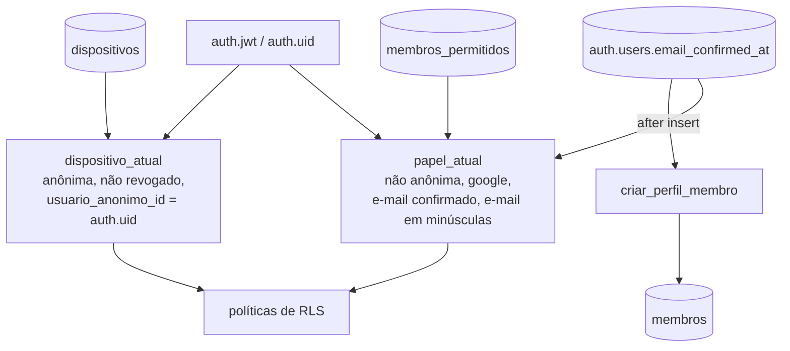

# supabase/migrations

## Cabeçalho

| Campo | Valor |
|---|---|
| Id | DIR-supabase-migrations |
| Título | `migrations` |
| Tipo | banco de dados · migrações SQL versionadas |
| Data | 2026-11-17 |
| Usuário responsável | TokumoH |
| Status | ativo |
| Commits | commit que introduz este arquivo — `git log --format=%h -- supabase/migrations/README.md` |
| Arquivos | `README.md`, `20261117000000_fundacao.sql`, `20261126142500_membros_sem_autoalteracao.sql`, `20261126190407_biblioteca_storage.sql`, `20261127124303_ao_vivo_e_pareamento.sql`, `20261127200000_episodio_em_teste_nao_se_apaga.sql`, `20261127220000_estado_do_palco_em_topico_proprio.sql`, `20261127230000_video_da_camera.sql`, `20261128093000_gestos.sql` |

## Propósito

Migrações do banco do Supabase, na ordem em que são aplicadas. A primeira cria o modelo de dados do [DES-001](../../docs/desenho/2026-11-16-revocast-cameras-desenho.md) (seção 7) com a segurança da seção 8: RLS em todas as tabelas, funções auxiliares `papel_atual()` e `dispositivo_atual()` e o gatilho que cria o perfil do membro. A segunda (etapa E1, decisão D1 do [PLA-002](../../docs/planos/2026-11-26-e1-entrada-e-membros.md)) recria as políticas de `update` e `delete` de `membros_permitidos` para que nenhum `admin` altere nem remova a própria linha. A terceira (etapa E2, decisões D3 a D5 do [PLA-003](../../docs/planos/2026-11-26-e2-preparar-episodio.md)) cria o bucket privado `midias` do Storage e as políticas de `storage.objects` (leitura, envio e exclusão; sem `update`). A quarta (etapa E3, decisões D2 e D4 a D7 do [PLA-004](../../docs/planos/2026-11-27-e3-ao-vivo-por-toque.md)) cria o pareamento de dispositivos (código só em hash, de uso único, com limite de tentativas), a revogação, o episódio ativo, o estado do episódio só por função (privilégios por coluna em `episodios`, `estudio_estado` só leitura) e as duas políticas dos canais privados do Realtime em `realtime.messages`. A oitava (etapa E5, decisões D2 a D5 do [PLA-006](../../docs/planos/2026-11-28-e5-gestos.md)) cria as quatro funções dos gestos (`enviar_gesto`, `definir_gestos_ligados`, `definir_reconhecimento` e `situacao_dos_gestos`) e abre em `pode_usar_canal` o tópico `gestos:<uid>`, só para receber.

## Origem

Criado na Tarefa 3 da etapa E0 ([PLA-001](../../docs/planos/2026-11-17-e0-fundacao.md)), registro VER-010. A segunda migração entrou na Tarefa 2 da E1 (PLA-002), registro VER-016; a terceira, na Tarefa 3 da E2 (PLA-003), registro VER-026; a quarta, na Tarefa 3 da E3 (PLA-004), registro VER-037; a quinta, na correção da revisão final da E3, registro [VER-046](../../docs/verificacoes/2026-11-27-046-e3-correcoes-revisao-final.md) (I3); a sexta, no registro [VER-047](../../docs/verificacoes/2026-11-27-047-e3-estado-em-topico-proprio.md) (I4 da mesma revisão); a sétima, na Tarefa 2 da E4 ([PLA-005](../../docs/planos/2026-11-27-e4-celular-como-camera.md)), registro [VER-050](../../docs/verificacoes/2026-11-27-050-e4-banco-video.md); a oitava, na Tarefa 3 da E5 ([PLA-006](../../docs/planos/2026-11-28-e5-gestos.md)), registro [VER-060](../../docs/verificacoes/2026-11-28-060-e5-banco-gestos.md). O formato do nome segue a Supabase CLI (decisão 2 do PLA-001), embora na E0 a aplicação seja pelo editor SQL ([`../README.md`](../README.md)).

## Organização

- Nome: `AAAAMMDDHHMMSS_nome.sql` (carimbo de data e hora, formato da Supabase CLI); a ordem alfabética é a ordem de aplicação.
- Migração já aplicada no Supabase **nunca é editada**: qualquer correção vai numa migração nova, também aplicada pelo editor SQL.
- Todo objeto leva o schema explícito (`public.`; `storage.` na terceira migração) em `create table`, `alter table ... enable row level security`, `create policy ... on`, `create function`, `revoke` e `grant`, para não depender do `search_path` de quem aplica. As checagens `rpc:grants-check` e `data-api:check` (Tarefa 4 da E0) não leem o texto: aplicam as migrações num PGlite com [`../tests/simulacao-supabase.sql`](../tests/simulacao-supabase.sql) e conferem o catálogo resultante (funções, ACLs, RLS, políticas, privilégios; ver [`../../scripts/README.md`](../../scripts/README.md)).
- Toda função: `security definer`, `set search_path = ''`, `revoke execute ... from public, anon, service_role` e `grant execute ... to authenticated` (o `service_role` entrou na Correção 14: os privilégios padrão do Supabase também lhe dão `EXECUTE` em funções novas).
- Privilégios de tabela explícitos (Correção 13 da Tarefa 3): desde 2026-10-30 o Supabase não dá mais `select`, `insert`, `update` e `delete` automáticos em tabelas novas de `public` (nem `usage`/`select` em sequências novas) a `anon`, `authenticated` e `service_role`, mas ainda dá `truncate`, `references`, `trigger` e `maintain` (Postgres 17+) nas tabelas e `update` nas sequências ([changelog](https://supabase.com/changelog/45329-breaking-change-tables-not-exposed-to-data-and-graphql-api-automatically), [documentação](https://supabase.com/docs/guides/api/hardening-data-api)). A migração começa com `revoke all` em todas as tabelas e sequências de `public` para `anon`, `authenticated` e `service_role` e dá a `authenticated` só as operações que alguma política permite; `anon` e `service_role` não recebem nada, nem `codigos_pareamento`. O resultado é o mesmo em projeto criado antes ou depois da mudança. O `alter default privileges ... revoke all` faz o mesmo para tabelas e sequências futuras, mas vale só para as criadas pelo mesmo papel que roda as migrações (no Supabase, `postgres` pelo editor SQL); cada migração futura dá os seus `grant` explícitos.
- Nenhum e-mail nem segredo: o primeiro `admin` é inserido à mão ([`../README.md`](../README.md)).

## Por que esta organização

- Carimbo no nome dá ordem total e é o que a CLI espera, então o `supabase db push` futuro reconhece os arquivos (depois do `migration repair` descrito em [`../README.md`](../README.md)).
- Nunca editar migração aplicada mantém o banco real igual ao histórico do repositório.
- Schema explícito evita depender do `search_path` de quem aplica (e as funções `security definer` rodam com `search_path = ''`, onde só nome qualificado resolve).

## Por que não outras organizações

| Opção | Motivo de descarte |
|---|---|
| Um único `schema.sql` reescrito a cada mudança | Não diz o que já foi aplicado no banco real; correções viram reescrita |
| Numeração simples (`001_...`) | Não é o formato da CLI; exigiria renomear ao adotá-la |
| Função auxiliar para conferir o tipo da mídia de `sons` e `avisos` | Seria uma função fora das exceções e sem chamada a `papel_atual()`/`dispositivo_atual()`, barrada pelo `rpc:grants-check`; a chave estrangeira composta garante o mesmo sem código |

## Onde

| Arquivo ou subdiretório | O que contém |
|---|---|
| [`README.md`](README.md) | Este arquivo |
| [`20261117000000_fundacao.sql`](20261117000000_fundacao.sql) | 8 tipos, 12 tabelas, 2 índices parciais únicos, 3 funções (`papel_atual`, `dispositivo_atual`, `criar_perfil_membro`) com o gatilho em `auth.users`, RLS nas 12 tabelas com 33 políticas (nenhuma em `codigos_pareamento`), privilégios de tabela explícitos (`revoke all` de `anon`, `authenticated` e `service_role` em todas as tabelas, sequências e nos privilégios padrão das futuras; `grant` a `authenticated` só das operações que alguma política permite: `select, insert, update, delete` em `membros_permitidos`, `midias`, `sons`, `cenas`, `episodios` e `avisos`; `select, update` em `mapa_gestos` e `estudio_estado`; `select` em `membros` e `dispositivos`; `select, insert` em `registro_acoes`) e os dados iniciais (7 linhas de `mapa_gestos` e a linha 1 de `estudio_estado`) |
| [`20261126142500_membros_sem_autoalteracao.sql`](20261126142500_membros_sem_autoalteracao.sql) | Etapa E1, decisão D1 do PLA-002: recria `membros_permitidos_admin_altera` (update) e `membros_permitidos_admin_apaga` (delete) com a condição `(select public.papel_atual()) = 'admin' and email <> (select lower(auth.jwt() ->> 'email'))` (no `using` das duas e no `with check` da de update), sempre `to authenticated`; nenhum `grant`, tabela ou função muda (continuam 33 políticas) |
| [`20261126190407_biblioteca_storage.sql`](20261126190407_biblioteca_storage.sql) | Etapa E2, decisões D3 a D5 do PLA-003: a linha `midias` em `storage.buckets` (`public = false`, `file_size_limit = 52428800`, `allowed_mime_types` com os 8 tipos da D4, sem `image/svg+xml`; `on conflict (id) do update` para um bucket criado antes pelo painel) e 3 políticas em `storage.objects`, todas `to authenticated` e com `bucket_id = 'midias'` como conjunção de topo: `midias_storage_le` (select: `equipe`/`admin` e o dispositivo `obs_palco`), `midias_storage_insere` (insert: `equipe`/`admin`, com `name` em `som/<uuid>.(mp3\|wav\|ogg\|m4a)` ou `imagem/<uuid>.(png\|jpg\|webp\|gif)`, uuid em minúsculas) e `midias_storage_apaga` (delete: `equipe`/`admin`); sem política de `update` (D5); nenhum `grant`, tabela ou função (as 33 políticas de `public` continuam) |
| [`20261127124303_ao_vivo_e_pareamento.sql`](20261127124303_ao_vivo_e_pareamento.sql) | Etapa E3, decisões D2 e D4 a D7 do PLA-004: a tabela `tentativas_pareamento` (RLS, nenhuma política, `revoke all`; `usuario_id` → `auth.users` em cascata; índice por sessão e data), nove funções `security definer` com `search_path = ''` e `EXECUTE` só para `authenticated`: `criar_codigo_pareamento` (`equipe`/`admin`; código de 244 bits em base64url, 43 caracteres, devolvido uma vez e guardado só como SHA-256; cria o dispositivo ou reaproveita um existente do mesmo tipo; apaga o pendente), `parear_dispositivo` (só sessão anônima; 5 falhas em 10 min → `limite`; uso único, validade de 2 min, `for update`; tipo errado não consome; resultado `pareado`, `invalido`, `tipo_errado` ou `limite`), `meu_dispositivo` (a linha da própria sessão, com o rótulo), `revogar_dispositivo` (`equipe`/`admin`; marca `revogado_em`, apaga os pendentes, devolve a sessão revogada), `episodio_ativo` (o ao vivo ou, sem ele, o rascunho do modo teste; só membro ou dispositivo), `iniciar_ao_vivo`, `encerrar_ao_vivo`, `definir_modo_teste` (`equipe`/`admin`; `42501`, `22023`, `55000`, `23505`) e `pode_usar_canal` (matriz da D6); `episodios` com `insert (titulo, data, criado_por)` e `update (titulo, data)` em vez dos de tabela, e `episodios_equipe_apaga` recriada só para rascunho; `estudio_estado` sem `update` (privilégio e política); 2 políticas em `realtime.messages`, `canal_recebe` (select) e `canal_envia` (insert), `to authenticated`, chamando `public.pode_usar_canal(realtime.topic(), extension, false\|true)` |
| [`20261127200000_episodio_em_teste_nao_se_apaga.sql`](20261127200000_episodio_em_teste_nao_se_apaga.sql) | Correção da revisão final da E3 (VER-046, I3): troca a chave estrangeira `estudio_estado.episodio_teste_id` de `on delete set null` para `on delete no action` (rodada 1: fecha por construção a corrida `definir_modo_teste` × `delete` e qualquer delete que contorne a política, com `23503`) e recria `episodios_equipe_apaga` (delete, `to authenticated`) com a condição a mais `id is distinct from (select e.episodio_teste_id from public.estudio_estado e)`: o episódio do modo teste não se apaga (antes, o `on delete set null` de `estudio_estado.episodio_teste_id` desligava o teste por fora de `definir_modo_teste`, contra a D7, e sem `episodio_ativo_mudou`). Não cria tabela, função nem grant. A política depende de `estudio_estado_le` (todo membro lê o modo teste); sem essa leitura, a chave estrangeira mantém a recusa (falha fechada) |
| [`20261127220000_estado_do_palco_em_topico_proprio.sql`](20261127220000_estado_do_palco_em_topico_proprio.sql) | Correção do I4 da revisão final da E3 (VER-047): índice único parcial `dispositivos_um_palco_ativo` em `dispositivos (tipo) where tipo = 'obs_palco' and revogado_em is null` (no máximo um palco não revogado, pareado ou pendente; um segundo dá `23505`) e `create or replace` de `public.pode_usar_canal` (mesmo oid, mesma assinatura, `security definer`, `search_path = ''`, chamada de `papel_atual()`; `revoke`/`grant` repetidos): em `episodio:<ativo>:controle` só membros enviam (comando e presença) e o `obs_palco` só recebe; tópico novo `episodio:<ativo>:estado`, onde só o `obs_palco` envia broadcast, membros e o palco recebem e ninguém marca presença. Não cria tabela, política nem função nova |
| [`20261127230000_video_da_camera.sql`](20261127230000_video_da_camera.sql) | Etapa E4, decisões D2 a D5 do PLA-005 (VER-050): índice único parcial `dispositivos_um_obs_camera_ativo` em `dispositivos (tipo) where tipo = 'obs_camera' and revogado_em is null` (no máximo um `obs_camera` não revogado no banco, pareado ou pendente, de qualquer câmera; um segundo dá `23505`); `create or replace` de `public.pode_usar_canal` (mesmo oid e assinatura; o trecho de `estudio`, `:controle` e `:estado` é o da sexta, com o dispositivo lido uma vez por `select ... into`) com o tópico novo `video:<auth.uid()>`, em que só a própria sessão recebe (broadcast e presence), se for câmera ou `obs_camera` não revogado, com episódio ativo e a câmera (a própria ou a do `camera_id`) não revogada, e em que ninguém envia; e a função nova `enviar_sinal_de_video(p_tipo text, p_sessao uuid, p_sdp text)` (`security definer`, `search_path = ''`, `EXECUTE` só para `authenticated`, chamada de `dispositivo_atual()`), que a cada chamada confere a sessão (`42501`), o episódio ativo e a câmera não revogada (`55000`), o tipo pelo lado e a forma do SDP (`22023`), lê no banco a sessão atual do par (sem ela, `sem_par`), aplica o limite por remetente sob `pg_advisory_xact_lock` (10 em 10 s, 600 por hora, 1 000 000 caracteres de SDP por hora; `54000`) e publica com `realtime.send(..., 'sinal', 'video:<uid do par>', true)` o payload montado no servidor (`tipo`, `sessao`, `sdp`, `remetente` = `auth.uid()`). Não cria tabela, política nem privilégio de tabela |
| [`20261128093000_gestos.sql`](20261128093000_gestos.sql) | Etapa E5, decisões D2 a D5 do PLA-006 (VER-060): `create or replace` de `public.pode_usar_canal` (mesmo oid e assinatura; o corpo da sétima, copiado, mais o tópico novo `gestos:<auth.uid()>`, em que só a própria sessão recebe (broadcast e presence), se for `obs_palco`, câmera ou `obs_camera` não revogado, com episódio ativo, e, na câmera e no `obs_camera`, com a câmera (a própria ou a do `camera_id`) não revogada; ninguém envia) e quatro funções novas (`security definer`, `search_path = ''`, `EXECUTE` só para `authenticated`): `definir_gestos_ligados(p_episodio uuid, p_ligado boolean)` (qualquer membro, só no episódio ativo; trava de transação de chave fixa antes de tudo; o mesmo valor devolve sem gravar, contar nem publicar; só ao ligar, limite global de 20 avisos por minuto e 120 por hora contados com `event = 'gestos_mudaram'` no tópico do primeiro destino, `54000`; desligar nunca é negado; grava a coluna e publica o aviso `{ tipo: 'gestos_mudaram', remetente }`, sem o valor, em até 5 destinos em ordem definida: o palco, o `obs_camera` e as três câmeras pareadas mais recentes), `definir_reconhecimento(p_dispositivo uuid, p_local local_reconhecimento)` (`equipe`/`admin`; só câmera; local não nulo; `22023`), `situacao_dos_gestos()` (câmera ou `obs_camera`; `ligados` do episódio ativo, falso sem ele, e `reconhecer_aqui`: na câmera, `reconhecer_no` nulo ou `celular`; no `obs_camera`, `computador` na câmera não revogada) e `enviar_gesto(p_id uuid, p_gesto gesto)` (câmera ou `obs_camera` que reconhece, pela mesma regra, `42501`; episódio ativo e câmera não revogada, `55000`; id e gesto não nulos, `22023`; `desligados` com o interruptor desligado e `sem_palco` sem palco, sem publicar; sob trava de chave fixa, `intervalo` a menos de 2,5 s do último gesto publicado para o palco atual e `54000` com 600 por hora do mesmo remetente; publica com `realtime.send(..., 'gesto', 'gestos:<uid do palco>', true)` o payload `tipo`, `gesto_id`, `gesto`, `dispositivo` e `remetente` postos no servidor). As contagens usam o índice `messages_replay_index`. Não cria tabela, índice, política nem privilégio de tabela |

## Lógica

1. Toda sessão logada usa o papel `authenticated` do Postgres; o papel do app vem de `papel_atual()` (membros) ou `dispositivo_atual()` (dispositivos), conferidos dentro do banco.
2. As políticas de preparação deixam todo membro e o `obs_palco` ler `midias`, `sons`, `cenas`, `episodios`, `avisos` e `mapa_gestos`; `equipe`/`admin` inserem, alteram e apagam nas cinco primeiras e só alteram `mapa_gestos` (as 7 linhas vêm da migração). `estudio_estado` é lido por todo membro (não pelo palco) e só alterado por `equipe`/`admin`. `membros_permitidos` é só do `admin`, e desde a segunda migração nenhum `admin` altera nem remove a própria linha (comparação de e-mail em minúsculas, a mesma de `papel_atual()`; o `with check` também impede trocar o e-mail de outra linha pelo próprio); `membros` é lido por `equipe`/`admin`. `dispositivos`, `membros` e `codigos_pareamento` não têm política de escrita.
3. As políticas de `dispositivos` para sessões de dispositivo usam só `dispositivo_atual()`, que, por ser `security definer`, roda como o dono da tabela, e o dono não passa pela RLS (sem `force row level security`); nenhuma política lê `dispositivos` dentro de si (isso daria `42P17 infinite recursion`).
4. `registro_acoes` só recebe inserção do `obs_palco` e é lida por membros.
5. O tipo da mídia de `sons.midia_id` e `avisos.imagem_midia_id` é garantido por chave estrangeira composta para `midias (id, tipo)`, com a coluna de tipo presa por `check`.
6. **Storage (terceira migração):** o servidor do Storage roda cada comando como `authenticated` com as claims da sessão, então as mesmas `papel_atual()` e `dispositivo_atual()` decidem: `equipe`/`admin` leem, enviam e apagam objetos do bucket `midias`; o `obs_palco` só lê; `apresentadora`, conta fora da lista, câmera, `obs_camera`, sessão não pareada e `anon` não fazem nada. O caminho aceito no envio é o que o domínio gera (`caminhoDaMidia`, Tarefa 1 do PLA-003), e o nome do arquivo do computador nunca entra nele. Sem `update`, nada é sobrescrito (D5).
7. **Pareamento (quarta migração, D2):** `equipe`/`admin` pedem um código com `criar_codigo_pareamento`; o código sai uma vez (vai no QR ou no link, no fragmento) e o banco guarda só o hash. O aparelho entra com um login anônimo e chama `parear_dispositivo(código, tipo da rota)`: o código certo, sem uso, dentro dos 2 min e do mesmo tipo liga a sessão anônima ao dispositivo (`usuario_anonimo_id`), e a partir daí `dispositivo_atual()` passa a valer para ela, com as mesmas políticas da E0. Cada falha fica em `tentativas_pareamento`; a sexta tentativa em 10 min recebe `limite`. Parear de novo um dispositivo existente tira a sessão antiga dele; a mesma sessão pareando outro dispositivo solta o primeiro.
8. **Revogação e estado (quarta migração, D5 e D7):** `revogar_dispositivo` marca `revogado_em` (e `dispositivo_atual()` deixa de valer na hora) e apaga os códigos pendentes; o `estado` e o `gestos_ligados` de `episodios` e o modo teste de `estudio_estado` só mudam pelas funções (o `update` direto dá `permission denied`), e só rascunho pode ser apagado; desde a quinta migração (VER-046, I3), só o rascunho que não está no modo teste (para apagá-lo, sai-se do teste antes, pela função).
9. **Canais (quarta migração, D6):** o servidor do Realtime chama `realtime.authorize`, que avalia as duas políticas de `realtime.messages`; ambas só chamam `pode_usar_canal(tópico, extensão, enviar)`, que lê `papel_atual()`, `dispositivo_atual()` e `episodio_ativo()`: em `estudio`, membros e dispositivos recebem e marcam presença, só `equipe`/`admin` publicam; em `episodio:<ativo>:controle`, membros e o `obs_palco` recebem e publicam, só membros marcam presença; `persistence` e qualquer outro tópico, ninguém. Desde a sexta migração (VER-047), o `obs_palco` só recebe em `:controle` (comando e presença só de membros), e o estado no ar vai em `episodio:<ativo>:estado`, onde só o `obs_palco` envia e membros recebem; e só pode haver um `obs_palco` não revogado (`dispositivos_um_palco_ativo`).
10. **Vídeo da câmera (sétima migração, D2 do PLA-005):** a câmera e o `obs_camera` sinalizam o WebRTC só por `enviar_sinal_de_video`, que confere a sessão no banco a cada chamada, põe o remetente e publica com `realtime.send` (rodando como o dono da função, que no Supabase tem `INSERT` e `BYPASSRLS` em `realtime.messages`) no tópico `video:<uid da sessão atual do par>`; cada um só entra no próprio tópico, para receber, e ninguém envia pelo Broadcast ali (um `realtime.send` chamado direto pelo cliente passa pela política de `insert` e não grava nada). Repareado o dispositivo, a sessão antiga perde a função na hora e o tópico dela deixa de receber sinais novos; revogada a câmera, nem ela nem o `obs_camera` dela sinalizam ou recebem. Só um `obs_camera` não revogado no banco (`dispositivos_um_obs_camera_ativo`): um único par sinaliza, e o teto de disco do limite de sinais não cresce com o número de câmeras.
11. **Gestos (oitava migração, D2 a D5 do PLA-006):** o aparelho que reconhece (a câmera, com `reconhecer_no` nulo ou `celular`, ou o `obs_camera`, com `computador`; `definir_reconhecimento` muda, `situacao_dos_gestos` responde) manda cada gesto confirmado só por `enviar_gesto`, que confere a sessão, o episódio ativo, a câmera, quem reconhece, o interruptor e o intervalo de 2,5 s a cada chamada e publica com `realtime.send` no tópico `gestos:<uid da sessão atual do palco>`; o palco, a câmera e o `obs_camera` só entram no próprio tópico de gestos, para receber, e ninguém envia pelo Broadcast ali. O interruptor (`episodios.gestos_ligados`) muda só por `definir_gestos_ligados`, que avisa as sessões dos dispositivos sem levar o valor (quem recebe relê no banco); ligar tem limite global, desligar nunca é negado.

## Exemplo

Para conferir quem pode ler `avisos`: procurar `create policy avisos_le` no arquivo; a condição é `(select public.papel_atual()) is not null or (select tipo from public.dispositivo_atual()) = 'obs_palco'`. O teste que prova é `palco-le-avisos` (e o negativo, `camera-nao-le-avisos`) em [`../tests/rls.test.ts`](../tests/rls.test.ts).

## Verificação

- Links relativos, "Onde" e campo "Arquivos" conferidos por `npm run check-docs`; não há subdiretórios.
- A migração é aplicada pelos testes de [`../tests/`](../tests/README.md) em PGlite. **Teste dinâmico** (523 testes desde a E2, com os 22 do bloco E2 descritos no item "Terceira migração" abaixo; 501 na E1: 91 nomeados em `rls.test.ts` e `restricoes.test.ts` (83 da E0 e os 8 do bloco `E1 — entrada e lista de acesso`, cujas sabotagens estão no VER-016 e em [`../tests/README.md`](../tests/README.md)) e 410 em `matriz.test.ts`, que são as 396 células e 14 testes estruturais (cobertura da matriz; por tabela, que o `update` do teste muda toda linha; que toda coluna de vínculo com a sessão tem linha nula e linha de outra sessão; e que os dados extras têm as formas de valor); cada um dos 83 e cada uma das 396 células derrubado por ao menos uma sabotagem (na migração; o `dono-da-migracao-sem-superusuario`, em `banco.ts` ou na simulação), registro VER-010). Nos testes, a migração é aplicada por `postgres_sim`, um dono sem superusuário nem `BYPASSRLS` (o `postgres` do Supabase também não é superusuário; ver [`../tests/README.md`](../tests/README.md)), então o que depende de o dono não ser superusuário também é testado: por exemplo, acrescentar `force row level security` em `dispositivos` derruba 368 testes (as políticas que chamam `dispositivo_atual()` passam a negar ou entrar em recursão): a **matriz de permissões** do DES-001 (seção 8) inteira, em `matriz.test.ts`: para cada uma das 11 tabelas com política, cada uma das 9 sessões (`admin`, `equipe`, `apresentadora`, estranho (Google fora da lista), `obs_palco`, `camera`, `obs_camera`, sessão anônima não pareada e papel `anon`) e cada operação (select, insert, update e delete), 396 células, o permitido funciona com alcance total (lê todas as linhas da tabela, contadas como superusuário, fora os recortes que a spec prevê, câmera e `obs_camera` em `dispositivos`, conferidos linha a linha; o insert de uma linha válida é aceito; o update sem `where` altera toda linha; o delete sem `where` esvazia a tabela (desde a segunda migração, nos dois casos, update e delete, menos a própria linha do `admin` em `membros_permitidos`, que tem de ficar idêntica: `PROPRIA_LINHA_INTOCADA`); assim uma política que prenda `equipe`/`admin` às próprias linhas, como `criado_por = auth.uid()`, é pega; o update grava valores que nenhuma linha tem; nas colunas de vínculo com a sessão, o teste usa também a linha "da própria sessão" e a de vínculo nulo; os dados têm episódio `rascunho`, `ao_vivo` e `encerrado`, modo teste ligado, ação de teste, dispositivo revogado, aviso com link e imagem e gestos de cena e de som, para que uma política filtrada por esses valores seja vista) e o proibido não (lê 0 linhas; o insert da mesma linha válida dá violação de RLS; o update e o delete sem `where` não mudam o retrato; onde o papel do Postgres da sessão não tem o privilégio de tabela (todo o `anon`; para `authenticated`, as operações que nenhuma política permite, como insert em `membros`), a célula espera primeiro `permission denied for table` e o retrato igual (um `grant` a mais, mesmo sem política, derruba a célula) e depois, com os 4 privilégios dados pelo superusuário na transação do teste, a recusa da RLS acima (defesa em profundidade: uma política indevida continua pega onde hoje falta o `grant`); o mesmo vale para os cenários nomeados de escrita proibida em `rls.test.ts`). Sem os `grant` da migração, as 75 células permitidas caem (Correção 13). Tirar o `revoke all on all sequences` não muda nada hoje (a migração não cria sequência; `acl-de-tabelas-e-sequencias` confere que não há nenhuma) e vale para as futuras; com "Automatically expose new tables" ligado (ou no padrão antigo, `grant all`), o catálogo de privilégios sai igual, porque a migração começa com `revoke all` (teste `mesmo-catalogo-com-tabelas-expostas`, Correção 14). Isso inclui: nenhuma das 33 políticas acessível ao `anon`, à sessão não pareada ou ao estranho; ninguém fora do `admin` lê ou escreve a lista `membros_permitidos` (nas formas de linha testadas: uma política que deixasse a equipe inserir só `papel = 'apresentadora'` não é pega, limite em `matriz.test.ts`); nenhuma escrita direta em `dispositivos` (inclusive o auto-vínculo: inserir um dispositivo ligado à própria sessão ou tomar um dispositivo sem sessão), `membros`, `registro_acoes` (fora o insert do palco; inclusive o membro ou o estranho registrando ação em nome próprio), nem insert ou delete em `estudio_estado` e `mapa_gestos`; o `admin` e a `equipe` lendo e escrevendo a preparação; todo membro lendo `registro_acoes`. Em `codigos_pareamento` (fora da matriz), leitura e inserção dão `permission denied`, também para a sessão não pareada, e alteração e exclusão são conferidas por `has_table_privilege`. Em `rls.test.ts`, os cenários nomeados do plano (por exemplo, a câmera não vira `obs_palco`; `obs_camera` lê só a própria linha e a da câmera indicada); as condições de `papel_atual()` (inclusive a confirmação lida da linha do próprio `auth.uid()` (e não de `user_metadata.email_verified`, que o usuário edita), o e-mail lido das claims e claims sem `is_anonymous` ou sem `provider`) e de `dispositivo_atual()` (inclusive claims sem `sub`, que não casam com dispositivo ainda não pareado); o gatilho (nome, e-mail em minúsculas, anônimo e sem e-mail, só no cadastro: um update de e-mail em `auth.users` não cria outro perfil nem falha, e o `security definer`: nos testes quem grava em `auth.users` é o papel `supabase_auth_admin`, sem privilégio nas tabelas de `public` (só o `usage` do schema, que vem do `PUBLIC`), como no Supabase); o `revoke` de `anon` e de `service_role` nas 3 funções (`service-role-nao-executa-funcoes`); os privilégios de tabela (`acl-de-tabelas-e-sequencias`: a ACL de toda tabela e sequência de `public`, lida no catálogo, é exatamente o `grant` a `authenticated` da migração, sem privilégio de coluna e sem sequência; `privilegios-de-tabela`, por `has_table_privilege`: sem `truncate`/`references`/`trigger`/`maintain` nas 12 tabelas, `service_role` sem nenhum privilégio em nenhuma delas, nenhum privilégio para `anon`, `authenticated` e `service_role` numa tabela ou sequência futura do mesmo dono, e nenhum em `codigos_pareamento`; `mesmo-catalogo-com-tabelas-expostas`: o mesmo catálogo de privilégios com "Automatically expose new tables" ligado); a RLS ativa em 11 das 12 tabelas (tirar o `enable row level security` de qualquer uma delas, menos `codigos_pareamento`, derruba testes); e as restrições `episodios_um_ao_vivo`, `estudio_estado_linha_unica`, `mapa_gestos_equivalencia`, `dispositivos_usuario_anonimo_unico`, `dispositivos_camera_so_obs_camera` (as duas metades), `dispositivos_reconhecer_so_camera`, `membros_permitidos_email_minusculo`, `sons_midia_do_tipo_som`, `avisos_midia_do_tipo_imagem`, `avisos_link_https`, `midias_tamanho_ate_50mb` (com o limite de 52428800 bytes aceito), `registro_acoes_um_autor`, `sons_volume_0_a_1`, os `check` `sons_tipo_midia_som` e `avisos_tipo_imagem` isolados (insert com o tipo explícito errado, que a chave composta sozinha aceitaria) e a unicidade de `codigos_pareamento.codigo_hash`; os valores padrão que o DES-001 (seção 7) cita: `episodios.gestos_ligados` falso, `avisos.duracao_s` 10 e `codigos_pareamento.expira_em` em 2 minutos.
- **Terceira migração (E2, VER-026):** 22 testes do bloco `E2 — Biblioteca e preparação` de [`../tests/rls.test.ts`](../tests/rls.test.ts) (bucket privado com os limites, o ramo `on conflict` que devolve ao estado privado um bucket `midias` criado antes, quem envia, lê e apaga nas 9 sessões, sem `update`, 11 nomes fora do formato, outro bucket, e o comportamento da E0 de que a E2 depende), com as sabotagens em memória listadas em [`../tests/README.md`](../tests/README.md), "Verificação" (cada teste do bloco derrubado por ao menos uma); `rpc:grants-check` e `data-api:check` com 0 erros sobre as 3 migrações, e o `data-api:check` acusa em memória o bucket público, `image/svg+xml` nos tipos e a política de exclusão sem `bucket_id` (regras da D13, VER-025).
- **Decisão de leitura da spec** (controlador, Correção 8 da Tarefa 3; vai ao VER-010; o responsável pode reverter): o DES-001 (seção 8, "Membros"; seção 7, `estudio_estado`) diz que `equipe`/`admin` "escrevem" `estudio_estado` e a preparação. Em `mapa_gestos` e `estudio_estado`, "escrevem" é lido como `update` só, sem `insert` nem `delete`: os 7 gestos são a chave fixa já semeada pela migração (seção 7) e `estudio_estado` tem uma linha só (seção 7); um insert não tem linha nova possível e um delete quebraria o mapa ou o modo teste. A migração e `matriz.test.ts` seguem essa leitura (8 células: `admin` e `equipe` × insert/delete × as duas tabelas, proibidas).
- **Só as checagens de banco** (`rpc:grants-check` e `data-api:check`, Tarefa 4, que aplicam as migrações num PGlite e leem o catálogo; os testes de `../tests/` não pegam): `set search_path = ''` das funções (tirá-lo não muda o resultado, porque todo nome é qualificado: S72); a RLS ativa em `codigos_pareamento` (sem ela, o `revoke all` ainda nega tudo: S73) e a ausência de política nela (uma política extra também não abre nada, porque o `revoke all` nega antes: N22). O `security definer` das 3 funções e o `revoke` de `public` também são conferidos por essas checagens; conferido em 2026-11-21 contra as checagens reescritas: sem o `search_path` de `papel_atual`, `rpc:grants-check` acusa "SECURITY DEFINER sem set search_path"; sem a RLS de `codigos_pareamento` ou com a política extra nela, `data-api:check` acusa "sem row level security" e "tabela só-funções não pode ter política"; tirar o `security definer` de `papel_atual`, de `dispositivo_atual` ou do gatilho derruba testes dinâmicos (R18, N02, N01).
- **Mutações equivalentes** (não mudam o comportamento, nenhum teste pode pegar): trocar `tipo in ('camera', 'obs_camera')` por `tipo <> 'obs_palco'` na leitura própria de `dispositivos` (o tipo só tem 3 valores) e trocar por `true` o `with check` de qualquer política `for update` cujo `with check` repete o `using` (`membros_permitidos`, `midias`, `sons`, `cenas`, `episodios`, `avisos`, `mapa_gestos`, `estudio_estado`): só passa quem já passou no `using`, e `papel_atual()` não muda dentro do próprio comando. Também: comparar `lower(mp.email)` em vez de `mp.email` em `papel_atual()` (o `check` já garante minúsculas, N10); e tirar o `grant execute ... to authenticated` explícito de qualquer das 3 funções (revisão 11, N3): os privilégios padrão de `public` (no Supabase e na simulação, `alter default privileges ... grant all on functions to anon, authenticated, service_role` para o papel que aplica a migração) já dão `EXECUTE` a `authenticated`, e a migração só revoga de `public`, `anon` e `service_role`. Prova (PGlite com a simulação e `postgres_sim`): sem os 3 `grant`, as 3 funções ficam com `proacl = {authenticated=X/postgres_sim,postgres_sim=X/postgres_sim}` e `has_function_privilege('authenticated', ..., 'EXECUTE')` verdadeiro; a suíte passa inteira. O `rpc:grants-check` também não pode pegar, porque lê o catálogo, onde o privilégio continua. O `grant` explícito fica por clareza e para não depender do padrão do projeto. Desde a Correção 13, o `revoke all on table public.codigos_pareamento` explícito é redundante com o `revoke all on all tables in schema public` que vem depois: tirá-lo, restringi-lo a `select` ou só a `anon`, ou pôr um `grant` logo depois dele (antes do `revoke` em massa) não muda nada (sabotagens S18, S108, S159, S202 e S236 de t3-sab7); fica por clareza da intenção, e um `grant` em `codigos_pareamento` depois do `revoke` em massa é pego por `acl-de-tabelas-e-sequencias`. Uma política extra de `insert` em `estudio_estado` ou `mapa_gestos` (N19 e N20), antes equivalente porque a linha 1 e os 7 gestos já existem, agora é pega por `matriz.test.ts`, que apaga a linha como superusuário antes do insert.
- **Quarta migração (E3, VER-037):** bloco `E3 — pareamento, ao vivo e canais` de [`../tests/rls.test.ts`](../tests/rls.test.ts) (57 testes: pareamento, revogação (com a trava `for update` conferida no texto da função), `meu_dispositivo`, episódio ativo, estado só por função, a matriz do canal nas 10 sessões e as políticas de `realtime.messages`), os 6 testes da E0 ajustados (I1 da revisão do plano), as 10 células da matriz que mudaram (D7) e `chaves-estrangeiras` com a chave nova; `rpc:grants-check` e `data-api:check` com 0 erros sobre as 4 migrações. As sabotagens em memória (a migração nunca editada) estão no VER-037 e em [`../tests/README.md`](../tests/README.md), "Verificação".
- **Sétima migração (E4, VER-050):** bloco `E4 — vídeo da câmera` (dentro do bloco da E3) de [`../tests/rls.test.ts`](../tests/rls.test.ts), as 9 colunas novas de vídeo da matriz do canal (4 células mudadas: câmera e `obs_camera` recebem no próprio tópico), as contagens de funções (13 em `public`) e `um-obs-camera-ativo` em `restricoes.test.ts`; `rpc:grants-check` e `data-api:check` com 0 erros sobre as 7 migrações, sem mudança nas checagens (a sonda do VER-050 mostrou que nenhuma regra acusa a chamada a `realtime.send`). As sabotagens (numa cópia; a migração nunca editada) estão no VER-050 e em [`../tests/README.md`](../tests/README.md), "Verificação".
- **Oitava migração (E5, VER-060):** bloco `E5 — gestos` (dentro do bloco da E3) de [`../tests/rls.test.ts`](../tests/rls.test.ts), as 12 colunas novas de gestos da matriz do canal (6 células mudadas: palco, câmera e `obs_camera` recebem no próprio tópico), as contagens de funções (17 em `public`) e a lista das funções `security definer`; `rpc:grants-check` e `data-api:check` com 0 erros sobre as 8 migrações, sem mudança nas checagens. As sabotagens (numa cópia; a migração nunca editada) estão no VER-060 e em [`../tests/README.md`](../tests/README.md), "Verificação".
- **Chaves estrangeiras e unicidades (catálogo, revisão 12):** `restricoes.test.ts` lê em `pg_constraint` as 21 chaves estrangeiras de `public` (as 19 simples e as 2 compostas: tabela, colunas, tabela e colunas de destino e ação `on delete`, inclusive o `set null (imagem_midia_id)`) e as 6 restrições `unique`, e compara com a lista esperada (`chaves-estrangeiras` e `unicidades`). Tirar qualquer `references`, trocar qualquer ação `on delete` (as 15 explícitas e as 6 `no action`, desde o VER-046, que trocou `estudio_estado.episodio_teste_id` de `set null` para `no action`; antes, 16 e 5) ou tirar qualquer `unique` derruba o teste (sabotagens da Correção 12). Antes, nenhuma das 19 chaves simples tinha teste: sem as 19, a suíte passava inteira (I1 da revisão 12). Esse teste confere a declaração, não o comportamento; o comportamento de 4 ações também é exercido por testes dinâmicos (o `cascade` de `sons.midia_id` e de `avisos.episodio_id` pelos deletes permitidos da matriz, o `set null (imagem_midia_id)` pelo delete permitido de `midias`, que apaga uma imagem usada por um aviso semeado, e o `set null` de `estudio_estado.episodio_teste_id` por `apresentadora-nao-apaga-nem-altera-estudio`).
- **Sem teste:** `avisos_duracao_positiva`; `tamanho_bytes > 0`; o esquema do link em maiúsculas (`like` × `ilike`; o link sem as barras, `https:...`, é recusado por `aviso-link-so-https`); claims com `providers` contendo `google` mas `provider` diferente; os valores padrão que o DES-001 não cita (`episodios.estado` `rascunho`, `episodios.data`, `sons.volume` 1, `ordem` 0, `avisos.texto` vazio, `mapa_gestos.acao` `nenhuma`, `estudio_estado.id` 1 e os carimbos `now()`); os de `sons.tipo_midia` e `avisos.tipo_imagem` são exercidos pelos testes que inserem sem a coluna.

## Riscos

- Sétima migração (VER-050): não aplicada num Supabase real, e o passo de aplicar é da Tarefa 7 do PLA-005 (o app que a usa nasce nas Tarefas 3 a 6). Se o banco já tiver dois `obs_camera` não revogados, o `create unique index` falha com `23505` e nada dela vale (consultas no guia "Vídeo da câmera (E4)" de [`../README.md`](../README.md)). Os SDPs, com endereços IP de rede, ficam em `realtime.messages` de 72 h a 4 dias (o `update` do guia apaga só o conteúdo; o `postgres` não tem `DELETE` ali); `realtime.send` engole erros (`enviado` não garante a entrega); nos testes, o `postgres_sim` grava em `realtime.messages` pela participação no dono, e não pelo `BYPASSRLS` do `postgres` real (o teste `e4-funcao-publica-pelo-dono` mostra os dois caminhos lado a lado). Uma `pode_usar_canal` que devolva `true` continua passando nas duas checagens (limite N5): só os testes de banco a pegam.
- Oitava migração (VER-060): não aplicada num Supabase real; o passo de aplicar é da Tarefa 9 do PLA-006 (o app que a usa nasce nas Tarefas 4 a 8). Os gestos e os avisos ficam em `realtime.messages` de 72 h a 4 dias (sem conteúdo de imagem: só o nome do gesto, os ids e o remetente); `realtime.send` engole erros (`enviado` não garante a entrega); as travas de chave fixa serializam as chamadas, mas a concorrência real não é provada no PGlite (conexão única). Um membro pode manter o "ligar" bloqueado alternando ligar e desligar até encher a cota (N17 do PLA-006; o sistema falha para o lado seguro). Uma `pode_usar_canal` que devolva `true` continua passando nas duas checagens (limite N5).
- Sexta migração (VER-047): não aplicada num Supabase real. Se o banco já tiver dois `obs_palco` não revogados, o `create unique index` falha com `23505` e nada dela vale (as duas consultas do passo 2 do guia de [`../README.md`](../README.md), rodadas no editor SQL como dono, deixam só o palco pareado por último; depois, rodar a migração de novo). Aplicada com o palco conectado, ele mantém no socket o envio em `:controle` até o token novo (até 10 min): aplicar com o palco fechado. Parear de novo um palco revogado com outro ativo dá `23505` em `parear_dispositivo` (o código não é consumido); a aba Ao vivo não faz isso (reaproveita o ativo).
- Não aplicada num Supabase real nesta tarefa (ver riscos de [`../README.md`](../README.md)). A segunda migração também não: aplicá-la no editor SQL, depois da de fundação, é passo do responsável (Tarefa 6 do PLA-002).
- Regra da D1 (segunda migração): como só um `admin` mexe na lista e nenhum mexe na própria linha, sempre sobra ao menos um `admin` no uso normal. **Limite:** dois admins que se removem (ou rebaixam) um ao outro no mesmo instante, em transações concorrentes em que cada uma ainda vê a linha da outra, podem zerar os admins; a recuperação é o comando do primeiro `admin` em [`../README.md`](../README.md), rodado pelo dono no editor SQL. Um gatilho com trava fecharia a corrida, mas foi descartado na D1 (função de gatilho `SECURITY INVOKER` sob a RLS de quem chama).
- Entre o `drop policy` e o `create policy` da segunda migração a tabela fica sem política de `update`/`delete`, o que nega (falha fechada): se a aplicação parar depois dos `drop`, nenhum `admin` altera nem remove linhas até rodar de novo os `create policy` (não conferido se o editor SQL aplica o arquivo numa transação só).
- A premissa dos privilégios padrão vem do changelog e da documentação do Supabase (lidos em 2026-11-22), não de um projeto real: a documentação diz que tabelas novas mantêm `truncate`, `references`, `trigger` e `maintain`, e o changelog só cita `select/insert/update/delete` e sequências. A migração não depende disso: o `revoke all` inicial e os `grant` explícitos dão o mesmo resultado nos dois padrões (conferido com a simulação no padrão antigo, Correção 13, e pelo teste `mesmo-catalogo-com-tabelas-expostas`, Correção 14).
- `service_role` não tem nenhum privilégio de tabela nem de sequência (a migração revoga dele o que os privilégios padrão do Supabase dariam: hoje `truncate`, `references`, `trigger` e `maintain`; com "Automatically expose new tables" ligado, tudo) nem `EXECUTE` nas 3 funções (Correção 14). A chave de serviço continua passando por cima da RLS (`BYPASSRLS`), mas sem privilégio não acessa nada: um uso futuro no servidor (por exemplo, uma Edge Function com a chave secreta) pede decisão própria, com o `grant` explícito a `service_role` na migração que precisar dele e, a partir do VER-011, o ajuste do `data-api:check`, que acusa qualquer privilégio de `service_role`; tabela criada por outro papel que não o das migrações (por exemplo, pelo painel com outro dono) recebe os privilégios padrão do projeto, também para `service_role`.
- Os privilégios padrão dão `EXECUTE` a `anon`, `authenticated` e `service_role` em toda função criada depois (o padrão de funções não mudou); hoje isso só é coberto pelo `rpc:grants-check`, que acusa no catálogo toda função nova com `EXECUTE` para `PUBLIC`, `anon` ou `service_role` (ou sem `EXECUTE` para `authenticated`).
- O `alter default privileges ... revoke all` só alcança tabelas e sequências criadas pelo papel que aplicou esta migração; tabela criada por outro papel (por exemplo, pelo painel do Supabase com outro dono) recebe os privilégios padrão do Supabase (hoje `truncate`, `references`, `trigger` e `maintain` para `anon`, `authenticated` e `service_role`).
- `reconhecer_no` nulo na `camera` significa "padrão do app"; qual é esse padrão fica para a E3 (`criar_codigo_pareamento` não recebe `reconhecer_no`); decidido na E5 (D5 do PLA-006, oitava migração): nulo vale `celular` em `situacao_dos_gestos` e `enviar_gesto`.
- `camera_id` aponta para qualquer dispositivo: o banco não garante que o alvo seja do tipo `camera`. Desde a quarta migração, `criar_codigo_pareamento` confere o tipo ao criar um `obs_camera` (teste `e3-codigo-obs-camera-exige-camera`); a restrição continua só na função, e um `obs_camera` não muda de câmera depois de criado.
- `registro_acoes.episodio_id` é `on delete cascade`: apagar um episódio apaga o registro dele, o que contorna o "apenas inserção" do DES-001 (seção 7); decisão a revisitar na E3.
- O gatilho `criar_perfil_membro` faz falhar um segundo cadastro não anônimo com o mesmo e-mail em outra caixa (`lower(new.email)` bate em `membros_email_key`; numa sonda da revisão 9, sem teste na suíte, o segundo `cadastrarUsuario`, com o mesmo e-mail de teste em outra caixa, falhou e `auth.users` ficou com 1 linha). No Supabase real é pouco provável, porque o Auth normaliza o e-mail e tem índice único próprio. Também não há gatilho de `update`: se o e-mail da conta mudar, `membros.email` fica com o antigo (sem efeito no papel, que vem do e-mail do JWT).
- `registro_acoes.membro_id` e `dispositivo_id` não apagam em cascata: apagar um membro ou dispositivo com ações registradas falha (a revogação não apaga, só marca `revogado_em`).
- As funções da E3 e as políticas de `realtime.messages` entraram na quarta migração; `definir_gestos_ligados` e `definir_reconhecimento` ficam para a E5 e a E4 (PLA-004, D8), em migrações novas (as duas entraram na oitava, VER-060), e o tópico `:video` abre na E4 com `create or replace function public.pode_usar_canal` numa migração nova.
- **Terceira migração (Storage):** não aplicada num Supabase real; aplicá-la no editor SQL, depois das duas anteriores, é passo do responsável (Tarefa 8 do PLA-003, guia em [`../README.md`](../README.md)). Limites que sobram (D4): o servidor do Storage confere o `file_size_limit` e o `allowed_mime_types` contra o tamanho e o `Content-Type` **declarado** no envio, não contra os bytes; um membro da equipe com acesso à API pode guardar bytes de outro tipo sob um tipo aceito (dano contido: bucket privado, uso só em `<audio>` e ``, quem envia já é da equipe). Objetos órfãos (envio que não chegou a registrar a linha em `midias`, ou exclusão cujo objeto não saiu, D6) ficam no bucket e não entram na soma do uso (D7). A política de envio confere a pasta e a extensão do caminho, não o `Content-Type` (um `som/<uuid>.mp3` pode ser enviado como `image/png`, que o bucket aceita). O ramo `on conflict do update` só roda num projeto com um bucket `midias` criado antes; nos testes, `e2-bucket-criado-antes-fica-privado` o roda (trecho lido do próprio arquivo, sobre um bucket estragado) e confere o resultado, mas no Supabase real o `update` também dispara os gatilhos de `update` de `storage.buckets`, que a simulação não tem (não verificado contra o real; a consulta ao bucket depois de aplicar, no guia da Tarefa 8 do PLA-003, confere o resultado).
- **Quarta migração (E3):** não aplicada num Supabase real; aplicá-la no editor SQL, depois das três anteriores, é passo do responsável (Tarefa 10 do PLA-004, guia em [`../README.md`](../README.md)), junto com o login anônimo ligado (com o limite por IP do Supabase Auth) e o acesso público ao Realtime desligado. Limites que sobram: um `create or replace` de `pode_usar_canal` que devolva `true` com uma chamada de papel decorativa passaria nas duas checagens (só `e3-canal-matriz` pega); quando o episódio ativo muda, o tópico antigo deixa de autorizar só para quem entra, reconecta ou renova o token (até 10 min; D6, N6); o rótulo é aparado com `btrim` (só espaços), enquanto o domínio usa `trim()` do JavaScript (todo espaço em branco): o adaptador manda o rótulo já conferido; o limite de tentativas é por sessão anônima, e trocar de sessão esbarra só no limite de logins anônimos por IP do Supabase Auth (a força do código vem dos 244 bits); a limpeza de tentativas e de códigos com mais de 1 dia roda dentro das próprias funções, sem tarefa agendada; `registro_acoes` continua com a autoria declarada (DES-001 §8). Entre o `drop policy` e o `create policy` de `episodios_equipe_apaga` a tabela fica sem política de `delete` (falha fechada).
- **Quinta migração (VER-046, I3):** não aplicada num Supabase real; aplicá-la no editor SQL, depois da quarta, é passo do responsável (guia em [`../README.md`](../README.md)). Entre o `drop policy` e o `create policy` a tabela fica sem política de `delete` (falha fechada). Testes: `e3-episodio-do-teste-nao-se-apaga` em [`../tests/rls.test.ts`](../tests/rls.test.ts), o controle de `apresentadora-nao-apaga-nem-altera-estudio` (que antes apagava o episódio do teste e agora sai do teste antes) e as 2 células de `delete` de `episodios` em [`../tests/matriz.test.ts`](../tests/matriz.test.ts), cujo recorte passou a deixar o rascunho do modo teste; desde a rodada 1, `e3-episodio-do-teste-fk-restrict` (o `delete` direto como superusuário e como `postgres_sim` dá `23503`), `e3-episodio-do-teste-dependencia-da-leitura` (sem `estudio_estado_le`, o `delete` da equipe falha com `23503`, nunca apaga) e `chaves-estrangeiras` com a ação `no action`. A corrida entre duas transações não é reproduzível no PGlite (uma conexão só); a chave estrangeira a fecha por construção (checagem com foto nova e trava).
