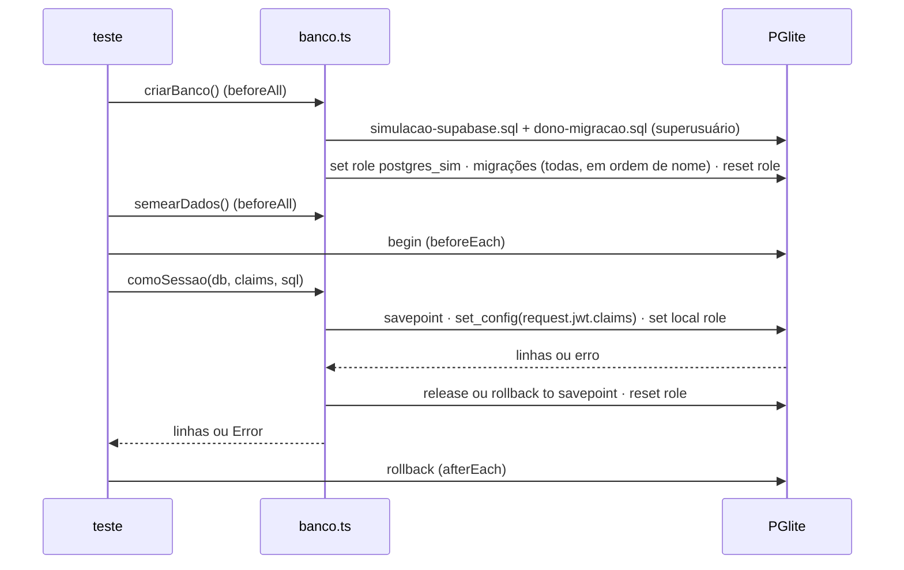

# supabase/tests

## Cabeçalho

| Campo | Valor |
|---|---|
| Id | DIR-supabase-tests |
| Título | `tests` |
| Tipo | testes · RLS, gatilho e restrições do banco |
| Data | 2026-11-17 |
| Usuário responsável | TokumoH |
| Status | ativo |
| Commits | commit que introduz este arquivo — `git log --format=%h -- supabase/tests/README.md` |
| Arquivos | `README.md`, `simulacao-supabase.sql`, `dono-migracao.sql`, `banco.ts`, `rls.test.ts`, `restricoes.test.ts`, `matriz.test.ts` |

## Propósito

Provar, sem conta e sem Docker, que as migrações de [`../migrations/`](../migrations/README.md), aplicadas em ordem, fazem o que o [DES-001](../../docs/desenho/2026-11-16-revocast-cameras-desenho.md) (seções 7 e 8) pede: quem lê e quem escreve cada tabela, o que as funções `papel_atual()` e `dispositivo_atual()` aceitam, o que o gatilho cria e quais dados o banco recusa. Os testes rodam no `npm test` e, por ele, no hook `pre-push` e na CI.

## Origem

Criado na Tarefa 3 da etapa E0 ([PLA-001](../../docs/planos/2026-11-17-e0-fundacao.md)), registro VER-010. A decisão 2 do PLA-001 trocou os "testes SQL de RLS no Supabase" do DES-001 (seção 11) por testes em PGlite com simulação do Supabase.

## Organização

- `simulacao-supabase.sql`: o mínimo do Supabase que a migração usa (papéis `anon`, `authenticated`, `service_role` (com `BYPASSRLS`) e `supabase_auth_admin`, privilégios padrão do schema `public` no padrão vigente desde 2026-10-30, com a exposição automática de tabelas desligada, `auth.users`, `auth.jwt()`, `auth.uid()` e, desde a Tarefa 2 da E2 ([PLA-003](../../docs/planos/2026-11-26-e2-preparar-episodio.md), D13), o schema `storage`: `storage.buckets` e `storage.objects` (só as colunas usadas, com `path_tokens` gerada) de `supabase_storage_admin`, com RLS, os privilégios do Supabase (`anon` e `authenticated` com `select`, `insert`, `update` e `delete`; `service_role` com tudo), `storage.foldername()` e o gatilho `protect_objects_delete`, cada um com a fonte e a data da leitura no comentário). **Só para testes**: fica fora de `migrations/` para nunca ser aplicada no Supabase.
- `dono-migracao.sql`: o dono das migrações, `postgres_sim`, com os atributos do `postgres` do Supabase (`NOSUPERUSER CREATEDB CREATEROLE LOGIN REPLICATION`) menos `BYPASSRLS`, `grant all` no banco, os privilégios do `postgres` em `auth.users` e os privilégios padrão `for role postgres_sim` (no mesmo padrão de 2026-10-30) e, desde a Tarefa 2 da E2 (D13), a participação em `supabase_storage_admin` (o mínimo que dá à migração o efeito da `supautils` e do `BYPASSRLS` do `postgres` real em `storage`; ver "Por que esta organização"). Também só para testes. Fica num arquivo próprio porque é quem aplica a migração, não algo que ela usa; as checagens de banco da Tarefa 4 também o carregam e aplicam as migrações como `postgres_sim`.
- `banco.ts`: fabricação pura dos testes (`criarBanco`, `semearDados`, `comoSessao`, `cadastrarUsuario`, `membroGoogle`, `sessaoAnonima`) e as constantes de uid e id dos dados semeados e do dono da migração (`DONO_MIGRACAO`). `criarBanco` aplica **todas** as migrações de `../migrations/*.sql` em ordem de nome (constante `MIGRACOES`, por `import.meta.glob`; o prefixo `AAAAMMDDHHMMSS` é a ordem de aplicação, como na Supabase CLI), desde a Tarefa 2 da E1 (PLA-002; antes importava só a de fundação).
- `matriz.test.ts`: a matriz de permissões é dado (objeto `MATRIZ`, comentado com a referência ao DES-001 §8); cada célula (papel × tabela × operação) vira um teste por `test.each`, e os comandos de cada tabela ficam em `COMANDOS`. Mudar a regra de um papel é mudar uma linha da matriz. Ao lado de `RECORTES` (exceções de leitura) fica `PROPRIA_LINHA_INTOCADA` (exceção de escrita, desde a Tarefa 2 da E1): nas células `membros_permitidos` × `adm` × `update` e × `delete`, o permitido é "toda linha muda ou some, exceto a linha `email = EMAIL_ADM`, que fica idêntica" (decisão D1 do PLA-002).
- `*.test.ts`: um arquivo por assunto; cada teste tem um nome curto (os do plano usam o nome do plano, ex.: `estranho-nao-le`).
- E-mails de teste só no domínio `revocast.test` (TLD `.test`, reservado pela RFC 2606), liberado no `check-doc-secrets`.

## Por que esta organização

- **GRASP Pure Fabrication:** banco, sessão e semeadura ficam em `banco.ts`; os arquivos de teste só descrevem cenários.
- Um banco por arquivo (`beforeAll`) e cada teste numa transação desfeita (`begin`/`rollback`) isolam os testes sem recriar o banco. O `beforeAll` e o `afterAll` dos três arquivos recebem como terceiro argumento a constante `TEMPO_LIMITE_HOOK_MS` (120 s, exportada de `banco.ts`): o `beforeAll` cria o PGlite, aplica a simulação e as migrações e semeia, e com a máquina carregada passou dos 10 s padrão do Vitest (load 12,5: 0/493, "Hook timed out in 10000ms"); com a máquina leve leva de 1,4 a 1,8 s (medido em 2026-11-22, Correção 16; a verificação adversarial mediu de 3 a 6 s). O limite fica nos arquivos daqui, e não no `vite.config.ts`, para não mudar a configuração global do Vitest. O teste `mesmo-catalogo-com-tabelas-expostas`, que cria 3 bancos a mais (cerca de 2 vezes o tempo do `beforeAll`), usa o dobro (`2 * TEMPO_LIMITE_HOOK_MS`).
- `comoSessao` usa `savepoint`: uma recusa esperada (erro de RLS ou de permissão) não aborta a transação do teste.
- A simulação dá a `anon`, `authenticated` e `service_role` os privilégios padrão do Supabase vigentes desde 2026-10-30 (2026-05-30 nos projetos novos): tabelas novas de `public` sem `select`, `insert`, `update` e `delete`, só com `truncate`, `references`, `trigger` e `maintain`; sequências novas só com `update`; funções com `execute` ([changelog](https://supabase.com/changelog/45329-breaking-change-tables-not-exposed-to-data-and-graphql-api-automatically) e [documentação](https://supabase.com/docs/guides/api/hardening-data-api), lidos em 2026-11-22; fonte e data também no arquivo). Assim nenhum teste depende de privilégio automático: o acesso vem dos `grant` explícitos da migração, e dentro deles quem bloqueia é a RLS; onde o `grant` falta, o Postgres recusa antes (`permission denied`), e os testes esperam essa recusa. A opção "Automatically expose new tables" da Data API muda esse padrão (ligada, tabelas e sequências novas recebem `grant all`, como no padrão antigo): a simulação fica com a opção desligada, o padrão de hoje, e a variante ligada é `criarBanco({ exporTabelasNovas: true })` em `banco.ts`, usada pelo teste `mesmo-catalogo-com-tabelas-expostas`, que confere que a migração deixa o mesmo catálogo de privilégios nas duas (ela começa com `revoke all`). Basta rodar a suíte inteira numa variante porque, com o catálogo igual, o comportamento de acesso é o mesmo; a Correção 13 conferiu isso também rodando a suíte inteira no padrão antigo. `service_role` tem `BYPASSRLS`, como no Supabase; nenhum teste depende disso, porque ele não tem privilégio nenhum.
- A migração é aplicada como `postgres_sim`, sem superusuário, porque no Supabase quem a aplica é o papel `postgres`, que não é superusuário (`ALTER ROLE postgres NOSUPERUSER ... BYPASSRLS`, em `migrations/db/migrations/10000000000000_demote-postgres.sql` do repositório `supabase/postgres`). Como superusuário, uma regressão que só aparece com dono comum passaria: por exemplo, `force row level security` em `dispositivos` dava 0 falhas e, com `postgres_sim`, derrubava 368 dos 493 testes da E0 (364 dos 487 na revisão 11 da Tarefa 3). O superusuário fica só para semear, preparar e tirar retratos.
- `postgres_sim` não tem `BYPASSRLS`, ao contrário do `postgres` real: é mais restrito de propósito. A migração não pode depender de passar por cima da RLS; o dono só passa por ela porque as tabelas não têm `FORCE ROW LEVEL SECURITY` (é o que o comentário de `dispositivo_atual()` afirma, e é o que os testes protegem).
- Em `storage` (PLA-003, D13; fontes lidas em 2026-11-26 e citadas em `dono-migracao.sql`): o `postgres` real cria política em `storage.objects` pela `supautils` (`supautils.policy_grants` inclui `storage.objects` e `storage.buckets`) e insere em `storage.buckets` pelo `BYPASSRLS`, e não é membro de `supabase_storage_admin` desde 2025 (`20250421084701_revoke_admin_roles_from_postgres.sql`). O PGlite não tem a `supautils` e `postgres_sim` não ganha `BYPASSRLS`; o mínimo que dá o mesmo efeito é a participação em `supabase_storage_admin`. Ela dá ao dono simulado mais poder em `storage` do que o real (desligar a RLS, criar coluna, índice ou gatilho...), compensado pela regra de `storage.*` do `data-api:check` ([`scripts/README.md`](../../scripts/README.md)).

## Por que não outras organizações

| Opção | Motivo de descarte |
|---|---|
| Testes em SQL puro (pgTAP) | Exigem extensão e outro executor; Vitest já roda no `npm test` |
| Recriar o banco a cada teste | Mais lento (a migração inteira por teste) sem ganho de isolamento sobre a transação desfeita |
| Simulação no padrão antigo (`grant all` em tabelas e sequências novas) | Não é mais o Supabase de hoje: os testes provariam o comportamento num modelo de privilégios que não existe (revisão 13, I1: assim a suíte passava sem nenhum `grant` na migração, que no Supabase daria `permission denied` em tudo) |
| Simulação sem nenhum privilégio padrão de tabela | Esconderia o `truncate`, `references`, `trigger` e `maintain` que o padrão de hoje ainda dá e que a migração precisa revogar (`truncate` passa por cima da RLS) |
| Células proibidas sem `grant` aceitando qualquer recusa | Um `grant` a mais sem política passaria despercebido na matriz; esperando `permission denied` onde o `grant` falta, a célula cai com ele (além do catálogo `acl-de-tabelas-e-sequencias`) |
| Células proibidas sem `grant` conferindo só o `permission denied` | A RLS atrás do privilégio deixaria de ser testada: uma política indevida (por exemplo, para `anon`) passaria e só apareceria quando alguém desse o `grant`. Por isso a célula também confere a RLS com os privilégios dados na transação do teste (`semPrivilegioERls` faz o mesmo em `rls.test.ts`) |
| Aplicar a migração como superusuário | Esconde o que depende de o dono não ser superusuário (o `force row level security` acima, a leitura de `auth.users` pelas funções `security definer`, os privilégios padrão "do mesmo papel que roda as migrações") |
| `postgres_sim` com `BYPASSRLS`, igual ao `postgres` real | O `force row level security` em `dispositivos` voltaria a passar sem falha (conferido: só o teste `dono-da-migracao-sem-superusuario` falha). No Supabase real isso hoje não quebraria nada, mas a migração passaria a depender de um atributo do papel que ela não controla |
| Arquivo `.sql` lido com `fs` | `banco.ts` importa os `.sql` com `?raw` (tipado por `vite/client`), sem `@types/node` |

## Onde

| Arquivo ou subdiretório | O que contém |
|---|---|
| [`README.md`](README.md) | Este arquivo |
| [`simulacao-supabase.sql`](simulacao-supabase.sql) | Papéis (`anon`, `authenticated`, `service_role` com `BYPASSRLS` e `supabase_auth_admin`, que grava em `auth.users`), privilégios padrão de 2026-10-30 para os três papéis da Data API (exposição automática desligada), `auth.users` e as funções `auth.jwt()` e `auth.uid()`; no fim, o bloco `storage` (D13): `supabase_storage_admin`, `storage.buckets`, `storage.objects`, RLS, privilégios, `storage.foldername()`, `storage.protect_delete()` e o gatilho `protect_objects_delete`, com as fontes |
| [`dono-migracao.sql`](dono-migracao.sql) | O papel `postgres_sim` (dono das migrações nos testes e nas checagens de banco; `CREATEDB` e `CREATEROLE` como o real, sem superusuário nem `BYPASSRLS`), seus privilégios no banco, em `public` e em `auth.users`, a participação em `anon`, `authenticated` e `service_role`, os privilégios padrão `for role postgres_sim` e a participação em `supabase_storage_admin` (D13, com o que ela dá a mais que o real) |
| [`banco.ts`](banco.ts) | `criarBanco()` (simulação e `dono-migracao.sql` como superusuário, todas as migrações, em ordem de nome, como `postgres_sim`), `semearDados()`, `comoSessao()`, `cadastrarUsuario()`, `membroGoogle()`, `sessaoAnonima()`, tipo `Claims` e constantes (inclusive `DONO_MIGRACAO` e `TEMPO_LIMITE_HOOK_MS`) |
| [`rls.test.ts`](rls.test.ts) | 59 testes: acesso por papel (membros e dispositivos), escrita direta proibida, privilégios de tabela (`acl-de-tabelas-e-sequencias`: a ACL de tabelas e sequências de `public` lida no catálogo e comparada com `PRIVILEGIOS_AUTHENTICATED`; `privilegios-de-tabela`: sem `truncate`, `references`, `trigger` e `maintain`, `service_role` sem nenhum privilégio em nenhuma tabela, e nada numa tabela ou sequência futura criada por `postgres_sim`; `mesmo-catalogo-com-tabelas-expostas`: o mesmo catálogo com a exposição automática de tabelas ligada; `service-role-nao-executa-funcoes`), dono da migração sem superusuário (`dono-da-migracao-sem-superusuario`), funções auxiliares (inclusive claims incompletas) e gatilho (inclusive só no cadastro: `gatilho-so-no-cadastro`); e o bloco `E1 — entrada e lista de acesso` (8 testes, Tarefa 2 do PLA-002, com o SQL equivalente ao que o adaptador manda pela Data API): `e1-papel-de-cada-sessao`, `e1-admin-troca-papel-vale-na-hora`, `e1-admin-remove-vale-na-hora`, `e1-liberado-depois-de-entrar`, `e1-equipe-nao-escreve-na-lista`, `e1-admin-nao-altera-a-si-mesmo` (também com o e-mail da sessão em maiúsculas e trocando o e-mail de outra linha pelo próprio), `e1-admin-remove-outro-admin` e `e1-sempre-sobra-um-admin` |
| [`restricoes.test.ts`](restricoes.test.ts) | 32 testes: `check`, índices únicos e chaves estrangeiras compostas, conferindo SQLSTATE e nome da restrição; as 21 chaves estrangeiras (com a ação `on delete`) e as 6 restrições `unique` de `public`, lidas no catálogo (`chaves-estrangeiras`, `unicidades`); e os 3 valores padrão que o DES-001 §7 cita (`gestos_ligados` falso, `duracao_s` 10, `expira_em` em 2 minutos) |
| [`matriz.test.ts`](matriz.test.ts) | 410 testes: a matriz papel × tabela × operação do DES-001 §8 declarada no arquivo (11 tabelas com política × 9 papéis (`adm`, `equipe`, `apresentadora`, estranho, palco, câmera, `obs_camera`, sessão anônima não pareada, `anon`) × select/insert/update/delete = 396 células, todas testadas com `test.each`; nas células `membros_permitidos` × `adm` × `update`/`delete`, a própria linha do `admin` fica intocada (`PROPRIA_LINHA_INTOCADA`, D1); a célula proibida espera `permission denied` onde o papel do Postgres não tem o `grant` (`temPrivilegio`, derivado da própria matriz) e, em seguida, com os 4 privilégios dados na transação do teste, a recusa da RLS, como onde o `grant` existe), 1 teste que confere a cobertura da matriz, 11 que conferem que o `update` de cada tabela muda toda linha (com as linhas próprias de cada papel), 1 que confere que toda coluna de vínculo com a sessão tem linha nula e linha de outra sessão e 1 que confere que os dados extras têm as formas de valor (estados do episódio, modo teste, ação de teste, dispositivo revogado, aviso com e sem link e imagem, gestos de cena e de som) |

## Lógica



1. `semearDados()` insere, como superusuário: `ana` (`equipe`), `bia` (`apresentadora`) e `adm` (`admin`) em `membros_permitidos`; os três em `auth.users` (confirmados, provedor `google`; esse insert, como todo `cadastrarUsuario`, roda como `supabase_auth_admin`), com os perfis em `membros` criados pelo gatilho; três sessões anônimas; 1 cena, 1 episódio em `rascunho`, 1 aviso e 1 dispositivo de cada tipo (`obs_camera` apontando para a câmera). As tabelas e funções são de `postgres_sim` (dono da migração); o superusuário passa por cima da RLS e serve para semear e conferir.
2. `comoSessao(db, null, ...)` roda como `anon` sem claims; com claims, como `authenticated`.
3. "Lê" significa exatamente as linhas que a sessão deve ver: em `rls.test.ts`, a linha semeada (ou, nos controles de lote, todas as linhas da tabela contadas como superusuário); em `matriz.test.ts`, todas as linhas da tabela, fora os recortes que a spec prevê (`RECORTES`: a câmera lê só o próprio registro em `dispositivos`; o `obs_camera`, o próprio e o da câmera indicada), conferidos linha a linha. Na matriz, o update permitido também altera toda linha e o delete permitido esvazia a tabela, menos a própria linha do `admin` em `membros_permitidos` (`PROPRIA_LINHA_INTOCADA`), que fica idêntica. Nos dois arquivos, todo teste de 0 linhas tem controle positivo com a sessão autorizada (na matriz, toda tabela tem ao menos um papel com leitura permitida).

## Exemplo

```bash
npx vitest run supabase/tests
```

Saída esperada: `Test Files  3 passed (3)` e `Tests  501 passed (501)`. Para criar um teste novo de acesso: em `rls.test.ts`, usar as claims prontas (`ana`, `bia`, `adm`, `palco`…) e `comoSessao`, e conferir o resultado com `linhas()` (deve dar certo) ou `erro()` (deve ser recusado).

## Verificação

- Links relativos, "Onde" e campo "Arquivos" conferidos por `npm run check-docs`; não há subdiretórios.
- Bloco E1 (Tarefa 2 do PLA-002, registro VER-016): sem a migração `20261126142500_membros_sem_autoalteracao.sql`, falham só `e1-admin-nao-altera-a-si-mesmo` e `e1-sempre-sobra-um-admin` (os demais documentam o comportamento da E0 de que a E1 depende) e, na matriz, só as células `membros_permitidos` × `adm` × `update` e × `delete` (antes do ajuste `PROPRIA_LINHA_INTOCADA`). Sabotagens em memória (troca de texto na hora de aplicar, num arquivo só, em `banco.ts`; nenhuma migração editada, conferido por `sha256sum` antes e depois), cada uma derrubando: a condição da migração nova trocada por `papel_atual() is not null` (3 ocorrências) → `e1-equipe-nao-escreve-na-lista` (no `update` e no `delete` sem `where`), `e1-admin-nao-altera-a-si-mesmo`, `e1-sempre-sobra-um-admin`, `ninguem-se-promove`, `so-admin-apaga-lista` e 6 células; sem ` and email <> ...` (3) → `e1-admin-nao-altera-a-si-mesmo`, `e1-sempre-sobra-um-admin` e as 2 células do `adm`; sem `lower` na migração nova (3) → a variante em maiúsculas de `e1-admin-nao-altera-a-si-mesmo`; sem `lower` em `papel_atual()` (1, migração de fundação) → `email-com-maiusculas` e `e1-admin-nao-altera-a-si-mesmo`; o `with check` de update sem a condição de e-mail (1) → `e1-admin-nao-altera-a-si-mesmo` (a troca do e-mail de outra linha pelo próprio dá `duplicate key` no lugar da violação de RLS); `criado_por = auth.uid()` no lugar da condição de e-mail (3) → as 2 células do `adm` (prova de que `PROPRIA_LINHA_INTOCADA` continua pegando a política presa às "próprias linhas"), 5 testes `e1-*`, `ninguem-se-promove` e `so-admin-apaga-lista`; a política de insert da lista com `with check (false)` (fundação) → `e1-liberado-depois-de-entrar`; `papel_atual()` devolvendo sempre `equipe` (fundação) → `e1-papel-de-cada-sessao` e mais 42.
- Cada um dos 83 testes nomeados da E0 em `rls.test.ts` e `restricoes.test.ts`, inclusive os controles positivos (`gesto-cena-ok`, `gesto-som-ok`, `obs-camera-com-camera-ok`, `aviso-com-midia-imagem-ok`, `camera-sem-reconhecer-ok`), foi sabotado: a regra correspondente foi removida, afrouxada ou endurecida na migração, numa cópia fora do repositório, e o teste falhou (lista e saídas no registro VER-010). Os 3 testes de valor padrão caem trocando o padrão (`default true`, `default 30`, `interval '20 minutes'`); `dono-da-migracao-sem-superusuario` cai com `banco.ts` aplicando a migração como superusuário (junto com `privilegios-de-tabela`) e com `postgres_sim` recebendo `BYPASSRLS` ou perdendo `CREATEROLE`, `CREATEDB`, `LOGIN` ou `REPLICATION` (o teste confere os seis atributos do papel). `chaves-estrangeiras` cai tirando cada uma das 21 `references` e trocando cada ação `on delete`; `unicidades`, tirando cada `unique`; `aviso-link-so-https` também cai com `like 'https:%'`; `gatilho-so-no-cadastro` cai com o gatilho em `after insert or update of email` (revisão 12). Privilégios de tabela (Correção 13): sem os 4 `grant` da migração, as 75 células permitidas caem; sem cada `grant`, ou com cada privilégio revogado de `authenticated` (32), caem `acl-de-tabelas-e-sequencias` e as células da tabela; um `grant` a mais caiu em todos os casos testados: a `anon` em cada tabela e operação (48), a `authenticated` em operação sem política (12) ou em `codigos_pareamento` (4), a `PUBLIC`, com `grant option`, de coluna, de `truncate`, `maintain`, `references`/`trigger` e `grant all on all tables` a `anon`; sem o `revoke all` inicial, caem `privilegios-de-tabela`, `acl-de-tabelas-e-sequencias`, `ninguem-trunca` e `mesmo-catalogo-com-tabelas-expostas`; sem o `alter default privileges ... revoke all on tables`, caem `privilegios-de-tabela` (tabela futura) e `mesmo-catalogo-com-tabelas-expostas`. Não caem, como esperado: tirar o `revoke all on all sequences` (não há sequência; vale para as futuras). `service_role` (Correção 14): sem ele no `revoke all` inicial, caem `acl-de-tabelas-e-sequencias`, `privilegios-de-tabela` e `mesmo-catalogo-com-tabelas-expostas`; sem ele nos `alter default privileges` de tabelas ou de sequências, caem `privilegios-de-tabela` (tabela e sequência futuras) e `mesmo-catalogo-com-tabelas-expostas`; um `grant` a ele em cada uma das 12 tabelas, de `truncate`, de coluna, `grant all on all tables` ou nos privilégios padrão de tabelas ou sequências, cai; sem ele no `revoke execute` de cada função, ou com `grant execute` a ele, cai `service-role-nao-executa-funcoes`. Equivalentes: tirar `service_role` do `revoke all on all sequences` (não há sequência) e do `revoke all` explícito de `codigos_pareamento` (redundante); tirar o `BYPASSRLS` da simulação.
- Cada uma das 396 células de `matriz.test.ts` foi invertida sozinha numa cópia (célula proibida: política permissiva extra só para aquele papel; célula permitida: política `as restrictive` que nega só aquele papel), e o teste da célula falhou em todas (registro VER-010). Os 14 testes estruturais da matriz (o de cobertura, os 11 de "o `update` muda toda linha", o das colunas de vínculo e o das formas de valor) conferem o próprio teste, não a migração, e não têm sabotagem nela; os 11 do `update` foram conferidos voltando as constantes antigas (`papel = 'apresentadora'`, `acao = 'marcador'`), que coincidiam com linhas semeadas: falham os de `membros_permitidos` e `mapa_gestos`.
- Em `matriz.test.ts`, a célula permitida exige alcance total (select de todas as linhas fora `RECORTES`, update de toda linha, delete que esvazia a tabela): só "ler ou mudar alguma linha" deixaria passar uma política que prende `equipe`/`admin` às próprias linhas (sabotagens X01 a X04 da revisão 10). A semeadura extra tem também valores de estado (um episódio `ao_vivo` e um `encerrado`, `estudio_estado.episodio_teste_id` preenchido, uma ação com `teste = true`, um dispositivo revogado sem sessão, um aviso com `link` e `imagem_midia_id`, um gesto de cena e um de som), para que uma leitura, alteração ou remoção indevida filtrada por esses valores seja vista (V1 e V3 da revisão 10; V5 a V9 da revisão 11: a câmera lendo episódio encerrado, gesto de cena ou aviso com link, o palco lendo dispositivo revogado e a apresentadora apagando episódio encerrado). A constante de `update` de `mapa_gestos` usa outra cena e `som_id = null`, para continuar diferente de toda linha.
- Em `matriz.test.ts`, o `update` atribui constantes que diferem do valor de toda linha semeada (senão uma política indevida limitada a essas linhas, como a apresentadora se promovendo a `admin` na própria linha da lista, não mudaria o retrato), sem ler coluna: um `update` que lê coluna (`set x = x || ...`) passa também pela política de `select`, e uma política de `update` indevida para um papel que não lê a tabela afetaria 0 linhas sem ser notada (foi o que a primeira versão do arquivo deixou passar em 39 células). O `insert` em `mapa_gestos` e `estudio_estado`, onde toda linha possível já existe, é precedido de um `delete` como superusuário, para que só a RLS possa recusar. Antes de todo `delete`, `registro_acoes` é esvaziada como superusuário, para que a chave estrangeira não recuse no lugar da RLS (assim o `delete` de `dispositivos` é conferido pelo retrato md5); antes do `delete` de `cenas`, `sons` e `midias`, os gestos de cena e de som voltam a `nenhuma`, pelo mesmo motivo (`mapa_gestos` → `cenas`/`sons` não tem ação de delete). O que só as checagens de banco (`rpc:grants-check` e `data-api:check`, que leem o catálogo) cobrem e o que não tem teste está em [`../migrations/README.md`](../migrations/README.md), "Verificação".
- Bloco `storage` da simulação (Tarefa 2 do PLA-003, registro VER-025): com ele, os 501 testes daqui continuam passando (nenhuma tabela de `public` muda), e uma sonda fora do repositório aplicou as migrações e a migração da Tarefa 3 copiada do plano como `postgres_sim`: o bucket é gravado, as três políticas são criadas, o `insert` de uma sessão sem papel é recusado pela RLS, o `delete` direto sem `storage.allow_delete_query` dá `42501` e, com ele, apaga 0 linhas pela RLS, e `supabase_storage_admin` não cria nada em `public` (`permission denied for schema public`).

## Riscos

- O limite de 120 s dos hooks só evita a falha falsa por máquina carregada: um `beforeAll` travado (por exemplo, um laço na migração) leva até 120 s para falhar em cada arquivo, em vez de 10 s (e `mesmo-catalogo-com-tabelas-expostas`, até 240 s, em vez dos 60 s de antes). O job da CI tem limite de 5 min.
- A simulação cobre só o que a migração usa; o comportamento real do Supabase (por exemplo, a forma exata das claims e as colunas de `auth.users`) não é testado aqui.
- `postgres_sim` imita os atributos e privilégios do `postgres` do Supabase lidos no repositório `supabase/postgres` (`CREATEDB`, `CREATEROLE`, `LOGIN`, `REPLICATION`, `grant all` no banco, membro de `anon`, `authenticated` e `service_role`, todos os privilégios em `auth.users`, privilégios padrão de `public`; não o `grant all` nos schemas `auth` e `extensions`; em `storage`, a participação em `supabase_storage_admin` no lugar da `supautils` e do `BYPASSRLS`), mas não foi conferido num Supabase real. Ele é mais restrito que o `postgres` real (sem `BYPASSRLS`): uma regressão que só quebra sem `BYPASSRLS`, como o `force row level security` em `dispositivos`, derruba os testes embora no Supabase de hoje não quebrasse nada; é o lado seguro do erro.
- As checagens de banco (`rpc:grants-check` e `data-api:check`, Tarefa 4) também carregam `dono-migracao.sql` e aplicam as migrações como `postgres_sim`: mudar esse arquivo muda as duas coisas.
- `semearDados()` depende do gatilho: se ele sumir, todos os testes do arquivo falham já na semeadura (os perfis de `ana`, `bia` e `adm` não existem para as chaves estrangeiras).
- Em `rls.test.ts`, no teste `anon-nao-le-nem-escreve`, um `delete` indevido de `anon` em `dispositivos` seria recusado pela chave estrangeira de `registro_acoes` (semeada no teste), não pelo retrato md5: o teste falha do mesmo jeito, e a mesma célula é conferida pelo md5 em `matriz.test.ts`.
- `matriz.test.ts` deriva o privilégio esperado da própria matriz (`temPrivilegio`: `authenticated` tem a operação se algum papel a tem; `anon`, nunca). Se uma etapa futura der um `grant` sem política correspondente (por exemplo, para uma função `security invoker`), as células dessa operação passam a esperar a recusa da RLS e o teste precisa mudar junto. A premissa dos privilégios padrão de 2026-10-30 vem da documentação do Supabase, não de um projeto real; a migração não depende dela (o resultado é o mesmo no padrão antigo).
- Insert, update, delete e select provam a regra para as **formas de linha** que existem no teste. Nas colunas de vínculo com a sessão (`usuario_anonimo_id`, `membro_id`, `dispositivo_id`, `criado_por`, `enviado_por`, `atualizado_por`, `membros.id`), `matriz.test.ts` cobre a forma "da própria sessão" (uma forma de insert por coluna, e uma linha própria criada pelo superusuário antes de select, update e delete) e a forma de vínculo nulo (por exemplo, um dispositivo sem sessão), o que pega políticas de auto-vínculo como inserir um dispositivo ligado a si mesma, tomar um dispositivo sem sessão ou registrar ação em nome próprio (sabotagens B07, B08 e R37 da revisão 9). Uma política de insert filtrada por outro valor (por exemplo, a equipe inserir só `papel = 'apresentadora'` em `membros_permitidos`, R18, ou um dispositivo inserir só ação com `teste = true`, V2) não seria vista; em select, update e delete, os valores da semeadura (episódio `ao_vivo` e `encerrado`, modo teste, ação de teste, dispositivo revogado, aviso com link e imagem, gestos de cena e de som) reduzem esse limite, mas um valor que não está semeado (por exemplo, um gesto com `acao = 'clipe'` filtrado por outro gesto) continua fora. Sessões sem membro (dispositivos, sessão não pareada, `anon`) não podem ter linha própria nas colunas que apontam para `membros` (chave estrangeira), então essa forma só existe para os quatro membros.
- O `update ... where` de quem não é `admin` em `membros_permitidos` também é barrado pela política de leitura; por isso `ninguem-se-promove` faz ainda um `update` sem `where`, que só a política de `update` barra (assim o teste pega o afrouxamento só dela, sabotagem S14, registro VER-010). Do mesmo modo, `so-admin-apaga-lista` faz um `delete` sem `where`, e `e1-equipe-nao-escreve-na-lista` faz, depois dos comandos com `where` e `returning` do adaptador, um `update` e um `delete` sem `where` e sem `returning` (com a política de escrita afrouxada para `papel_atual() is not null`, o `update ... where ... returning` da equipe devolve 0 linhas e não muda nada, mas o sem `where` muda as 3 linhas).
- `PROPRIA_LINHA_INTOCADA` compara a coluna `email` (a única tabela com a exceção é `membros_permitidos`); uma exceção nova em outra tabela pede generalizar a coluna.
- Simulação de `storage` (PLA-003, D13): só as colunas usadas, sem os índices do Supabase (inclusive o único de nome por bucket da versão sem versionamento), sem as demais tabelas e funções de `storage` e sem os gatilhos que não mudam o resultado de um `insert` ou `delete` de `authenticated` (lista e motivo no comentário do arquivo). As fontes são as migrações do servidor do Storage e do `supabase/postgres` lidas em 2026-11-26 (commits citados no arquivo); um projeto que ainda não recebeu a migração `0073` do Storage tem também `truncate`, `references`, `trigger` e `maintain` para `anon` e `authenticated` em `storage.*` (aqui não, como na versão atual). O gatilho `protect_objects_delete` recusa com `42501` todo `delete` direto em `storage.objects` sem `storage.allow_delete_query = 'true'`, que o servidor do Storage liga em cada transação: um teste que imita um `delete` do servidor tem de ligar o mesmo parâmetro (`set_config('storage.allow_delete_query', 'true', true)`) além do papel e das claims.
